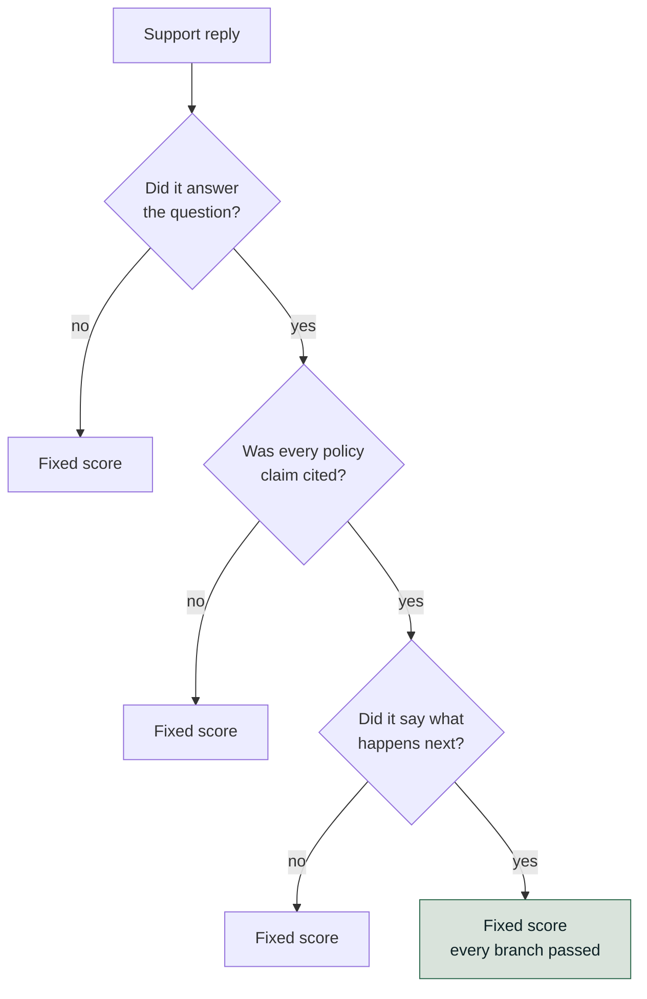
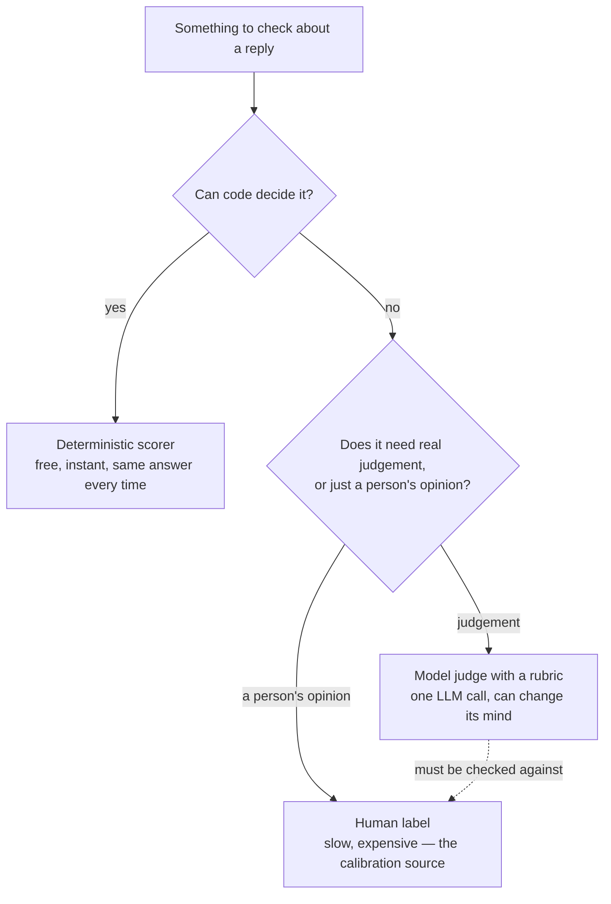
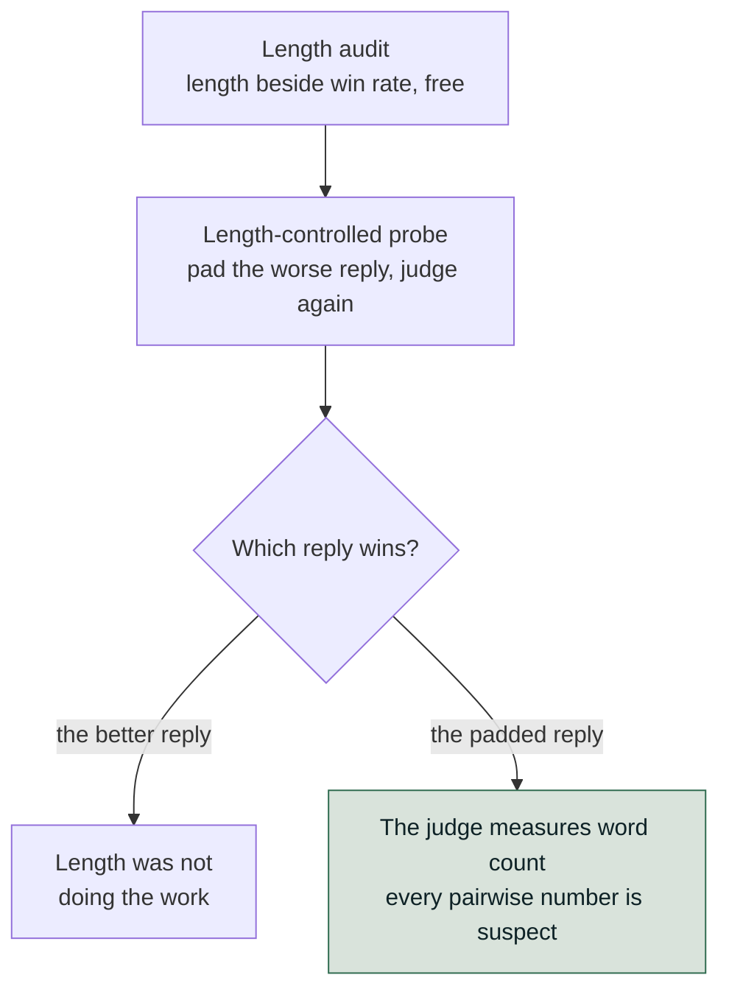
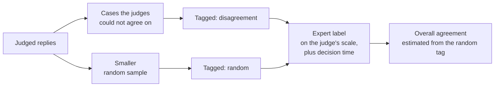
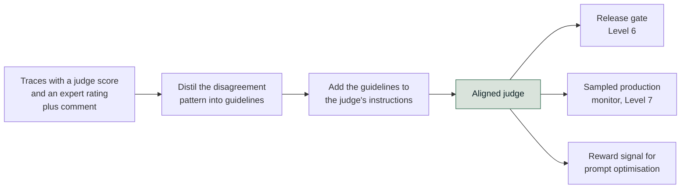
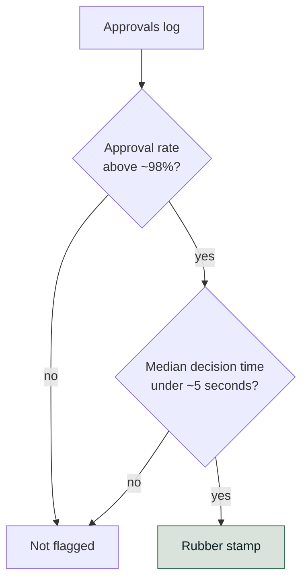

# Judges, and the Humans Who Validate Them

*A judge is the only way to score open-ended text at scale, and it cannot be trusted until it is measured against the people who do not scale.*

◷ 28 min read · Level 4 · [Level 3](03-ground-truth.md) covered where reference answers come from. This level answers what that leaves open: who decides
whether a reply is actually good?

A customer asks, the agent answers, and somebody has to decide whether that was a good reply. A person can read a handful. Thousands a day do not scale. Teams use another model to grade the replies instead. That grading model is a **judge**.

> **Who this is for.** No library knowledge is assumed. Every technical term is defined in plain words the first time it appears.

A judge is just another model. Its number needs a reason to be believed, because a judge can fail in three ways:

- **Fluent, wrong text can fool it.**
- **It can prefer whichever answer it saw first.**
- **It can go easy on writing that reads like its own.**

> **A judge is an instrument, not an oracle.** Every instrument is calibrated against something more trustworthy. For a judge, that is a person.

**An uncalibrated judge is still internally consistent. It can detect that something changed. It cannot yet assert that either version is good.**

The rest of this level earns that. The running example is a customer-support reply, graded on three questions:

- Does it answer the question?
- Are its claims grounded?
- Does it say what happens next?

---

## 1. Build the Judge in One of Three Shapes

There is more than one way to turn "is this reply good?" into a number. Each shape trades expressiveness against how easy the result is to defend.

| | Prose criteria (`GEval`) | Decision tree | Fixed rubric levels |
|---|---|---|---|
| You write | criteria in prose, or explicit steps | an explicit branching tree | fixed level descriptions |
| Reproducibility | lowest | **highest** | high |
| Expresses nuance | **best** | only what you branched for | blunt at boundaries |
| "Why did this score X?" | a paragraph | **a path through the tree** | a level description |
| Cost to change | re-word and re-run | add a branch | re-word a level |
| Good for | exploration, fuzzy quality | compliance, auditability | stable regression scoring |

- **Prose criteria.** The judge works out how to apply them. Fastest to write and hardest to debug. A wrong score has no branch to point at, only a paragraph to re-word. Naming score ranges ("0–3: wrong, or confidently unsupported") reduces how much verdicts drift between runs.
- **A decision tree.** It asks the same question as branches. Every path ends at a fixed score. Runs that take the same branches land on the same number. The trade: a tree cannot express a nuance nobody anticipated. Adding one means adding a branch by hand.
- **Fixed rubric levels.** A small number of bands (bad, weak, good), each with a description of what separates it. Stable across runs, and blunt exactly at the boundaries. A reply that is "almost good" scores the same as one that is "barely good".

This diagram shows the decision tree for the support reply.

### Reference-based versus reference-free

A judge can be built two ways:

- **Reference-based.** It gets the golden set's reference answer to compare against.
- **Reference-free.** It gets only the question and the reply.

**Only the reference-free kind runs in production.** Production traffic has no answer key. Running both versions over the same replies measures the **reference gap**: how much signal disappears when a judge works without ground truth.

> **That gap is not zero.** It is the honest answer to "how much of my offline evaluation still applies once this ships?"

### Know which rung a judged check stands on

Build any of the three only once a judged check is the right rung at all. Judged checks fail in specific ways:

- **Fluent and wrong passes.** A judge decides whether text *sounds* right. A fluent, confident, wrong answer exploits exactly that.
- **A weaker judge is noisier.** The judge should be at least as capable as the task it grades.
- **Runs disagree.** Two runs on the same input can disagree, especially near a threshold. Never gate a release on one row.
- **A vague rubric makes a judge disagree with itself.** The judge can only be as specific as the rubric written for it.
- **Cost compounds.** Five judged dimensions over 500 cases is 2,500+ model calls.
- **Score direction has no shared convention.** A hallucination score of 0.9 means a lot of hallucination.

Two steps up from an off-the-shelf judged check change different things:

- **A custom rubric** changes the standard applied. The mechanism and the cost stay the same.
- **A trace-based judge** reads the whole run. It changes what evidence the judge can see.

> **That second step is the expensive one.** Make it only when the answer is not in the final output text.

### Let the judge return a category, not only a number

A partial answer is a different outcome from a failed one. A single numeric scale flattens that into a lower score. A **categorical** judge returns named outcomes instead, such as `fully_resolved`, `partially_resolved` and `unresolved`. The distinction survives.

> **Say explicitly that a correct refusal or escalation counts as `fully_resolved`.** Otherwise the judge punishes an agent for following a policy it was told to follow.

Iterating is cheap if done right:

- **Slow and wasteful.** Re-running a full evaluation to test the wording of one guideline.
- **Cheap.** Calling the judge's decision logic directly on a single example. Drafting a rubric then costs one model call and answers immediately.

### Split "quality" into named dimensions

Correctness and groundedness ([Level 1](01-rag-retrieval-and-generation.md)) say whether a reply is true and supported. They say nothing about whether it is any use. A correct, grounded reply can still:

- **Bury the answer.**
- **Skip the next step.**
- **Strike the wrong tone.**

One "quality" number blurs all of that into a score nobody can act on. Eight named dimensions break "useful" into parts for a support reply.

| Dimension | The question | What failing looks like |
|---|---|---|
| Helpfulness | Did it solve the user's task? | Accurate, but the user has to ask again |
| Completeness | Are the conditions, caveats and next steps that matter all there? | Gives the refund window, omits that it applies only to annual plans |
| Conciseness | Is everything in it needed? | Three paragraphs where one sentence answers |
| Tone | Does the register fit the user and the moment? | A breezy reply to someone reporting a double charge |
| Actionability | Can the user act on it without another round trip? | "Contact support", with no route, form or reference number |
| Formatting | Is it laid out the way it will be read? | Five steps buried in one paragraph |
| Business usefulness | Does it serve the workflow's goal as well as the literal question? | Answers the question asked, misses that the user is about to cancel |
| Escalation quality | When it hands off, is that the right call, and does the handoff carry what the human needs? | Escalates without a case summary, or escalates what it could have answered |

Two narrower judges are worth adding when the domain calls for them:

- **Entity-correctness judge.** Checks only that the names, IDs, dates and amounts in the reply match the source. It ignores style.
- **Clarity judge.** Asks only whether a non-expert could follow the reply.

Both are easier to calibrate than a general quality judge. Each has one thing to look at.

Three rules for scoring the dimensions:

- **One scale per dimension.** Write level descriptions two people can apply and agree on.
- **Never average them into one number.** A friendly reply can be wrong and a terse one can be right. Style must not buy back a correctness failure.
- **Decide per use case what blocks.** Some dimensions block a release and others are only reported. Level 9 keeps "must-have" and "blocking" as two separate axes for exactly this reason.

---

## 2. Spend Judgement Only Where Judgement Is Needed

Not every question about a reply needs a model to answer it. Some have a definite, checkable answer:

- Was a specific tool called?
- How many words is this reply?
- Does a customer ID that isn't the requester's own appear in the text?

**A judge is the wrong, expensive way to answer those.**

| | Code | Model judge | Human |
|---|---|---|---|
| Cost per check | ~£0 | ~£0.001 | ~£1 |
| Same answer twice? | Always | Usually | Often not |
| Can judge "is this polite?" | No | Yes | Yes |
| Realistic to run on | 100% of traffic | 2–5% of traffic | ~50 cases, once |

> **Code runs on everything, a judge on a slice, a human on a small, deliberately chosen sample.** Section 4 therefore takes care over *which* cases reach that scarce human attention.

### The cost hierarchy of scorers

| Kind | Cost per row | Deterministic? | Use it when |
|---|---|---|---|
| **Deterministic scorer** (plain code) | free, instant | yes (same input, same verdict) | The rule has a definite answer: was a tool called, how many words, does a pattern match |
| **Configurable scorer** | free, instant | yes | The same deterministic check, needed at several settings at once |
| **Wrapped judge** (a judge call inside a custom scorer) | one model call | no | A judge is genuinely needed, but with extra context it can't extract alone |
| **Custom judge** | one model call | no | The question needs real judgement: quality, tone, whether a resolution happened |
| **Trace-based judge** | one model call, large prompt | no | Judging *how* the agent worked as well as what it said |

Two things set deterministic scorers apart:

- **They are free.** They run on every row while judged checks get rationed.
- **They are reproducible** in a way judges are not. **A deterministic metric moving means the system changed. A judged one moving might be the judge having a different day.**

> **A custom scorer gets exactly what the agent's answer function returned, and nothing normalises the shape first.** A scorer expecting a dictionary breaks on an agent returning a plain string.

### An unexpected tool call has to count as a failure too

One way to check "did the agent call the right tools?" looks only at which *expected* tools were missing. It ignores unexpected calls.

- **The loophole.** Under that rule, an agent that calls every tool available on every request scores 100%.
- **Why.** It never misses an expected call, because it never misses any call.

| Expected a tool call? | Actually called one? | Verdict | What it means |
|---|---|---|---|
| yes | yes | pass | — |
| no | no | pass | — |
| yes | **no** | fail | Answered an account question without looking up the account, and made the answer up |
| no | **yes** | fail | Pulled customer data with no reason to: a privacy problem as well as an efficiency one |

An agent that fetches account data on every question is one prompt-injection attack away from putting that data somewhere it should not go.

### Deterministic and judged on the same question is not redundant

Take a privacy check: did this reply disclose an account ID that isn't the requester's own?

| Check | What it catches | How reliably | Cost |
|---|---|---|---|
| **Pattern-matching rule** | A literal ID like `CUST-1003`. Not a paraphrase like *"the other account owes $152.90"*, which contains no ID at all | Every single time | Free |
| **Judge** | The paraphrase | Only probabilistically | A call every time |

Cheap-and-certain plus expensive-and-general beats either alone. The deterministic check's blind spot is documented rather than hidden. **Knowing exactly what it does not cover is the reason to have one.**

### Report the tail, not just the mean

Not every scorer returns pass/fail. A count aggregates across a run, and six aggregations are valid: min, max, mean, median, variance, p90.

> **The mean is the one people report. The p90 is the one worth watching.** A healthy average hides the tail of rambling replies that users actually complain about.

Thresholds belong outside the scorer:

- **Hardcoded threshold.** The scorer can only run once.
- **Configurable scorer.** It takes its settings as fields. Identical logic then runs twice in one evaluation at two settings: a strict 80-word limit and a loose 250-word limit, reported as two named metrics.

A **trace-based judge** gets the whole execution trace. It judges the path the agent took to its reply.

> **Two agents can produce the identical correct reply, one in two steps and one in nine.** Only a trace-based judge tells those runs apart.

---

## 3. Test the Three Ways a Judge Lies

A judge is a model. It inherits the weaknesses of the thing it grades, including biases that have nothing to do with the quality of the answer.

| Bias | What it is | The test |
|---|---|---|
| **Position bias** | The judge prefers whichever answer it saw first (or second) | Score the same pair in both orders and check the verdict does not flip |
| **Verbosity bias** | The judge prefers the longer answer, independent of quality | Pad the *worse* answer until it's longer, and judge again |
| **Same-model bias** | A judge from the same model family rates that family's output generously | Score with a judge from a different family and compare the *ranking*, not the raw numbers |

### Position bias

A **pairwise judge** is shown two replies and picks the better one. The test:

1. Ask it to choose between A and B.
2. Ask again with the order swapped.
3. **The verdict should not change.**

If it does, the judge is scoring which side of the screen an answer appeared on. Every pairwise number it ever produced becomes suspect, including a canary win rate that decides whether a rollout continues.

Picture two wine judges. One always prefers whichever glass is handed over first. The other always prefers whichever glass is fuller. Neither is tasting the wine.

### Verbosity bias

> **Clearing a judge of position bias is necessary and not sufficient.** If the worse answer is also the shorter one, *"the better answer won"* and *"the longer answer won"* describe the same result. Swapping order can never tell them apart.

Two steps separate the explanations:

- **The length audit (free).** It re-reads verdicts that already exist and puts the length distribution next to the win rate. In one run the stronger reply won 12 of 12, and the winners averaged 25.2 words against 18.7 (35% longer, every time). That alone cannot separate quality from word count.
- **The length-controlled probe (costs model calls).** Pad the worse reply with filler until it is the longer one. Then judge again.

This diagram shows how the probe's result reads.

A padded-reply win reaches canary comparisons too. A new build that writes longer replies can win a judged canary without being better.

> **A win rate published without the length distribution beside it is partly a word count.**

### Same-model bias

A judge tends to recognise its own family's habits (phrasing, structure, hedging) and reads that familiarity as quality.

- **The test.** Re-score with a judge from a genuinely different family.
- **What does not count.** A bigger model in the same family.

Two judges can give different scores and still agree. The test is **whether the ranking survives**, measured by rank correlation:

- **High rank correlation with a positive mean difference is benign.** One judge is more generous. They agree which reply is better. A gate comparing two builds still works.
- **Low rank correlation is serious.** They do not agree which build is better. Neither can gate a release alone.

Bias can also live in a **stratum** (one slice of the data, such as one language) rather than overall:

- **Lower across *every* judge.** The agent is genuinely worse in that language.
- **Lower for only *one* judge.** That is a property of that judge, for example one scoring fluency in its own strongest language.

### The fourth failure mode, underneath all three

Those three are failures of a judge given a clear question. Underneath sits a simpler one: an ambiguous question.

- **The cause.** Rubric levels that overlap ("fairly good" against "good", with no line between).
- **The effect.** The judge has room to improvise, and improvisation does not reproduce.

> **The test is whether two careful people can apply the rubric independently and agree.** Section 5's kappa measures that. A rubric can sound reasonable and still fail it.

A working judge can quietly stop working this way. Somebody "clarifies" the wording and removes the specificity that made it reproducible.

---

## 4. Collect the One Kind of Human Feedback That Calibrates

"Human feedback" names three different things. Treating them as interchangeable is one reason feedback efforts produce nothing useful.

| Kind | Where | Volume | Biased? | Can calibrate a judge? |
|---|---|---|---|---|
| **Runtime approval** | Inside the agent, blocking a pending action | Low | N/A: a decision, not a rating | **No** |
| **End-user feedback** (thumbs) | In production, voluntary | High | Severely: only the angriest and most delighted respond | **No**: a signal, never a label |
| **Expert annotation** | Offline, on a deliberately sampled set | Low | Only by your sampling choice | **Yes, the only one** |

- **Runtime approval.** One blocking decision about one pending action, such as "should this refund go out?" It does not rate quality and cannot calibrate anything. The approval process itself still needs evaluating, which Section 8 covers.
- **End-user thumbs.** Abundant and self-selected. The people who click are disproportionately the angriest and the most delighted. That says little about how the system is doing. Thumbs are a useful *signal*, never a *label*.
- **Expert annotation.** A domain expert rates a deliberately sampled set offline. It is the only kind both labelled and representative enough to calibrate a judge. The sampling choice is under the team's control.

### Choosing which cases to send a human

Labelling everything is impossible. Choosing *what* to send decides how much calibration signal the labels carry. "A random sample" is not automatically the right answer.

| Strategy | What it gets you | What it costs you |
|---|---|---|
| Random | An unbiased estimate of overall quality | Mostly easy cases, so little calibration signal |
| **Judge disagreement** | The cases where your judges are least reliable | A biased sample; never use it alone to estimate overall quality |
| Low judge score | Confirmation of known failures | Nothing about false negatives |
| Safety-adjacent | The cases most likely to hurt someone | A tiny, unrepresentative slice |

A practical default is **disagreement-first with a random tail**:

- **The disagreement group.** The cases multiple judges could not agree on.
- **The random tail.** A smaller random sample. It keeps the labels able to estimate overall agreement.

This diagram shows the two groups on their way to the labeller.

> **Tag the two groups separately.** Estimating overall agreement from the disagreement group alone understates the judge badly. Those are its worst cases, picked on purpose.

Record two things with each label:

- **The verdict, on the same scale the judge uses.** The two then compare directly without inventing a mapping.
- **How long the reviewer took to decide.** Section 8's rubber-stamp check uses it.

### Mask what the labeller does not need to see

Expert annotation sends real replies to people. Real traces carry names, account numbers, addresses, and sometimes health or financial details. Three controls belong in front of every labelling queue:

- **Mask personal data.** Use typed placeholders such as `[CUSTOMER_NAME]` and `[ACCOUNT_ID]`. Use them consistently within a trace, and the conversation still reads.
- **Limit access.** Decide who can open the queue, and which fields each reviewer sees.
- **Log every review action.** A label can then be traced to who made it and what they were shown.

> **Masking can delete the very thing being labelled.** If the question is "did this reply disclose another customer's account?", replacing every ID with `[ACCOUNT_ID]` hides the failure. Use placeholders that keep identity apart, such as `[ACCOUNT_A]` and `[ACCOUNT_B]`. Or route privacy cases to a smaller reviewer group that sees raw values.

Record on each label that it was made on masked data. A disagreement between judge and human sometimes comes down to the human not seeing what the judge saw.

---

## 5. Measure Agreement Above Chance, Not Raw Agreement

Once a judge score and a human score exist for the same cases, calibration asks how often they agree. Then it asks the harder question: **how often would they have agreed purely by luck?**

| | Human: good | Human: bad |
|---|---|---|
| **Judge: good** | *a* | *b* |
| **Judge: bad** | *c* | *d* |

Three numbers come out of that table:

- **Observed agreement** is (*a* + *d*) / total.
- **Expected agreement by chance** is the probability both happen to say "good" plus the probability both happen to say "bad".
- **Cohen's kappa** is (observed − expected) / (1 − expected).

> **Raw agreement flatters on a skewed dataset.** If 90% of replies are fine, a judge saying "good" on every row agrees 90% of the time and has learned nothing.

Kappa corrects for exactly this. That do-nothing judge scores **0**.

### When plain kappa is not enough

On a 1–5 scale, plain kappa treats every disagreement as equally bad. One point off scores the same as wildly off. That is the wrong penalty for an **ordinal** scale, one whose values have an order:

- **One point away** is a near-miss.
- **Four points away** is a different opinion.

**Quadratic weighted kappa** penalises a disagreement by the *square* of its distance. Take the same ten human ratings and two judges:

| Judge | Exact agreement | Plain kappa | Quadratic weighted kappa |
|---|---|---|---|
| One point too generous | 0.00 | −0.25 | **+0.71** |
| Uncorrelated with the human score | 0.00 | −0.25 | **−0.82** |

The two judges score identically on the first two measures. They are worlds apart on the third.

> **Only the off-by-one judge is cheaply fixable.** Shift its scale. The uncorrelated one has to be rebuilt.

### Set the threshold from labels instead of guessing it

A pass/fail cutoff starts as a guess. Once human labels exist it need not stay one:

1. Sweep candidate thresholds.
2. Compute kappa at each.
3. Take the one maximising agreement with the people whose judgement is meant to matter.

A couple of hundred labels will not train anything. They will tell you the pass mark is 0.62 rather than 0.70.

> **Maximising kappa treats a false pass and a false block as equally costly.** On a refund agent they are not. A false pass ships a broken release. A false block annoys an engineer. Weigh the two against each other before choosing the threshold. Then pick the cutoff that minimises the weighted cost rather than the one that maximises agreement.

### Direction matters more than rate

When a judge and a human disagree, *which way* tells more than how often.

| Direction | Judge | Human | Effect |
|---|---|---|---|
| **Too generous** | passes | fails | Ships bad releases |
| **Too harsh** | fails | passes | Blocks good releases and gets the judge switched off by a frustrated team |

Kappa can be high overall and collapse within one stratum, say near zero in Hindi. Then the judge cannot be used for a per-stratum release gate in that language at all.

---

## 6. Align the Judge on Expert Disagreement

Calibration tells you *whether* a judge agrees with your experts. **Alignment** uses the pattern in where they disagreed to improve the judge.

The technique reads traces that carry a judge score and an expert rating with a written comment. This diagram shows its steps and where the aligned judge goes next.

Three details make or break it:

- **The label name must exactly match the judge's name.** That is how ratings pair with scores. Get it wrong and alignment raises no error. It finds no pairs and hands back the judge you started with.
- **Comments are not optional.** Alignment distils expert *reasoning* into guidelines. A bare "2" only says the judge was wrong. The comment is what becomes the guideline.
- **Set the embedding model explicitly.** Alignment embeds every labelled trace (turns it into a list of numbers that stands for its meaning). A default can silently send that traffic, and its bill, somewhere unintended.

### Read the result the right way up

**Alignment usually makes the judge's average score go down, and that drop is the success condition.**

- **The unaligned judge** graded against generic best practice and inflated scores.
- **The aligned judge** applies the stricter standard the experts actually hold.

**The agent has not changed between the two runs. Only the measurement has become honest.**

Mean score fell 1.4 points between the unaligned and aligned judge while *every* agreement measure rose:

| Measure | Unaligned judge | Aligned judge |
|---|---|---|
| Exact agreement | 0.08 | 0.92 |
| Weighted kappa | 0.29 | 0.96 |

> **The unaligned judge rated this agent 4.3 out of 5 while domain experts rated the same replies 2.8.** Every green light in an earlier gate was given on a number wrong by a point and a half.

Alignment leaves the agent untouched. It makes every *other* number produced about the agent mean something.

An aligned judge replaces the unaligned one everywhere: the release gate (Level 6), the sampled production monitor (Level 7), and the reward signal for prompt optimisation.

> **Optimising against an unaligned judge tunes the agent toward a standard nobody holds.** That is worse than not optimising, because the result is confidently wrong.

---

## 7. Blind the Preference Test, and Use Two Raters

Sections 5 and 6 score one reply at a time. A **preference test** shows people two replies to the same request and asks which one they pick. It is the human counterpart to the pairwise judge. A production canary comparison can stand in for it.

Three rules make a preference test worth running. Dropping any one quietly invalidates the result.

| Rule | Why it matters | What breaks without it |
|---|---|---|
| **Blind the arms** | The rater must not know which reply is the new build | People favour whatever they were told is "the improvement" |
| **Randomise the side** | Left and right coin-flipped per case, not fixed | Raters learn "the new one is always on the right" and guess the pattern instead of judging |
| **Use two raters** | One rater's taste is not a measurement | Agreement becomes unmeasurable, since kappa needs two raters by definition |

Kappa between a judge and a human measures calibration. The same statistic **between two humans** asks whether the rubric is *teachable* at all.

> **A judge disagreeing with a human is a judge problem. Two humans disagreeing with each other is a rubric problem.** No amount of judge tuning fixes it. There is no single target to tune toward.

A blinding check is a cheap sanity test:

- **Tally** how often the winning reply landed on the left of the screen.
- **Expect** a figure near 50%.
- **Far from that** means the randomisation itself is broken, whatever the quality.

> **A small panel's kappa swings on which cases happened to be sampled.** The same two raters, identically reliable, can produce kappa anywhere from roughly 0.15 to 0.60 across different case sets. That panel is reporting a *range*, not a measurement.

---

## 8. Check the Approver, Not Just the Approval

A runtime approval step is easy to check for *existence*: does every refund carry an approval ID? **That check passes completely while the approval step does nothing at all.**

Three signals, all computable from an approvals log, separate a real control from a rubber stamp.

| Signal | Healthy | Broken |
|---|---|---|
| Approval rate | Some real rejections happen | Close to 100% |
| Median decision time | Long enough to actually read the case | A second or two |
| Queue depth / age | Stable | Growing, or items quietly aging out unresolved |

> **A 99.8% approval rate with a 1.2-second median decision time is a latency cost with a compliance story attached.**

| Approver | Approval rate | Decision time | Passes the approval-ID check? |
|---|---|---|---|
| Genuine | ≈86% | tens of seconds to minutes | Yes |
| Rubber-stamping | ≈99.9% | one to two seconds | Yes |

Both pass a check verifying that every refund has an approval ID attached, because both do. This diagram shows a crude two-threshold rule that catches the rubber stamp: approval rate above ~98% **and** median decision time under ~5 seconds.

The failure is not subtle. A subtler detector would only invite an argument about the cutoff.

**Judge drift is the related danger.** A judge drifting toward passing everything barely moves raw agreement, because most replies really were fine. Kappa collapses toward zero. A judge with one opinion carries no information.

> **Kappa, not raw agreement, belongs on a production dashboard.**

---

## 9. Rehearse the Judge Questions

**"You're using an LLM to grade another LLM. Why should anyone believe the number?"**

They shouldn't, until it has been checked against a human and *agreement* (not average score) has been measured. Expect the score to drop, and say so before it happens.

**"Your judge and your domain expert disagree on 20% of cases. What do you do?"**

Find out *which* 20% before touching anything. Scattered across the range means an unreliable judge. Bunched at the threshold means borderline cases, and matters far less than the headline. Then check whether the experts agree with *each other*. If two disagree 15% of the time, 20% is near the human ceiling. The work is then deciding an open policy question rather than tuning a model.

**"When would you not use an LLM judge?"**

Four situations:

- Code can decide the question outright.
- The judge is what an optimiser is tuned against, and it cannot certify its own result.
- The humans have not agreed the standard yet.
- Volume is high enough that the judged-call bill exceeds the cost of serving the traffic.

**"The judge scores 0.9 and the customer says it's terrible. Who's wrong?"**

Usually neither. Get three examples the customer calls bad, run them, and read the traces. There are four likely explanations:

- The metric does not cover what they care about.
- The aggregate hides their slice.
- The judge was never calibrated.
- The golden set never had their kind of question.

All four have the same fix. Either the metric scores them badly too, or it scores them well and a dimension nobody measured has been found. Both are progress. Arguing from the dashboard is not.

---

## Key Takeaways

- A judge is an instrument, not an oracle. Uncalibrated, it detects that something changed and cannot assert that either version is good.
- Three judge shapes trade nuance against reproducibility, and only the reference-free kind survives deployment.
- Code runs on everything, a judge on a slice, a human on a deliberately chosen sample. A tool-call check must fail in both directions.
- Position, verbosity and same-model bias are each testable, and clearing one says nothing about the others.
- Only expert annotation can calibrate a judge. Thumbs are a signal and a runtime approval is a decision.
- Kappa, not raw agreement, is the measure: a do-nothing judge scores 90% agreement and zero kappa.
- Alignment lowers the average score and raises every agreement measure. The measurement became honest. The agent did not get worse.
- A preference test needs blinding, side randomisation and two raters. Two humans disagreeing is a rubric problem, not a judge problem.
- An approval step that never rejects is a latency cost with a compliance story attached.

## Check Yourself

1. A judge has never been compared to a human. What is it still good for? **Detecting that something changed. It cannot yet assert either version is
   good.**
2. Your pairwise judge gives the same verdict in both orders. Is it trustworthy? **Not yet. If the worse answer is also shorter, "better won" and
   "longer won" are the same result. Pad the worse reply and re-judge.**
3. A tool-call scorer passes an agent that calls every available tool on every request. What is missing? **The unexpected-call direction.
   Coverage-only checks never see a privacy problem.**
4. 90% of replies are fine and your judge agrees with humans 90% of the time. How good is it? **Unknown. A judge saying "good" every time scores
   exactly that. Kappa corrects for it and gives that judge 0.**
5. Two judges score the same replies differently but rank the builds identically. Is that a problem? **No. High rank correlation with a mean offset
   still gates releases correctly. Low rank correlation is the serious case.**
6. Alignment drops the mean judge score by 1.4 points. Did the agent get worse? **No. The agent is unchanged. The measurement became honest. Every
   agreement measure rose.**
7. Your two human raters disagree 15% of the time. What does that tell you about your judge target? **There isn't a single one. That is a rubric
   problem, and no judge tuning fixes it.**
8. Every refund carries an approval ID, approval rate is 99.8%, median decision time 1.2 seconds. What do you have? **A rubber stamp. The existence
   check passes completely while the control does nothing.**

---

## References

All content above was drawn only from material already in this repository. Nothing here was invented, and no external source was consulted. This page
is the restyled edition of `archive/roadmap-explainers-org/04-judges-and-the-humans-who-validate-them.md`; its content is the same, with library class
names replaced by what each judge shape does.

**Notebook:**

- `courses/03-agentic-eval-harness/08_building_custom_judges.ipynb`: the three judge shapes, the reference-based/reference-free split and the
  reference gap, categorical judges, and cheap rubric iteration.
- `courses/03-agentic-eval-harness/09_human_feedback_and_calibration.ipynb`: the three kinds of human feedback, disagreement-first sampling, Cohen's
  kappa derived by hand, setting a threshold from labels, blinded preference testing with inter-rater kappa, and the rubber-stamp detector for the
  approval step.
- `courses/02-databricks-mlflow-evals/03_custom_scorers_and_judges.ipynb`: the custom-scorer cost hierarchy, the outputs-shape trap, the tool-call
  scorer's two failure directions, the deterministic-plus-judged pairing for account leaks, the six aggregations, categorical judge output, cheap
  single-guideline iteration, and the trace-based judge.
- `courses/02-databricks-mlflow-evals/07_judge_alignment_memalign.ipynb`, with its backing module `courses/02-databricks-mlflow-evals/alignment.py`:
  the three agreement measures side by side, the off-by-one versus uncorrelated weighted-kappa example, alignment mechanics, and the before/after
  result.

**Docs:**

- `docs/concepts/field-guide/01-the-map.md`, LLM as judge: the judge failure modes used in Section 1.
- `docs/guide-audits/openai-eval-guide-tutorial.md`, §4 (§4.1–§4.6): the code-versus-judge-versus- human flowchart and its cost table in Section 2,
  the three-bias framing and wine-judge analogy, the 12-of-12 verbosity figures, and the blinded-preference rules in Sections 4 and 7.
- `docs/concepts/databricks-mlflow-evals.md`: scorer cost hierarchy, bias tests, the human-feedback taxonomy, kappa and weighted kappa, alignment, and
  preference testing.
- `docs/interview-prep/QUESTION_BANK.md`, Part 4 (Q14–Q17): the four questions reproduced in full in Section 9 rather than pointed at.
- `docs/study-guide/evaluation-roadmap.md`: Level 4's topic list and goal statement.
- `docs/study-guide/evaluation-topic-notebook-mapping.md`: Level 4's resource table.

**Limitations.** Written from the repository's own material without running any notebook or calling any API. It does not verify any vendor's
documentation.

---

**Next:** [Level 5, Statistics and Stratified Reporting](05-statistics-and-stratified-reporting.md) · **Previous:** [Level 3, Ground Truth: Where Cases and Labels Come From](03-ground-truth.md)
