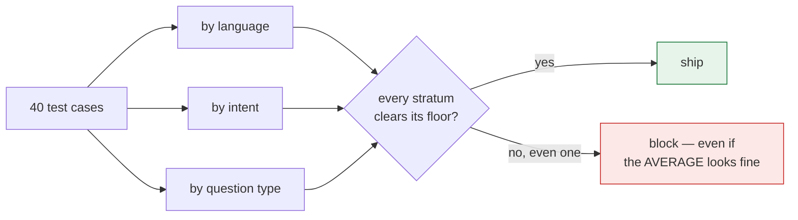
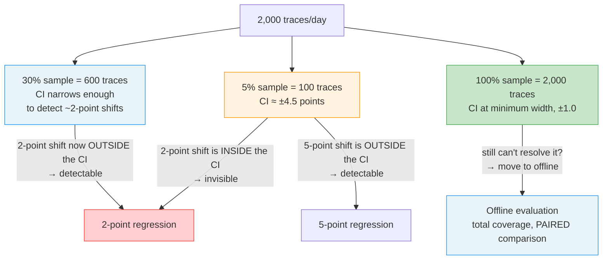

# Statistics and Stratified Reporting

*Gate on the worst slice rather than the average, because a group is only as loud in the mean as
it is big.*

◷ 18 min · Level 5 · No statistics background assumed. Every technical term — sample size,
paired comparison, bootstrap, confidence interval — is defined in plain words on first use.

A support bot is tested on 40 questions, in English, Spanish and Hindi. Version 1 is live and
version 2 is ready to ship. Here is the full result.

| Group | Cases | v1 passes | v2 passes | Change |
|---|---|---|---|---|
| English | 22 | 20 (91%) | 22 (100%) | better |
| Spanish | 10 | 8 (80%) | 10 (100%) | better |
| Hindi | 8 | 7 (88%) | 4 (50%) | **collapsed** |
| **Overall** | **40** | **35 (87.5%)** | **36 (90%)** | **better** |

The overall score went up, 87.5% to 90%. Green on every dashboard, and version 2 ships. Hindi
went 88% to 50%: nearly half those customers now get a wrong answer. Hindi is 8 of 40 cases, so
the average felt only 20% of its 37.5-point fall — 7.5 points, buried under 10 points of gain
from the other two groups.

**This is arithmetic, not bad luck. A group is only as loud in the average as it is big.** A
group that is 5% of traffic can fail entirely and move the overall score by five points.

---

## 1. Score Each Slice, Not the Whole

A **stratum** is a group of test cases sharing something — all the Hindi questions, all the
billing questions, all the ones where the right answer is "I don't know". **Stratified
reporting** means scoring each slice on its own and reading all of them.

**Pick the ways users actually differ.** For a support bot, four usually matter.

| Split by | Example groups | Catches |
|---|---|---|
| Language | English · Spanish · Hindi | A language with thin documentation behind it |
| What the user wants | billing · account · general question · escalation | One workflow breaking while the rest are fine |
| Question type | simple lookup · multi-step · answer not in the docs | A bot that guesses instead of saying "I don't know" |
| Turns | single message · a back-and-forth | Quality falling apart after turn three |

**For a multilingual system, give language more than a pass rate.** Three things are worth
separating. **Recall per language**:
retrieval quality is usually uneven across languages, and a pooled recall figure is mostly the
largest language's figure. **Cross-lingual retrieval**: a question asked in one language whose
answer lives in a document written in another is its own stratum, and easily the weakest one.
**Native-speaker review**: cases written natively in each language rather than only translated
from English, and native-speaking reviewers labelling a sample per language, above all in
high-risk domains. A judge's verdicts in a less-resourced language are checked against those
labels before its per-language numbers are believed.

*The analogy:* a school announces its average exam score went up. It did. The announcement does
not mention that one class failed every subject, and the other classes improved enough to cover
it. The number is true, and useless for the only decision that mattered.

**Tag cases when they are created, not later. A test set cannot be split by a label it does not
have.** This cuts both ways when a dashboard looks green and customers still complain, which is
usually an averaging problem before it is a quality problem. Split the
results by segment, and also check whether the test set contains those customers' questions at
all. A segment with zero test cases cannot show up as failing, so a coverage gap and a healthy
segment look identical unless someone checks.

**Report each split on its own. Never cross-tabulate.** Slicing by language *and* intent *and*
question type at once gives mostly empty cells with 40 cases, and an empty cell is where
somebody makes a confident statement about a segment of size one.

**Every mean needs its `n` printed beside it. A mean without a sample size is a rumour.** The
report format makes this literal: for every stratum and every metric, it prints the average and
how many cases produced it. Different metrics can be missing for different subsets of the same
stratum — a stratum with 12 cases might have a faithfulness score for only 3.

> *"Never as one number. I tag every test case by language, intent and question type, score
> each group separately, and gate the release on the worst group rather than the mean. An
> average is the easiest place in the system to hide a failing segment."*

**Gate on the worst group, not the average.** A release passes when every group clears its
floor, not when the mean clears a line. Reporting by group and then shipping on the average
changes nothing. It is the same mistake with an extra step.

> *"Overall quality improved, the release was blocked, and the reason was a segment that is 4% of
> traffic and 100% of some customers' experience."*



---

## 2. Ask Whether the Suite Could See the Change

Before arguing about whether a 4-point move is real, ask a cheaper question. **Could a test set
this size ever detect a move that small?** The rule of thumb for a proportion, at 95% confidence
and 80% power — power being the chance of noticing a real effect if one is there:

```
n ≈ 15.7 · p(1 − p) / δ²
```

`p` is roughly where the score sits now, and `δ` is the size of the change worth seeing. The
15.7 comes from `2 × (1.96 + 0.84)²`, the standard two-sided constants, so this is a documented
rule of thumb rather than a full power analysis. It gives the right order of magnitude instantly.

At `p = 0.80`, seeing a 10-point move (`δ = 0.10`) needs `n ≈ 251` cases. **A 40-case suite sees a collapse
but not a slip.** Run the formula backwards for the smallest change a given `n` can detect at
all: `δ ≈ √(15.7 · p(1−p) / n)`.

> **Publish that number next to every report.** It turns "the score dropped 4 points" from a
> fire drill into a known limitation of the suite.

---

## 3. Report a Small Stratum Without Gating on It

Sample-size arithmetic cuts hardest against the *smallest* groups. With 8 Hindi cases, **one
case flipping moves that group by 12.5 points.** So a "15-point drop in Hindi" might be one case
having a bad day.

**The fix is not to ignore small groups.** Report them, do not block on them until they are big
enough to mean something, and say out loud that this is happening. A stratum below the minimum
size still gets its number printed. It just cannot fail a release on its own. Dropping it
silently would hide the very customers it is meant to protect. Gating on it silently would block
releases at random.

> *"We report every group, but we only block on groups above a minimum size. Below that, one
> case flipping swings the number more than a real regression would, so blocking there would
> just be reacting to noise."*

This is the argument behind the release gate's minimum-cases setting, covered in Level 6. The
per-stratum detection-limit table — `n`, what one case is worth, and the smallest detectable
change — is what draws that line, not a round number picked in advance.

**The tools in this level agree with each other.** Take the smallest stratum, flip a single
case, and check it two ways. The bootstrap confidence intervals before and after overlap
almost completely. McNemar's test on the same pairing finds nothing significant. Both readings
say a single flipped case is noise, which is exactly why the gate reports a small
stratum instead of blocking on it.

---

## 4. Compare the Same Cases, Not Two Samples

Version 1 and version 2 are not compared on two different, unrelated samples. They run the exact
**same** golden cases. **That pairing is information, and treating the two runs as independent
throws it away.**

McNemar's test looks only at the cases that changed between the two runs.

```
                 candidate
                pass    fail
  baseline pass   b       c      <- c: regressions (used to pass, now fails)
           fail   d       a      <- d: fixes       (used to fail, now passes)

  statistic = (|c − d| − 1)² / (c + d)      ~ chi-square, 1 degree of freedom
  significant (p < 0.05) when the statistic exceeds 3.84
```

Cases landing in the same place both times carry **no information about a change**, and McNemar
ignores them deliberately. That is why a paired test needs far fewer cases than an unpaired one
to see the same effect. An unpaired comparison fights through the noise of all 40 cases. McNemar
only looks at the handful that flipped.

The worked example takes the golden set's results as baseline, then builds a candidate by
deliberately breaking 5 previously-passing cases and fixing 2 previously-failing ones. With
`c + d` that small, the test may come back not-significant. **That is the correct answer, not a
failure of the test.** A handful of flips on a 40-case suite is what chance alone produces.

---

## 5. Put an Interval Around Every Number

A single score — "90% resolved" — is a point estimate. It does not say how much that number
would move on a different 40 cases. A **confidence interval** answers that: a range the true rate
probably falls inside, given the sample in hand.

### The bootstrap

The **bootstrap** answers "how much would this number move on a different sample of the same
size?" by simulating exactly that, thousands of times. Resample the existing cases *with
replacement*, so the same case can be picked more than once and some are not picked at all.
Recompute the statistic on each resample. Take the middle 95% of the spread.

It is deliberately implemented in about ten lines of plain standard library. **A confidence interval nobody can derive is a confidence interval everybody misreads.** The bootstrap's real
advantage is that it works for *any* statistic — a mean, a median, a rate — because it never
assumes a bell-curve shape. It just resamples what was actually observed.

**Read the widths, not the points.** A stratum whose interval spans 0.4 is not reporting that
it is worse than another stratum. It is reporting that nobody knows, because the sample is too
small to say anything precise.

### Wilson intervals

For the common case of a proportion there is a closed-form formula, the **Wilson interval**, with
no resampling required. It stays well-behaved at small sample sizes and near 0% or 100%, where a
naive bell-curve approximation breaks down. At an observed rate of 0.95 it resolves to:

| Traces scored | Resolution (± points) |
|---|---|
| 50 | ±6.6 |
| 100 | ±4.5 |
| 200 | ±3.1 |
| 600 | ±1.8 |
| 2,000 | ±1.0 |

Read it the same way as the bootstrap widths. This is the wobble a number carries purely from
*which* cases happened to be sampled, before anyone asks whether the system changed.

**In one line:** Wilson is a fast closed-form shortcut that only works for proportions. The
bootstrap is slower, works for any statistic, and — because it is written by hand — never leaves
anyone unsure what it claims.

---

## 6. Buy the Sample Rate That Can See the Regression

The Wilson table is not only an offline concern. It is the arithmetic behind a common production
mistake: grading a *sample* of live traffic instead of every request, because grading everything
with a judge costs real money.

An agent handles 2,000 conversations a day. Grade 100 of them — a 5% sample — and assume the rest
look similar. The number wobbles purely from *which* 100 got graded.

```
Day 1:  you grade 100 conversations → 95 pass → you report 95%
Day 2:  you grade a different 100    → 92 pass → you report 92%

Nothing changed. Same agent, same code, same prompt.
Only WHICH 100 you happened to grade changed.
```

That is a ±4.5-point wobble, the same number the Wilson table gives for n=100. Whether a real
problem is visible depends entirely on its size relative to that wobble.

| The drop you are hunting | Wobble from grading 100 | Can you see it? |
|---|---|---|
| 10 points (95% → 85%) | ±4.5 | Yes — far bigger than the wobble |
| 5 points (95% → 90%) | ±4.5 | Probably |
| **2 points (95% → 93%)** | ±4.5 | **No — smaller than the wobble** |



**An alert set at 2 points, at a 5% sample rate, is worse than no alert at all.** Two ordinary,
unchanged days can differ by several points from luck alone, so the alert fires when nothing
broke. A team paged for nothing learns to close the page without looking, which is exactly the
credibility cost this level exists to avoid.

**Detecting a 2-point drop needs about 606 scored traces.** At 2,000 traces a day that is a 30%
sample rate, not the 5% that felt affordable.

> **If a delta cannot be resolved even at 100% sampling, the answer is not more sampling.** Move
> the comparison offline, where every input is scored and the comparison is **paired**.

More sampling cannot fix this because production is *different questions every day*. Monday's
traffic is genuinely harder or easier than Tuesday's, and that difference never averages away.
The same fixed questions asked of the old build and the new one removes *what customers happened
to ask* as a confound. That is the paired idea behind McNemar, applied to production.

*The analogy:* tasting a pot of soup. One spoonful settles instantly whether it is far too
salty. It can never settle whether today's pot is 2% saltier than yesterday's — especially when
it is a different pot every day.

The procedure that follows is repeatable. Decide the smallest regression that must be caught.
Compute the samples needed for that resolution. Divide by daily traffic to get the sample rate.
Deterministic scorers never need sampling at all, because they are free — score every request
with those.

**Name the smallest regression worth refusing to miss, then buy the sample rate that can see
it.** If no sample rate can, that comparison belongs offline rather than on a dashboard.

---

## 7. Watch for Every Stratum Improving While the Total Falls

This is not a trick question. It is a mechanical consequence of stratified reporting. Every
stratum can genuinely improve while the overall number falls, whenever a release also shifts the
*mix* of traffic between strata.

| Stratum | Before | After | Change |
|---|---|---|---|
| English (n: 90 → 20) | 90.00% | 95.00% | **+5.00** |
| Hindi (n: 10 → 80) | 50.00% | 55.00% | **+5.00** |
| **Overall** | **86.00%** | **63.00%** | **−23.00** |

Every stratum went up 5 points while the overall number collapsed 23, because the mix moved from
90% English / 10% Hindi to 20% / 80%, and Hindi is the weaker segment either way.

> **A gate on the aggregate would block a release that made every group better. A gate on the
> worst stratum passes it correctly.**

This is why the release gate carries a dedicated per-stratum check separate from its
overall-average one.

---

## 8. Combine the Four Tools

Four small tools, four different questions, and none substitutes for another.

| Tool | Question it answers |
|---|---|
| Stratified grouping | *Which segment is bad?* |
| `n ≈ 15.7·p(1−p)/δ²` | *Could this suite even see that change?* |
| McNemar | *Did the same cases really get worse, or did a handful flip by chance?* |
| Bootstrap / Wilson interval | *How much would this number move on a different sample?* |

Two decision rules sit on top of all four. **Gate on the worst stratum, not the average.** And
**report a small stratum's number without blocking a release on it.** Do all of this before the
release gate itself, covered in Level 6. This level is what makes that gate's numbers
trustworthy.

In one sentence: **refuse to act on a number the sample cannot resolve, and never report an
average that buries a segment.**

---

## 9. Rehearse the Reporting Questions

**"The customer wants one number for a dashboard. What do you give them?"**

Restructure into three layers rather than fighting the request. Two systems — one mediocre
everywhere, one excellent except that it leaks account data under an adversarial prompt —
produce the same headline average.

The **headline** is a pass/fail verdict against the blocking gates, not an average. A verdict
cannot be rescued by being good at something else. The **slices** go by category, by whether a
tool was involved, by attack type, by turn. And **"not measured"** gets its own column: reporting
a gap as a zero makes a healthy system look broken, and hiding it makes a blind spot look like
coverage. *"The headline tells you whether to look, the slices tell you where."*

**"A metric dropped two points this week. Walk me through what you do."**

First ask whether the sample can resolve two points at all. Only then ask what caused it. If it
clears the noise floor, separate three candidates. **Us** — a prompt, model, retrieval config or
tool; check the deployment timeline first, since it is cheapest to rule out. **Them** — the
traffic mix shifted; a drop concentrated in one category is almost always this, and one spread
evenly points back at us. **The measurement** — a judge model upgraded underneath the pipeline, or the scored population
changed. Rare, easy to miss, and the system never moved at all.

Then reproduce it offline where the comparison is paired, fix it, and leave the case behind as a
regression test. *"Paging someone about noise is how you teach a team to ignore the alert — that
costs more than the drop."*

Simpson's paradox is the strongest follow-up to have ready. It is the one case where the
aggregate and every individual stratum genuinely disagree, and the aggregate is the one that is
wrong.

---

## Key Takeaways

- A group is only as loud in the average as it is big, so an overall score can rise while a
  segment collapses.
- Report every dimension separately, never cross-tabulated, and print `n` beside every mean.
- Ask whether the suite can resolve a change before arguing about it — a 40-case suite sees a
  collapse but not a slip.
- Report small strata and let only large enough ones block a release.
- Compare two builds on the same cases; the pairing is information, and McNemar only reads the
  cases that flipped.
- Read interval widths, not point estimates — a wide interval means nobody knows, not that the
  segment is worse.
- Name the smallest regression you refuse to miss, then buy the sample rate that can see it; a
  2-point alert on a 5% sample is worse than no alert.
- Every stratum can improve while the total falls, which is why the gate reads the worst
  stratum rather than the aggregate.

## Check Yourself

1. Overall pass rate rose 87.5% → 90% and one 8-case group fell 88% → 50%. Should it ship?
   **No. The group's 37.5-point fall entered the average at 20% weight. Gate on the worst
   group.**
2. Your suite has 40 cases at about 80% passing. Can it detect a 10-point regression? **No —
   that needs roughly 251 cases. It sees a collapse, not a slip.**
3. A stratum of 8 cases drops 12.5 points. What happened? **One case flipped. That is the value
   of a single case at n=8, and it is noise, not a regression.**
4. Why does a paired test need fewer cases than comparing two independent samples? **It ignores
   cases that landed the same way twice and reads only the flips, instead of fighting the noise
   of the whole set.**
5. Two strata have the same mean but one has an interval spanning 0.4. What does that mean?
   **That its sample is too small to say anything precise — not that it is worse.**
6. You grade 5% of 2,000 daily conversations and alert on a 2-point drop. What will happen?
   **It fires on ordinary days. The wobble at n=100 is ±4.5 points, so the alert is worse than
   none.**
7. Every stratum improved 5 points and the overall number fell 23. Is the release good? **Yes.
   The traffic mix shifted toward the weaker segment. An aggregate gate would block a release
   that made every group better.**
8. A metric dropped two points. What is the first question? **Whether the sample can resolve two
   points at all — before asking what caused it.**

---

## References

All content above was drawn only from material already in this repository. Nothing here was
invented, and no external source was consulted. This page is the restyled edition of
`org/05-statistics-and-stratified-reporting.md`; its content is the same. Two retired pages have
since been merged into it: the plain-English stratified-reporting explainer from
`docs/interview-prep/`, and the sampling-resolution section of the online-versus-offline
concepts page (Section 6). The rest of that page now lives in
[`databricks-mlflow-evals.md`, Part 5](../concepts/databricks-mlflow-evals.md#part-5--online-vs-offline).

**Notebook:**

- `courses/03-agentic-eval-harness/10_stratified_reporting_and_statistics.ipynb` — the
  by-dimension grouping and reporting code, the sample-size formula and per-stratum
  detection-limit table, McNemar's test and its "5 broken, 2 fixed" demonstration, the ten-line
  bootstrap and "read the widths, not the points", the one-case-flip demonstration, the
  Simpson's-paradox demonstration, and the four-tool recap.

**Docs:**

- The retired stratified-reporting explainer (`docs/interview-prep/`) — the English/Spanish/Hindi
  worked example used as this file's running example, the definition of "stratum", the "why the
  average lies" arithmetic, the four-way grouping table, the 12.5-points-per-case illustration,
  the school-average analogy, the "tag cases when you create them" point, and the 4%-of-traffic
  line.
- The retired online-versus-offline page, §5 — the production sampling-wobble example, the
  drop-you-are-hunting table, the sampling-resolution flowchart, the different-questions-every-day
  argument, and the soup analogy.
- `archive/AI_Engineer_Interview_Kit_RAG_Agents_Production_Failure_Scenarios_FINAL.pdf` —
  multilingual evaluation as a slicing case (recall per language, cross-lingual retrieval,
  native-speaker review).
- `docs/concepts/databricks-mlflow-evals.md`, Part 4 — the Wilson-interval resolution table, the
  ~606-traces figure, and the four-step sample-rate decision procedure.
- `docs/interview-prep/QUESTION_BANK.md`, Q4 and Q21 — the two questions reproduced in full in
  Section 9 rather than pointed at.
- `docs/study-guide/evaluation-roadmap.md` — Level 5's topic list and goal statement.
- `docs/study-guide/evaluation-topic-notebook-mapping.md` — Level 5's resource table.

**Limitations.** This file was written by reading the repository's own material, not by running
any notebook or calling any API — no cost was incurred producing it, consistent with this
project's rule against executing anything that spends money without being asked. The sample-size,
McNemar and Simpson's-paradox numbers are the notebook's own illustrative worked examples, not
live output. The plain-language description of the Wilson interval is standard statistical
terminology, included because the source states the technique's name and its resulting numbers
but not its closed-form definition.
