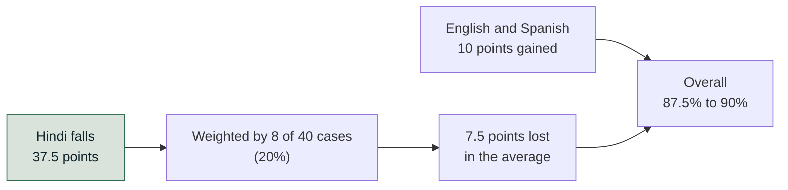
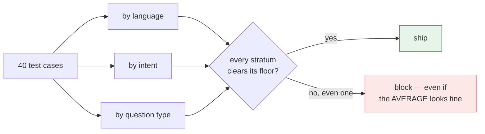
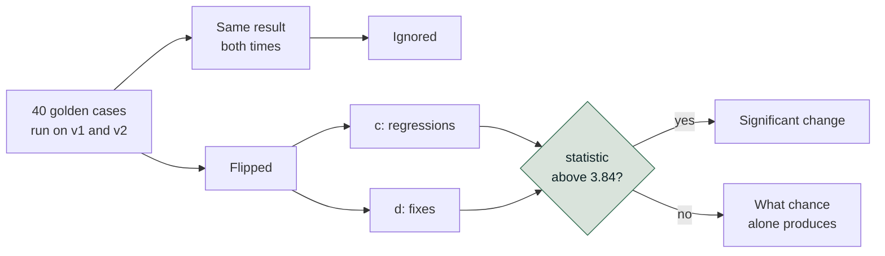
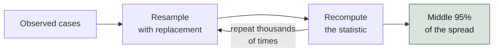
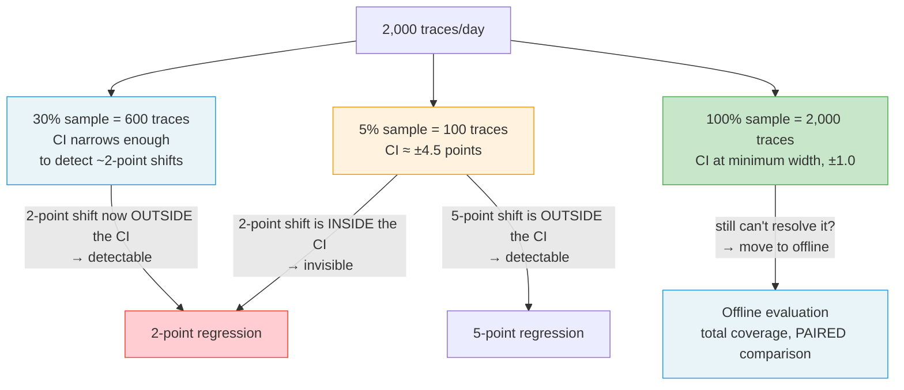
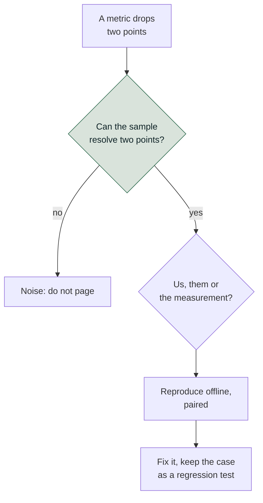

# Statistics and Stratified Reporting

*Gate on the worst slice rather than the average, because a group is only as loud in the mean as it is big.*

◷ 18 min read · Level 5 · No statistics background assumed. Every technical term (sample size, paired comparison, bootstrap, confidence interval) is
defined in plain words on first use.

A support bot is tested on 40 questions, in English, Spanish and Hindi. Version 1 is live and version 2 is ready to ship. Here is the full result.

| Group | Cases | v1 passes | v2 passes | Change |
|---|---|---|---|---|
| English | 22 | 20 (91%) | 22 (100%) | better |
| Spanish | 10 | 8 (80%) | 10 (100%) | better |
| Hindi | 8 | 7 (88%) | 4 (50%) | **collapsed** |
| **Overall** | **40** | **35 (87.5%)** | **36 (90%)** | **better** |

The overall score rose from 87.5% to 90%. Every dashboard turns green, and version 2 ships. Underneath:

- **Hindi fell from 88% to 50%.** Nearly half those customers now get a wrong answer.
- **Hindi is 8 of 40 cases.** The average felt only 20% of its 37.5-point fall.
- **That 20% is 7.5 points.** The other two groups gained 10 points, which buried it.

This diagram shows how the Hindi fall shrank on its way into the overall score.



**This is arithmetic. A group is only as loud in the average as it is big.** A group that is 5% of traffic can fail entirely and move the overall
score by five points.

---

## 1. Score Each Slice, Not the Whole

A **stratum** is a group of test cases that share something: all the Hindi questions, all the billing questions, all the ones where the right answer
is "I don't know". **Stratified reporting** means scoring each slice on its own and reading all of them.

**Pick the ways users differ.** For a support bot, these four splits fit.

| Split by | Example groups | Catches |
|---|---|---|
| Language | English · Spanish · Hindi | A language with thin documentation behind it |
| What the user wants | billing · account · general question · escalation | One workflow breaking while the rest are fine |
| Question type | simple lookup · multi-step · answer not in the docs | A bot that guesses instead of saying "I don't know" |
| Turns | single message · a back-and-forth | Quality falling apart after turn three |

**For a multilingual system, give language more than a pass rate.** Separate these:

- **Recall per language.** Retrieval quality can be uneven across languages. A pooled recall figure is mostly the largest language's figure.
- **Cross-lingual retrieval.** A question asked in one language, with its answer in a document written in another, is its own stratum. It can be the
  weakest one.
- **Native-speaker review.** Write cases natively in each language, not only translated from English. Have native-speaking reviewers label a sample
  per language, above all in high-risk domains.
- **The judge, per language.** Check a judge's verdicts in a less-resourced language against those labels before trusting its per-language
  numbers.

*The analogy:* a school announces its average exam score went up. It did. The announcement leaves out that one class failed every subject. The other
classes improved enough to cover it. The number is true, and useless for the only decision that mattered.

Four rules keep the slices honest:

- **Tag cases when they are created.** A test set cannot be split by a label it does not have.
- **Suspect averaging first.** When a dashboard looks green and customers still complain, check for an averaging problem before a quality problem.
  Split the results by segment. Then check whether the test set holds those customers' questions at all. A segment with zero test cases cannot show
  up as failing. A coverage gap and a healthy segment look identical unless someone checks.
- **Report each split on its own. Never cross-tabulate.** Slicing by language *and* intent *and* question type at once leaves mostly empty cells with
  40 cases. An empty cell is where somebody makes a confident statement about a segment of size one.
- **Print `n` beside every mean.** A mean without a sample size is a rumour. The report format prints, for every stratum and every metric, the
  average and how many cases produced it. Different metrics can be missing for different subsets of one stratum. A stratum with 12 cases might have
  a faithfulness score for only 3.

> *"Never as one number. I tag every test case by language, intent and question type, score each group separately, and gate the release on the worst
> group rather than the mean. An average is the easiest place in the system to hide a failing segment."*

Then decide on the slices too:

- **Gate on the worst group.** A release passes only when every group clears its floor.
- **Do not report by group and then ship on the average.** That changes nothing. It is the same mistake with an extra step.

> *"Overall quality improved, the release was blocked, and the reason was a segment that is 4% of traffic and 100% of some customers' experience."*



---

## 2. Ask Whether the Suite Could See the Change

Before arguing about whether a 4-point move is real, ask a cheaper question. **Could a test set this size ever detect a move that small?**

The rule of thumb for a proportion has two settings:

- **Confidence: 95%.**
- **Power: 80%.** Power is the chance of noticing a real effect if one is there.

```
n ≈ 15.7 · p(1 − p) / δ²
```

- **`p`** is roughly where the score sits now.
- **`δ`** is the size of the change worth seeing.
- **15.7** comes from `2 × (1.96 + 0.84)²`, the standard two-sided constants.
- **It is a documented rule of thumb**, not a full power analysis. It gives the right order of magnitude instantly.

Two ways to use it:

- **At `p = 0.80`, a 10-point move (`δ = 0.10`) needs `n ≈ 251` cases.** A 40-case suite sees a collapse but not a slip.
- **Run the formula backwards** to get the smallest change a given `n` can detect at all: `δ ≈ √(15.7 · p(1−p) / n)`.

> **Publish that number next to every report.** It turns "the score dropped 4 points" from a fire drill into a known limitation of the suite.

---

## 3. Report a Small Stratum Without Gating on It

Sample-size arithmetic cuts hardest against the *smallest* groups.

- **With 8 Hindi cases, one case flipping moves that group by 12.5 points.**
- **A "15-point drop in Hindi"** might be one case having a bad day.

Do not ignore small groups. Handle them in three moves:

- **Report them.** A stratum below the minimum size still gets its number printed.
- **Do not block on them** until they are big enough to mean something. A small stratum cannot fail a release on its own.
- **Say out loud that this is happening.**

Both silent options fail:

- **Dropping it silently** would hide the customers it is meant to protect.
- **Gating on it silently** would block releases at random.

> *"We report every group, but we only block on groups above a minimum size. Below that, one case flipping swings the number more than a real
> regression would. Blocking there would be reacting to noise."*

This is the argument behind the release gate's minimum-cases setting, covered in Level 6. The per-stratum detection-limit table draws that line,
not a round number picked in advance. It lists:

- **`n`**, the stratum's case count.
- **What one case is worth**, in points.
- **The smallest detectable change.**

**The tools in this level agree with each other.** Take the smallest stratum, flip a single case, and check it two ways:

- **Bootstrap confidence intervals.** The intervals before and after overlap almost completely.
- **McNemar's test on the same pairing.** It finds nothing significant.

Both readings say a single flipped case is noise. That is why the gate reports a small stratum instead of blocking on it.

---

## 4. Compare the Same Cases, Not Two Samples

Version 1 and version 2 run the exact same golden cases. **That pairing is information. Treating the two runs as independent throws it away.**

**McNemar's test** looks only at the cases that changed between the two runs.

```
                 candidate
                pass    fail
  baseline pass   b       c      <- c: regressions (used to pass, now fails)
           fail   d       a      <- d: fixes       (used to fail, now passes)

  statistic = (|c − d| − 1)² / (c + d)      ~ chi-square, 1 degree of freedom
  significant (p < 0.05) when the statistic exceeds 3.84
```

- **Cases that land the same way twice carry no information** about a change. McNemar ignores them on purpose.
- **A paired test needs far fewer cases** than an unpaired one to see the same effect.
- **An unpaired comparison fights the noise of all 40 cases.** McNemar looks only at the handful that flipped.

This diagram shows which cases McNemar reads and which it drops.



The worked example runs this on purpose:

- **Baseline.** The golden set's results.
- **Candidate.** 5 previously-passing cases broken on purpose, and 2 previously-failing ones fixed.
- **Result.** With `c + d` that small, the test may come back not-significant. **That is the correct answer.** A handful of flips on a 40-case
  suite is what chance alone produces.

---

## 5. Put an Interval Around Every Number

A single score such as "90% resolved" is a **point estimate**. It does not say how much that number would move on a different 40 cases. A
**confidence interval** answers that. It is a range the true rate probably falls inside, given the sample in hand.

### The bootstrap

The **bootstrap** answers "how much would this number move on a different sample of the same size?" It simulates exactly that, thousands of times:

1. **Resample the existing cases *with replacement*.** The same case can be picked more than once, and some are not picked at all.
2. **Recompute the statistic** on each resample.
3. **Take the middle 95%** of the spread.



The notebook implements it in about ten lines of plain standard library, on purpose.

**Read the widths, not the points.** A stratum whose interval spans 0.4 is reporting that its sample is too small to say anything precise. That
includes whether it is worse than another stratum.

### Wilson intervals

For a proportion there is a closed-form formula, the **Wilson interval**. At an observed rate of 0.95 it resolves to:

| Traces scored | Resolution (± points) |
|---|---|
| 50 | ±6.6 |
| 100 | ±4.5 |
| 200 | ±3.1 |
| 600 | ±1.8 |
| 2,000 | ±1.0 |

Read it the same way as the bootstrap widths. This is the wobble a number carries purely from *which* cases happened to be sampled, before anyone
asks whether the system changed.

| | Wilson interval | Bootstrap |
|---|---|---|
| Speed | Fast, a closed-form shortcut with no resampling | Slower, it resamples |
| Works for | Proportions only | *Any* statistic (a mean, a median, a rate) |
| Small samples, rates near 0% or 100% | Stays well-behaved, where a naive bell-curve approximation breaks down | Never assumes a bell-curve shape. It only resamples what was observed |
| How it is built | A closed-form formula | Written by hand, so nobody is unsure what it claims |

---

## 6. Buy the Sample Rate That Can See the Regression

The Wilson table also explains a production mistake: grading a *sample* of live traffic instead of every request. Teams sample because grading
everything with a judge costs real money.

Take an agent that handles 2,000 conversations a day.

- **Grade 100 of them**, a 5% sample, and assume the rest look similar.
- **The number wobbles** purely from *which* 100 got graded.

```
Day 1:  you grade 100 conversations → 95 pass → you report 95%
Day 2:  you grade a different 100    → 92 pass → you report 92%

Nothing changed. Same agent, same code, same prompt.
Only WHICH 100 you happened to grade changed.
```

That is a ±4.5-point wobble, the same number the Wilson table gives for n=100. A real problem is visible only when it is large next to that wobble.

| The drop you are hunting | Wobble from grading 100 | Can you see it? |
|---|---|---|
| 10 points (95% to 85%) | ±4.5 | Yes, far bigger than the wobble |
| 5 points (95% to 90%) | ±4.5 | Probably |
| **2 points (95% to 93%)** | ±4.5 | **No, smaller than the wobble** |



- **An alert at 2 points, on a 5% sample, is worse than no alert at all.** Two ordinary, unchanged days can differ by several points from luck
  alone. The alert fires when nothing broke. A team paged for nothing learns to close the page without looking.
- **A 2-point drop needs about 606 scored traces.** At 2,000 traces a day that is a 30% sample rate, not the 5% that felt affordable.

> **If a delta cannot be resolved even at 100% sampling, move the comparison offline.** There, every input is scored and the comparison is paired.

More sampling cannot fix this. Production asks *different questions every day*.

- **Traffic changes daily.** Monday's traffic is harder or easier than Tuesday's, and that difference never averages away.
- **Offline holds the questions fixed.** Asking the old build and the new one the same questions removes *what customers happened to ask* as a
  confound.
- **That is the paired idea behind McNemar**, applied to production.

*The analogy:* tasting a pot of soup. One spoonful settles instantly whether it is far too salty. It can never settle whether today's pot is 2%
saltier than yesterday's, especially when it is a different pot every day.

The procedure is repeatable:

1. **Decide the smallest regression** that must be caught.
2. **Compute the samples needed** for that resolution.
3. **Divide by daily traffic** to get the sample rate.
4. **Score every request with the deterministic scorers.** They are free and never need sampling.

---

## 7. Watch for Every Stratum Improving While the Total Falls

This follows mechanically from stratified reporting. Every stratum can improve while the overall number falls. It happens whenever a release also
shifts the *mix* of traffic between strata.

| Stratum | Before | After | Change |
|---|---|---|---|
| English (n: 90 to 20) | 90.00% | 95.00% | **+5.00** |
| Hindi (n: 10 to 80) | 50.00% | 55.00% | **+5.00** |
| **Overall** | **86.00%** | **63.00%** | **−23.00** |

- **Every stratum went up 5 points.** The overall number still collapsed 23, from 86% to 63%.
- **The mix moved** from 90% English / 10% Hindi to 20% / 80%.
- **Hindi is the weaker segment either way.** Most of the traffic is now Hindi.

> **A gate on the aggregate would block a release that made every group better. A gate on the worst stratum passes it correctly.**

That is why the release gate carries a dedicated per-stratum check, separate from its overall-average one.

---

## 8. Combine the Four Tools

Four small tools answer four different questions. None substitutes for another.

| Tool | Question it answers |
|---|---|
| Stratified grouping | *Which segment is bad?* |
| `n ≈ 15.7·p(1−p)/δ²` | *Could this suite even see that change?* |
| McNemar | *Did the same cases really get worse, or did a handful flip by chance?* |
| Bootstrap / Wilson interval | *How much would this number move on a different sample?* |

Four decision rules apply on top of the tools:

- **Gate on the worst stratum rather than the average.**
- **Report a small stratum's number without blocking a release on it.**
- **Refuse to act on a number the sample cannot resolve.**
- **Never report an average that buries a segment.**

Do all of this before the release gate itself, covered in Level 6, so the numbers that gate reads can be trusted.

---

## 9. Rehearse the Reporting Questions

**"The customer wants one number for a dashboard. What do you give them?"**

Restructure into three layers rather than fighting the request. Two systems can produce the same headline average:

- **One is mediocre everywhere.**
- **One is excellent**, except that it leaks account data under an adversarial prompt.

The three layers:

- **The headline.** A pass/fail verdict against the blocking gates, not an average. A verdict cannot be rescued by being good at something else.
- **The slices.** By category, by whether a tool was involved, by attack type, by turn.
- **"Not measured".** It gets its own column. Reporting a gap as a zero makes a healthy system look broken. Hiding it makes a blind spot look like
  coverage.

*"The headline tells you whether to look, the slices tell you where."*

**"A metric dropped two points this week. Walk me through what you do."**

Work through it in order:

1. **Ask whether the sample can resolve two points at all.** Only then ask what caused it.
2. **If the drop clears the noise floor, separate three candidates** (the table below).
3. **Reproduce it offline**, where the comparison is paired.
4. **Fix it**, and leave the case behind as a regression test.

*"Paging someone about noise is how you teach a team to ignore the alert. That costs more than the drop."*

| Candidate | What changed | How to tell |
|---|---|---|
| **Us** | A prompt, model, retrieval config or tool | Check the deployment timeline first. It is the cheapest to rule out |
| **Them** | The traffic mix shifted | A drop concentrated in one category is almost always this. One spread evenly points back at us |
| **The measurement** | A judge model upgraded underneath the pipeline, or the scored population changed | Rare and easy to miss. The system never moved at all |

This diagram shows the order of the questions.



Have Simpson's paradox ready as a follow-up. It is the one case where the aggregate and every individual stratum disagree, and the aggregate is the
one that is wrong.

---

## Key Takeaways

- A group is only as loud in the average as it is big. An overall score can rise while a segment collapses.
- Report every dimension separately, never cross-tabulated, and print `n` beside every mean.
- Ask whether the suite can resolve a change before arguing about it. A 40-case suite sees a collapse but not a slip.
- Report small strata and let only large enough ones block a release.
- Compare two builds on the same cases. The pairing is information, and McNemar reads only the cases that flipped.
- Read interval widths, not point estimates. A wide interval means nobody knows, not that the segment is worse.
- Name the smallest regression that must not be missed, then buy the sample rate that can see it. A 2-point alert on a 5% sample is worse than no
  alert.
- Every stratum can improve while the total falls. That is why the gate reads the worst stratum rather than the aggregate.

## Check Yourself

1. The overall pass rate rose from 87.5% to 90%, and one 8-case group fell from 88% to 50%. Should it ship? **No. The group's 37.5-point fall
   entered the average at 20% weight. Gate on the worst group.**
2. A suite has 40 cases at about 80% passing. Can it detect a 10-point regression? **No. That needs roughly 251 cases. It sees a collapse, not a
   slip.**
3. A stratum of 8 cases drops 12.5 points. What happened? **One case flipped. That is the value of a single case at n=8, and it is noise, not a
   regression.**
4. Why does a paired test need fewer cases than comparing two independent samples? **It ignores cases that landed the same way twice and reads only
   the flips, instead of fighting the noise of the whole set.**
5. Two strata have the same mean, but one has an interval spanning 0.4. What does that mean? **That its sample is too small to say anything precise,
   not that it is worse.**
6. A team grades 5% of 2,000 daily conversations and alerts on a 2-point drop. What will happen? **It fires on ordinary days. The wobble at n=100 is
   ±4.5 points. The alert is worse than none.**
7. Every stratum improved 5 points and the overall number fell 23. Is the release good? **Yes. The traffic mix shifted toward the weaker segment. An
   aggregate gate would block a release that made every group better.**
8. A metric dropped two points. What is the first question? **Whether the sample can resolve two points at all, before asking what caused it.**

---

## References

All content above was drawn only from material already in this repository. Nothing here was invented, and no external source was consulted. This page
is the restyled edition of `archive/roadmap-explainers-org/05-statistics-and-stratified-reporting.md`; its content is the same. Two retired pages have
since been merged into it: the plain-English stratified-reporting explainer (`archive/stratified-reporting-explained.html`), and the
sampling-resolution section of the online-versus-offline concepts page (Section 6). The rest of that page now lives in [`databricks-mlflow-evals.md`,
Part 5](../concepts/databricks-mlflow-evals.md#part-5--online-vs-offline).

**Notebook:**

- `courses/03-agentic-eval-harness/10_stratified_reporting_and_statistics.ipynb`: the by-dimension grouping and reporting code, the sample-size
  formula and per-stratum detection-limit table, McNemar's test and its "5 broken, 2 fixed" demonstration, the ten-line bootstrap and "read the
  widths, not the points", the one-case-flip demonstration, the Simpson's-paradox demonstration, and the four-tool recap.

**Docs:**

- The retired stratified-reporting explainer (`archive/stratified-reporting-explained.html`): the English/Spanish/Hindi worked example used as this
  file's running example, the definition of "stratum", the "why the average lies" arithmetic, the four-way grouping table, the 12.5-points-per-case
  illustration, the school-average analogy, the "tag cases when you create them" point, and the 4%-of-traffic line.
- The retired online-versus-offline page, §5: the production sampling-wobble example, the drop-you-are-hunting table, the sampling-resolution
  flowchart, the different-questions-every-day argument, and the soup analogy.
- `archive/AI_Engineer_Interview_Kit_RAG_Agents_Production_Failure_Scenarios_FINAL.pdf`: multilingual evaluation as a slicing case (recall per
  language, cross-lingual retrieval, native-speaker review).
- `docs/concepts/databricks-mlflow-evals.md`, Part 4: the Wilson-interval resolution table, the ~606-traces figure, and the four-step sample-rate
  decision procedure.
- `docs/interview-prep/QUESTION_BANK.md`, Q4 and Q21: the two questions reproduced in full in Section 9 rather than pointed at.
- `docs/study-guide/evaluation-roadmap.md`: Level 5's topic list and goal statement.
- `docs/study-guide/evaluation-topic-notebook-mapping.md`: Level 5's resource table.

**Limitations.** Written from the repository's own material without running any notebook or calling any API. The sample-size, McNemar and
Simpson's-paradox numbers are the notebook's own illustrative worked examples, not live output. The plain-language description of the Wilson interval
is standard statistical terminology, included because the source states the technique's name and its resulting numbers but not its closed-form
definition.

---

**Next:** [Level 6, The Release Gate and CI](06-the-release-gate-and-ci.md) · **Previous:** [Level 4, Judges, and the Humans Who Validate Them](04-judges-and-the-humans-who-validate-them.md)
