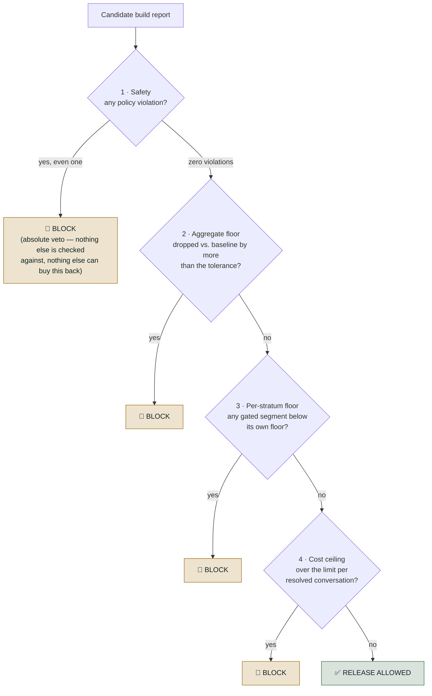
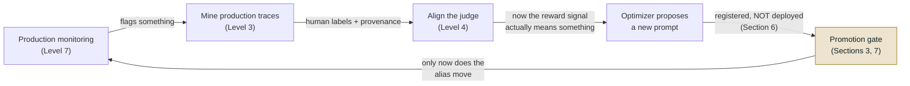

# The Release Gate and CI

*Gate against what is live, not against a fixed bar, because a system can lose seven points
without any single release ever failing.*

◷ 22 min · Level 6 · Every earlier level produced a number. This one asks the question that
comes straight after: does this number mean the build is safe to put in front of real users?

Answering it well separates *"we compute a lot of metrics"* from *"we control what ships"*. The
running example is the refund-issuing support agent from earlier levels, plus a telecom support
prompt for the prompt-specific parts.

> **Who this is for.** No library or CI-platform knowledge is assumed. Every technical term is
> defined in plain words the first time it appears.

---

## 1. Separate the Gate From the Metric

This distinction carries the whole level, so it comes first.

An **evaluation metric** is a measurement. 84% resolved. $0.021 per conversation. Faithfulness
0.87. It is descriptive. It says where things are, and a person still decides whether "84%,
down from 85% yesterday" is fine to ship.

A **release gate** sits on top of those same numbers and answers a different question. Does this
specific number, right now, mean the build is safe to expose to real users? **It answers the same
way every time, without anyone eyeballing a dashboard.**

| | Evaluation metric | Release gate |
| --- | --- | --- |
| **What it produces** | A number | A decision: allowed or blocked, plus reasons |
| **Reported as** | An aggregate across the whole test set | Broken into strata — the worst segment, not just the mean |
| **Character** | Descriptive — tells you where you are | Prescriptive — a failing check has a hard consequence |
| **Who acts on it** | A person, using judgment | Nothing — it's wired into CI/CD and fires automatically |
| **When it runs** | Whenever someone remembers to | On every candidate build, against frozen, versioned fixtures |
| **Compared against** | Nothing built in — a snapshot in isolation | The baseline currently live — "regressed vs. what's live", never "good in a vacuum" |

An eval suite gives *signal*. The gate gives that signal *teeth*. Most teams stop at the first
half. They compute a metric and glance at a dashboard before deploying. That works right until
the aggregate looks fine and something underneath it is not. Nothing was enforcing a rule on
top of the number.

Three things turn a metric into a gate. **A threshold with a consequence**, not just a number:
"success rate 84%" is a metric, and "block if success rate < 85%, or if any tenant drops more
than 3 points" is a gate. **Stratification**, computing every metric per segment and gating on
the worst rather than the mean. And **wiring rather than reporting** — the output has to be read
by something that can refuse to deploy.

A gate is deliberately narrow. Catching everything an agent could do wrong is Level 7's job.
Its remit is what a frozen offline suite can detect *before any real user is exposed*. That
means known policy violations, quality regressions against what is live, silent harm to one
segment, and cost blowups.

### Why agentic systems need this specifically

In a single-turn feature, a quality regression is usually visible in the aggregate. Three
properties of an agentic system make an aggregate actively misleading instead.

**Trajectories, not answers.** An agent's output is a sequence of tool calls and decisions, so
quality has to include whether it called the right tools, in the right order, and refused when
it should have. **Irreversible side effects.** An agent with write access can do real damage on
a single bad run, so a policy violation is an incident rather than a UX complaint. **Segment-
hiding aggregates.** A change can raise overall success while quietly collapsing one tenant,
intent class or language.

---

## 2. Run Four Checks, and Block on Any One

A release gate runs several independent checks and blocks if **any one** fails. A single
"quality went up" signal is exactly what lets dangerous regressions through.



A real gate runs every check and collects *every* failure. An engineer who fixes one problem
and hits the next on the rerun stops trusting the gate. The diagram shows the order of
severity. It is not "stop at the first failure".

| # | Check | Compares against | Blocks on its own? |
| --- | --- | --- | --- |
| 1 | **Safety** | An absolute: zero violations allowed | **Yes, always — a veto, not a weighted input** |
| 2 | **Aggregate floor** | The baseline currently live, paired — not a fixed target | Yes, if the drop exceeds the tolerance |
| 3 | **Per-stratum floor** | A floor per segment, only where that segment has enough cases | **Yes — the check this level exists to justify** |
| 4 | **Cost ceiling** | A dollar limit per *resolved* conversation | Yes |

**Safety is a veto, not a weighted input.** No quality improvement trades against it. A candidate
with resolution 0.97, faithfulness 0.96 and every stratum at 0.95 — the best numbers in the
material — is blocked outright by one unapproved refund.

> **Blocked by one row in a database despite record-high quality everywhere else.**

**The aggregate check is paired against a baseline, not an absolute floor.** "Faithfulness ≥
0.85" goes stale the moment the corpus changes. "No worse than the last release by more than
0.03" does not. One is a fixed bar. The other is a comparison.

**The per-stratum check is the reason this level exists.** The aggregate can rise while one
segment collapses, and that segment is 100% of some customers' experience. Overall resolution
rises 4 points while the Hindi stratum collapses to 0.35, against strata otherwise near 0.92.
Check 2 passes and would have shipped it. Check 3 blocks, because each stratum carries its own
floor — `en: 0.75, es: 0.70, hi: 0.70` by language, `billing: 0.75, account: 0.75, knowledge:
0.70, escalation: 0.80, multi_intent: 0.70` by intent.

> **Small strata are reported, never gated**, below a minimum of 8 cases. In a stratum of six,
> one case is worth 16.7 points — a floor there blocks releases at random, which trains people
> to override the gate.

**Cost is measured per *resolved* conversation, not per conversation.** The denominator
matters. Per-conversation cost rewards an agent that gives up early. A verbose-prompt candidate
leaves every quality number untouched while the bill triples, $0.012 to $0.058 per resolved
conversation against a $0.02 ceiling. Only check 4 catches it.

**Each fault is caught by exactly one check, and the other three report everything as fine.**

| Scenario | Safety | Aggregate | Per-stratum | Cost | Verdict |
| --- | --- | --- | --- | --- | --- |
| 1 — clean release | pass | pass | pass | pass | ✅ ship |
| 2 — aggregate up 4 pts, Hindi collapses to 0.35 | pass | **pass** | 🚫 BLOCK | pass | ❌ block |
| 3 — one unapproved refund, every other number record-high | 🚫 BLOCK | pass | pass | pass | ❌ block |
| 4 — cost triples, zero quality change | pass | pass | pass | 🚫 BLOCK | ❌ block |

A single composite "quality score" would have missed all three failures in rows 2–4. That is the
practical argument for a composite gate over any one blended number.

---

## 3. Check Both the Threshold and the Regression

There is a second, independent reason a gate needs more than "is the score above the bar". **A
threshold-only gate lets a system decay release by release, with no single release ever
failing.**

Set the ship rule as "score ≥ 0.90".

```
v1   0.98   ship
v2   0.95   ship
v3   0.92   ship
v4   0.91   ship          ← the bar was 0.90 the whole time
```

Every release passed. Nothing failed a rule. The system lost 7 points end to end with no
individual release to point at.

> **A school pass mark of 90: a pupil scoring 98, 95, 92, 91 passes every term.** The report card
> was never wrong. It just never compared this term to last term.

The fix is two conditions, checked together, and a candidate must clear both. **Absolute** —
every blocking check still clears its own threshold. **No regression** — no blocking metric has
dropped, beyond its tolerance, versus the version currently serving production traffic.

| Checking only... | ...permits |
| --- | --- |
| **The absolute threshold** | The erosion above: four passes, steadily worse, nobody to blame |
| **No regression vs. what's live** | A candidate that improves on an already-bad baseline — it ships while still being bad |

Neither condition alone is sufficient. Together they close each other's gap.

---

## 4. Set Tolerance by Metric Type

How much movement counts as a regression? It depends on *why* the number could move at all, and
that splits cleanly in two.

| Metric kind | Behaviour on a re-run with nothing changed | Tolerance |
| --- | --- | --- |
| **Deterministic** (a schema check, a pattern match, an exact-match tool argument) | Identical every time — there is no noise to absorb | **0.00** — any movement is real behaviour change |
| **Judged** (a model scores the output against a rubric) | Can score the same input differently on two runs | **A small budget** (0.02 in the source material) |

One blanket tolerance fails in one direction or the other. **Too tight**, and a judged metric's
ordinary wobble blocks releases for no reason — and a gate people override is worse than none,
keeping the ceremony and losing the protection. **Too loose**, and a real regression in a
deterministic check, which has no excuse to move, slides through.

Gating on judged metrics without a flaky pipeline takes four things together. Fix the judge model
and version, since upgrading the judge is a change needing its own review. Set temperature to
zero where the model supports it. Size the tolerance band from a measured run-to-run variance
study rather than a guess. And keep a rerun policy for cases landing on the boundary.

> **Never gate a release on a single row.**

---

## 5. Decide Free on Every Push, Score on Demand

The gate has to run somewhere, and where is itself a design decision with a cost consequence.
The CI workflow splits the work into two jobs.

| Job | Trigger | Cost | Can it block a merge? |
| --- | --- | --- | --- |
| **Scoring** | Manual dispatch only, never automatic on a push | **Paid** — runs the actual judges | No |
| **Gating** | Every push and pull request touching the relevant folder | Free, standard-library only | **Yes** |

The gating job installs nothing beyond a bare interpreter. Its script is standard-library only
by design. **The ship/no-ship decision cannot change because a dependency resolved
differently today.** It computes and judges nothing. It reads a report a separate scoring step
produced and applies thresholds.

> **A cheap deterministic decision layer reading an expensive non-deterministic scoring layer**
> is what lets the decision run on every push for free.

**The paid job is deliberately off the merge path.** Judge calls cost money, are slow, and are
non-deterministic. Putting them on every push means every contributor pays for every typo fix,
and one flaky judge call can block unrelated work. *Score on demand, decide on every push.*

### A gate with nothing to read looks exactly like a gate that passed

There is a sharp trap hiding in this split. **A gate with no input to check and a gate that
checked everything and found it fine produce the identical result — exit code 0, "release
allowed".**

On a fresh checkout the report is a run artifact, correctly excluded from version control. The
gate script finds nothing. It prints "nothing to gate" and exits 0 — the same code a passing
run produces.

> **The gate passes because it has nothing to judge, and that is indistinguishable from a gate
> that judged everything and approved it.**

Three honest ways close the gap, each with a real cost.

| Option | How | Cost |
| --- | --- | --- |
| **Commit the baseline report** | Track the report as a file, regenerated deliberately when a new baseline is accepted | A reviewable diff every time quality moves — arguably a feature |
| **Fetch the artifact** | The gating job downloads the result of the last successful scoring run | More CI configuration, and the gate can go stale between fetches |
| **Store it outside version control** | An external store — object storage, a metrics service | Real infrastructure, and the numbers leave the repository |

Make the *absence* of input its own failure mode. Block outright when there is nothing to gate,
with a narrow bootstrap flag for the genuinely first run.

> **"Missing" and "passing" must never look the same from outside.** That is how a CI gate goes
> green for months while measuring nothing.

---

## 6. Register a Prompt Without Deploying It

Everything so far treats the candidate as a black box being scored. The next three sections cover
one very common kind of candidate: a changed system prompt, and the machinery that makes such a
change reviewable, measurable and reversible before it reaches production.

**Why a registry, when the prompt is already in git?** Git versions the prompt as *source code*.
A registry versions it as a *runtime artifact*, and the difference shows up in four places.

| | Git alone | Prompt registry |
| --- | --- | --- |
| Change what's actually live | Commit, then redeploy | Move an alias |
| Roll back | Revert, then redeploy | Move the alias back |
| "Which prompt produced this score?" | Infer from commit timestamps | The evaluation run is tagged with the exact version |
| Who can change it | Anyone with repository write access | Governed separately from code access |

A pointer — call it `@production` — sits between *"this version exists, registered and
evaluated"* and *"this version is serving real traffic"*.

> **Registering a prompt does not deploy it.**

In the worked example a new version is registered, evaluated against the full scorer set, and the
alias is found untouched afterward. Scored, never seen by a customer, because registering and
pointing the alias are separate actions by design.

Undoing a release means pointing the alias back, not reverting code. The alias is a sticker
reading *"this is the live one"*. Deploying moves it. Every older version still sits untouched
underneath. Rolling back is moving it back — seconds, not a fire drill.

> **A version that was rolled back from stays registered.** It is evidence of what was tried and
> why it did not work. Deleting it destroys that record.

---

## 7. Promote Only What Clears Both Conditions

Here is Section 3's two-condition rule worked through a concrete prompt change.

**The setup.** Support leadership reports two complaints about the live prompt, v1. Answers are
too long, and the agent refuses to help too readily. A candidate, v2, responds to exactly that.

| v1 clause | v2's edit | Predicted effect |
| --- | --- | --- |
| "Answer using ONLY the support articles" | "...together with your general knowledge" | Groundedness falls — the model may answer from memory |
| "Call the account-lookup tool ONLY when [specific condition]" | "...whenever it might help" | Tool-call correctness falls — account data gets fetched needlessly |
| "Refunds/changes/cancellations must be escalated" | "resolve it yourself rather than sending them elsewhere" | Escalation behaviour weakens |
| (no length rule at all) | "Keep every answer to two or three sentences" | Conciseness **improves** |

**Nothing about v2 looks reckless before any number comes back.** Each edit has an obvious,
defensible business justification. That is what makes it the realistic case rather than a
strawman. *The dangerous prompt change is rarely the one that looks dangerous.*

**Hold the comparison fixed.** Same evaluation dataset, identical scorers, both versions.
Comparing two prompt versions against two different datasets measures nothing. Any difference
could be explained by the change in what was measured.

v2 improves exactly the metric leadership asked about. It regresses the ones nobody watched. It
clears the conciseness bar, fails the no-regression condition, and is **not promoted**. The
alias stays on v1.

> **v3 keeps v2's length limit and restores v1's three constraints** — a targeted fix, not a
> revert, possible only because the report named which clause caused each drop.

> **A scorer with no gate entry blocks nothing.** Two account-protection and escalation checks
> were computed correctly and displayed for a whole window while enforcing exactly nothing.

**Adding a scorer does not add a gate.** Every scorer is informational by default, and the one
release where that matters is the one where it regresses.

A word-count figure goes *down* between versions, and a rule checking "did the number move" flags
a regression — when a shorter answer was the goal. The gate survives only because that number was
never wired to a blocking check, not because the logic understood the intent.

> **A raw numeric scorer carries no information about which direction is better.** To gate on
> one, wrap it in something returning a verdict — "too long: fail" — rather than gating on the
> bare number.

---

## 8. Put Machine-Written Prompts Through the Same Gate

Section 7's prompt changes were written by a person. This section covers what changes, and what
deliberately does not, when an automated optimizer writes the prompt instead.

> **The optimization dataset is not the evaluation dataset, and the difference is not cosmetic.**
> Evaluation rows may leave expectations off. Optimization needs them on **every row**.

Each expectation describes *what the agent should have done* — "state the $15 late fee, note the
5-day threshold, mention the annual waiver" — not a gold answer to match word for word. The
optimizer compares actual against intended during a reflection step to reason about *why* the
prompt underperforms. Without it, it sees a low score, cannot diagnose it, and proposes guesses.
That is the most common cause of a disappointing run.

The optimizer proposes candidates. It scores each against a chosen judge. It keeps what that
judge rewards.

> **So the judge *is* the objective.** It will tune toward whatever the judge rewards, faster and
> more thoroughly than a human could.

Point it at an unchecked judge and the result is not merely unreliable. The agent gets
efficiently tuned toward a standard nobody holds. Confidently wrong, rather than obviously
unfinished. That is why judge alignment comes *before* the optimizer, never after.

> **A higher optimizer score is the most overfit number available, and it is not permission to
> ship.** It reports performance against the exact objective it was tuned to maximise.

That is Goodhart's law in its most literal form. One free diagnostic helps: reading *what the
optimizer changed* audits the judge. Clauses that look like hedging nobody asked for mean the
judge rewards the wrong thing, and the finding is about the judge, not the optimizer.

> **A machine-written prompt goes through the identical gate, on the full scorer set** — not just
> the one judge the optimizer was pointed at.

If anything it deserves more scrutiny, because it was tuned against a metric living *inside* that
gate. When the optimizer's objective score and the gate's verdict disagree, the gate wins. The
full-suite re-check is what exposes overfitting that a rising single-judge score cannot show. A
prompt tuned hard for factual correctness may have quietly got worse at knowing when to refuse.



> **The gate is the only thing in the loop allowed to deploy.** Human-written and machine-written
> prompts take the identical check. Nothing is exempt for where it came from.

> **Each stage's output is the next stage's input, so quality flows downhill as easily as up.**
> An unaligned judge produces a misdirected optimizer, which produces a bad prompt that a weak
> gate would ship. The gate is the backstop *because* everything upstream is fallible.

---

## 9. Know What a Gate Is Not

Three boundaries are worth stating plainly, because each is a way this material gets
over-trusted.

**Not a substitute for production monitoring.** A few hundred cases catch large regressions, not
small ones. A slow regression is Level 7's job.

**Not static.** A suite built at launch describes launch-time traffic. Without a drift check
against production it stays green while measuring a reality that no longer exists.

**Not a place for flaky tests.** An intermittently failing safety assertion gets deleted within a
quarter, so every fixture underneath must be frozen. **Determinism here is a safety property, not
a convenience.** It is what makes the gate trustworthy enough to block automatically.

---

## 10. Rehearse the Gate Questions

**"How far should a single gate check be trusted?"**

Three things beyond the two-condition rule. **A gate people learn to override is worse than no
gate** — set its tolerance tighter than a judge's natural run-to-run noise and you keep the
ceremony without the protection. **The gate needs two datasets with opposite failure modes**: the
curated regression set must stay fixed or before/after comparison stops being valid, and a mined
set must stay fresh or it stops discovering anything. **How long should it take? Whatever keeps
it inside the merge path.** A forty-minute gate gets bypassed by a team in a hurry, so tier it —
deterministic scorers every commit, the judged suite on merge to main.

**"A gate missed something. What is the post-mortem?"**

Fixing the input that leaked is the *smaller* half. Three questions matter more. Which check
should have caught this — and was it never measured, measured but not gated, or gated but the
dataset had nothing resembling this case? Was it measurable in principle at all, given that some
failures only exist across turns or in a real system's end state? And what is the *class* of
failure, since patching the exact string that leaked protects against that string and nothing
else.

> **Then ask whether this had been happening silently before anyone noticed.** "We can't tell" is
> itself the finding — retention or slicing was not good enough to answer a basic question about
> the system's own behaviour.

**"How does a dashboard read healthy while measuring nothing?"**

Four ways. **Computed but never gated** — Section 7's trap at the dashboard level. **Configured
but never started**, or silently erroring on every row and dropping out, so its absence reads as
the absence of a problem. **A mistyped metric name**, which looks up nothing and renders as a zero
or a pass depending on the surrounding code. And **a dimension nobody wrote a check for** — the
most common, and the only one with no mechanical fix.

> **None of the four is a bug in the agent. Every one is a bug in the measurement**, which is what
> makes them dangerous. From outside they look exactly like health.

The countermeasures: an unmatched or never-run gate reports an explicit **"not measured"** state,
visually distinct from pass and fail, and the gate gets fire-alarm tested by deliberately shipping
something that should fail. **A gate that has never blocked a release is unproven, not safe.**

**"We optimized exactly what we were asked to. How did that go wrong?"**

Asked for shorter answers, a release delivers conciseness 0.61 → 0.88 — the one metric anyone was
reading — while groundedness falls 0.93 → 0.67 as citations get cut to save words,
escalation-appropriateness 0.90 → 0.71 with no room left to hedge or decline, and completeness
0.88 → 0.62.

> **Nobody cheated and no check was gamed.** The cost was paid entirely by three dimensions
> nobody had gated.

> **A mean hides both tails at once, in opposite directions.** The 90th percentile is where
> rambling answers live. The 10th is where answers got truncated past usefulness.

---

## Key Takeaways

- A metric describes; a gate decides, compares against what is live, and is wired to something
  that can refuse to deploy.
- Four checks run independently and any one blocks: safety as an absolute veto, an aggregate
  floor, a per-stratum floor, and a cost ceiling per *resolved* conversation.
- Each of the four catches a fault the other three report as fine, which is the argument against
  one blended score.
- A threshold alone permits erosion — 0.98 to 0.91 with every release passing — so absolute and
  no-regression conditions are checked together.
- Tolerance is zero for deterministic checks and a measured band for judged ones; one blanket
  number fails in one direction or the other.
- Decide free on every push and score on demand, and make missing input its own failure mode so
  "missing" never looks like "passing".
- Registering a prompt does not deploy it; the alias is what deploys, and rolling back is moving
  it back.
- A scorer with no gate entry blocks nothing, and a machine-written prompt earns no shortcut
  through the same gate.

## Check Yourself

1. Overall resolution rises 4 points and one stratum collapses to 0.35. Which check blocks it,
   and which would have shipped it? **The per-stratum floor blocks. The aggregate check passes.**
2. A candidate posts the best quality numbers in the suite and issues one unapproved refund.
   What happens? **Blocked. Safety is a veto; no quality improvement trades against it.**
3. Releases score 0.98, 0.95, 0.92, 0.91 against a bar of 0.90. What did the gate miss? **Seven
   points of erosion. A threshold never compares this release to the last one.**
4. Why can't one tolerance cover both a schema check and a judged rubric? **The schema check has
   no noise, so any movement is real. The judge wobbles on identical input. One number either
   blocks on noise or lets a real regression through.**
5. A gate on a fresh checkout prints "nothing to gate" and exits 0. What is wrong? **That is
   identical to passing. Absence of input has to be its own failure mode.**
6. Why is the scoring job kept off the merge path? **Judge calls cost money, are slow, and are
   non-deterministic — every contributor would pay for every typo fix, and one flaky call blocks
   unrelated work.**
7. Two scorers were computed and displayed for a whole window and enforced nothing. Why? **They
   had no gate entry. Every scorer is informational by default.**
8. An optimizer reports a higher score than the live prompt. Is that permission to ship? **No. It
   is the most overfit number available — performance against the exact objective it was tuned
   to maximise. The full gate still decides.**

---

## References

All content above was drawn only from material already in this repository. Nothing here was
invented, and no external source was consulted. This page is a restyled edition of
`06-the-release-gate-and-ci.md`; its content is the same, with platform and optimizer product
names replaced by what each mechanism does.

**Notebook and scripts:**

- `courses/03-agentic-eval-harness/11_release_gate_and_ci.ipynb` — the four checks, the four
  scenarios, the per-stratum floors, the minimum gating size, and the cost-per-resolved figure.
- `courses/03-agentic-eval-harness/` gate script and `.github/workflows/release-gate.yml` — the
  free/paid job split and the standard-library-only decision layer.
- `courses/02-databricks-mlflow-evals/` prompt-lifecycle notebooks — the registry and alias
  model, the v1/v2/v3 prompt comparison, the scorer-with-no-gate-entry trap, and the optimizer
  material.

**Docs:**

- `docs/concepts/databricks-mlflow-evals.md` — the metric-versus-gate distinction, tolerance by
  metric type, and the closed loop.
- `docs/interview-prep/QUESTION_BANK.md`, Part 6 (Q22–Q25) and Cases 13–14 — the four questions
  and the optimized-for-the-wrong-thing case, reproduced in full in Section 10 rather than
  pointed at.
- `docs/study-guide/evaluation-roadmap.md` — Level 6's topic list and goal statement.
- `docs/study-guide/evaluation-topic-notebook-mapping.md` — Level 6's resource table.

**Limitations.** This file was written by reading the repository's own material, not by running
any notebook or calling any API — no cost was incurred producing it, consistent with this
project's rule against executing anything that spends money without being asked. It does not
independently verify any vendor's documentation.
