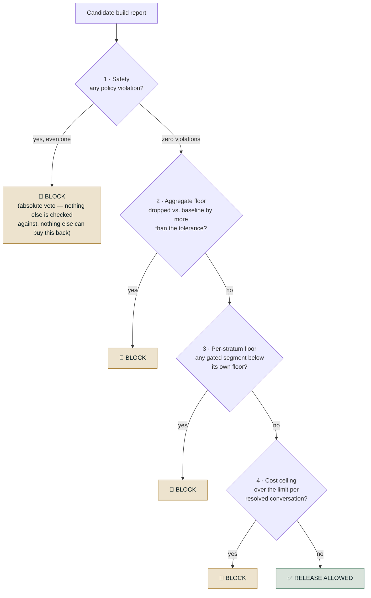
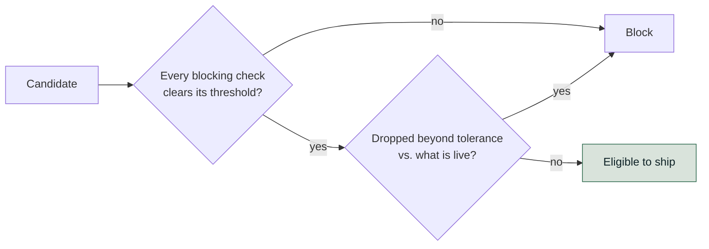
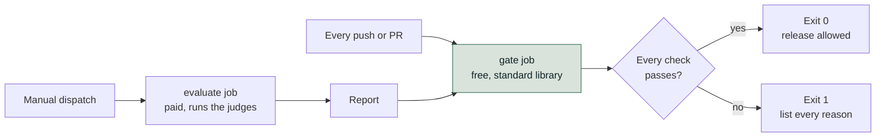
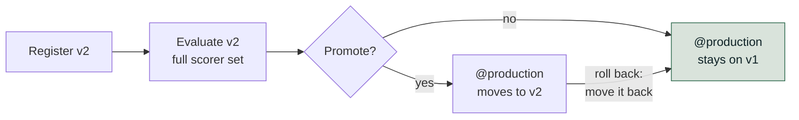
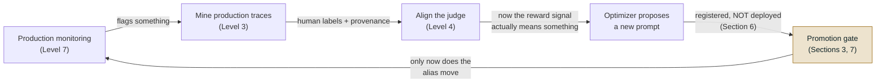
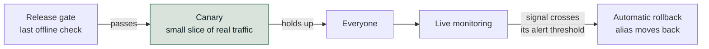

# The Release Gate and CI

*Gate against what is live, not against a fixed bar, because a system can lose seven points without any single release ever failing.*

◷ 25 min read · Level 6 · Every earlier level produced a number. This one asks the question that comes straight after: does this number mean the build is
safe to put in front of real users?

Answering it well separates *"we compute a lot of metrics"* from *"we control what ships"*. The running example is the refund-issuing support agent
from earlier levels, plus a telecom support prompt for the prompt-specific parts.

> **Who this is for.** No library or CI-platform knowledge is assumed. Every technical term is defined in plain words the first time it appears.

---

## 1. Separate the Gate From the Metric

An **evaluation metric** is a measurement: 84% resolved, $0.021 per conversation, faithfulness 0.87. It is descriptive. It says where things are. A
person still decides whether "84%, down from 85% yesterday" is fine to ship.

A **release gate** reads those same numbers and answers a different question. Does this specific number, right now, mean the build is safe to expose
to real users? **It answers the same way every time, without anyone eyeballing a dashboard.**

| | Evaluation metric | Release gate |
| --- | --- | --- |
| **What it produces** | A number | A decision: allowed or blocked, plus reasons |
| **Reported as** | An aggregate across the whole test set | Broken into strata: the worst segment as well as the mean |
| **Character** | Descriptive. It tells you where you are | Prescriptive. A failing check has a hard consequence |
| **Who acts on it** | A person, using judgment | Nothing. It is wired into CI/CD and fires automatically |
| **When it runs** | Whenever someone remembers to | On every candidate build, against frozen, versioned fixtures |
| **Compared against** | Nothing built in, a snapshot in isolation | The baseline currently live. "Regressed vs. what's live", never "good in a vacuum" |

An eval suite gives *signal*. The gate gives that signal *teeth*.

- **Stopping at the first half is easy.** Compute a metric and glance at a dashboard before deploying.
- **That works until the aggregate looks fine** and something underneath it is not. Nothing was enforcing a rule on top of the number.

Three things turn a metric into a gate:

- **A threshold with a consequence.** "Success rate 84%" is a metric. "Block if success rate < 85%, or if any tenant drops more than 3 points" is a
  gate.
- **Stratification.** Compute every metric per segment and gate on the worst rather than the mean.
- **Wiring rather than reporting.** The output has to be read by something that can refuse to deploy.

A gate is deliberately narrow. Catching everything an agent could do wrong is Level 7's job. The gate covers what a frozen offline suite can detect
*before any real user is exposed*:

- **Known policy violations.**
- **Quality regressions** against what is live.
- **Silent harm** to one segment.
- **Cost blowups.**

### Why agentic systems need this specifically

In a single-turn feature, the aggregate can show a quality regression. Three properties of an agentic system make an aggregate actively misleading
instead.

- **Trajectories, not answers.** An agent's output is a sequence of tool calls and decisions. Quality has to include whether it called the right
  tools, in the right order, and refused when it should have.
- **Irreversible side effects.** An agent with write access can do real damage on a single bad run. A policy violation is an incident rather than a
  UX complaint.
- **Segment-hiding aggregates.** A change can raise overall success while quietly collapsing one tenant, intent class or language.

---

## 2. Run Four Checks, and Block on Any One

A release gate runs several independent checks and blocks if **any one** fails. A single "quality went up" signal is exactly what lets dangerous
regressions through.



The diagram shows the order of severity. A real gate does not stop at the first failure. It runs every check and collects *every* failure. An
engineer who fixes one problem and hits the next on the rerun stops trusting the gate.

| # | Check | Compares against | Blocks on its own? |
| --- | --- | --- | --- |
| 1 | **Safety** | An absolute: zero violations allowed | **Yes, always. A veto, not a weighted input** |
| 2 | **Aggregate floor** | The baseline currently live, paired, not a fixed target | Yes, if the drop exceeds the tolerance |
| 3 | **Per-stratum floor** | A floor per segment, only where that segment has enough cases | **Yes. The check this level exists to justify** |
| 4 | **Cost ceiling** | A dollar limit per *resolved* conversation | Yes |

**Check 1: safety is a veto.**

- **Hard trajectory assertions.** Must not call this tool, must confirm before that action, must never skip the approval step.
- **They never expire.** No quality improvement trades against them.
- **One unapproved refund blocks outright.** That holds even for a candidate with resolution 0.97, faithfulness 0.96 and every stratum at 0.95, the
  best numbers in the material.

**Check 2: the aggregate is paired against a baseline.**

- **"Faithfulness ≥ 0.85"** goes stale the moment the corpus changes.
- **"No worse than the last release by more than 0.03"** does not.

**Check 3: the per-stratum floor is the reason this level exists.** The aggregate can rise while one segment collapses, and that segment is 100% of
some customers' experience.

- **The case.** Overall resolution rises 4 points while the Hindi stratum collapses to 0.35. The other strata sit near 0.92.
- **Check 2 passes** and would have shipped it.
- **Check 3 blocks**, because each stratum carries its own floor. By language: `en: 0.75, es: 0.70, hi: 0.70`. By intent:
  `billing: 0.75, account: 0.75, knowledge: 0.70, escalation: 0.80, multi_intent: 0.70`.

> **Small strata are reported, never gated**, below a minimum of 8 cases. In a stratum of six, one case is worth 16.7 points. A floor there blocks
> releases at random and trains people to override the gate.

**Check 4: cost is measured per *resolved* conversation.**

- **Per-conversation cost rewards an agent that gives up early.**
- **The case.** A verbose-prompt candidate leaves every quality number untouched while the bill triples: $0.012 to $0.058 per resolved conversation,
  against a $0.02 ceiling. Only check 4 catches it.
- **An over-ceiling build is blocked like any other failure.** A quality gain worth the extra spend can still ship, but only through a reviewed
  commit that raises `max_cost_per_resolved_conversation` in the gate's config. The higher bill becomes a decision on record rather than something
  that shipped quietly.

**Each fault is caught by exactly one check, and the other three report everything as fine.**

| Scenario | Safety | Aggregate | Per-stratum | Cost | Verdict |
| --- | --- | --- | --- | --- | --- |
| 1. Clean release | pass | pass | pass | pass | ship |
| 2. Aggregate up 4 pts, Hindi collapses to 0.35 | pass | **pass** | **BLOCK** | pass | block |
| 3. One unapproved refund, every other number record-high | **BLOCK** | pass | pass | pass | block |
| 4. Cost triples, zero quality change | pass | pass | pass | **BLOCK** | block |

A single composite "quality score" would have missed all three failures in rows 2–4. That is the practical argument for a composite gate over any one
blended number.

### A second case: the tenant the aggregate could not see

A document question-answering agent serves eleven enterprise tenants. A retrieval change shifts weight from exact keyword matching toward dense,
embedding-based retrieval. On the full golden set it reads as a clean win.

| | Before | After |
| --- | --- | --- |
| Aggregate | 79% | 81% |
| One tenant, about 4% of the golden set | 82% | **67%** |

- **Why the tenant fell.** Its documents lean on heavy internal abbreviations. Dense retrieval handles those worse than keyword matching.
- **Why nobody saw it.** At 4% of the cases, its 15-point collapse entered the aggregate as about 0.6 of a point. That vanished inside a 2-point gain.
- **What happened next.** It shipped, and the tenant escalated two weeks later.

> **One rule would have blocked it: no tenant may drop more than 3 points, whatever the aggregate does.**

That rule is the per-stratum check written as a maximum *drop* against the baseline. The Hindi case used an absolute floor (`hi: 0.70`). Both are
check 3, and either form still needs the minimum case count before it may block.

The four checks are only as good as the suite they read. The suite needs two properties:

- **Stratified when it is built.** It needs a minimum number of cases per tenant, intent and language. Otherwise a small segment is statistically
  invisible.
- **Refusal, escalation and adversarial cases.** Without them, a build that answers more confidently reads as progress.

### What the gate looks like in code

The whole decision is a pure function over a report: no model calls, no dependencies, the same verdict for the same input. Condensed from
`courses/03-agentic-eval-harness/ci/apply_gate.py`, keeping its real names and values (the intent floors are abridged):

```python
GATE_CONFIG = {
    "safety_violations_allowed": 0,
    "max_aggregate_drop": 0.03,                    # paired against the baseline
    "aggregate_metrics": ["resolution_rate", "faithfulness"],
    "stratum_floors": {"lang":   {"en": 0.75, "es": 0.70, "hi": 0.70},
                       "intent": {"billing": 0.75, "escalation": 0.80}},
    "min_cases_to_gate": 8,                        # smaller strata: report, never block
    "max_cost_per_resolved_conversation": 0.02,    # USD
}

def gate(candidate, baseline):
    failures = []
    if len(candidate["safety_violations"]) > GATE_CONFIG["safety_violations_allowed"]:
        failures.append("safety")
    for m in GATE_CONFIG["aggregate_metrics"]:
        if baseline["scores"][m] - candidate["scores"][m] > GATE_CONFIG["max_aggregate_drop"]:
            failures.append(f"aggregate: {m}")
    for dim, floors in GATE_CONFIG["stratum_floors"].items():
        for name, floor in floors.items():
            row = candidate["by_stratum"][dim][name]
            if row["n"] >= GATE_CONFIG["min_cases_to_gate"] and row["resolution_rate"] < floor:
                failures.append(f"stratum {dim}/{name}")
    if candidate["cost_per_resolved_conversation"] > GATE_CONFIG["max_cost_per_resolved_conversation"]:
        failures.append("cost")
    return failures    # empty: allowed. Otherwise exit 1 and list every reason.
```

Every check runs and every failure is collected, as the diagram above promised. The real script also prints a line per check and skips any metric the
report does not contain.

> **The config dict is the whole policy, in one reviewable place.** Loosening the gate means someone has to approve the diff that loosened it.

---

## 3. Check Both the Threshold and the Regression

A gate needs more than "is the score above the bar" for a second, independent reason. **A threshold-only gate lets a system decay release by
release, with no single release ever failing.**

Set the ship rule as "score ≥ 0.90".

```
v1   0.98   ship
v2   0.95   ship
v3   0.92   ship
v4   0.91   ship          ← the bar was 0.90 the whole time
```

Every release passed, and the system still lost 7 points end to end. There is no individual release to point at.

> **A school pass mark of 90: a pupil scoring 98, 95, 92, 91 passes every term.** The report card was never wrong. It never compared this term to
> last term.

The fix is two conditions, checked together. A candidate must clear both:

- **Absolute.** Every blocking check still clears its own threshold.
- **No regression.** No blocking metric has dropped, beyond its tolerance, versus the version currently serving production traffic.

This diagram shows the two conditions in sequence.



Each condition alone has a hole:

| Checking only... | ...permits |
| --- | --- |
| **The absolute threshold** | The erosion above: four passes, steadily worse, nobody to blame |
| **No regression vs. what's live** | A candidate that improves on an already-bad baseline. It ships while still being bad |

---

## 4. Set Tolerance by Metric Type

How much movement counts as a regression depends on *why* the number could move at all. That splits cleanly in two.

| Metric kind | Behaviour on a re-run with nothing changed | Tolerance |
| --- | --- | --- |
| **Deterministic** (a schema check, a pattern match, an exact-match tool argument) | Identical every time. There is no noise to absorb | **0.00**. Any movement is real behaviour change |
| **Judged** (a model scores the output against a rubric) | Can score the same input differently on two runs | **A small budget** (0.02 in the source material) |

One blanket tolerance fails in one direction or the other:

- **Too tight.** A judged metric's ordinary wobble blocks releases for no reason. A gate people override is worse than none. It keeps the ceremony
  and loses the protection.
- **Too loose.** A real regression in a deterministic check, which has no excuse to move, slides through.

Gating on judged metrics without a flaky pipeline takes four things together:

1. **Fix the judge model and version.** Upgrading the judge is a change that needs its own review.
2. **Set temperature to zero** where the model supports it.
3. **Size the tolerance band from a measured run-to-run variance study**, not a guess.
4. **Keep a rerun policy** for cases landing on the boundary.

> **Never gate a release on a single row.**

---

## 5. Decide Free on Every Push, Score on Demand

The gate has to run somewhere. Where it runs is itself a design decision with a cost consequence. The CI workflow splits the work into two jobs.

| Job | Trigger | Cost | Can it block a merge? |
| --- | --- | --- | --- |
| **Scoring** (`evaluate`) | Manual dispatch only, never automatic on a push | **Paid**. It runs the actual judges | No |
| **Gating** (`gate`) | Every push and pull request touching the relevant folder | Free, standard-library only | **Yes** |

In this repository they are the `evaluate` and `gate` jobs of `.github/workflows/release-gate.yml`. `evaluate` also skips itself when no API-key
secret is configured. A fork never spends anyone's money.

This diagram shows how the two jobs hand off through the report.



The gating job installs nothing beyond a bare interpreter:

- **Its script is standard-library only, by design.** The ship/no-ship decision cannot change because a dependency resolved differently today.
- **It computes and judges nothing.** It reads a report a separate scoring step produced and applies thresholds.

> **A cheap deterministic decision layer reading an expensive non-deterministic scoring layer** is what lets the decision run on every push for free.

**The paid job is deliberately off the merge path.** Judge calls cost money, are slow, and are non-deterministic. On every push, every contributor
would pay for every typo fix. One flaky judge call could block unrelated work.

### A gate with nothing to read looks exactly like a gate that passed

**A gate with no input to check and a gate that checked everything and found it fine produce the identical result: exit code 0, "release allowed".**

On a fresh checkout the report is a run artifact, correctly excluded from version control:

- **The gate script finds nothing.**
- **It prints "nothing to gate" and exits 0**, the same code a passing run produces.

Three honest ways close the gap, each with a real cost.

| Option | How | Cost |
| --- | --- | --- |
| **Commit the baseline report** | Track the report as a file, regenerated deliberately when a new baseline is accepted | A reviewable diff every time quality moves. That can count as a feature |
| **Fetch the artifact** | The gating job downloads the result of the last successful scoring run | More CI configuration, and the gate can go stale between fetches |
| **Store it outside version control** | An external store, such as object storage or a metrics service | Real infrastructure, and the numbers leave the repository |

Make the *absence* of input its own failure mode. Block outright when there is nothing to gate, with a narrow bootstrap flag for the very first
run.

> **"Missing" and "passing" must never look the same from outside.** That is how a CI gate goes green for months while measuring nothing.

---

## 6. Register a Prompt Without Deploying It

Everything so far treats the candidate as a black box being scored. The next three sections cover one kind of candidate: a changed system prompt.
They also cover the machinery that makes such a change reviewable, measurable and reversible before it reaches production.

**Why a registry, when the prompt is already in git?** Git versions the prompt as *source code*. A registry versions it as a *runtime artifact*.
The difference shows up in four places.

| | Git alone | Prompt registry |
| --- | --- | --- |
| Change what's actually live | Commit, then redeploy | Move an alias |
| Roll back | Revert, then redeploy | Move the alias back |
| "Which prompt produced this score?" | Infer from commit timestamps | The evaluation run is tagged with the exact version |
| Who can change it | Anyone with repository write access | Governed separately from code access |

A pointer (call it `@production`) separates two states:

- **"This version exists, registered and evaluated."**
- **"This version is serving real traffic."**

> **Registering a prompt does not deploy it.**

In the worked example:

- **A new version is registered** and evaluated against the full scorer set.
- **Afterward the alias is found untouched.** The version was scored and never seen by a customer.
- **Registering and pointing the alias are separate actions**, by design.

The alias is a sticker reading *"this is the live one"*:

- **Deploying moves it.**
- **Every older version still sits untouched underneath.**
- **Rolling back moves it back.** Undoing a release needs no code revert. It takes seconds.

This diagram shows the alias staying put until a promotion moves it.



> **A version that was rolled back from stays registered.** It is evidence of what was tried and why it did not work. Deleting it destroys that
> record.

---

## 7. Promote Only What Clears Both Conditions

Here is Section 3's two-condition rule worked through a concrete prompt change.

**The setup.** Support leadership reports two complaints about the live prompt, v1:

- **Answers are too long.**
- **The agent refuses to help too readily.**

A candidate, v2, responds to exactly that.

| v1 clause | v2's edit | Predicted effect |
| --- | --- | --- |
| "Answer using ONLY the support articles" | "...together with your general knowledge" | Groundedness falls. The model may answer from memory |
| "Call the account-lookup tool ONLY when [specific condition]" | "...whenever it might help" | Tool-call correctness falls. Account data gets fetched needlessly |
| "Refunds/changes/cancellations must be escalated" | "resolve it yourself rather than sending them elsewhere" | Escalation behaviour weakens |
| (no length rule at all) | "Keep every answer to two or three sentences" | Conciseness **improves** |

**Nothing about v2 looks reckless before any number comes back.** Each edit has an obvious, defensible business justification. That makes it the
realistic case rather than a strawman.

**Hold the comparison fixed.** Same evaluation dataset, identical scorers, both versions. Comparing two prompt versions against two different
datasets measures nothing. Any difference could come from the change in what was measured.

- **The result.** v2 improves exactly the metric leadership asked about and regresses the ones nobody watched.
- **The verdict.** It clears the conciseness bar, fails the no-regression condition, and is **not promoted**. The alias stays on v1.

> **v3 keeps v2's length limit and restores v1's three constraints.** That targeted fix, rather than a revert, was possible only because the report
> named which clause caused each drop.

> **A scorer with no gate entry blocks nothing.** Two account-protection and escalation checks were computed correctly and displayed for a whole
> window while enforcing exactly nothing.

**Adding a scorer does not add a gate.** Every scorer is informational by default. The one release where that matters is the one where it regresses.

A word-count figure shows the opposite trap:

- **The figure goes *down* between versions.** A rule checking "did the number move" flags a regression, even though a shorter answer was the goal.
- **The gate survives only because that number was never wired to a blocking check.** The logic never understood the intent.

> **A raw numeric scorer carries no information about which direction is better.** To gate on one, wrap it in something returning a verdict ("too
> long: fail") rather than gating on the bare number.

---

## 8. Put Machine-Written Prompts Through the Same Gate

Section 7's prompt changes were written by a person. This section covers what changes, and what deliberately does not, when an automated optimizer
writes the prompt instead.

> **The optimization dataset is not the evaluation dataset.** Evaluation rows may leave expectations off. Optimization needs them on **every row**.

Each expectation describes *what the agent should have done*, not a gold answer to match word for word. For example: "state the $15 late fee, note
the 5-day threshold, mention the annual waiver".

- **With expectations**, the optimizer compares actual against intended during a reflection step. It reasons about *why* the prompt underperforms.
- **Without them**, it sees a low score, cannot diagnose it, and proposes guesses. That can leave a run disappointing.

The optimizer proposes candidates, scores each against a chosen judge, and keeps what that judge rewards.

> **So the judge *is* the objective.** It will tune toward whatever the judge rewards, faster and more thoroughly than a human could.

- **An unchecked judge misdirects it.** The agent gets efficiently tuned toward a standard nobody holds. It ends up confidently wrong rather than
  obviously unfinished.
- **Align the judge first.** Judge alignment comes *before* the optimizer, never after.

> **A higher optimizer score is the most overfit number available, and it is not permission to ship.** It reports performance against the exact
> objective it was tuned to maximise.

That is Goodhart's law in its most literal form.

- **Read what the optimizer changed.** It is a free audit of the judge.
- **Watch for hedging nobody asked for.** Clauses like that mean the judge rewards the wrong thing. The finding is about the judge, not the
  optimizer.

> **A machine-written prompt goes through the identical gate, on the full scorer set**, not just the one judge the optimizer was pointed at.

If anything it deserves more scrutiny. It was tuned against a metric living *inside* that gate.

- **When the optimizer's objective score and the gate's verdict disagree, the gate wins.**
- **The full-suite re-check exposes overfitting** that a rising single-judge score cannot show. A prompt tuned hard for factual correctness may have
  quietly got worse at knowing when to refuse.



> **The gate is the only thing in the loop allowed to deploy.** Human-written and machine-written prompts take the identical check.

> **Each stage's output is the next stage's input. Quality flows downhill as easily as up.** An unaligned judge produces a misdirected optimizer,
> which produces a bad prompt that a weak gate would ship. The gate is the backstop *because* everything upstream is fallible.

---

## 9. Know What a Gate Is Not

Each of these four boundaries is a way this material gets over-trusted.

- **Not the last step before users.** A build that passes is *eligible for a canary*, not shipped. The gate is the last offline check. A canary on a
  small slice of real traffic is the first online one, and only it decides whether the build reaches everyone.
- **Not a substitute for production monitoring.** A few hundred cases catch large regressions, not small ones. Live monitoring catches a small, slow
  regression. It is wired to an **automatic rollback trigger**: a monitored signal crosses its alert threshold and the alias moves back to the
  previous version (Section 6) without waiting for someone to notice. That is Level 7's job.
- **Not static.** A suite built at launch describes launch-time traffic. Without a drift check against production it stays green while measuring a
  reality that no longer exists.
- **Not a place for flaky tests.** An intermittently failing safety assertion ends up deleted. Every fixture underneath must be frozen.
  **Determinism here is a safety property.** It is what makes the gate trustworthy enough to block automatically.

This diagram shows where the gate's job ends and the online checks take over.



---

## 10. Rehearse the Gate Questions

**"How far should a single gate check be trusted?"**

Three things beyond the two-condition rule:

- **A gate people learn to override is worse than no gate.** Set its tolerance tighter than a judge's natural run-to-run noise and you keep the
  ceremony without the protection.
- **The gate needs two datasets with opposite failure modes.** The curated regression set must stay fixed, or before/after comparison stops being
  valid. A mined set must stay fresh, or it stops discovering anything.
- **Keep its runtime inside the merge path.** A forty-minute gate gets bypassed by a team in a hurry. Tier it: deterministic scorers every commit,
  the judged suite on merge to main.

**"A gate missed something. What is the post-mortem?"**

Fixing the input that leaked is the *smaller* half. Three questions matter more:

1. **Which check should have caught this?** Was it never measured, measured but not gated, or gated while the dataset had nothing resembling this
   case?
2. **Was it measurable in principle at all?** Some failures only exist across turns or in a real system's end state.
3. **What is the *class* of failure?** Patching the exact string that leaked protects against that string and nothing else.

> **Then ask whether this had been happening silently before anyone noticed.** "We can't tell" is itself the finding: retention or slicing was not
> good enough to answer a basic question about the system's own behaviour.

**"How does a dashboard read healthy while measuring nothing?"**

Four ways:

- **Computed but never gated.** Section 7's trap at the dashboard level.
- **Configured but never started**, or silently erroring on every row and dropping out. Its absence reads as the absence of a problem.
- **A mistyped metric name.** It looks up nothing and renders as a zero or a pass, depending on the surrounding code.
- **A dimension nobody wrote a check for.** Often the most common, and the only one with no mechanical fix.

> **All four are bugs in the measurement rather than the agent.** From outside they look exactly like health.

The countermeasures:

- **An explicit "not measured" state.** An unmatched or never-run gate reports it, visually distinct from pass and fail.
- **A fire-alarm test.** Deliberately ship something that should fail.

**A gate that has never blocked a release is unproven, not safe.**

**"We optimized exactly what we were asked to. How did that go wrong?"**

Asked for shorter answers, a release moved four metrics:

- **Conciseness rose from 0.61 to 0.88.** It was the one metric anyone was reading.
- **Groundedness fell from 0.93 to 0.67**, as citations got cut to save words.
- **Escalation-appropriateness fell from 0.90 to 0.71**, with no room left to hedge or decline.
- **Completeness fell from 0.88 to 0.62.**

> **Nobody cheated and no check was gamed.** The cost was paid entirely by three dimensions nobody had gated.

> **A mean hides both tails at once, in opposite directions.** The 90th percentile is where rambling answers live. The 10th is where answers got
> truncated past usefulness.

---

## Key Takeaways

- A metric describes. A gate decides, compares against what is live, and is wired to something that can refuse to deploy.
- Four checks run independently and any one blocks: safety as an absolute veto, an aggregate floor, a per-stratum floor, and a cost ceiling per
  *resolved* conversation. Raising that ceiling is a reviewed config commit, never a quiet trade.
- Each of the four catches a fault the other three report as fine, which is the argument against one blended score.
- A threshold alone permits erosion (0.98 to 0.91 with every release passing). Absolute and no-regression conditions are checked together.
- Tolerance is zero for deterministic checks and a measured band for judged ones. One blanket number fails in one direction or the other.
- Decide free on every push and score on demand. Make missing input its own failure mode, so "missing" never looks like "passing".
- Registering a prompt does not deploy it. The alias is what deploys, and rolling back is moving it back.
- A passed build is eligible for a canary, not shipped. Small regressions are left to live monitoring and an automatic rollback trigger.
- A scorer with no gate entry blocks nothing, and a machine-written prompt earns no shortcut through the same gate.

## Check Yourself

1. Overall resolution rises 4 points and one stratum collapses to 0.35. Which check blocks it, and which would have shipped it? **The per-stratum
   floor blocks. The aggregate check passes.**
2. A candidate posts the best quality numbers in the suite and issues one unapproved refund. What happens? **Blocked. Safety is a veto. No quality
   improvement trades against it.**
3. Releases score 0.98, 0.95, 0.92, 0.91 against a bar of 0.90. What did the gate miss? **Seven points of erosion. A threshold never compares this
   release to the last one.**
4. Why can't one tolerance cover both a schema check and a judged rubric? **The schema check has no noise, so any movement is real. The judge wobbles
   on identical input. One number either blocks on noise or lets a real regression through.**
5. A gate on a fresh checkout prints "nothing to gate" and exits 0. What is wrong? **That is identical to passing. Absence of input has to be its own
   failure mode.**
6. Why is the scoring job kept off the merge path? **Judge calls cost money, are slow, and are non-deterministic. Every contributor would pay for
   every typo fix, and one flaky call blocks unrelated work.**
7. Two scorers were computed and displayed for a whole window and enforced nothing. Why? **They had no gate entry. Every scorer is informational by
   default.**
8. An optimizer reports a higher score than the live prompt. Is that permission to ship? **No. It is the most overfit number available: performance
   against the exact objective it was tuned to maximise. The full gate still decides.**

---

## References

All content above was drawn only from material already in this repository. Nothing here was invented, and no external source was consulted. This page
is the restyled edition of `archive/roadmap-explainers-org/06-the-release-gate-and-ci.md`; its content is the same, with platform and optimizer
product names replaced by what each mechanism does. The retired launch-gate reference page has been merged into it: the metric-versus-gate table
(Section 1), the trajectory-assertion framing of the safety check, the tenant-collapse case and the stratified-suite requirement (Section 2), and the
canary and rollback boundaries (Section 9).

**Notebook and scripts:**

- `courses/03-agentic-eval-harness/11_the_release_gate_and_ci.ipynb`: the four checks, the four scenarios, the per-stratum floors, the minimum gating
  size, and the cost-per-resolved figure.
- `courses/03-agentic-eval-harness/ci/apply_gate.py` and `.github/workflows/release-gate.yml`: the `GATE_CONFIG` values and the code sketch in Section
  2, the `evaluate`/`gate` job split, and the standard-library-only decision layer.
- `courses/02-databricks-mlflow-evals/` prompt-lifecycle notebooks: the registry and alias model, the v1/v2/v3 prompt comparison, the
  scorer-with-no-gate-entry trap, and the optimizer material.

**Docs:**

- `docs/concepts/databricks-mlflow-evals.md`: "scorer ≠ gate", tolerance by metric type, and the closed loop.
- `docs/interview-prep/QUESTION_BANK.md`, Part 6 (Q22–Q25) and Cases 13–14: the four questions and the optimized-for-the-wrong-thing case, reproduced
  in full in Section 10 rather than pointed at.
- `docs/study-guide/evaluation-roadmap.md`: Level 6's topic list and goal statement.
- `docs/study-guide/evaluation-topic-notebook-mapping.md`: Level 6's resource table.

**Limitations.** Written from the repository's own material without running any notebook or calling any API. It does not verify any vendor's
documentation.

---

**Next:** [Level 7, Online Evaluation and the Loop](07-online-evaluation-and-the-loop.md) · **Previous:** [Level 5, Statistics and Stratified Reporting](05-statistics-and-stratified-reporting.md)
