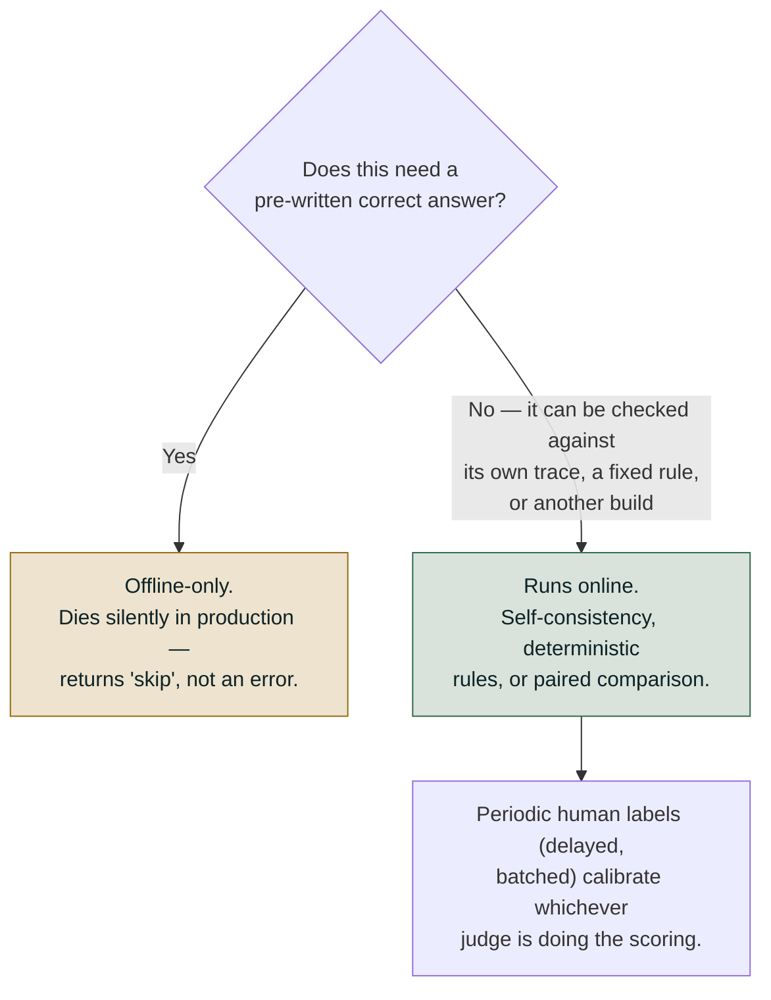
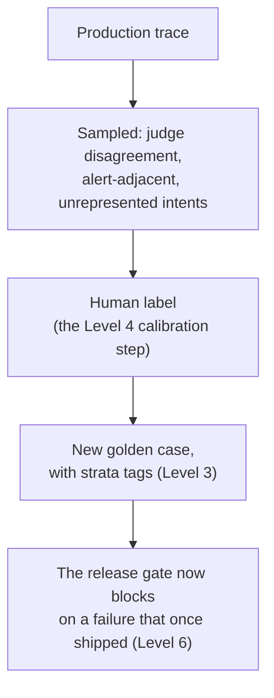

# Online Evaluation and the Loop

*Every check that needs an answer key dies at deployment, and it dies silently — reporting
"skipped" rather than failing.*

◷ 21 min · Level 7 · Assumes Levels 0–6: the five-layer taxonomy, the reference-based split,
judges and their failure modes, statistics and stratified reporting, and the release gate.

Level 6 ended with a gate: a build passes a fixed, curated set of cases, or it does not ship.
**That gate can only ever catch what someone thought to put in the dataset.** Production is
where the rest arrives.

> **Who this is for.** No library or platform knowledge is assumed. Every technical term is
> defined in plain words the first time it appears.

Picture the same support agent, now live. A question arrives that nobody wrote a golden case
for. A knowledge-base rebuild silently returns zero documents while still answering "200 OK". A
tool starts retrying itself in a loop that never shows up as an error. None of it was in the
golden set, because the golden set is a claim about what was expected.

Production differs from a golden set in three ways. Every technique here exists because of one
of them. **The traffic mix is not the suite's mix.** Real traffic is mostly easy and
repetitive; a golden set is deliberately hard. **There are no reference answers, ever.** And
**there is a long tail the dataset never represented**, which is the entire reason to do this.

> **Stop scoring correctness; start scoring consistency and shape.** "Is this right?" needs a
> reference. "Is this grounded in what it retrieved?" and "is this better than the build we
> shipped?" do not.

---

## 1. Accept That Production Has No Ground Truth

Nobody wrote the correct answer to a question a real customer asked thirty seconds ago, and
nobody ever will. That single fact splits the entire suite in two. State it as a mechanical
test rather than a vibe.

> **Does this scorer read an expectation** — an expected answer, an expected list of tool calls,
> an expected final state? **If yes, it is offline-only, however good it is.**

This bites in an easy-to-miss way. A tool-correctness scorer reads an expected tool-call flag.
Point it at live traffic and it does not error. **It returns "skipped" on every single trace,
silently, while looking perfectly healthy on a dashboard.** That is the failure mode to design
against: a scorer going dark reads exactly like a scorer reporting good news.

| | Runs online? | Why |
|---|---|---|
| Context recall, context precision | ❌ No | Needs the set of documents that *should* have been retrieved |
| Answer correctness vs. a reference | ❌ No | Needs a human-written right answer |
| Tool correctness | ❌ No | Needs an expected tool-call list |
| Faithfulness / groundedness | ✅ Yes | Compares the answer to its **own** logged context — no reference needed |
| Goal accuracy (without-reference form) | ✅ Yes | A judge infers the goal from the conversation itself |
| Topic adherence | ✅ Yes | Scope comes from policy, not from a golden answer |
| Trajectory / safety assertions | ✅ Yes, **on 100%** | Deterministic, reads the trace directly, costs nothing |
| Paired canary comparison | ✅ Yes | Compares one build to another, not to an ideal |

**Everything that needs an answer key dies at deployment**, however well it worked in CI. A
three-way split makes the same point from another angle.

| Offline-only | Runs in both | Online-only |
|---|---|---|
| Answer correctness vs. a written reference | Faithfulness / groundedness (context is its own reference) | Deflection rate, escalation rate, reformulation rate |
| Task/tool correctness vs. a known-correct action | Safety & trajectory assertions (approval, tenant isolation) | p95 latency, cost-per-success drift, queue depth |
| Anything scored against a human-authored "right answer" | Citation accuracy, contradiction disclosure | Tool status mix, cache hit rate, corpus/traffic drift |

The middle column is worth sitting with. It is not a *weaker* version of the left column. It is
a different *kind* of check. It never needed a reference in the first place. The right column
is different again: metrics that do not exist until real traffic does.

**An offline resolution rate and an online resolution rate are never comparable.** Never plot
them on the same axis. A golden set is deliberately hard and production is mostly easy, so a gap
is expected. What matters is whether that gap *changes* over time.

---

## 2. Score Consistency and Shape Instead of Correctness

If a check cannot compare against a pre-written answer, what is an online judge scoring?
Production substitutes for a golden answer in three ways, with a fourth technique validating the
setup from outside.

**Self-consistency judges the answer against its own trajectory.** The judge compares the
answer to the context *this exact run just retrieved*, which production already logs. That
needs zero external ground truth, **because the reference travels with the run itself.** For
RAG it is faithfulness, citation accuracy and contradiction disclosure. For a support agent it
is whether the reply matched what the tool returned, scored against the tool's logged output.

**Deterministic trajectory rules need no judge at all.** Safety and policy checks were never
comparisons to a reference. Did it call the write-tool without an approval step? Did it cross a
tenant boundary? Those are pass/fail assertions read off the logged trace. They run online
exactly as in the gate, at full volume, for free.

**Periodic human labels calibrate rather than score.** A small sample goes to reviewers on a
delay, in a batch, never inline. That batch does two jobs. It measures how well the judge
agrees with a human on the *same* case. And it becomes new golden cases, so the offline suite
stops describing last quarter's traffic.

**Some labels arrive on their own, later.** A delayed outcome is ground truth that production
produces for free: was the ticket reopened, did the proposed fix resolve it, did the customer
come back with the same question. And when a person reviews an output before it is used, their
**accept, edit or reject** is a label with perfect provenance, collected as a side effect of the
work. Log both from day one. They are the cheapest labels the system will ever get.

**A causal claim needs checking against reality, not against text.** When an agent reports a
root cause, self-consistency only says the claim agrees with what the run retrieved. It cannot
say the stated cause produced the failure. Re-check the claim against a real record — does the
failing row, log line or config actually show what the agent says? — before the report goes
out. Until that check exists, the control is human review before anything acts on the claim.

**Paired canary comparison is relative, not absolute.** For a rollout the question is not
whether an answer is correct. It is whether the new build wins, loses or ties against the old
one on the same live input. That needs no ground truth either, only two things to compare.

In short: production substitutes the logged context for a golden answer wherever it can. It
falls back to rule-based assertions where no judgment is needed. It reaches for human labels
only in small delayed samples. Never to score every request.

Where the tools named across this roadmap genuinely help online:

| Tool | What it is good at online |
|---|---|
| RAGAS | RAG-specific metrics; its with/without-reference split says plainly which side of Section 1's line each metric falls on |
| DeepEval | Component-level metrics, `assert_test` in CI, tracing via `@observe` |
| Langfuse | Trace storage, annotation queues and user-feedback scores — the human-label loop above |
| MLflow / LangSmith | Experiment tracking and trace comparison across builds |

**No off-the-shelf toolkit ships the two things this level depends on: the final-state check and
the release gate.** Those stay in-house, because only the team running the system knows what its database should
look like afterward, and what "good enough to ship" means for that product.

---

## 3. Sample the Judges, Never the Free Checks

Knowing *which* checks can run online leaves the question of *how much* of production each one
should see. The honest answer is two different amounts.

**Never sample the free checks.** Deterministic rules cost nothing per call. Sampling one buys
a blind spot for no saving. They run on 100% of traffic, always. Sampling applies only to
judge-based metrics, which cost real money per call. At $0.0015 per judged conversation,
scoring all 2,000 daily conversations costs roughly $3/day. Cheap for one agent; the number
that gets a sampling policy approved once there are dozens.

**A sampled rate is an estimate, and estimates have error bars.** Grade a 5% sample of 2,000
daily conversations and the pass rate can sit **±4.5 percentage points** either side of the
truth, from luck alone. Grade a different 100 tomorrow with nothing changed, and a 2–3 point
swing appears. It is pure noise.

> **The soup analogy.** One spoonful settles instantly whether the pot is far too salty. It can
> never settle whether today's pot is 2% saltier than yesterday's — especially when it is a
> different pot every day, which is exactly what a day of production traffic is.

| Sample rate | Traces/day (at 2,000/day) | Resolution (95% CI half-width) | Smallest reliably detectable drop |
|---|---|---|---|
| 5% | 100 | ± 4.5 points | ~9 points |
| 30% | 600 | ± 1.8 points | ~2 points |
| 100% | 2,000 | ± 1.0 point | ~1 point — and if even this can't resolve it, the comparison belongs offline |

**Pick the sample rate from the smallest regression worth refusing to miss, not from a round
number that felt affordable.** Decide the drop that must be caught, look up the sample size resolving
it, then price it. That is a real budget conversation, better had before an incident than during
one.

**An alert set tighter than the resolution fires on noise and gets muted within a month.** After
that the monitoring looks healthy and tells nobody anything — arguably worse than none, because
it still *looks* like monitoring. An alert threshold also has to be paired with knowing what a
delta means. A metric named after the failure it detects runs backwards.

**If a regression is too small to see even at 100% sampling, do not chase it online at all.**
Move that comparison offline, where every input in a fixed dataset gets scored and the
comparison is *paired*.

**Sample rates are not set once and left alone.** Raise a judge's rate while investigating a
complaint, then lower it back. Pause a monitor during a noisy migration without losing its
configuration. Delete one once its scorer is superseded. Monitoring configuration is a living
thing.

**One gap worth naming: cost and latency get measured here, and nothing gates on them.** Both
appear on these dashboards and neither blocks a release the way a quality or safety floor does.
In production they should. A technically correct answer taking nine seconds is a different kind
of failure, not a success with a footnote.

---

## 4. Alert on Shape, Not on Quality

Given that quality judges are sampled and slow, what should page someone? The alerts below are
deliberately **not** quality metrics. They are *shape* metrics, because shape is what can be
measured without an answer key, cheaply, across all of production.

| Alert | Fires when | Catches |
|---|---|---|
| Cost spike | Cost per conversation exceeds 3× the trailing median | A verbose-prompt regression, a retry loop |
| Citation-free rate | Share of answers citing nothing exceeds a floor | A silently empty retrieval index, a retrieval outage |
| Tool status mix | The share of `empty`/`unavailable` tool results shifts materially | A data source going quietly stale |
| Approval decision time | The median falls below a floor | Rubber-stamping — the signal Level 4 warned about |
| Loop rate | An identical tool call repeats within one conversation | Retry storms, stuck agents |

**The first alert should not be a quality metric at all.** The most valuable early signal is
structural: trace volume, error-span rate, scorer-coverage rate. Those catch the case where the
monitoring pipeline itself silently stopped. That looks exactly like a healthy system
everywhere else.

**A quality score is the least sensitive thing on a dashboard.** A prompt change making an agent
chattier and more hedging moves like this:

| Signal | Before | After |
|---|---|---|
| Quality judge | 0.90 | 0.89 — barely moves |
| Tool-call rate | 62% | 31% — halved |
| Mean response length | 140 words | 310 words — doubled |
| Refusal rate | 3% | 11% — tripled |

Three of those four moved immediately, and none is a quality score. Four categories are worth
watching, and only one is a quality number. **Quality on sampled traffic**, as a trend rather
than a gate. **Behavioural distributions**, like tool-call rate. **Operational shape per
step**, which turns "it got slower" into "retrieval latency doubled". And **failures and
refusals**.

> **A rising refusal rate is a quality regression that most quality metrics score as a pass.**
> The refusal is well-written and safe, so nothing looks wrong to a judge reading one turn.

**Adoption is a quality signal, and often the earliest one.** When people quietly stop using an
output, it is usually right but useless, or wrong often enough that checking it costs more than
doing the work. Four measures read it without a single label.

| Signal | What it reads |
|---|---|
| Acceptance rate | Share of outputs used as given |
| Edit distance | How far the final text moved from the generated text |
| Time-to-close, with vs. without the tool | Whether the tool actually saves work |
| Quietly ignored outputs | Produced, never opened or acted on |

**A falling acceptance rate under flat quality scores means the quality scores measure the wrong
thing** — correctness, when users needed specificity. Instrument adoption from launch.
Retrofitted, there is no "before" to compare against.

**Watch the inputs, not just the outputs.** A router forced to choose among known routes picks
one, confidently, even for a request it has never seen. A rising rate of low-confidence routing
decisions is a drift warning that needs no labels. Give the router an explicit **no route /
escalate to a human** outcome and score it as a *correct* answer in its own right, so honest
uncertainty is not counted as a failure.

And the one people miss entirely. **A monitor that was configured but never switched on looks
exactly like a monitor reporting no problems.** Registering a scorer creates it. Starting it is
what begins evaluating. Verifying the pipeline is genuinely running belongs on the launch
checklist, not in the assumptions.

---

## 5. Drill the Alerts to Learn What They Miss

**An alert nobody has seen fire is an alert nobody knows is wired up.** Break production on
purpose and watch which lights come on — and which stay dark.

**Drill 1, a silently empty retrieval index.** A rebuild returns zero documents for every
query. The service still answers with a fluent 200 OK, so an error-rate dashboard sees nothing.
Citation-free rate fires almost immediately — it is a counting rule over data already logged.
Resolution rate barely moves. Billing and account questions still "succeed" with no
documentation behind them.

> *"An index rebuild that returns zero rows still returns HTTP success, so error-rate monitoring
> stays green while quality collapses."*

**Drill 2, a retry loop.** A tool starts calling itself repeatedly inside one conversation. Cost
and loop-rate fire. Citation-free stays quiet. Resolution rate is unchanged — customers are
helped correctly, repeatedly, at several times the price, and no quality dashboard shows it.

At larger scale: an upstream service returned HTTP 200 with an empty body during an outage, the
model retried with reworded arguments, and 70% of conversations hit the step ceiling for eleven
hours.

> **Latency and error rate both stayed green.** What caught the cause was the tool status mix
> shifting toward `empty`/`unavailable`.

Running every fault against every alert produces a coverage matrix. **The gaps are the point,
not an embarrassment to hide.**

| Incident | Cost spike | Citation-free | Tool status mix | Approval time | Loop rate |
|---|---|---|---|---|---|
| Healthy day | — | — | — | — | — |
| Empty index | — | 🚨 | — | — | — |
| Retry loop | 🚨 | — | — | — | 🚨 |
| Verbose prompt | 🚨 | — | — | — | — |
| Tool source stale | — | — | 🚨 | — | — |

An alert that never fires in any drill is not necessarily useless. The approval-time alert
catches rubber-stamping, which none of these drills simulate. But **an alert whose last
confirmed firing was during its own code review is decoration, not monitoring.** Run a drill for
every alert, on a schedule.

---

## 6. Ask Whether the New Build Beats the Old One

Without a reference, "is this build good?" cannot be asked. A strictly easier question happens
to be the actual decision anyway: **is it better than the one already running?**

The mechanism is a paired comparison. Route a slice of traffic to the new build and the same
slice's inputs to the old one, then count outcomes across four buckets — both succeeded, only
the old one succeeded, only the new one succeeded, both failed. **The two "only one succeeded"
counts are exactly the paired cells McNemar's test was built for.** That is not a coincidence.
It is the same statistical question, asked about two live builds instead of two offline runs.

Three outcomes, not two. **Promote** when the result is significant and the new build wins more
often than it loses. **Roll back** when it is significant and the new build loses more often.
**Keep watching** when it is not yet distinguishable from noise.

**"Keep watching" is a real answer, not a failure to decide.** With a small canary slice most
genuine differences are not resolvable yet, and the honest move is to let it keep running rather
than promote on a coin flip. Name the regression that cannot be missed, and do not call the race before the sample can call
it.

---

## 7. Turn Every Finding Into a Permanent Test

Every technique above produces a signal. **The signal only compounds if it turns into a
permanently harder test suite.** Otherwise a finding helps exactly once, and the next incident
starts from zero.

**What gets selected for labelling is deliberately not a random sample of healthy traffic.** That
would be cheap to label and teach nothing the golden set does not already know. Selection targets
where the suite is weakest: conversations from intents the golden set has zero examples of,
answers with no citation (the shape that tends to precede a hallucination), and conversations
where a tool returned something other than `ok`.

**A drift check keeps the gate honest about what it protects.** A golden set is a claim about
what traffic looks like, and traffic moves. Compare the golden set's stratum mix, say by
language, against production's actual mix using **total variation distance**: half the sum of
the absolute differences between each stratum's share in the two. The course notebook flags
anything above 0.15. When they have drifted apart, the
per-stratum floors are tuned for a traffic mix that no longer exists. Either rebalance the suite,
or accept that a shrinking segment is being over-protected at the expense of a growing one.

**Watch the judge for drift too.** The delayed human labels from Section 2 give a running
agreement score, kappa, between the judge and the reviewers. Kappa can collapse while raw
agreement barely moves, so track kappa itself and alert when it falls below a floor. Decide in
advance what that alert does on the days no labels have arrived yet. A drifted judge goes back
through alignment before its scores are trusted again.

**Every incident ends by adding a golden case.** An incident that does not change the suite will
happen again, and the second time nobody will remember the first. **Online discovers; offline
prevents recurrence.**

---

## 8. Trace Live, and Judge the Tool's Own Output

Everything up to here builds and scores test cases by hand. That is the right way to *learn*
what each check does. It is not how evaluation runs against a live system, where every model
call, tool call and agent step has to be captured automatically as a span.

**Real tracing changes what "the trace" even is.** Instrument every model call automatically,
then wrap explicit spans around the router loop and each tool call. That is the production
version of a hand-rolled trace list. Same idea, captured by infrastructure instead of an append
call. Router and tool-selection checks run unchanged against it, queried off real spans.

**Traces land as genuinely queryable data, which has no offline equivalent.** Each span becomes
one row in a table, joinable and queryable. That turns a vague complaint into a specific
diagnosis: **"it got slower" becomes "retrieval p95 doubled"**, because latency can be queried
per span type rather than guessed at.

Two ideas belong here because nothing earlier covers them.

**Skill evaluation judges a tool's own output quality, in isolation.** Is the SQL a tool
generated actually correct? Does generated chart code run? **A well-chosen tool that does its
job badly is invisible to every check so far**: tool selection passes because the right tool was
picked, argument correctness passes because the arguments were valid, and the output is quietly
wrong. Where possible this is code-based — does the generated code execute? — rather than judged.

**Version comparison re-runs the same experiment against a changed system.** Every check so far
judges one run in isolation. This one re-runs an identical dataset, task and evaluator against
a system with one deliberate change, then compares the two runs. It answers *"did my prompt
change actually help, or did it just feel better?"* — the paired-canary question, asked offline
before anything ships.

The dataset/task/evaluator shape is what makes this generalise. Instead of a one-off script over
a single hand-built trace, the same three objects work for any agent and any metric. That is the
difference between a one-time analysis and a reusable experiment.

---

## 9. Rehearse the Online Questions

**"What can you measure in production that you can't measure offline, and vice versa?"**

The difference is not the environment. It is ground truth. Anything reference-free transfers
unchanged. Anything needing a written answer key is offline-only, and fails *quietly* online.
Offline is total coverage of a narrow fixed world with a hard bar. Online is partial coverage
of the real world with only a trend. **The loop between them is not optional.** A production
discovery becomes a permanent offline test, or it helps once.

**"You can't afford to judge every production request. How do you sample?"**

Two decisions. The first is where people go wrong, by treating everything as one pool. Never
sample the free deterministic checks. Then derive the judge sample rate from the smallest
regression that must be detected, not from a round affordable-sounding number. **A rate picked for affordability might be unable to detect
anything anyone would act on**, which is the worst outcome, because it still looks like
monitoring.

**"What does production monitoring look like beyond a quality score?"**

Four things, and only one is a quality number. Quality on sampled traffic, as a trend.
Behavioural distributions like tool-call rate, which drift long before quality does. Per-step
operational shape, which turns "it got slower" into a diagnosis. And failures and refusals,
since a rising refusal rate is a regression most judges pass. The detail people miss entirely
is the monitor configured but never started.

**"Set up production monitoring for a 2,000-conversation-a-day agent."**

The mechanical eligibility test first. Sample the judges and never the deterministic checks.
Derive the rate from the smallest detectable drop — roughly 30% to resolve 2 points at this
volume. Land traces as queryable tables, so "it got worse" becomes "retrieval p95 doubled for
tenant 14 starting Tuesday". And carry every finding into a gated offline test.

> *"An alert threshold finer than your sampling resolution is a noise generator."*

Verify each scorer has a live sampling config, not just a registration.

---

## Key Takeaways

- Any scorer reading an expectation is offline-only, and online it returns "skipped" rather than
  failing — silence that reads as health.
- Production substitutes the run's own logged context for a golden answer, falls back to
  deterministic rules, and uses delayed human labels only to keep the judge honest.
- Never sample the free checks; derive the judge's sample rate from the smallest regression
worth refusing to miss.
- Alert on shape rather than quality, because a quality score is the least sensitive number on
  the dashboard.
- An alert nobody has watched fire is an alert nobody knows is wired up, and the coverage gaps
  are the point of a drill.
- Without a reference the answerable question is whether the new build beats the old one, and
  "keep watching" is a real verdict.
- A finding only compounds if it becomes a golden case; online discovers, offline prevents
  recurrence.
- A well-chosen tool doing its job badly passes every selection and argument check, so the
  tool's own output needs judging too.

## Check Yourself

1. Your tool-correctness scorer shows no failures in production for a month. Is the agent
   healthy? **Unknown. It reads an expected tool-call list, so it returns "skipped" on every
   trace. It went dark, and that looks identical to good news.**
2. Offline resolution is 0.72 and online resolution is 0.91. Which is wrong? **Neither. A golden
   set is deliberately hard and production is mostly easy. Only a change in the gap matters.**
3. Why can faithfulness run online when answer correctness cannot? **Its reference travels with
   the run — the answer is compared to the context that run retrieved, not to a written answer.**
4. A teammate proposes sampling the deterministic safety assertions at 10% to save money. What is
   wrong? **They cost nothing per call. Sampling buys a blind spot for no saving.**
5. You grade 5% of traffic and alert at a 2-point drop. What happens? **It fires on ordinary
   days, gets muted within a month, and leaves monitoring that still looks like monitoring.**
6. An index rebuild returns zero documents and the service answers 200 OK. Which alert fires, and
   which stays quiet? **Citation-free rate fires. Resolution rate barely moves, because questions
   still "succeed" with nothing behind them.**
7. A canary shows the new build ahead but not significantly. What do you do? **Keep watching.
   That is a verdict, not indecision — promoting on a coin flip is the failure.**
8. Tool selection and argument correctness both pass, and the generated SQL is wrong. What was
   never checked? **The tool's own output. Skill evaluation is the missing check, and it is often
   code-based rather than judged.**

---

## References

All content above was drawn only from material already in this repository. Nothing here was
invented, and no external source was consulted. This page is the restyled edition of
`org/07-online-evaluation-and-the-loop.md`; its content is the same, including that edition's
table of where each named tool helps online (Section 2) and its drift check by total variation
distance (Section 7).

**Notebook:**

- `courses/03-agentic-eval-harness/12_online_evaluation_and_the_loop.ipynb` — the eligibility
  test, the five alerts, the incident drills and coverage matrix, the paired canary, the loop back
  into the golden set, the 0.15 drift threshold, and the judge-drift (kappa) alert exercise.
- `courses/02-databricks-mlflow-evals/` online-monitoring notebooks — sampling policy, the
  registered-but-never-started trap, and traces as queryable tables.
- `labs/agent-evaluation/arize-phoenix-labs/` — live tracing, skill evaluation, and the
  dataset/task/evaluator experiment shape used in Section 8.

**Docs:**

- [`databricks-mlflow-evals.md`, Part 5](../concepts/databricks-mlflow-evals.md#part-5--online-vs-offline)
  and [Explainer 05, Section 6](05-statistics-and-stratified-reporting.md#6-buy-the-sample-rate-that-can-see-the-regression)
  — the offline/online split, the sampling-resolution table, and the soup analogy (merged there
  from the retired online-versus-offline page).
- `docs/concepts/rag-vs-support-eval-walkthrough.html` — the self-consistency framing for RAG
  against support agents.
- `docs/interview-prep/QUESTION_BANK.md`, Part 5 (Q18–Q20) and Case 15 — the four questions
  reproduced in full in Section 9 rather than pointed at.
- `docs/study-guide/evaluation-roadmap.md` — Level 7's topic list and goal statement.
- `docs/study-guide/evaluation-topic-notebook-mapping.md` — Level 7's resource table.

**Limitations.** This file was written by reading the repository's own material, not by running
any notebook or calling any API — no cost was incurred producing it, consistent with this
project's rule against executing anything that spends money without being asked. It does not
independently verify any vendor's documentation.
