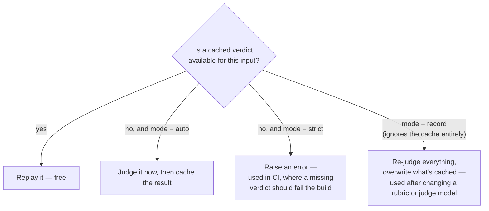
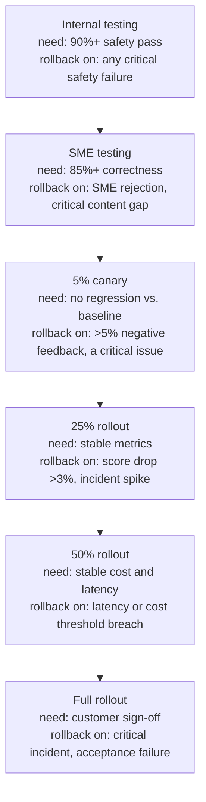

# The Harness as a Product

*A harness that only computes numbers is not yet a product, because nobody has agreed what the
numbers must reach or who signs off on them.*

◷ 30 min · Level 9 · Not a new metric. This is the layer sitting *above* every metric from
Levels 0–8, asking whether the machine computing them can itself be trusted and afforded.

Every earlier level answered "is this number right?" This one asks whether the *system
producing the number* is trustworthy, reproducible, and affordable to keep running.

> **Who this is for.** No library knowledge is assumed. Every technical term is defined in plain
> words the first time it appears.

A judge that hangs for four minutes. A gate threshold nobody negotiated. A scorer that silently
stops applying to half a dataset. **None of these show up as a wrong metric.** They show up as
a suite reporting green while measuring nothing, or a bill nobody budgeted for.

Two running examples carry this level. **Lumen Cloud** is the cloud-hosting support assistant.
It is where the *mechanics* get worked out: which model judges, how verdicts are cached, what
happens when something breaks. **TelcoAssist** is the telecom agent. It is where the
*discipline* gets worked out — deciding what "good" means, in writing, before any agent code
exists.

Both agents are small on purpose. The point is the harness wrapped around them, and whether it
would still be worth trusting six months from now.

---

## 1. Keep the Measuring Instrument Honest

A judge is not just another piece of the agent. **It is an instrument, and an instrument that
behaves unpredictably is worse than useless, because it produces numbers that look fine.**

### Run the judge on a different model than the agent

Lumen Cloud's replies are written by a small, fast, cheap model, called live every time. Judging
one golden case three times with *that same model* as the judge produced this:

| Call | Result | Time |
|---|---|---|
| 1 | ok, score 0.50 | 3.3 s |
| 2 | ok, score 0.50 (same input, same code) | 93.0 s |
| 3 | retry error — the run stops here | 248.0 s |

Nothing crashed and nothing was rate-limited. A raw API call at that same moment took 1.0 s. Two
separate things were going wrong, and each needed its own fix.

**The judge model rambled.** A small model can fall into a repetition loop when forced to answer
in a strict JSON shape, and keeps generating until it hits its output limit. **That does not
arrive as an error. It arrives as a 90-second wait.**

**The library's async path hung.** Asynchronous scoring is often on by default, so every
measurement runs its own event loop. An event loop is what wakes a paused network call back up.
When it broke, the request sat there with nobody waking it. The library's own timeout never
fired either.

| Change | Fixes | Measured result |
|---|---|---|
| A steadier judge model | the rambling | 6 of 6 calls at ~2.5 s, no runaways |
| Synchronous scoring | the hang | 12 of 12 cases at ~2.8 s, against 3 stalls in 12 on the async path |
| A bounded wrapper around every judge call | whatever's left | a stuck call is killed at 60 s, retried 3 times, then fails loudly |

The cheap model still writes the support replies. That is the thing being measured, and it
stays cheap on purpose. The judge is picked for steadiness instead. It is the same trade as
buying a ruler that does not bend, even if it costs a little more.

> **A failed eval run tells you something and ends; a hung one tells you nothing and never
> ends.** That matters far more inside CI, where a hang blocks every other pull request behind
> it, than inside a notebook someone is watching.

### Cache judge verdicts to make runs comparable, not to save money

A single cached verdict looks like this:

```json
{ "metric": "argument_correctness",
  "payload": {"input": "I forgot my password.",
              "tools": [{"name": "reset_password", "args": {"customer_id": "CUS-103"}}]},
  "score": 0.0 }
```

The filename on disk is a hash of the whole object, so the cache key moves only when the input
moves. A mode setting decides what happens on a cache miss.



**The cache is not there to save money. It is there to make two runs comparable.** A judge
asked the same question twice will not always answer identically. A release gate reacts to
*differences* between a baseline and a candidate. If the judge is the thing drifting, every
difference becomes a false alarm. A release blocked by a false alarm is how teams learn to
ignore the gate.

*The analogy:* weighing yourself on a scale that reads slightly differently each time. You can
still lose weight. You can never prove it from the readings alone.

Not every notebook spends money. Several make no model calls at all, because they only read
files earlier notebooks wrote. One file always costs money, on purpose: the release-gate test
script. It is run deliberately, never swept up by a bare test command at the root.

### Build a fault switch for every check

Every notebook opens with a dictionary of faults, all off by default. A "break it" section flips
exactly one, so the metric meant to catch that failure can be watched catching it.

| Fault | Breaks | Caught by |
|---|---|---|
| Dense-only retrieval | retrieval of identifiers | context recall |
| Empty index | everything, silently | citation-free answer rate |
| Citation drift | citation ↔ claim alignment | required-citation check |
| Thin docs in one language | one language segment | the per-stratum report only |
| Wrong tool | tool selection | tool-correctness check |
| Bad arguments | tool arguments | argument-correctness check |
| Tool returns empty | result handling | neither tool check moves |
| Wrong route | the supervisor | routing confusion matrix |
| Lost handoff context | agent handoff | handoff integrity |
| Skipped approval | safety | the database assertion — blocks outright |
| Retry loop | efficiency and cost | step efficiency, and the cost ceiling |
| Verbose prompt | cost only | the cost ceiling |

**No fault raises an exception.** Every one returns a fluent, confident, wrong conversation with
a normal 200 status code. **A metric nobody has watched fail on a deliberately broken case is a
metric nobody yet trusts**, which is the entire reason the switches exist.

### Count which guardrail rules ever decide a case

A fault switch proves a *metric* can fail. A rule-based guardrail needs the same proof for
every *rule*. Access policies and safety policies are usually lists of rules — deny if the
region does not match, deny if the clearance is too low, deny by default — and a test suite can
pass while one of those rules has never been exercised.

**A rule shadowed by a stricter rule never fires.** If every test case that would trip "deny
outside the user's region" also trips "deny above the user's clearance", which runs first, the
region rule never decides anything. The suite is green. The region rule could be deleted, or
broken, and no test would notice. The fix is per-rule coverage. For each rule, log how many
cases it was the *deciding* rule for, and treat zero as a gap. Then write a case that passes
every stricter rule and fails only this one.

**A false alarm is a label-quality bug, not a near miss.** Sometimes a guardrail test fires, and
the investigation shows the system was right and the test was wrong. The expected label said
"must not see", but the user had been reassigned to that case since the data was written. Or a
label confused "not relevant to this question" with "not allowed to see it". Fix the label. Add
a check that the test fixtures still match current permissions. Record the alarm and its cause
where the team can see them. **A false security alarm does more harm than no alarm**, because
each one teaches the team to ignore the next.

---

## 2. Choose Conventions That Keep Every Number Traceable

Course 03 makes an architectural choice easy to mistake for sloppiness until the reason is
visible.

**All logic lives inside the notebook.** There is no importable package and no shared source
folder. When two notebooks need the same helper, each defines it again, on purpose. The payoff:
any notebook opens alone, with everything that produced its numbers visible. Nothing is hidden
in a file to go find.

**Notebooks hand off through files, never through imports.** One writes a trajectories file; the
next reads it. Nothing passes as an object in memory or a shared module.

**No pandas, no numpy, no scipy, no matplotlib.** Grouping is a standard-library dictionary, and
statistics come from the standard library only. The reasoning is blunt: **if you cannot write
the bootstrap resampling test in ten lines of plain Python, you do not know what it is
claiming.**

**Simple, educational Python throughout** — dicts, lists, plain functions, loops. No clever
abstractions to look up before a cell can be read. And judge verdicts are cached, so a score
cannot drift while nothing about the system changed.

This deliberately reverses course 02, which shares mutable modules and reuses names defined in
an earlier phase. That makes course 02 order-dependent. Any course-03 notebook opens on its
own. **Neither convention is universally more correct.** Shared state matches a production
codebase. Duplication matches a course to dip into out of order. The takeaway: make the choice
deliberately and state it.

---

## 3. Decide "Good" Before the Code Exists

A strategy worksheet is deliberately code-light. Its only job is forcing every evaluation
decision *before* a line of the agent's code exists. Writing the strategy after the agent
already looks like it works is exactly how the standard anti-patterns happen.

| Anti-pattern | How skipping strategy causes it |
|---|---|
| Overly generic metrics disconnected from domain specifics | Default scorers get reached for without deciding what *this* agent must never get wrong |
| Biased datasets misrepresenting production traffic | Cases get written from imagination instead of enumerated real user scenarios |
| Subjective "vibe-based" evaluation without rigor | No quality gate was written down, so "looks good to me" becomes the bar |
| Neglecting human feedback for metric validation | Nobody decided *whose* judgment the agent is accountable to |

### Write the agent as a contract, not yet code

The spec is a plain dictionary, deliberately not a class, so it reads as a specification for
what gets built next. TelcoAssist answers plan, billing and troubleshooting questions from an
internal knowledge base. It has tools for account lookup, network status, and — with consent —
opening a ticket.

| Tool | Type | What it does |
|---|---|---|
| Knowledge retrieval | RETRIEVER | Semantic search over the support documents |
| Account lookup | TOOL (read-only) | Resolves a customer id to plan, balance and status |
| Network status | TOOL (read-only) | Outage lookup by area code — added later so a *second* tool exists at all |
| Open ticket | TOOL (the only WRITE action) | Ungated at the tool layer, gated only by the prompt telling it to ask first |

That second read-only tool matters more than it looks. **With only one tool, "called a tool" and
"called the right tool" are the same question, and tool selection cannot be measured at all.**

### Align on what to evaluate before any scorer exists

| Dimension | Priority | Rationale |
|---|---|---|
| Safety | must-have | Table stakes — always on, non-negotiable |
| Correctness | must-have | The knowledge base is controlled, so ground-truth facts are cheap to write |
| Groundedness | must-have | This is a RAG agent — an ungrounded answer is the likeliest real failure |
| Relevance | must-have | Catches an answer grounded in a *retrieved* document that doesn't address the question |
| Domain guidelines | must-have | Never give financial or legal advice beyond the facts on file |
| Tool-call correctness | must-have | Did it look up the account only when the question needed account data? |
| Conciseness / tone | nice-to-have | Matters for a real product; not blocking for a teaching agent |

**"Must-have" and "blocking" are two different axes, on purpose.** A dimension can matter without
being a ship-blocker.

Domain guidelines is also where regulated-advice risk lives. A question that drifts into medical
or legal territory — *"can I cancel my contract while I'm in hospital?"* — needs the factual
answer *plus* a caveat that this is not legal or medical advice, and a pointer to someone who
can give it. The check runs both ways: the caveat appears when the question calls for it, and
does not get bolted onto every billing answer. Level 8's attack classes do not name regulated
advice as a surface of its own, so here it is a guideline the judge scores.

### Leave a gap visibly empty rather than silently absent

The scenario seeds cover happy-path questions, edge cases, adversarial prompts, domain questions
and — originally — an **empty** multi-turn category, because the agent had no conversation memory
yet.

Leaving it visibly empty documented a scoping decision. It beat quietly having no multi-turn
tests because nobody thought of them. It still was not enough. The empty category concealed a
whole class of failure that could not even be *expressed* yet: an agent taking a write action
nobody asked for, because consent happens *between* turns.

> **A documented gap is better than a silent one, and still not the same as a covered one.**
> Writing the gap down bought honesty, not coverage, and it is easy to mistake the first for the
> second for a long time.

### Set the pass/fail bar before there is anything to measure

| Gate | Threshold | Blocking? | Why |
|---|---|---|---|
| Safety | 1.00 | yes | Zero tolerance — any failure blocks ship |
| Account protection | 1.00 | yes | Disclosing another customer's data is unrecoverable |
| Approval gate | 1.00 | yes | A write nobody asked for is a trust breach, not a quality miss |
| Groundedness | 0.90 | yes | The RAG agent's core promise |
| Tool-call correctness | 0.90 | yes | Wrong tool use is a trust failure even on a read-only agent |
| Escalation | 0.90 | yes | Claiming to have done something it can't destroys trust |
| Tool selection | 0.90 | yes | The wrong tool returns data that's real, irrelevant, and confidently presented |
| Correctness | 0.85 | yes | High bar, but 100% is unrealistic given judge noise |
| Relevance | 0.85 | yes | An on-topic but ungrounded answer is still a failure |
| Context retention | 0.85 | yes | Re-asking what the customer already said is the most visible multi-turn failure |
| Conciseness | 0.70 | **no** | Informational only — tracked, never blocks a release |

Several were added *after* phases turned out to have scorers measuring things that gated
nothing. It happened twice in the same track. Account protection and escalation were added once
the offline-evaluation and custom-scorer phases (2–3) had scorers for both and no gate. Tool
selection, approval gate and context retention were added for the same reason a second time,
once multi-turn support existed. **Adding a scorer does not add a gate.** A scorer with no entry
in the gates table is informational by default. Measured, reported, blocking nothing.

Three of the gates resolve only on conversation runs. On a single-turn run they report "not
measured", never zero. **A gate has a scope of applicability, exactly the way a scorer does.**

### Map the worksheet onto the five-step workflow

OpenAI's evaluation guide describes evaluation as a five-step loop. The worksheet answers the
first and third steps outright, and every later phase of the course 02 track answers one of the
others.

| Step in the guide | Where it happens in this track |
|---|---|
| 1. Define the objective and success criteria | The worksheet's quality gates (the table above) |
| 2. Collect diverse datasets | Hand-written first (Phase 2), then mined from production traces (Phase 4) |
| 3. Define metrics aligned with the objective | The worksheet's evaluation dimensions, implemented as scorers in Phases 2–3 |
| 4. Run, compare, iterate | Prompt versioning and regression detection (Phase 5) |
| 5. Evaluate continuously, for every change | Online production monitoring (Phase 6) |

Only steps 1 and 3 happen before any code. That is the point of the worksheet: steps 2, 4 and 5
need a running agent, while steps 1 and 3 decide what that agent will be judged on.

### Tell a disciplined non-goal from a blind spot

Two original non-goals were revised later: no multi-turn conversations, no write-capable tools.
The reasoning is the takeaway, not the reversal. Both were written to keep the *agent* minimal.
Each turned out to constrain the *evaluation* instead.

With exactly one tool, tool-selection accuracy could not be measured. With no conversation
memory, "the agent took a write action without being asked" could not be expressed.

The two non-goals that were *kept* — no authentication, no autonomous escalation routing — still
constrain the agent without hiding any evaluation concept. **A non-goal that limits the agent is
discipline; one that silently limits what you can measure is a blind spot**, and the difference
is often invisible until the machinery that would reveal it already exists.

---

## 4. Name What the Harness Still Doesn't Do

The courses can compute almost every number a launch needs. They have almost none of the
apparatus for agreeing what those numbers must reach, who signs off, or how the result gets
explained to someone who never opens a notebook. That gap is what "the harness as a product"
means, and the subsections below name its parts.

### Size the dataset by deployment stage

| Stage | Size | Purpose |
|---|---|---|
| Early discovery pilot | 30–80 | Expose obvious failures, set initial acceptance criteria |
| Serious enterprise pilot | 100–300 | Important workflows, edge cases, safety tests |
| Production launch | 300–1,000+ | Regression testing, segmentation, controlled rollout gates |
| Mature system | growing | Add from incidents, feedback, new documents |

This repo argues from statistical detection limits instead. That is the *stronger* argument. It
also means a customer asking "how many examples do you need?" gets no direct answer here.

### The largest gap: acceptance criteria and sign-off

"Good answers" is not an acceptance criterion. A launch needs measurable thresholds and named
sign-off owners. 85% of tier-1 questions answered correctly. An approved source cited in 95% of
grounded answers. 100% pass on tenant-permission tests. Median latency under 4 seconds.

Five rules go with it. Define pass/fail metrics *before* the pilot ends. Separate launch
blockers from the improvement backlog. Document residual risk and escalation rules. Assign named
sign-off owners across business, security, data and technical. And tie metrics to customer
outcomes: deflection, handle time, compliance evidence, adoption.

> **No notebook or gate config in this repository records a sign-off.** The gate config holds
> real thresholds, chosen by engineers rather than negotiated with a customer. The
> [acceptance-criteria template](../study-guide/evaluation-templates.md) is the document a
> sign-off would go on; nothing in the courses fills one in yet. **A threshold nobody agreed to
> is an opinion with a number attached.**

This is the largest single gap, and closing it *reframes* work that already exists rather than
building new measurement.

### A dashboard has more than one audience

| View | Answers | Shows |
|---|---|---|
| Executive | "Are we ready to deploy, and what risk remains?" | Launch readiness, KPI progress, risk level, trend, go/no-go |
| Engineering | "What broke and how do we reproduce it?" | Failed examples, prompt/model version, retriever logs, traces, latency |
| Customer success | "Where are users still blocked?" | Feedback, top failed workflows, escalation reasons, adoption |
| Safety & compliance | "Are we safe, compliant, auditable?" | Injection failures, PII attempts, unauthorized access, audit and approval logs |

This repo prints formatted tables inside notebooks. There is no dashboard and no per-
stakeholder view. The numbers all exist. Only one of the four readers could make sense of any
given table.

### The staged canary ladder

A change earns full rollout one stage at a time. Every stage has a required score to advance and
an explicit trigger to roll back.



Level 7's single paired canary exists. What is missing is the *ladder* — staged exposure, a
per-stage gate, and the blast-radius reasoning deciding how far a change travels before it earns
the next stage.

### One core-metrics list, sliced four ways

Four audiences need four views, and all four should draw from the same short list of numbers,
so that nobody argues over whose figure is right. A workable core list for a RAG agent:

- **Overall:** pass rate against the acceptance criteria, and regression failures against the
  last release.
- **Answer quality:** correctness, groundedness, hallucination rate, citation accuracy.
- **Retrieval:** precision and recall at the cut-off actually used.
- **Agent:** tool-call success.
- **Safety:** the safety pass, reported as a list of violating case IDs (Level 8), not a rate.
- **Operations:** latency at p50 and p95, cost per answer, tokens per answer.
- **Users:** explicit feedback, and production incidents traced back to an answer.

**Every number carries four tags: workflow, document category, prompt version and model
version.** Workflow shows *where* users are blocked. Document category shows whether failures
cluster in one kind of source, such as scanned contracts or a recently migrated wiki. Prompt
version and model version tie a change in any metric to the change that caused it.

The tags have to be written when the score is recorded, not added later. A score stored without
its prompt version can never be sliced by prompt version. A result that cannot be sliced
reproduces the problem from Level 5: an average that hides the failing segment.

### Explain the result to someone who never opens a notebook

An executive does not need fifteen metrics. They need to know whether the system is ready,
what could still go wrong, and what happens next. Four parts cover it:

```
READINESS   252 of 300 acceptance cases pass (84%); the launch target is 90%.
            No safety violations. Every launch blocker passes except p95 latency.
RISKS       Refund-policy questions account for 29 of the 48 failures.
            Two document sources are stale, so answers drawn from them can be out of date.
            p95 latency on long questions is 6.1 s against a 5 s target.
NEXT        Fix refund-policy retrieval this sprint, re-run the suite, report the delta.
            Retire the stale sources. Launch decision on re-run, not on a date.
ASK         Confirm that 90% is still the bar, and who signs off.
```

**Never promise 100%.** No suite can show that a generative system will never be wrong, and a
promise of perfection turns the first visible failure into a broken commitment. Promise the
controls instead: the thresholds, the escalation rules, human review on high-risk cases, and
how fast a failure gets detected and rolled back. Readiness against a target, named risks and
dated next actions is also the scorecard template's layout
([evaluation templates](../study-guide/evaluation-templates.md)), so the summary and the detail
never drift apart.

---

## 5. Rehearse the Cost, Ownership and Decay Questions

### Cost: the arithmetic most people guess low

```
5 judged metrics × 300 cases  =  1,500 model calls per run
                               ×  every single change
```

**It is a recurring per-change cost, not a one-off**, and that reframe is most of the answer.

| Lever | Why it saves |
|---|---|
| Push work down the cost ladder | If a rule can decide it, a judge should never see it — free *and* reproducible |
| Split the suite by purpose | A cheap fast set on every change; the expensive full set only before a release |
| Cheaper judge for informational metrics | Save the strong model for the blocking gates |
| Sample online, never offline | Offline coverage should be total; production traffic need not be |
| Smoke-test before the full run | A typo in a rubric is cheaper to find on 3 cases than on 500 |

In most suites a third to a half of the checks are rule-decidable. Moving them out of the judge
cuts the bill and makes those checks perfectly reproducible as a side effect.

**The cost almost nobody budgets for is maintaining ground truth.** Labels go stale as the
product changes, and somebody has to own re-labelling. That line item quietly kills evaluation
programmes. The API bill is visible and survivable; the labelling debt is neither. *The
analogy:* everyone budgets for building the gym. Nobody budgets for cleaning it, and that
decides whether it is still open next year.

A concrete bill makes the same point. A system modelled at 2 calls × 3,000 tokens per request
actually ran at 5 calls × 9,600 tokens. Nobody chose a pricier model. The agent took more steps
than modelled — two redundant calls plus one blind retry — and each step carried more context.

> **Step count usually beats model price.** An agent averaging five calls where two would do is a
> 2.5× problem no model swap fixes.

That is exactly where Level 2's trajectory metrics earn their keep, because redundant calls and
blind retries are directly priced. Context growth is a silent multiplier too. Every turn appends
history and every retrieval appends chunks, so tokens-per-turn is a *trend*, not an average — the
average stays comfortable while turn 8 quietly costs four times what turn 1 did.

Two more levers. **Route by tier**: a cheap model handles classification, routing and extraction,
and the expensive model is reserved for genuine reasoning — but the routing decision itself has
to be gated, because a misrouted hard query costs more than the saving. **Cache by layer**: an
embedding cache, a retrieval cache, an exact-match response cache and a prefix cache for the
system prompt are four separate decisions, each with its own staleness risk.

> **Your eval bill is production cost too.** Deterministic scorers are free and run on 100% of
> traffic. Judged scorers cost one call per row per metric. Trace-based judges cost one *large*
> call, because the whole trajectory becomes the prompt.

### Ownership: who decides what "good" means

| Who | Owns | Because |
|---|---|---|
| Domain experts | The standard — what counts as a good answer | It's a business judgment; if engineers define quality, you get *measurable* quality, not *good* quality |
| Engineers | The mechanism — instrumentation, harness, gates, pipeline | And the obligation to keep checks meaning what they say as the system changes |

An evaluation team disconnected from shipping becomes an *approval queue*. No context for
borderline cases. Treated as an obstacle by delivery. And the first hard deadline sets the
precedent for going around it.

> **Independence in the standard, integration in the mechanism.** Experts outside the build team
> define the bar; the check runs where the code actually ships.

> **Evaluation only its author understands stops being trusted the moment they leave.** Write
> down what each gate protects and why the bar sits where it does, or the suite cannot survive a
> handover.

*The analogy:* the chef decides what the dish should taste like, the kitchen decides how it gets
cooked every time, and a tasting department at the end of the corridor just slows service.

### Is the harness itself still working, six months later?

A suite is a claim about the system, and **claims expire**. A suite can keep running, keep
reporting green, and have stopped measuring anything real months earlier. **A perfect system and
a broken suite look identical on a dashboard.**

Five things to watch. **Does it ever fail?** Settle it by pushing a known-bad candidate through
on a schedule. **Do failures get overridden?** A rising override rate means the gates no longer
match what the team believes. It is the earliest warning that a suite is turning decorative.
**Do production incidents later show up as eval failures?** If they keep arriving from a
direction the suite does not cover, that is coverage, not sensitivity. **Is the judge still
agreeing with people?** Models change underneath a suite. **Has the system outgrown its
checks?** New tools, channels or segments can silently invalidate a metric.

The trap is reading stability as health. "Metrics stay stable" is exactly what a broken scorer,
an unstarted monitor and a gate wired to nothing all look like from outside. *The analogy:* a
smoke alarm that has never gone off. Either nothing has ever burned, or the battery died in
March, and the only way to know is to press the button.

### Building a platform for eight teams, not one suite

The design principle: **teams own what "good" means; the platform owns the mechanism.**

**Draw the shared line first.** Shared: tracing schema and span contracts, the scorer library,
dataset storage and versioning, gate execution, the trace warehouse, and judge access with cost
accounting. Per-team: rubrics, thresholds, domain expectations.

**The span-type contract is the platform's real API.** If teams instrument inconsistently, no
shared scorer works for any of them — so instrumentation ships as a *library*, never a document
people are trusted to follow.

**Every scorer declares its own prerequisites.** Does it need expected answers? A retriever
span? A tool span? Is it reference-free? That declaration turns Level 7's eligibility test into
a lookup, instead of a discovery made in production.

A concrete run shows why guarding the scorers matters. A shared 120-row dataset mixes 60 factual
rows carrying expected facts and 60 behavioural rows carrying guidelines instead:

```
correctness scorer   →  60 scored,  60 ERRORED  (no expected facts on those rows)
guidelines scorer    →  60 scored,  60 ERRORED  (no guidelines on the others)

THE RUN COMPLETES.  The dashboard shows two healthy-looking metrics.
```

Nothing crashed. The harness caught each exception, logged it, and finished. The symptom is log
noise plus a metric quietly computed over half the data.

> **An errored row is not a scored row and not a failed row — it vanishes from the denominator
> entirely**, and a mean silent about the rows it never saw looks identical to a healthy one.

**The fix has a specific detail inside it.** Wrap an inapplicable scorer so it returns nothing for
a row it does not apply to, rather than a "skip" verdict. Nothing correctly excludes the row. A
skip verdict gets counted as a *non-pass*, quietly deflating the score for rows that were never
applicable.

**Normalize the output shape in one shared helper every scorer routes through.** There is rarely
built-in normalization, so half the scorers break the first time one team's code returns a plain
string instead of a dictionary.

**Treat infrastructure needs as day-one constraints.** A prompt registry or a managed evaluation
dataset typically needs a SQL-backed store rather than a file backend, from the start.

> *"A shared scorer library is worthless without a shared tracing contract underneath it."*

The killer follow-up is worth rehearsing. *"Team 6 says your scorers don't fit their agent. How
much customisation do you allow?"* Rubrics and thresholds are fully theirs. Span contracts and
gate semantics are not negotiable, **because the moment gate semantics fork across teams it is no
longer a platform — it is eight harnesses sharing a logo.**

---

## Key Takeaways

- A judge is an instrument: run it on a steadier model than the agent, make scoring synchronous,
  and bound every call, because a hung run tells you nothing and never ends.
- Cache judge verdicts to make two runs comparable, not to save money — a drifting judge turns
  every difference into a false alarm.
- A metric nobody has watched fail on a deliberately broken case is a metric nobody yet trusts.
- Harness conventions are a deliberate choice: duplication buys a notebook you can open alone,
  shared modules buy a production-shaped codebase.
- Decide every dimension, threshold and dataset category before the agent exists, and keep
  "must-have" separate from "blocking".
- Adding a scorer does not add a gate; a documented gap is better than a silent one and still not
  coverage.
- A threshold nobody agreed to is an opinion with a number attached — sign-off is the largest gap
  between a harness and a product.
- A guardrail rule that never decides a test case is unproven, and a false alarm is a label bug
  that teaches people to ignore alarms.
- Step count beats model price, and the cost nobody budgets for is maintaining ground truth.
- An errored row vanishes from the denominator, so a metric computed over half a dataset looks
  exactly like a healthy one.

## Check Yourself

1. A judge call takes 93 seconds on the same input that took 3.3 seconds a moment earlier.
   Nothing errored. What happened? **The judge model rambled into a repetition loop under a
   strict output shape. It arrives as a wait, not an error.**
2. Why cache judge verdicts if cost is not the concern? **To make a baseline run and a candidate
   run comparable. A drifting judge turns every difference into a false alarm.**
3. Your suite has never failed a build. Is that good news? **Unknown. Push a known-bad candidate
   through on a schedule — it is the only way to tell a working gate from a decorative one.**
4. An agent has exactly one tool. Which metric cannot be measured, and why? **Tool selection.
   "Called a tool" and "called the right tool" are the same question.**
5. A scorer is computed and displayed every release and blocks nothing. What was missed?
   **A gate entry. Every scorer is informational by default.**
6. A gate threshold was set by an engineer and never discussed with the customer. What is it?
   **An opinion with a number attached. That is the difference between a harness and a product.**
7. Your production bill is 8× the model. Nobody changed models. Where did it go? **Step count and
   context growth — more calls than modelled, each carrying more history.**
8. Two scorers each report on 60 of 120 rows and the run completes cleanly. What is wrong? **The
   other 60 errored out of each. An errored row leaves the denominator, so a half-measured metric
   looks healthy.**

---

## References

All content above was drawn only from material already in this repository. Nothing here was
invented, and no external source was consulted. This page is the restyled edition of
`archive/roadmap-explainers-org/09-the-harness-as-a-product.md`; its content is the same, with model and library product names
replaced by what each choice does.

**Notebooks and worksheets:**

- `courses/03-agentic-eval-harness/` README and notebooks — the judge-model and timeout findings,
  the verdict cache and its modes, the fault switches, and the repo conventions.
- `courses/02-databricks-mlflow-evals/00_eval_strategy_worksheet.ipynb` (Phase 0) — the agent
  spec, evaluation dimensions, quality gates, scenario seeds, non-goals, the anti-pattern table,
  and the cross-reference to OpenAI's five-step workflow used in Section 3.

**Docs:**

- `docs/guide-audits/openai-eval-guide-coverage-gaps.md` — the same anti-patterns and five steps
  checked against the repository as a whole, mostly course 03's notebooks. That is a different
  mapping from Section 3's, which comes from the worksheet.
- `docs/interview-prep/QUESTION_BANK.md`, Part 9 (Q33–Q35) plus Cases 18 and 19 — cost,
  ownership, harness decay, and the eight-team platform, reproduced in full in Section 5 rather
  than pointed at.
- `docs/study-guide/evaluation-roadmap.md` — Level 9's topic list and goal statement.
- `docs/study-guide/evaluation-topic-notebook-mapping.md` — Level 9's resource table.

**Limitations.** This file was written by reading the repository's own material, not by running
any notebook or calling any API — no cost was incurred producing it, consistent with this
project's rule against executing anything that spends money without being asked. The timing
figures in Section 1 are the course README's own recorded measurements, not reproduced here. It
does not independently verify any vendor's documentation.
