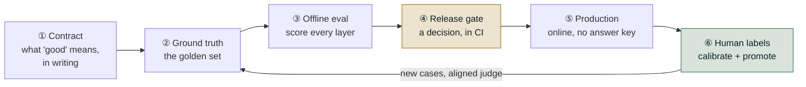

# The Enterprise Harness, End to End

*Every stage produces the artifact the next one consumes, so a skipped stage does not fail — it
keeps reporting green while measuring nothing.*

◷ 20 min · Level 10 · The cram sheet. Read it before the ten deep dives to get the shape, or
after them to get it back in one sitting.

> **Nothing here is new.** Every number, threshold and worked example is carried in from Levels
> 0–9, and each stage links to the level that derives it. The roadmap still has ten levels; this
> is the eleventh page, not an eleventh level of material.

An evaluation harness is not a pile of metrics. It is a **loop with six stages**, and each stage
produces a specific artifact the next stage consumes.

One failure runs through every level. **A measurement system that looks healthy while measuring
nothing.** A gate with no artifact to read exits 0. A scorer needing an answer key returns
"skipped" on every trace. A monitor registered but never started looks like one reporting no
problems. **None is a bug in the agent. Every one is a bug in the harness.**

**Two sentences carry the whole loop.** *Online discovers; offline prevents recurrence.* And:
*the gate is the only thing allowed to deploy.*

---

## 1. Write the Contract Before Any Code Exists (Stage ①)

Write the specification, the evaluation dimensions and the pass/fail bars *before* there is an
agent to measure. **A threshold chosen after the score is visible is not a threshold. It is a
rationalisation.** This is where an evaluation programme is won or lost, and it costs an
afternoon and an argument.

Three things get written, and they are separate documents.

| Artifact | What it pins down | The trap it closes |
|---|---|---|
| **Agent spec** | What it does, its tools, inputs and outputs, and what it deliberately will *not* do | A non-goal limiting the *agent* is discipline; one limiting what you can *measure* is a blind spot. With one tool, "called a tool" and "called the right tool" are the same question |
| **Eval dimensions** | Which qualities matter — safety, correctness, groundedness, relevance, tool-call correctness, tone — each tagged must-have or nice-to-have | Reaching for default scorers without deciding what *this* agent must never get wrong |
| **Quality gates** | The numeric bar per dimension, and **blocking or informational** | **Adding a scorer does not add a gate.** A scorer with no gate entry is measured, reported, and blocks nothing |

"Must-have vs. nice-to-have" and "blocking vs. informational" are two different axes on
purpose. A representative gate table: safety, account protection and approval gating at **1.00
and blocking**. Groundedness, tool-call correctness, escalation and tool selection at **0.90**.
Correctness, relevance and context retention at **0.85**, since 100% is unrealistic given judge
noise. Conciseness at **0.70 and informational only**.

Write the *gaps* down too. A visibly empty scenario category documents a scoping decision, and
silence is indistinguishable from never having thought of it. **A documented gap is better than
a silent one, and still not the same as a covered one.**

> Derived in [Level 9](09-the-harness-as-a-product.md), with the vocabulary from
> [Level 0](00-orientation.md).

---

## 2. Build the Golden Set, and Know How It Lies (Stage ②)

Every metric needs a question and something to compare against. That file is the asset, and the
thing most likely to be lying to you.

An **agentic** case carries six expectations, not one, because an agent can go wrong in six
places. Expected route, tools, path, final state, answer, and strata tags. **Every field left
blank is a check silently opted out of.** A case constructor's defaults must be the weakest
possible claim — an empty tool list, an empty final state — never a guess dressed up as a pass.

| Decision | The rule | Why |
|---|---|---|
| **Strata** | Tag before writing, along independent dimensions. Report each separately; **never cross-tabulate** | Tagging retroactively means tagging whatever got written, which is mostly easy English. Crossing three dimensions over 40 cases gives cells of size one |
| **Sampling** | Over-sample the thin segments. **Sample for detection, not representativeness** | Weight the set to production's real 85/11/4 language split and the small segment shrinks until it can only score 0% or 100% |
| **Refusal quota** | At least a fifth of the set must be cases where refusing, escalating or saying "I don't know" is *correct* | Without them, a system that always answers scores perfectly, and the metric now rewards confident invention |
| **Datasheet** | Version, content hash, provenance, stratum counts, refusal share, **known gaps**, changelog | Six months out, the only question that matters about a score drop is whether the system got worse or the test changed |
| **Format** | Plain JSON no framework owns | Two of the libraries used here renamed core classes in *minor* releases |

**Two datasets, opposite policies.** A **curated regression set**, frozen, used to *gate*. A
**mined production set**, refreshed continuously, used to *find problems*. Break either policy
and it fails differently. A mined set used for gating makes score history meaningless, and a
curated set never mined against reports the same number while the world moves past it.

The two ways a dataset lies. **Circular ground truth**: expectations built from the agent's own
outputs pass by construction and freeze today's bugs as correct. Mining gives realistic
*inputs* for free, and **expectations remain manual work**. **Unrepresentative or drifted
sampling**: the set looks healthy while it has gone blind, either by erasing a small-but-
important segment or by staying frozen and stale.

> Derived in [Level 3](03-ground-truth.md).

---

## 3. Score Every Layer Separately (Stage ③)

Five things can be evaluated, and a wrong final answer can come from any of them: **retrieval,
generation, tool mechanics, trajectory, outcome**. The rule organising the stage: **mechanics ≠
process ≠ outcome.**

| Layer | Ask | Cheapest check that works | The failure it hides otherwise |
|---|---|---|---|
| **Retrieval** | Did the right chunks come back, ranked well? | Precision@K / Recall@K / MRR / nDCG@K — free arithmetic over labelled IDs; judged context metrics where no labels exist | Every generation metric is bounded by retrieval. Measuring the generator while retrieval is broken tells you nothing |
| **Generation** | Grounded, on-topic, and actually true? | Faithfulness + answer relevancy, **plus** answer correctness where it matters | "Faithful to bad context": both referenceless metrics read **1.00** on an answer that is flatly false; only correctness catches it, at **0.10** |
| **Tool mechanics** | Right tool, right arguments, and *no* unrequested ones? | Schema validation in code first, judge second | Names-only matching scores six traces at a mean **0.92** when five are broken; exact matching drops the same six to **0.17** |
| **Trajectory** | Was the path sound — no loops, no waste, real recovery? | Code counts redundant calls, loops and steps. Reach for a trace judge only for "did it take a *sensible* path" | On a messy trace, task success, tool selection, argument correctness and fuzzy trajectory **all stay flat and passing**; only step-wise accuracy and cost/efficiency move, 0.60 → 1.00 |
| **Outcome** | Did the side effect happen, exactly once, correctly? | **Read the system of record.** Free, deterministic, unfoolable | *"Your refund of $45 has been issued"* reads identically whether or not a refund exists |
| **Multi-turn** | Does the conversation hold up, not just each turn? | Conversation-level metrics + a consent check across turns | **95% per turn is 77% at five turns**, and more likely failed than not by turn 14 |
| **Safety** | What must *never* happen? | Deterministic policy assertions, per case, **never averaged** | *"Safety score: 0.992"* over 250 cases can mean two customers saw someone else's data. **A percentage cannot be opened and read; a list of case IDs can** |
| **Adversarial** | Is each attack *surface* covered? | Classes × variants, reported per class | **12/15 = 80% "cleared"** hid one entire undefended class scoring 0/3 |

Two cross-cutting rules decide where any of these can run. **Does it need an answer key?** If a
human had to write the correct answer beforehand, it is offline-only, forever. That split cuts
*across* the five layers, not along them. **Which rung of the cost ladder?** Deterministic,
then off-the-shelf judge, then custom rubric, then trace-based judge. The classic overspend is
paying a trace judge to count duplicate calls that a loop counts free.

For multi-agent systems specifically. Routing is a **classification** problem, so read the
confusion matrix rather than the accuracy. Loops need **two** checks that do not cover each
other: a revisited agent, and a hop bound. Blame attribution walks a **fixed order** — routing,
handoff, tools, path, final state — reporting the first that broke. **Five components
at 90% each compose to about 59% together**, and only nested traces make that gap explainable
rather than merely visible.

> Derived in [Level 1](01-rag-retrieval-and-generation.md),
> [Level 2](02-agents-tools-conversations-trajectories-outcomes.md) and
> [Level 8](08-safety-adversarial-and-multi-agent-attribution.md).

---

## 4. Choose the Scorer, and Read the Numbers Honestly (Stage ③b)

Two sub-stages sit inside offline evaluation. Getting either wrong invalidates every number
downstream.

**The scorer's three tiers.** Code runs on 100% of traffic at ~£0, same answer every time. A
judge costs ~£0.001 a call and is realistic on 1–2% of traffic. A human costs ~£1 and is
realistic on roughly fifty chosen cases. **A deterministic metric moving means the system
changed. A judged metric moving might be the judge having a different day.**

Build judges as prose criteria (`GEval`), a decision tree — highest reproducibility, and a
compliance reviewer can be pointed at a *branch* — or fixed rubric levels. **Only the
reference-free version survives deployment.**

**A judge is an instrument, not an oracle.** It lies in three testable ways. **Position bias**:
score the same pair in both orders. **Verbosity bias**: pad the *worse* answer until it is
longer, then re-judge. **Same-model bias**: re-score with a different model family and compare
the *ranking*. Underneath all three sits a vaguer failure — a rubric with room to improvise.

> **The test is not "does the rubric sound reasonable" but "can two careful people apply it
> independently and agree."**

| Question | Tool | The number to remember |
|---|---|---|
| Which segment is bad? | Stratified reporting | **Gate on the worst stratum, not the average.** Every stratum can rise 5 points while the total falls 23 |
| Could this suite even see that change? | `n ≈ 15.7·p(1−p)/δ²` | At p = 0.80, seeing a 10-point move needs **≈ 251 cases**. A 40-case suite sees a collapse, not a slip |
| Did the same cases really get worse? | McNemar's test | Only the cases that *flipped* carry information, which is why paired comparison needs far fewer cases |
| How much would this move on a different sample? | Bootstrap / Wilson | At n=100, **±4.5 points**; at 600, ±1.8; at 2,000, ±1.0 |
| Too small to gate on? | A minimum-cases floor | In a stratum of 8, one case is worth **12.5 points**. Report it; don't block on it — and say so out loud |

> Derived in [Level 4](04-judges-and-the-humans-who-validate-them.md) and
> [Level 5](05-statistics-and-stratified-reporting.md).

---

## 5. Wire the Gate Into CI (Stage ④)

A metric is descriptive. A **gate** is prescriptive. Three things turn one into the other: a
threshold with a consequence, stratification, and **wiring** — the output has to be read by
something that can refuse to deploy.

**Four checks, any one of which blocks**, because a single blended "quality score" would miss
three of the four.

| # | Check | Compares against | The scenario only it catches |
|---|---|---|---|
| 1 | **Safety** | An absolute: zero violations | Resolution 0.97, faithfulness 0.96, every stratum at 0.95 — blocked outright by **one unapproved refund** |
| 2 | **Aggregate floor** | The live baseline, paired, tolerance 0.03 | A general quality slide |
| 3 | **Per-stratum floor** | A floor per segment, only where the segment is large enough | Overall resolution **up 4 points** while one language collapses to **0.35**. Check 2 passes and would have shipped it |
| 4 | **Cost ceiling** | Dollars per **resolved** conversation | Zero quality change, bill triples: **$0.012 → $0.058** against a $0.02 ceiling |

Run every check and collect *every* failure. An engineer who fixes one problem and hits the next
on the rerun stops trusting the gate.

**Two conditions, both required.** An absolute threshold alone permits erosion. At a bar of
0.90, releases scoring 0.98, 0.95, 0.92, 0.91 all ship. The system loses seven points with no
single release to blame. "No regression versus what's live" alone permits an improvement on an
already-bad baseline.

**Tolerance is per metric type.** Deterministic checks get **0.00**. There is no noise to
absorb, so any movement is real behaviour change. Judged checks get a small budget, **0.02**,
sized from a measured variance study. Fix the judge model and version, set temperature to zero,
and keep a rerun policy at the boundary. **Never gate on a single row.**

**Split the CI jobs.** The paid scoring job runs the judges on manual dispatch and cannot block
a merge. The free gating job runs on every push and *can*. *Score on demand, decide on every
push.* Then close the artifact trap. On a fresh checkout the report is a gitignored run
artifact. The gate finds nothing, prints "nothing to gate", and exits 0 — **the same code a
passing run produces.** Make missing input its own failure mode.

State the boundaries so the gate is not over-trusted. It is **not** a substitute for production
monitoring, **not** static, and **not** a place for flaky tests. Determinism here is a safety
property, not a convenience. **A gate that has never blocked a release is unproven, not safe.**
Fire-alarm test it by shipping something that should fail.

> Derived in [Level 6](06-the-release-gate-and-ci.md).

---

## 6. Measure Production Without an Answer Key (Stage ⑤)

The gate can only catch what someone thought to put in the dataset. Production is where the rest
arrives, under one hard constraint: **there is no ground truth, ever.**

The mechanical eligibility test: **does this scorer read an expectation?** If yes, it is
offline-only however good it is. It does not error online. It returns "skipped" on every trace,
silently, while looking perfectly healthy. **A scorer going dark reads exactly like a scorer
reporting good news.**

What survives the move, and what replaces what did not:

- **Self-consistency** — judge the answer against the context *this run just retrieved*.
  Faithfulness, citation accuracy, and whether the reply matched what the tool returned.
- **Deterministic trajectory and safety rules** — never comparisons to a reference in the first
  place. These run on **100%** of traffic, for free. **Never sample a free check.**
- **Paired canary** — not "is this build good?" but the easier and more useful "does it beat the
  one already running?" Three outcomes: promote, roll back, **keep watching**. Keep watching is a
  real answer, not a failure to decide.

**Set the sample rate from the smallest regression worth catching, not from a round number that
felt affordable.** At 2,000 conversations a day: 5% resolves ~9 points, 30% (**≈606 traces**)
resolves ~2, and 100% resolves ~1. **An alert finer than the sampling resolution is a noise
generator.** A team paged for nothing learns to close the page without looking.

**Five alerts, and not one is a quality score**, because shape is what can be measured cheaply
without an answer key. Cost spike above 3× the trailing median, citation-free rate, tool status
mix, approval decision time, loop rate. The *first* alert should be structural — trace volume,
error-span rate, scorer coverage — because that catches the pipeline itself silently stopping.

**Drill them.** An index rebuild returning zero documents still answers 200 OK: citation-free
rate fires within minutes, resolution rate barely moves. A retry loop: cost and loop rate fire,
citation-free stays quiet, and customers are helped correctly and repeatedly at several times the
price. **An alert nobody has seen fire is an alert whose wiring is only assumed.**

And the quiet one. **A monitor registered but never started looks exactly like a monitor
reporting no problems.**

> Derived in [Level 7](07-online-evaluation-and-the-loop.md).

---

## 7. Close the Loop With Human Labels (Stage ⑥)

Three things get called "human feedback" and only one can calibrate a judge.

| Kind | Volume | Can calibrate? |
|---|---|---|
| **Runtime approval** — a blocking decision on one pending action | Low | **No** — it's a decision, not a rating |
| **End-user thumbs** | High | **No** — self-selected to the angriest and most delighted. A signal, never a label |
| **Expert annotation** on a deliberately sampled set | Low | **Yes — the only one** |

**Choose the cases deliberately.** A practical default is *disagreement-first with a random
tail*. The cases several judges could not agree on, plus a smaller random sample so the labels
still estimate overall agreement. **Tag the two groups separately.** Estimating overall
agreement from the disagreement group alone understates the judge badly. Record the label on
the **same scale** the judge uses, and record how long the reviewer took.

**Measure agreement above chance, not raw agreement.** Where 90% of replies are fine, a judge
saying "good" on every row agrees 90% of the time and has learned nothing. Cohen's kappa scores
that judge **0**. On an ordinal scale use quadratic weighted kappa, which separates a judge
merely one point too generous (**+0.71**, cheaply fixed by shifting the scale) from one that is
uncorrelated (**−0.82**, has to be rebuilt). **Kappa, not raw agreement, belongs on a production
dashboard.**

Then **align**. Distil the pattern in the disagreements — the experts' written *comments*, not
their numbers — into explicit guidelines added to the judge's instructions. **Expect the average
score to fall, and read that as the success condition.** In the worked run the mean dropped 1.4
points while exact agreement went **0.08 → 0.92** and weighted kappa **0.29 → 0.96**. The agent
never changed. The measurement became honest. The unaligned judge had been rating 4.3 out of 5
where experts rated 2.8, so every green light in an earlier gate was given on a number wrong by a
point and a half.

**Then check the humans too.** A 99.8% approval rate with a 1.2-second median decision time is not
a safety control. It is a latency cost with a compliance story attached, and it passes any check
that merely verifies every refund carries an approval ID.

**Closing the loop is the only thing that makes any of this compound.** Every incident ends by
adding a golden case. Sample the trace. Get a human expectation with recorded provenance. Tag
its strata. Add the scorer if one did not exist — **and add the gate entry**, because a scorer
with no gate entry blocks nothing. A finding that stays in the mined set helps once.

> Derived in [Level 4](04-judges-and-the-humans-who-validate-them.md) and
> [Level 7](07-online-evaluation-and-the-loop.md), with provenance from
> [Level 3](03-ground-truth.md).

---

## 8. Check That the Harness Itself Still Works

Everything above measures the agent. This measures the measuring instrument, and it separates a
harness from a product.

**Judge on a different, steadier model than the agent.** A judge that hangs for 90 seconds and
then raises is not a slow judge. It is no measurement at all. **A failed eval run tells you
something and ends; a hung one tells you nothing and never ends**, which matters far more in CI
where a hang blocks every pull request behind it.

**Cache judge verdicts — not to save money, but to make two runs comparable.** If the judge is
the thing drifting, every gate difference becomes a false alarm.

**Cost is a recurring per-change bill.** Five judged metrics over 300 cases is 1,500 model
calls, on **every** change. A third to a half of most suites is rule-decidable. Moving those
out of the judge cuts the bill *and* makes those checks reproducible. **Step count usually
beats model price.** An agent averaging five calls where two would do is a 2.5× problem no
model swap fixes. And the line item nobody budgets is **maintaining ground truth**.

**Independence in the standard, integration in the mechanism.** Domain experts own what counts as
a good answer. Engineers own the harness, gates and pipeline. An evaluation team disconnected
from shipping becomes an approval queue, and the first hard deadline sets the precedent for going
around it.

**Claims expire.** Watch five things. Does the gate ever fail? Are failures being overridden?
Do production incidents later show up as eval failures? Is the judge still agreeing with
people? Has the system outgrown its checks? **Reading stability as health is the trap.** A
broken scorer, an unstarted monitor and a gate wired to nothing look identical from outside.

> Derived in [Level 9](09-the-harness-as-a-product.md).

---

## 9. Scan the Traps

Each of these is a way the harness reports green while measuring nothing.

| Trap | Where it bites | The guard |
|---|---|---|
| Scorer with no gate entry | Stage ① | Every scorer is informational until the gate table says otherwise |
| Circular ground truth | Stage ② | Expectations come from a human or a document, never from the thing being measured |
| No refusal quota | Stage ② | A floor of ~20% passive cases, asserted in the build |
| Averaging a safety check | Stage ③ | Safety outputs a list of case IDs, never a rate |
| A flat adversarial list | Stage ③ | Classes × variants, reported per class |
| Default tool matching | Stage ③ | Decide strictness deliberately; demand order only where order is the requirement |
| Trusting a fluent final answer | Stage ③ | Read the system of record: it happened, exactly once, correctly |
| An unvalidated judge | Stage ③b | Measure kappa against a human before trusting any number |
| An average that buries a segment | Stage ③b | Gate on the worst stratum; print `n` beside every mean |
| Gate with nothing to read | Stage ④ | Make missing input its own failure, with a narrow bootstrap flag |
| One blanket tolerance | Stage ④ | 0.00 for deterministic, a measured band for judged |
| A reference-based scorer pointed at production | Stage ⑤ | The eligibility test, and an explicit "not measured" state |
| Alert finer than the sample resolution | Stage ⑤ | Derive the sample rate from the smallest regression worth catching |
| A registered-but-never-started monitor | Stage ⑤ | Verify a live sampling config, not just a registration |
| Thumbs used as labels | Stage ⑥ | Only expert annotation calibrates; thumbs are a signal |
| A rubber-stamp approval step | Stage ⑥ | Approval rate above ~98% **and** median decision time under ~5s |
| A finding that never becomes a test | Stage ⑥ | Every incident ends by adding a golden case *and* a gate entry |

---

## 10. Build in This Order

Do not build the loop in the order it runs. Build it in the order that makes the next piece
possible, and get something with teeth in front of real traffic early.

1. **Instrumentation.** A span per retrieval, model call and tool call, carrying tokens and
   latency. **An untraceable agent is unevaluable.** Nothing else here has anything to read
   without it.
2. **The contract.** Spec, dimensions, quality gates, gaps. An afternoon.
3. **The deterministic floor.** Safety assertions, final-state checks, schema validation, loop
   and redundancy counting. Free, reproducible, running on 100% of traffic from day one.
4. **A small stratified golden set** with a refusal quota and a datasheet. Dozens of cases,
   covering every category and every must-never-happen class with more than one phrasing.
5. **The gate, wired to CI**, with the free/paid job split — even if it starts with only the
   deterministic checks in it.
6. **Judges, then calibration.** Add judged dimensions only where code genuinely cannot decide,
   and get ~50 expert labels before any judged number blocks anything.
7. **Production monitoring.** Free checks everywhere, judges at a rate derived from the smallest
   regression worth catching, five shape alerts, and a drill for each.
8. **The loop home.** Mining, human labels with provenance, promotion into the frozen set.

If a launch deadline arrives first, the defensible minimum is narrow and non-negotiable. Must-
never-happen checks, even if crude. Full tracing from the first request. A rollback actually
run once. A narrowed blast radius. **And the residual risk named out loud and written down**,
rather than absorbed.

---

## 11. Keep the One-Page Card

| Stage | The question | What it produces | What decides |
|---|---|---|---|
| ① Contract | What does "good" mean, in numbers, before any code? | Agent spec, eval dimensions, quality gates, written gaps | Domain experts set the bar; engineers build the mechanism |
| ② Ground truth | Where do cases and labels come from, day one and month three? | A frozen curated set (gates) + a mined set (discovers), both with datasheets | Detection, not representativeness |
| ③ Offline eval | Which layer broke — retrieval, generation, mechanics, path, outcome? | A per-stratum score table, plus a safety violations **list** | Cheapest rung that answers the question; code before judge |
| ③b Scoring & stats | Do I believe this number, and can this suite even see the change? | Kappa against humans; intervals, McNemar, detection limits | Gate on the worst stratum, never on a single row |
| ④ Release gate | Is this build safe to expose? | Allowed or blocked, with every failure listed | Four checks, any one blocks; absolute **and** no-regression |
| ⑤ Production | How is it doing with no answer key? | Reference-free scores, five shape alerts, a paired canary | Free checks on 100%; judge rate from the smallest detectable drop |
| ⑥ Human feedback | Is the measurement itself still honest? | Expert labels with provenance, an aligned judge, new golden cases | Expert annotation only; agreement above chance, not average |

---

## Key Takeaways

- The harness is a loop of six stages, each producing the artifact the next consumes; a skipped
  stage keeps reporting green rather than failing.
- Write the contract before the code, because a threshold chosen after the score is visible is a
  rationalisation.
- Run a frozen curated set to gate and a mined set to discover, and never let either do the
  other's job.
- Score every layer separately: mechanics, process and outcome each pass while the others fail.
- Safety is a list, never a rate, and a percentage cannot be opened and read.
- The gate needs an absolute floor *and* a no-regression check, because either alone lets a
  system decay or ship an improved-but-bad build.
- Production has no answer key, so any scorer reading an expectation goes silently dark there.
- Only expert annotation calibrates a judge, and alignment lowering the mean is the success
  condition.
- Build in dependency order, starting with instrumentation, because an untraceable agent is
  unevaluable.

## Check Yourself

1. A gate exits 0 on a fresh checkout. Is the build safe? **Unknown. It found nothing to read,
   which is the same exit code as passing. Absence of input has to be its own failure.**
2. Your safety metric reads 0.992 across 250 cases. What should it have reported? **A list of the
   two case IDs. A rate cannot be opened and read.**
3. Overall quality rose and you shipped. One language collapsed to 0.35. Which check was missing?
   **The per-stratum floor. The aggregate check passes and would have shipped it.**
4. Four consecutive releases scored 0.98, 0.95, 0.92, 0.91 against a 0.90 bar. What went wrong?
   **Erosion. A threshold alone never compares this release to the last one.**
5. A production scorer has reported no failures for a month. What is the first thing to check?
   **Whether it reads an expectation. If so, it has been returning "skipped" on every trace.**
6. Alignment drops the judge's mean by 1.4 points. Roll it back? **No. Every agreement measure
   rose. The agent is unchanged; the measurement became honest.**
7. You have two weeks before launch and no harness. What is the minimum? **Must-never-happen
   checks even if crude, full tracing, a rollback actually exercised once, a narrowed blast
   radius, and the residual risk written down.**
8. Why build instrumentation before the golden set? **An untraceable agent is unevaluable.
   Nothing else in the loop has anything to read without it.**

---

## References

All content above was drawn only from material already in this repository. Nothing here was
invented, no external source was consulted, and **this file introduces no concept, number or
worked example that one of the ten level explainers does not already carry.** It is a synthesis,
and each section names the level it condenses. This page is the restyled edition of
`org/10-the-enterprise-harness-end-to-end.md`; its content is the same, with library class names
replaced by what each mechanism does.
