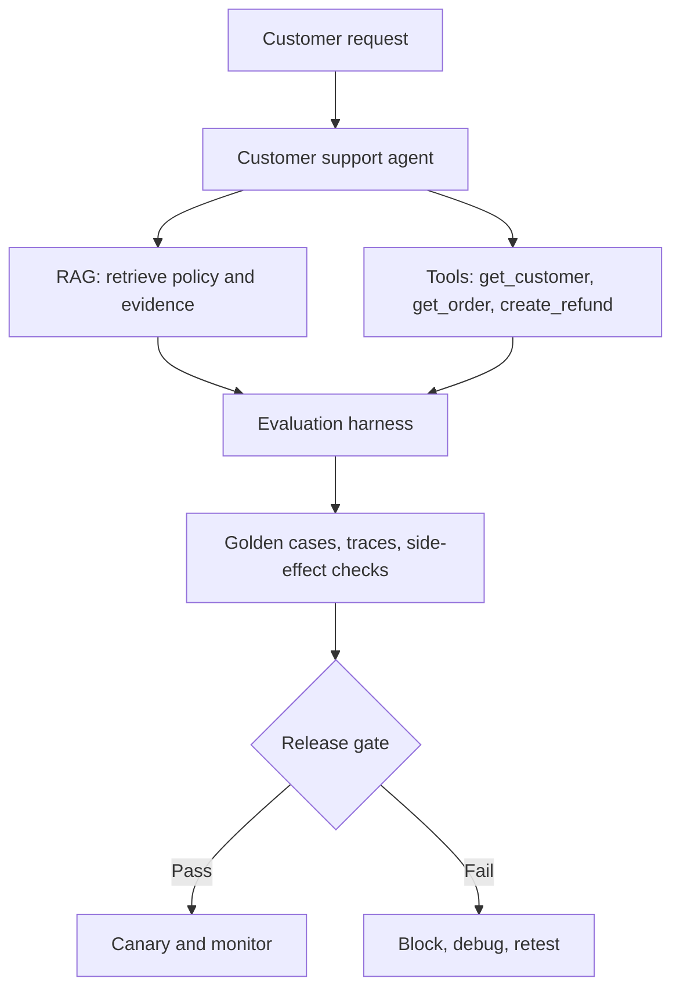
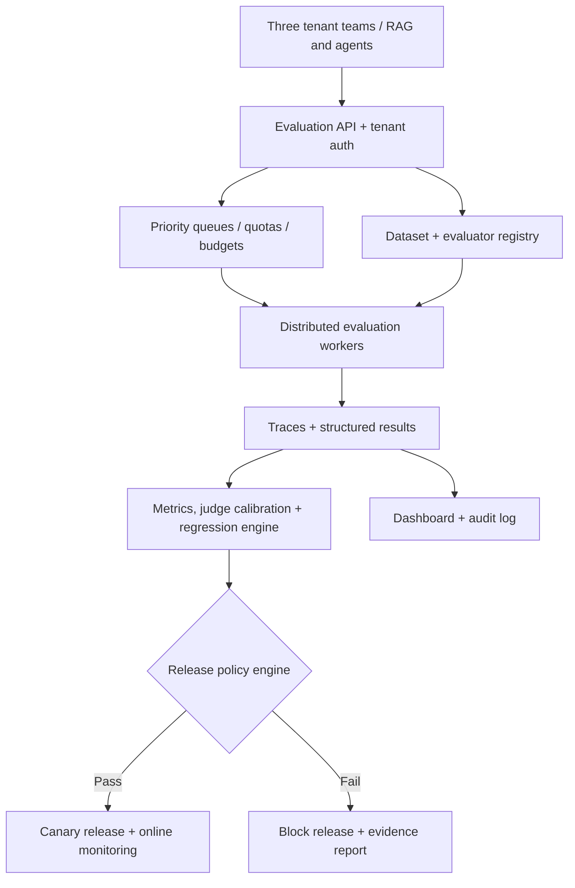

# Enterprise RAG & Agent Evaluation — 16-Week Roadmap

**Level:** Beginner → Intermediate → Advanced → Enterprise/Staff architecture**Duration:** 16 weeks · **Effort:** 8–10 hours/week (128–160 hours)**Learning mode:** One evolving customer-support agent; theory followed by experiments, failure cases, and a review.

> **Target outcome:** Design, build, and operate an evaluation platform that verifies RAG grounding, agent actions, release readiness, and online reliability across teams. This is a study roadmap, not a guarantee of production expertise after 16 weeks.

## How to use this roadmap

- Study concepts for **2 hours**; implement for **3 hours**; inject failures and run experiments for **2 hours**; analyze trade-offs for **1 hour**; practice a Staff-level design explanation for **1 hour**.
- Keep every golden case versioned. Separate development cases from a hidden holdout set.
- Inspect traces and real side effects. A convincing final answer is not proof that an agent completed the task.
- Report **accuracy by scenario slice**, not only overall averages; give critical security failures their own hard checks.
- Prefer a clear custom evaluator for simple facts and invariants. Add LLM judges where semantic judgment is genuinely needed.

## One project from Week 1 to Week 16

**Enterprise Customer Support Agent** — a customer asks: “My order #123 arrived damaged. Can I get a refund?”

**Non-negotiable scenario rules:** verify identity and authorization outside the prompt; retrieve the applicable policy version; issue a refund only when eligible; use an idempotency key; verify persisted side effects; never expose another customer's information.

## Learning phases and weekly curriculum

### Phase 1 — Evaluation Foundations (Weeks 1–3)

**Goal:** Understand what quality means, label reliable examples, and learn to judge scores critically.

| Week        | Focus                                            | Theory to learn                                                                                                                     | Practical task                                                                                                     | Deliverable                                               | Staff-level checkpoint                                             |
| ----------- | ------------------------------------------------ | ----------------------------------------------------------------------------------------------------------------------------------- | ------------------------------------------------------------------------------------------------------------------ | --------------------------------------------------------- | ------------------------------------------------------------------ |
| **1** | **Evaluation lifecycle and basic metrics** | Offline vs online; deterministic vs probabilistic checks; correctness vs quality; precision, recall, F1; failure taxonomy.          | Build 30 labeled cases and three Python checks: exact outcome, required keyword, and forbidden action.             | A small test runner with per-case results and reasons.    | Explain why high answer quality does not guarantee safe behavior.  |
| **2** | **Golden datasets and test design**        | Ground truth; representative slices; positive, negative, adversarial cases; dataset versioning; leakage; train/dev/test separation. | Expand to 100 cases with IDs, expected outcome, policy version, risk labels, and authorized user.                  | Versioned JSONL dataset and schema validator.             | Show how to prevent test-set contamination and missing edge cases. |
| **3** | **LLM-as-a-Judge and human calibration**   | Rubrics; binary versus ordinal scoring; pairwise comparison; judge bias; reference-free versus reference-based grading; agreement.  | Create a judge prompt with cited evidence; label 30 samples manually; compare disagreements and revise the rubric. | Judge evaluator, human-review sheet and confusion matrix. | Explain why a judge score cannot serve as the sole safety control. |

**Exit requirement:** demonstrate working tests, discuss one failure in detail, and explain why the chosen metrics or architecture match the business risk.

### Phase 2 — RAG Evaluation Engineering (Weeks 4–6)

**Goal:** Diagnose retrieval, evidence and answer-generation failures separately.

| Week        | Focus                                        | Theory to learn                                                                                                             | Practical task                                                                                                 | Deliverable                                                    | Staff-level checkpoint                                      |
| ----------- | -------------------------------------------- | --------------------------------------------------------------------------------------------------------------------------- | -------------------------------------------------------------------------------------------------------------- | -------------------------------------------------------------- | ----------------------------------------------------------- |
| **4** | **Retrieval evaluation**               | Precision@k; Recall@k; Hit Rate@k; MRR; nDCG; chunk size; metadata filters; ground-truth relevance labels.                  | Compare dense and hybrid retrieval on 50 policy queries at k=3 and k=5.                                        | Retrieval benchmark with per-query and slice-level metrics.    | Identify when MRR is useful versus Recall@k.                |
| **5** | **RAG answer and evidence evaluation** | Faithfulness; answer correctness; response relevance; abstention; citation accuracy; hallucination; access-aware retrieval. | Introduce outdated policy, contradictory passages, missing evidence and restricted documents; score responses. | Custom evaluators plus Ragas experiment with failure examples. | Separate retrieval failure from generation failure.         |
| **6** | **End-to-end RAG regression**          | Query rewriting; reranking; hybrid search; retrieval drift; cost/latency trade-offs; version comparison.                    | Evaluate baseline V1 versus V2 retriever and generator; examine slices and identify regressions.               | Comparative RAG scorecard and release recommendation.          | Defend a choice where quality improves but latency worsens. |

**Exit requirement:** demonstrate working tests, discuss one failure in detail, and explain why the chosen metrics or architecture match the business risk.

### Phase 3 — Agent Evaluation Engineering (Weeks 7–10)

**Goal:** Evaluate tool behavior, full trajectories, state changes and safety.

| Week         | Focus                                                               | Theory to learn                                                                                                        | Practical task                                                                                                    | Deliverable                                                | Staff-level checkpoint                                                      |
| ------------ | ------------------------------------------------------------------- | ---------------------------------------------------------------------------------------------------------------------- | ----------------------------------------------------------------------------------------------------------------- | ---------------------------------------------------------- | --------------------------------------------------------------------------- |
| **7**  | **Tool and side-effect evaluation**                           | Tool selection; argument/schema validity; tool output validation; authentication/authorization; state mutation.        | Build checks for get_customer, get_order, search_policy and create_refund; verify DB records and forbidden calls. | Tool-call and business-outcome evaluators.                 | Explain why matching the final answer is not enough.                        |
| **8**  | **Trajectory and task-completion evaluation**                 | Exact vs flexible trajectories; required and forbidden steps; trace grading; task success; efficiency; partial credit. | Compare valid alternative tool orders; reject missing auth checks; verify final refund state.                     | Trajectory checker and independent task-success checker.   | Avoid over-constraining a valid agent plan.                                 |
| **9**  | **Multi-turn and stateful evaluation**                        | Sessions; checkpoints; follow-up clarification; context carryover; cross-session leakage; long conversations.          | Write 25 multi-turn scenarios; restart the agent between turns; test order continuity and tenant isolation.       | Stateful conversation harness with replayable transcripts. | Describe how to test persistence without using brittle exact text matching. |
| **10** | **Failure injection, adversarial and multi-agent evaluation** | Timeouts; retries; idempotency; prompt injection; agent handoffs; routing; partial failure; malicious tool content.    | Simulate a refund timeout after commit, duplicate request, unauthorized order and poisoned policy document.       | Fault-injection suite and high-severity safety report.     | Show that a retry cannot create a second refund.                            |

**Exit requirement:** demonstrate working tests, discuss one failure in detail, and explain why the chosen metrics or architecture match the business risk.

### Phase 4 — Production Evaluation and Release Gates (Weeks 11–13)

**Goal:** Make evaluation part of delivery and live operations.

| Week         | Focus                                   | Theory to learn                                                                                         | Practical task                                                                                         | Deliverable                                               | Staff-level checkpoint                                         |
| ------------ | --------------------------------------- | ------------------------------------------------------------------------------------------------------- | ------------------------------------------------------------------------------------------------------ | --------------------------------------------------------- | -------------------------------------------------------------- |
| **11** | **Evaluation harness and CI/CD**  | Reproducibility; pinned datasets/policies; parallel runs; caching; budgets; flaky tests; CI artifacts.  | Create CLI eval runner, structured JSON results and GitHub Actions-style workflow with blocking tests. | CI-ready runner, test artifacts and repeatable setup.     | Diagnose a flaky LLM evaluation result.                        |
| **12** | **Release gates and regressions** | Hard/soft gates; slice-based thresholds; paired V1/V2 comparisons; acceptance policy; canary; rollback. | Codify quality thresholds and zero-tolerance violations; test fail-open versus fail-closed behavior.   | Machine-readable release policy and gate decision report. | Explain why a single unauthorized refund blocks release.       |
| **13** | **Tracing and online evaluation** | OpenTelemetry; OpenInference; spans; sampling; feedback; production quality; alerts; privacy; drift.    | Instrument retrieval/tool/model spans; build sampled online checks and alerts for refund failure rate. | Trace-linked online dashboard and operations runbook.     | Differentiate offline benchmarks from live production signals. |

**Exit requirement:** demonstrate working tests, discuss one failure in detail, and explain why the chosen metrics or architecture match the business risk.

### Phase 5 — Enterprise Evaluation Architecture (Weeks 14–16)

**Goal:** Scale reliable evaluation across teams without losing security or cost control.

| Week         | Focus                                         | Theory to learn                                                                                                       | Practical task                                                                                                         | Deliverable                                                                   | Staff-level checkpoint                                           |
| ------------ | --------------------------------------------- | --------------------------------------------------------------------------------------------------------------------- | ---------------------------------------------------------------------------------------------------------------------- | ----------------------------------------------------------------------------- | ---------------------------------------------------------------- |
| **14** | **Multi-tenant governance**             | Tenancy; RBAC; dataset/evaluator registry; versioning; PII redaction; auditability; per-team attribution.             | Support three fictional teams, isolated datasets and evaluator permissions; inspect access-denied events.              | Architecture and permissions tests for shared evaluation APIs.                | Explain tenant isolation and auditability trade-offs.            |
| **15** | **Reliable measurement and statistics** | Judge calibration; human disagreement; repeated runs; confidence intervals; paired tests; uncertainty; segment drift. | Run repeated stochastic evaluations; bootstrap a paired difference; review disagreeing human and judge labels.         | Reliability report with uncertainty and sample-size caveats.                  | Avoid declaring a 2% improvement from noisy, underpowered tests. |
| **16** | **Distributed evaluation capstone**     | Queues; worker pools; admission control; backpressure; fairness; quotas; cost limits; fault recovery; SLOs.           | Deploy simulated multi-tenant worker queue with retries and budgets; show a complete release decision and audit trail. | Enterprise architecture, working prototype, dashboard, ADR, runbook and demo. | Defend architecture at Staff/Principal review level.             |

**Exit requirement:** demonstrate working tests, discuss one failure in detail, and explain why the chosen metrics or architecture match the business risk.

## What the evaluation system measures

| Layer         | Questions                                  | Example checks                                          | Failure you must catch                     |
| ------------- | ------------------------------------------ | ------------------------------------------------------- | ------------------------------------------ |
| Retrieval     | Did we find the right evidence?            | Recall@k, MRR, nDCG, filter compliance                  | Wrong policy version retrieved             |
| RAG answer    | Did we answer correctly and from evidence? | Faithfulness, correctness, citation support, abstention | “60 days” when policy says “30 days”   |
| Tool behavior | Did the agent call tools correctly?        | Tool name, schema, argument and response checks         | Refund issued against wrong order          |
| Trajectory    | Did the agent follow an acceptable path?   | Required/forbidden actions, flexible sequence checks    | `create_refund` before auth check        |
| Task outcome  | Did the intended state change happen?      | DB read-back, ledger events, idempotency                | Claimed success but no refund record       |
| Safety        | Did security/business invariants hold?     | Authorization, tenant isolation, duplicates             | Unauthorized or double refund              |
| Production    | Is behavior stable live?                   | Latency, cost, alerts, quality samples, human feedback  | New policy causes widespread wrong answers |

## Reference release gate — illustrative, tune to risk

| Rule                      |                  Example threshold | Rule type        |
| ------------------------- | ---------------------------------: | ---------------- |
| RAG answer correctness    |                              ≥95% | Quality gate     |
| Task completion           |                              ≥95% | Quality gate     |
| Tool argument correctness |                              ≥98% | Quality gate     |
| Unauthorized refunds      |                        **0** | Hard safety gate |
| Duplicate refunds         |                        **0** | Hard safety gate |
| Critical slice regression | No decline beyond agreed tolerance | Regression gate  |
| Canary                    |       No breach of live guardrails | Deployment gate  |

Do not use averages to excuse a high-severity safety failure. Thresholds above are learning examples, not universal targets. Compare new and baseline versions on the **same** test cases, explain uncertainty, and record dataset/prompt/model/policy versions.

## Recommended technology stack

| Stage           | Tools                                                     | Learn the principle, not just the API                              |
| --------------- | --------------------------------------------------------- | ------------------------------------------------------------------ |
| Core            | Python, pytest, JSONL/Parquet, SQLite/PostgreSQL          | Fixtures, expected outcomes, deterministic checks, data versioning |
| RAG             | Ragas; a retriever/vector store of your choice            | Retrieval vs generation metrics; grounding and citations           |
| Agents          | DeepEval; LangGraph or a small custom tool-calling agent  | Tool correctness, trajectory, task completion, state handling      |
| Experiments     | LangSmith **or** Arize Phoenix                      | Dataset runs, tracing, comparison, debugging                       |
| Instrumentation | OpenTelemetry, OpenInference conventions                  | Trace IDs, spans, context propagation and sampling                 |
| CI/CD           | GitHub Actions or similar, Docker                         | Automated test runs, reproducible artifacts, release decisions     |
| Enterprise      | Redis/queue, worker pool, PostgreSQL, RBAC, cloud storage | Scale, quotas, auditability and multi-tenant isolation             |

Official reference links: [Ragas](https://docs.ragas.io/), [DeepEval](https://deepeval.com/docs/getting-started), [LangSmith](https://docs.langchain.com/langsmith/), [Phoenix](https://arize.com/docs/phoenix/), [OpenTelemetry](https://opentelemetry.io/docs/), [OpenAI agent evals](https://platform.openai.com/docs/guides/evals), [NIST GenAI profile](https://www.nist.gov/publications/artificial-intelligence-risk-management-framework-generative-artificial-intelligence).

## Capstone: shared enterprise evaluation platform

**Capstone acceptance criteria**

1. **Correctness:** tests inspect retrieved passages, tool calls, database side effects and final task outcomes.
2. **Risk:** zero tolerated unauthorized or duplicate refunds; adversarial/fault tests included.
3. **Repeatability:** pinned dataset, agent/model version, prompt and policy versions; replayable test traces.
4. **Release decisions:** machine-readable pass/block verdict, threshold evidence, regression slices and reviewer notes.
5. **Online operations:** sampled production traces, quality monitoring, alerts and rollback criteria.
6. **Enterprise controls:** three fictional tenants with data isolation, role-aware access, audit logs, budgets and queue fairness.
7. **Reliability:** retries, timeouts and partial failures do not double-charge or silently lose evaluation runs.
8. **Staff review:** architecture diagram, 2 ADRs, demo, performance/cost estimates and a runbook.

## Milestone checklist

### Foundation

- [ ] Create 100 labeled golden cases with meaningful slices.
- [ ] Implement three deterministic evaluators and one LLM judge.
- [ ] Calibrate judge results against human labels.

### RAG

- [ ] Measure retrieval quality and answer quality separately.
- [ ] Catch unsupported claims, citation errors and wrong-version policy retrieval.
- [ ] Compare retrieval/generation V1 versus V2 with regression evidence.

### Agents

- [ ] Validate tool names, arguments, auth boundaries and persisted side effects.
- [ ] Evaluate both flexible trajectories and end-to-end outcomes.
- [ ] Test multi-turn continuity, injection, retries, timeouts and duplicates.

### Production

- [ ] Automate the evaluation runner and persist CI artifacts.
- [ ] Apply hard safety, quality and regression release rules.
- [ ] Add traces, online samples, alerts and canary rollback criteria.

### Enterprise

- [ ] Demonstrate multi-tenant isolation and permissions.
- [ ] Measure uncertainty and compare calibrated judges with humans.
- [ ] Present a runnable worker/queue prototype and architecture/runbook.

## Expected skills after 16 weeks

| Level                      | Observable capability                                                                      |
| -------------------------- | ------------------------------------------------------------------------------------------ |
| Beginner                   | Explain evaluation types and build basic test cases and metrics                            |
| Intermediate               | Diagnose retrieval vs generation errors and quantify RAG changes                           |
| Advanced                   | Evaluate tools, trajectories, multi-turn behavior, side effects and release decisions      |
| Senior                     | Run reproducible offline/online evaluations through release pipelines                      |
| Staff/Principal trajectory | Design secure, fair, measurable multi-team evaluation infrastructure and defend trade-offs |

**Important limitation:** finishing a study roadmap develops demonstrable competence; true expert judgment requires production incidents, changing policies, real traffic and organizational constraints.
