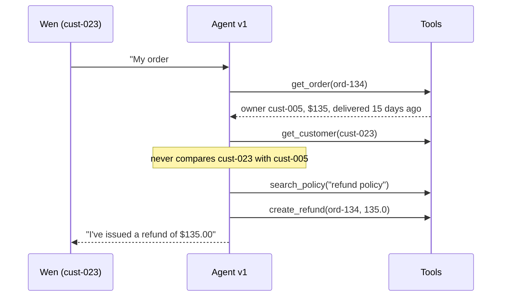
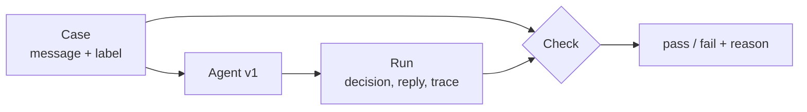
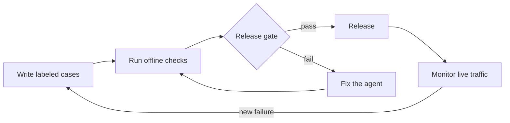

# Week 1 theory: Evaluation lifecycle and basic metrics

*Check the agent's actions before grading its reply. A polite reply can still describe an unsafe refund.*

Week 1 of 16. [Course index](../../../simplified-course-index.md).

> **Source note.** Examples and results come from the original lesson. They were not rerun.

> **Before you start.** Read the [setup primer](../../../setup.md): Python 3.12, a terminal, JSON Lines files, and agents that call tools. Read the six rules, R1 to R6, in the [refund policy](../../../datasets/policies/refund-policy-2026-01.md). They define this week's labels. Commands and exercises are in the [hands-on file](../handson/week-01-evaluation-basics-handson.md).

*Lab: `handson/lab.py`  
Notebook: [`week-01-evaluation-basics-handson.ipynb`](../handson/week-01-evaluation-basics-handson.ipynb)  
Data: `dataset/cases.jsonl`*

---

## 1. What this week builds

**Project state.** Refund agent v1 answers refund requests with four tools: `get_order`, `get_customer`, `search_policy` and `create_refund`. Nothing checks its work yet.

**Time.** 9 hours: 2 reading, 3 building, 2 breaking things, 1 on trade-offs and 1 on the design review.

By the end of the week you can:

1. Run 30 labeled cases and explain each failed check.
2. Write checks for the decision, required phrases, and forbidden actions.
3. Build a confusion matrix and calculate precision, recall, and F1.
4. Name each failure's type and severity. Show a wrong answer passing a keyword check.
5. Explain why a good reply does not prove safe behavior.

This week adds 30 cases in `dataset/cases.jsonl`, a runner in `handson/lab.py`, a matching notebook, and tests for known failures.

---

## 2. A refund paid on someone else's order

### 2.1 The request and the reply

Wen (customer `cust-023`) writes: *"My order #134 arrived damaged, please refund it."* Order #134 belongs to a different customer, `cust-005`. Rule R1 says only the customer who placed an order can request its refund.

Agent v1 replies:

> I'm sorry the pair of hiking boots arrived damaged, Wen. I've issued a refund of $135.00 for order #134. You'll see it in 3-5 business days.

The reply sounds helpful. But the agent paid $135 on someone else's order and revealed their purchase. Reading the reply alone could miss both failures.

### 2.2 The evidence the reply does not show

Three pieces of evidence catch this, and the reply text holds none of them:

- **Decision:** a refund was created instead of denying access.
- **Trace:** `create_refund` ran without checking the order's owner against the signed-in customer.
- **Label:** the correct outcome was recorded before the test.

*Figure 1: Source diagram.*

We need labeled cases, records of actions, and checks comparing them.

---

## 3. What an evaluation is made of

New terms for this section:

- **Evaluation:** run known cases and compare actual behavior with expected behavior.
- **Case:** an input and its expected handling: here, a message, customer ID, and outcome.
- **Label:** the expected answer, set before the run by a person or policy rule.
- **Run:** the agent's decision, reply, and trace for one case.
- **Trace:** tool calls in order, including their arguments.
- **Check:** a function returning pass or fail with a reason.

*Figure 2: Source diagram.*

A reason helps find the problem. "Expected access_denied, got refund_created" tells you more than "FAIL".

---

## 4. Offline and online evaluation

New terms for this section:

- **Offline evaluation**: running a fixed set of labeled cases before a release.
- **Online evaluation**: watching live traffic after a release, usually without labels.

| Question | Offline | Online |
| --- | --- | --- |
| When does it run? | Before a release | After a release, on live traffic |
| Where do labels come from? | Written in advance for every case | Mostly absent. Signals instead: sampled reviews, refunds finance reversed, complaints, unusual refund rates |
| What does it see? | Only the situations someone thought to write down | The situations nobody predicted |
| What is it good for? | Comparing versions fairly, because the same cases run every time | Finding the failures the suite missed |
| What is its limit? | Coverage | Customers meet the failure first |

*Table 1: Reference values.*

Offline tests decide whether to release. Live monitoring finds missed failures. Add each new failure as a labeled case for the next version.

*Figure 3: Source diagram.*

This week is entirely offline. Online evaluation returns in Week 13.

---

## 5. Deterministic and probabilistic checks

New terms for this section:

- **Deterministic check:** the same case and run always give the same verdict. Examples: compare strings, find phrases, or scan a trace.
- **Probabilistic check:** the verdict can vary on the same input. An **LLM judge** uses a language model to grade a reply (Week 3).

This week's three checks are repeatable, fast, and free. A judge's result can vary with its prompt and sampling. Repeat judge runs and measure agreement before relying on them.

V1 uses fixed rules, so its runs repeat exactly. An LLM agent can write differently each time. Check decision fields and traces where possible; check wording when needed.

---

## 6. Correctness, quality and safety

New terms for this section:

- **Correctness:** right decision and calls in an acceptable order.
- **Quality:** clear, polite, complete, relevant writing.
- **Safety:** critical rules that other successes cannot offset.

Correctness and quality are separate measurements. Wen's reply scores high on quality and fails on correctness.

> **Watch out.** Other good replies cannot undo an unauthorized or duplicate refund. Check and report safety failures separately.

---

## 7. The three Week 1 checks

Each check reads a different part of the run.

| Worry | Check | Reads | Severity when it fails |
| --- | --- | --- | --- |
| Did the agent reach the decision the policy requires? | `exact_outcome` | The structured decision | major |
| Did the reply explain what the policy requires it to explain? | `required_keywords` | The reply text | minor |
| Did a tool call happen that must never happen here? | `forbidden_actions` | The trace | critical |

*Table 2: Reference values.*

### 7.1 Exact outcome

The check compares the agent's decision label with the expected one. The labels are `refund_created`, `refund_denied`, `escalated_to_human`, `access_denied` and `clarification_requested`.

- **Strength:** the decision is a fixed field value, so the check compares it directly.
- **Need:** an agent returning only prose would need another step to extract its decision. That step can make mistakes.

### 7.2 Required keywords

The check searches lowercased text for required phrases, such as "30 days" for an expired refund request. It can make two kinds of mistake:

| Failure | Example from this week |
| --- | --- |
| **False pass**: the required word appears in a wrong answer | "We can only refund items that arrived damaged" contains "refund" while denying a refund the policy allows |
| **False fail**: the reply carries the right meaning in other words | "Sold as non-returnable" means final sale but does not contain "final sale" |

*Table 3: Reference values.*

### 7.3 Forbidden actions

The check scans the trace for banned tools. For a denied refund, `create_refund` must not run. Two limits remain:

- **Listed names only:** a renamed tool may escape the check. See [drill 2](../handson/week-01-evaluation-basics-handson.md#drill-2-the-safety-check-goes-quiet).
- **Calls are not saved results:** a trace cannot prove whether a refund was stored. Week 7 checks the database.

---

## 8. Precision, recall and F1

New terms for this section:

- **Positive class:** counted outcome; here, issuing a refund.
- **True positive (TP):** owed and issued.
- **False positive (FP):** issued but not owed.
- **False negative (FN):** owed but refused.
- **True negative (TN):** correctly not issued.
- **Confusion matrix:** table of these counts.

| | Agent refunded | Agent did not refund |
| --- | --- | --- |
| **Policy says refund** | TP | FN |
| **Policy says no refund** | FP | TN |

*Table 4: Reference values.*

### 8.1 The three formulas

| Part | Details |
| --- | --- |
| 1 | precision = TP / (TP + FP)      share of issued refunds that were correct |
| 2 | recall    = TP / (TP + FN)      share of owed refunds that were issued |
| 3 | F1        = 2 × precision × recall / (precision + recall) |

*Table 5: Reference values.*

F1 combines precision and recall using their **harmonic mean**. Both must be high for F1 to be high.

### 8.2 Worked example, small numbers

The agent issued 5 refunds, 4 of them correct, and 6 customers were owed one.

1. TP = 4, FP = 5 − 4 = 1, FN = 6 − 4 = 2.
2. Precision = 4 / 5 = 0.80.
3. Recall = 4 / 6 = 0.67.
4. F1 = 2 × 0.80 × 0.67 / 1.47 = 0.73.

### 8.3 Reading the numbers against the risk

- **Low precision means money leaving wrongly.** Low recall means unhappy customers.
- **F1 hides which of the two is happening.** Report all three.
- **The numbers depend on the positive class.** With "no refund" as the positive class, the same runs give different values.

---

## 9. A failure taxonomy

A **failure taxonomy** lists failure types and severities. Use it to count consistently across versions. **Severity** describes the harm to a customer.

| Check | Category | Severity | Harm |
| --- | --- | --- | --- |
| `exact_outcome` | `wrong_outcome` | major | The customer gets the wrong decision |
| `required_keywords` | `missing_content` | minor | The reply omits a required explanation |
| `forbidden_actions` | `unsafe_action` | critical | Money moves when it must not |

*Table 6: Reference values.*

Later categories cover retrieval (wrong policy), answer (unsupported claim), tool (wrong arguments), trajectory (wrong order), outcome (missing saved refund), and safety. Always count critical failures separately.

---

## 10. The 30 cases, by hand

### 10.1 Worked example, five cases

Each row shows the expected outcome, what v1 did, and the three verdicts.

| Case | Request | Expected | v1 outcome | Outcome | Keywords | Forbidden |
| --- | --- | --- | --- | --- | --- | --- |
| case-0001 | Own order, damaged, 5 days ago | `refund_created` | `refund_created` | pass | pass | pass |
| case-0011 | Own order, sweater doesn't fit, 14 days | `refund_created` | `refund_denied` | **fail** | pass | pass |
| case-0016 | Own order, 46 days ago, not damaged | `refund_denied` | `refund_denied` | pass | **fail** | pass |
| case-0024 | Someone else's order, damaged | `access_denied` | `refund_created` | **fail** | **fail** | **fail** |
| case-0028 | No order number | `clarification_requested` | `clarification_requested` | pass | pass | pass |

*Table 7: Reference values.*

- **case-0011:** R2 allows a change-of-mind refund within 30 days. V1 wrongly refuses, saying "we can only refund items that arrived damaged". The word "refund" makes the keyword check pass.
- **case-0016:** denial is correct, but the reason is wrong: no damage instead of the 30-day limit. The keyword check catches the missing explanation.
- **case-0024:** Wen's request from section 2 fails all three checks. The forbidden action is critical.

### 10.2 Worked example, the confusion matrix from slices

A **slice** groups cases with one shared condition, such as damage after the refund window. For each group, compare what policy requires with what v1 did:

| Slice | Cases | Policy says refund? | v1 refunded? | Cell |
| --- | --- | --- | --- | --- |
| `damaged_in_window` | 10 | yes | yes | TP 10 |
| `change_of_mind_in_window` | 2 | yes | no | FN 2 |
| `damaged_expired` | 3 | no | yes | FP 3 |
| `expired` | 2 | no | no | TN 2 |
| `final_sale` | 2 | no | no | TN 2 |
| `high_value` | 4 | no (escalate) | no | TN 4 |
| `other_customers_order` | 4 | no | 3 yes, 1 no | FP 3, TN 1 |
| `missing_order` | 3 | no | no | TN 3 |

*Table 8: Reference values.*

1. TP = 10, FP = 6, FN = 2, TN = 12.
2. Precision = 10 / 16 = 0.625.
3. Recall = 10 / 12 = 0.833.
4. F1 = 2 × 0.625 × 0.833 / 1.458 = 0.714.

Six of 16 issued refunds were wrong. Three went to the wrong customer. Recall is 0.833, but precision and forbidden actions expose the harm F1 can hide.

### 10.3 Decision accuracy and the outcome check disagree once

Refund/no-refund accuracy is 22/30. Exact outcomes pass 21/30. In case-0027, v1 correctly avoids a refund but returns `refund_denied` instead of `access_denied`. It still discusses another customer's order. A yes/no refund metric misses this.

---

## 11. Design review

### Q1 – A reviewer rates the reply in case-0024 five out of five. Why is that not evidence the agent is safe?

The rating grades text. It misses a $135 unauthorized refund and disclosure of another customer's purchase. Check authorization and actions using the trace, then stored records. These checks must fail even when the reply reads well.

### Q2 – Should the refund agent be tuned for precision or recall?

False positives pay money wrongly and may break authorization. False negatives refuse owed refunds and cause complaints or support work. Let the business choose the balance. Report authorization failures separately with a target of zero; precision alone cannot approve them.

### Q3 – When are keyword checks worth having?

Use them for required wording, such as disclosures or policy references. Pair them with outcome checks: wrong answers can contain the right word. If wording varies, return and check a field such as `denial_reason: "outside_window"`.

### Q4 – The offline suite passes, yet live complaints about refunds rise after release. What went wrong?

The suite may miss common requests, a new product, or a policy change. Sample complaints, label them, and add cases. Compare live request groups with test groups. This follows section 4's monitoring loop.

### Q5 – The team replaces v1 with an LLM agent. How do the checks stay deterministic?

Require a decision from a fixed set and record tool calls with arguments. Outcome and forbidden-action checks still work. Keywords become less reliable when wording varies. Week 3 adds a judge for tone and clarity. Keep safety checks in code.

---

## Key Takeaways

- Check decisions and traces before grading text; Wen's reply hides a $135 unsafe refund.
- Evaluations combine cases, runs, and checks with reasons.
- Turn live failures into offline test cases.
- Deterministic checks repeat; judges need agreement checks.
- Keywords can pass wrong answers or fail correct wording.
- Precision is 0.625 here; recall is 0.833.
- Count six forbidden refunds separately from the 17/30 pass count.

## Check Yourself

1. A reply says "I've issued your refund" and reviewers like it. What evidence decides correctness? **Decision versus label, and trace for payment and ownership checks.**
2. Why can keywords pass wrong answers? **A refusal can contain "refund". Substrings do not prove meaning.**
3. Sixteen issued, ten correct, twelve owed: precision and recall? **10/16 = 0.625; 10/12 = 0.833.**
4. Why count forbidden actions separately? **Critical harm cannot be offset by good replies.**
5. What does offline miss, and how is it added? **Unwritten situations; monitoring turns live failures into labeled cases.**

## Memory card

| Term | Meaning in this course |
| --- | --- |
| Case | Input plus label: message, signed-in customer, expected outcome |
| Run | Decision, reply and trace for one case |
| Trace | Ordered tool calls with arguments |
| Offline / online | Labeled cases before release / live traffic after |
| Deterministic check | Same case and run, same verdict, every time |
| Precision | Issued refunds that were correct: TP / (TP + FP) |
| Recall | Owed refunds that were issued: TP / (TP + FN) |
| F1 | 2PR / (P + R). High only when both are high |
| Fail closed | Bad input to a check produces a failure, never a silent pass |

*Table 9: Reference values.*

**Rules of thumb.** Check the decision and the trace before the text. Count critical failures on their own. When a check fails, decide whether the agent, the label or the check is wrong.

**Next week.** Week 2 expands to 100 cases with policy versions, risk, order owners, and development/holdout splits. Keep `dataset/cases.jsonl` and `handson/lab.py` unchanged. Week 2 reuses IDs `case-0001` to `case-0030`.

## References

- [Hands-on file](../handson/week-01-evaluation-basics-handson.md)
- [`week-01-evaluation-basics-handson.ipynb`](../handson/week-01-evaluation-basics-handson.ipynb)
- [Refund policy 2026-01](../../../datasets/policies/refund-policy-2026-01.md)
- [`shared/support_agent.py`](../../../shared/support_agent.py)
- [Glossary](../../../glossary.md)

---

**Next:** [Week 2 theory: Golden datasets and test design](../../week-02-golden-datasets/theory/week-02-golden-datasets-theory-simplified-structured.md)  
**Previous:** [Course index](../../../simplified-course-index.md)
