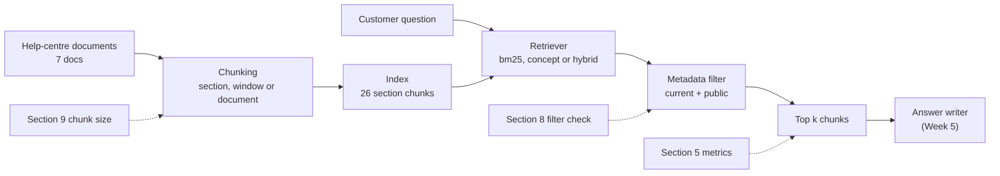
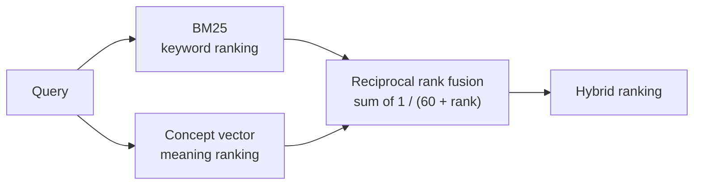

# Week 4 theory: Retrieval evaluation

*Before grading an answer, check with free arithmetic whether the right policy passage ever reached the agent.*

Week 4 of 16. [Course index](../../../simplified-course-index.md).

> **Source note.** Results are inherited, not rerun.

> **Before you start.** Review [Week 3](../../week-03-judges-and-human-calibration/theory/week-03-judges-and-human-calibration-theory-simplified-structured.md) and RAG in the [setup primer](../../../setup.md). This week covers search; Week 5 covers writing. Exercises are in the [hands-on file](../handson/week-04-retrieval-evaluation-handson.md).

*Lab: `handson/lab.py`  
Notebook: [`week-04-retrieval-evaluation-handson.ipynb`](../handson/week-04-retrieval-evaluation-handson.ipynb)  
Queries: `datasets/retrieval/policy-queries-v1.jsonl`  
Corpus: `datasets/policies/`, `datasets/corpus/`*

---

## 1. What this week builds

**Project state.** V1 has policy rules in its code. Real agents search for policy. This week adds help-centre search, which can fail before answer writing starts.

**Time.** 9 hours: 2 reading, 3 building, 2 running experiments, 1 on trade-offs and 1 on the design review.

By the end of the week you can:

1. Calculate Precision@k, Recall@k, Hit Rate@k, MRR, and nDCG by hand.
2. Test 50 labeled queries at k = 3 and 5, overall and by slice.
3. Compare keyword, concept-vector, and hybrid search.
4. Measure filter and chunk-size effects, including context size.
5. Choose between MRR and Recall@k for different questions.

This week adds seven help-centre documents (`datasets/policies/`, `datasets/corpus/`), fifty graded queries (`datasets/retrieval/`), `shared/retrieval.py`, and a benchmark.

---

## 2. Two searches that fail before any answer is written

### 2.1 The superseded policy ranks second

A customer asks: *"Is the refund window 60 days?"* Current policy says 30. The old 2025-06 policy says 60. Without filtering, hybrid search returns:

| Part | Details |
| --- | --- |
| 1 | 1. refund-policy-2026-01#R2               grade 3 |
| 2 |   2. refund-policy-2025-06#R2               grade 0  <- superseded/public |
| 3 |   3. payments-policy-2026-01#P2             grade 0 |
| 4 |   4. shipping-policy-2026-01#S3             grade 0 |
| 5 |   5. refund-escalation-playbook-2026-01#I2  grade 0  <- current/internal |

*Table 1: Reference values.*

The current rule ranks first, giving good relevance scores. But an outdated rule and an internal fraud playbook also enter the top five. Neither should reach a customer answer.

### 2.2 The exact rule number finds nothing

For *"What does section R6 of the refund policy cover?"*, keyword search misses R6 in all five chunks. The chunk says "One refund per order" but omits "R6", so the identifying term cannot match.

> **Watch out.** Search fails before writing begins. A wrong answer may need a search fix rather than a writing fix.

---

## 3. The search half of a RAG system

New terms for this section:

- **Corpus:** searchable documents; here, seven, including an old policy and an internal playbook.
- **Chunk:** one searchable passage. The default uses 26 numbered policy sections.
- **Retriever:** the search step that ranks chunks.
- **Top k:** the first k returned chunks; top five when k = 5.
- **Rank:** position in the list, starting at 1.
- **Metadata filter:** limits results, such as current and public only.

*Figure 1: Source diagram.*

---

## 4. Relevance labels

New terms for this section:

- **Relevance label:** a person's prewritten judgment of a passage's usefulness for a query.
- **Graded relevance:** 3 answers the query; 2 supplies needed context; 1 is related; unlabeled means 0.
- **Hard negative:** looks useful but is wrong, such as the old 2025-06 policy.

Three choices shape the 50 labeled queries:

- **Label sections:** a chunk takes the highest grade of its sections. Labels work across section, window, and document chunking.
- **Label current, public sections only:** old or internal chunks score 0 and count as violations.
- **Group difficult queries into slices.**

| Slice | Queries | What makes it hard |
| --- | --- | --- |
| `direct` | 16 | Nothing. The query uses the policy's words |
| `paraphrase` | 10 | The query shares almost no words with the passage ("my mug showed up in pieces") |
| `exact_term` | 8 | The query hinges on a code, number or amount ("R6", "$9.99", "110%") |
| `outdated_trap` | 6 | The query echoes the superseded policy ("60 days", "team lead") |
| `restricted_trap` | 5 | The query matches the internal playbook ("a $3,000 refund", "a new card") |
| `multi_section` | 5 | A full answer needs two or three sections |

*Table 2: Reference values.*

> **Watch out.** Only the course author labeled these queries. Another reviewer may disagree. Exercise 2 asks you to review some labels.

---

## 5. Five metrics, five questions

New terms for this section:

- **Precision@k:** relevant chunks divided by k.
- **Recall@k:** share of labeled sections covered by top-k chunks.
- **Hit Rate@k:** 1 for any relevant top-k chunk, otherwise 0. Average across queries.
- **MRR**, mean reciprocal rank: average 1/rank of the first relevant chunk. Here, no top-k hit gives 0.
- **nDCG@k**, normalized discounted cumulative gain: graded relevance, with less credit at lower ranks, compared with the best ranking.

| Question | Metric | Blind spot |
| --- | --- | --- |
| How much is useful? | Precision@k | Missing evidence |
| Did we find required sections? | Recall@k | Rank |
| Any useful result? | Hit Rate@k | Later results |
| First useful result near top? | MRR | Later useful passages |
| Useful sections ordered well? | nDCG@k | Requires graded labels; measures only top k |

*Table 3: Reference values.*

### 5.1 The formulas

| Part | Details |
| --- | --- |
| 1 | precision@k = relevant chunks in top k / k |
| 2 | recall@k    = labeled sections covered by top k / labeled sections |
| 3 | hit@k       = 1 if any relevant chunk in top k, else 0 |
| 4 | RR@k        = 1 / rank of the first relevant chunk in top k   (0 if none) |
| 5 | DCG@k       = sum over ranks i = 1..k of (2^grade_i - 1) / log2(i + 1) |
| 6 | nDCG@k      = DCG@k / DCG@k of the best possible order |

*Table 4: Reference values.*

### 5.2 What each one does as k moves

- **Precision:** one relevant section gives at most 1/5 at k = 5, even if ranked first.
- **Recall:** grows with k, but more results help only when they include missing sections.
- **MRR:** ignores everything after the first hit.
- **nDCG:** credit each section once. Repeated windows must not earn duplicate gain. See [drill 2](../handson/week-04-retrieval-evaluation-handson.md#drill-2-ndcg-above-one).

---

## 6. The metrics, by hand

`dataset/hand_rankings.jsonl` contains three hand-written section rankings. These are practice examples, not search output.

### 6.1 Worked example, the outdated policy ranked first

Query: *"Is the refund window 60 days?"* Gold: `refund-policy-2026-01#R2`, grade 3. The practice ranking places old R2 first, current R2 second.

1. Relevant chunks in the top 3: one, at rank 2. Precision@3 = 1/3 = 0.333.
2. Labeled sections covered: 1 of 1. Recall@3 = 1.0, and Hit@3 = 1.0.
3. First relevant rank is 2. RR@3 = 1/2 = 0.5.
4. DCG@3 = (2³ − 1) / log2(3) = 7 / 1.585 = 4.417. The best order puts grade 3 at rank 1: DCG = 7. nDCG@3 = 4.417 / 7 = 0.631.

### 6.2 Worked example, related sections first and the answer at rank 4

Query: *"My final-sale rug arrived damaged 3 days ago, can I get a refund?"* Grades: R3 = 3, S3 = 2, R2 = 1. Ranking: S3, R2, E1, R3, P1.

1. At k = 3: S3 and R2 are relevant. Precision@3 = 2/3 = 0.667, Recall@3 = 2/3 = 0.667.
2. The first chunk is relevant. RR@3 = 1.0.
3. DCG@3 = (2² − 1)/1 + (2¹ − 1)/log2(3) = 3 + 0.631 = 3.631.
4. The best order is grades 3, 2, 1: IDCG = 7 + 3/1.585 + 1/2 = 9.393. nDCG@3 = 3.631 / 9.393 = 0.387.
5. At k = 5, R3 enters at rank 4. Recall@5 = 1.0, and DCG@5 = 3.631 + 7/log2(5) = 6.646, so nDCG@5 = 0.708.

MRR is 1.0 despite the answer sitting at rank 4. It stops at the first relevant chunk. nDCG shows that the useful sections are poorly ordered.

### 6.3 Worked example, the best possible order

R3, S3, R2 is the best order: nDCG@3 = 1.0 and Precision@3 = 1.0.

---

## 7. Three local retrievers

New terms for this section:

- **BM25:** keyword scoring that rewards shared rare words, limits rewards for repeats, and adjusts for chunk length.
- **Embedding:** numbers representing meaning. **Cosine similarity** compares their directions.
- **Concept vector:** a teaching substitute. A hand-written word list maps "broken", "cracked", and "pieces" to DAMAGE, then counts concepts.
- **Hybrid retrieval:** combines keyword and vector rankings.
- **Reciprocal rank fusion (RRF):** adds 1 / (60 + rank) from each ranking for a chunk.

*Figure 2: Source diagram.*

| Retriever | Good at | Weak at |
| --- | --- | --- |
| BM25 | Codes, amounts and exact wording | Paraphrases with no shared words |
| Concept vector | Paraphrases its lexicon covers | Codes and numbers, and any concept missing from the lexicon |
| Hybrid (RRF) | Holding up across slices | Either input's strong slice can be diluted by the other |

*Table 5: Reference values.*

> **Watch out.** The concept word list was written with the 50 queries, so it benefits from seeing test vocabulary. This is leakage. Its scores do not measure learned embeddings. Use the optional `dense-live` experiment before drawing conclusions about dense search.

---

## 8. Metadata filters

New terms for this section:

- **Filter violation**: a retrieved chunk that the filter should have excluded, here one that is superseded or internal.
- **Post-filter**: rank everything, then drop excluded chunks and cut to k. This lab post-filters.
- **Pre-filter**: restrict the search to allowed chunks before ranking.

Hybrid at k = 5 with the filter off and on:

| Filter | Recall@5 | Hit@5 | MRR | Violations in 250 slots |
| --- | --- | --- | --- | --- |
| off | 0.850 | 0.900 | 0.724 | 57 |
| on | 0.903 | 0.960 | 0.835 | 0 |

*Table 6: Reference values.*

- **Better relevance:** removing old and internal chunks frees places for current public passages.
- **Separate harm:** relevance scores do not fully show the risk of exposing internal text or outdated rules.
- **Short lists:** filtering a limited candidate list can leave fewer than k chunks. Pre-filtering searches only allowed content and requires backend support.

> **Watch out.** Enforce access rules in the backend before text reaches the prompt. A prompt instruction or optional model filter cannot protect internal documents. Week 5 tests this failure.

---

## 9. Chunk size

New terms for this section:

- **Window chunking**: fixed 25-word windows that ignore section boundaries.
- **Document chunking**: one chunk per whole document.
- **Context size**: the words sent to the answer writer, here the total words in the top k.

Hybrid at k = 5, filtered:

| Chunking | Precision@5 | Recall@5 | nDCG@5 | Words sent |
| --- | --- | --- | --- | --- |
| section | 0.240 | 0.903 | 0.808 | 142 |
| window | 0.344 | 0.900 | 0.796 | 122 |
| document | 0.244 | 1.000 | 0.891 | 529 |

*Table 7: Reference values.*

- **Documents:** five cover all needed material, but send 3.7 times as many words.
- **Windows:** repeated chunks from one section raise precision without finding more sections.
- **Sections:** one rule per chunk makes labels and citations easier to match.

---

## 10. Reading the benchmark

### 10.1 Worked example, retrievers at k = 3 and k = 5

All filtered, section chunks:

| Retriever | P@3 | R@3 | P@5 | R@5 | Hit@5 | MRR@5 | nDCG@5 |
| --- | --- | --- | --- | --- | --- | --- | --- |
| bm25 | 0.313 | 0.740 | 0.212 | 0.800 | 0.880 | 0.775 | 0.731 |
| concept | 0.353 | 0.810 | 0.240 | 0.897 | 0.940 | 0.843 | 0.808 |
| hybrid | 0.347 | 0.813 | 0.240 | 0.903 | 0.960 | 0.835 | 0.808 |

*Table 8: Reference values.*

1. Moving from k = 3 to 5 adds about 0.06–0.09 recall and loses about 0.1 precision here.
2. Hybrid and concept tie on nDCG. They miss 2 and 3 queries; BM25 misses 6 of 50.
3. Similar averages hide different slice results.

### 10.2 Worked example, the slices

| Slice | BM25 Recall@5 | Concept Recall@5 | Hybrid Recall@5 | BM25 MRR | Concept MRR | Hybrid MRR |
| --- | --- | --- | --- | --- | --- | --- |
| `paraphrase` | 0.500 | 0.850 | 0.750 | 0.323 | 0.740 | 0.570 |
| `exact_term` | 0.875 | 0.875 | 1.000 | 0.875 | 0.698 | 0.760 |

*Table 9: Reference values.*

- **Paraphrases:** BM25 misses half the sections. "My mug showed up in pieces" shares few useful words with policy.
- **Exact terms:** BM25 MRR is 0.875, against concept's 0.698.
- **Hybrid:** finds all exact-term sections but ranks them below BM25. It also weakens concept's paraphrase results. It balances these groups rather than winning both.

### 10.3 When MRR is the right metric, and when Recall@k is

- **MRR:** use when one passage answers the question, such as card-refund timing.
- **Recall@k:** use when several passages are needed. The rug needs R3 and S3; H2 has MRR 1.0 with R3 still at rank 4.
- **nDCG:** use when usefulness varies and ordering matters.
- **Report several metrics:** each misses a different failure from section 5.

---

## 11. Design review

### Q1 – A team reports MRR 0.84 and calls retrieval done. What do you ask?

Ask how many questions need several passages and their Recall@k. MRR can be perfect while the deciding rule is missing. Request slice-level recall, nDCG, and filter violations alongside it.

### Q2 – Hybrid beats BM25 overall but loses to it on exact terms. Which do you ship?

Choose based on live queries and failure costs. For common codes or amounts, try fusion weights, adding section labels to chunks (drill 1), or routing code queries to keyword search. Report slice trade-offs.

### Q3 – The concept retriever's paraphrase recall is 0.85. Why not trust that number?

The word list saw the test vocabulary. Use new paraphrases written without seeing that list, or measure a learned embedding model instead.

### Q4 – Where must the "current, public" filter live, and how do you test it?

Enforce it in the search backend or calling service. Test old-policy and internal-document traps. Count every violation, targeting zero. Never rely on a prompt instruction.

### Q5 – Document chunks give Recall@5 = 1.0. Why not use them?

Documents send 529 words versus 142 for sections. Extra text costs time and tokens and can hide the deciding sentence. Measure recall, context size, and answer quality together in Week 5.

---

## Key Takeaways

- Search errors include the 60-day trap and missing R6.
- Section labels work across chunk sizes; include misleading wrong passages.
- Use five metrics for noise, coverage, hits, first-hit rank, and graded ordering.
- Compare slices; no retriever wins everywhere.
- Count filter violations separately: 57 occur without filtering.
- Documents reach recall 1.0 with 3.7 times the words.
- The test-tuned concept word list is a teaching example.

## Check Yourself

1. One relevant section ranks first. Precision@5? **1/5 = 0.2.**
2. H2: MRR 1.0, nDCG@3 0.387. Meaning? **Related text comes first; the deciding passage ranks low.**
3. Why did windows give nDCG 1.051? **Duplicate section gain; credit each section once.**
4. Why filter despite recall only moving 0.850 to 0.903? **57 old/internal chunks create separate harm.**
5. BM25 paraphrase recall is 0.50. Two fixes? **Try meaning-based search and rewrite queries in policy vocabulary.**
6. When lead with MRR? **One-passage answers where first-hit rank matters; use recall for several passages.**

## Memory card

| Term | Meaning in this course |
| --- | --- |
| Chunk | One searchable passage, by default one policy section |
| Graded relevance | 3 answers, 2 needed context, 1 related, 0 unlabeled |
| Hard negative | Looks right, isn't: the superseded 2025-06 policy |
| Precision@k | Relevant chunks in top k / k |
| Recall@k | Labeled sections covered / labeled sections |
| MRR | Mean of 1 / rank of the first relevant chunk |
| nDCG@k | Graded, rank-discounted gain over the best possible gain |
| RRF | Hybrid score: sum of 1 / (60 + rank) |
| Filter violation | A superseded or internal chunk in the top k |

*Table 10: Reference values.*

**Rules of thumb.** Measure retrieval before grading answers. Report every metric by slice. Count filter violations as a hard rule. Never trust a retriever tuned on its own test queries.

**Next week.** Week 5 checks answers for support, current-policy correctness, citations, and refusal when evidence is missing or restricted. It reuses the old-policy and internal-playbook traps.

## References

- [Hands-on file](../handson/week-04-retrieval-evaluation-handson.md)
- [`week-04-retrieval-evaluation-handson.ipynb`](../handson/week-04-retrieval-evaluation-handson.ipynb)
- [`shared/retrieval.py`](../../../shared/retrieval.py)
- Stephen Robertson and Hugo Zaragoza, "The Probabilistic Relevance Framework: BM25 and Beyond", *Foundations and Trends in Information Retrieval* 3(4), 2009: the source of BM25.
- Kalervo Järvelin and Jaana Kekäläinen, "Cumulated gain-based evaluation of IR techniques", *ACM Transactions on Information Systems* 20(4), 2002: the source of nDCG.
- Gordon V. Cormack, Charles L. A. Clarke and Stefan Büttcher, "Reciprocal rank fusion outperforms Condorcet and individual rank learning methods", SIGIR 2009: the source of RRF and its constant of 60.
- [Glossary](../../../glossary.md)

---

**Next:** [Week 5 theory: Answer quality and evidence](../../week-05-answer-quality-and-evidence/theory/week-05-answer-quality-and-evidence-theory-simplified-structured.md)  
**Previous:** [Week 3 theory: Model judges and human calibration](../../week-03-judges-and-human-calibration/theory/week-03-judges-and-human-calibration-theory-simplified-structured.md)
