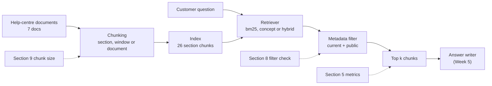
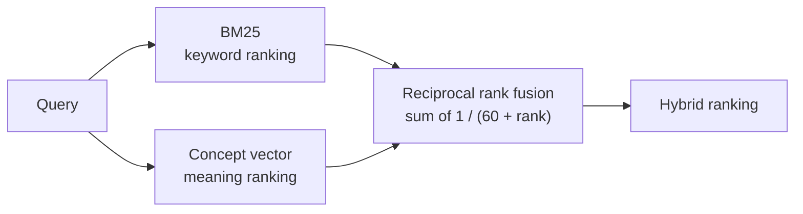

# Week 4 theory: Retrieval evaluation

*Before grading an answer, check with free arithmetic whether the right policy passage ever reached the agent.*

◷ 15 min read · Week 4 of 16 · Intermediate · [Course index](../../../README.md)

> **Before you start.** This page assumes Weeks 1 to 3, ending with the [Week 3 theory](../../week-03-judges-and-human-calibration/theory/week-03-judges-and-human-calibration-theory.md), and the retrieval-augmented generation section of the [setup primer](../../../setup.md). It covers the search half of a RAG system. Week 5 covers the half that writes the answer. The commands, the lab output and the exercises are in the [hands-on file](../handson/week-04-retrieval-evaluation-handson.md).

*Lab: `handson/lab.py` · Notebook: `week-04-retrieval-evaluation-handson.ipynb` · Queries: `datasets/retrieval/policy-queries-v1.jsonl` · Corpus: `datasets/policies/`, `datasets/corpus/`*

---

## 1. What this week builds

**Project state.** Agent v1 knows the refund policy because its rules are written into its code. Real support agents look policy up. From this week the agent's policy knowledge comes from a help-centre search, and that search can fail on its own.

**Time.** 9 hours: 2 reading, 3 building, 2 running experiments, 1 on trade-offs and 1 on the design review.

By the end of the week you can:

1. Calculate Precision@k, Recall@k, Hit Rate@k, MRR and nDCG by hand for a fixed ranking, and confirm the lab agrees.
2. Run a retrieval benchmark of 50 labeled policy queries at k = 3 and k = 5, overall and by slice.
3. Compare a keyword retriever, a concept-vector retriever and a hybrid, and say which slice each one wins.
4. Measure what a metadata filter and a chunking choice change, including the cost in context size.
5. Explain when MRR is the right metric and when Recall@k is.

The week adds a help-centre corpus of 7 documents (`datasets/policies/` and `datasets/corpus/`), 50 policy queries with graded labels (`datasets/retrieval/`), a shared retrieval module (`shared/retrieval.py`) and a benchmark lab.

---

## 2. Two searches that fail before any answer is written

### 2.1 The superseded policy ranks second

A customer asks: *"Is the refund window 60 days?"* The current policy says 30 days. The corpus also holds the superseded 2025-06 policy, which said 60. Without a filter, the hybrid retriever returns:

```text
  1. refund-policy-2026-01#R2               grade 3
  2. refund-policy-2025-06#R2               grade 0  <- superseded/public
  3. payments-policy-2026-01#P2             grade 0
  4. shipping-policy-2026-01#S3             grade 0
  5. refund-escalation-playbook-2026-01#I2  grade 0  <- current/internal
```

The right passage is first, so every relevance metric scores this query well. Two of the five passages must never reach a customer answer, though: an outdated rule that says "60 days", and an internal fraud playbook.

### 2.2 The exact rule number finds nothing

A customer asks: *"What does section R6 of the refund policy cover?"* The keyword retriever returns five chunks, and none of them is R6. The chunk text holds the heading "One refund per order" but not the label "R6", so the one word that identifies the section never matches.

> **Watch out.** Both failures happen before the agent writes a word. An answer graded wrong in Week 5 might be a search failure, and the fix for a search failure is different from the fix for a writing failure.

---

## 3. The search half of a RAG system

New terms for this section:

- **Corpus**: the documents the agent can search. Here, 7 help-centre documents, including one superseded policy and one internal playbook.
- **Chunk**: a passage cut from a document so it can be searched. Here, one chunk per numbered policy section by default, 26 in all.
- **Retriever**: the search step that ranks chunks for a query.
- **Top k**: the k highest-ranked chunks the retriever returns. With k = 5, the first five are scored.
- **Rank**: a chunk's position in that list, starting at 1.
- **Metadata filter**: a rule sent with the search, such as "current policy only" or "public audience only", that limits which chunks can come back.

This diagram shows where retrieval sits and where this week's checks read.



---

## 4. Relevance labels

New terms for this section:

- **Relevance label**: a person's judgment of how useful a passage is for a query, written before any retriever runs.
- **Graded relevance**: a usefulness score instead of yes or no. Here, 3 answers the query, 2 is needed context, 1 is related, and anything unlabeled is 0.
- **Hard negative**: a passage that looks right and isn't. The superseded 2025-06 refund policy is the main one in this corpus.

Three choices shape the 50 labeled queries:

- **Labels name policy sections, not chunks.** A chunk's grade is the highest grade among the sections it covers. The same labels then work for section chunks, word windows and whole documents, which is what makes the chunking experiment in section 9 possible.
- **Only current, public sections are labeled.** A superseded or internal chunk is never relevant. When the filter is off, it scores 0 and counts as a violation.
- **Slices group the queries by what makes them hard.**

| Slice | Queries | What makes it hard |
| --- | --- | --- |
| `direct` | 16 | Nothing. The query uses the policy's words |
| `paraphrase` | 10 | The query shares almost no words with the passage ("my mug showed up in pieces") |
| `exact_term` | 8 | The query hinges on a code, number or amount ("R6", "$9.99", "110%") |
| `outdated_trap` | 6 | The query echoes the superseded policy ("60 days", "team lead") |
| `restricted_trap` | 5 | The query matches the internal playbook ("a $3,000 refund", "a new card") |
| `multi_section` | 5 | A full answer needs two or three sections |

> **Watch out.** These labels were written by one annotator, the course author, and nobody has reviewed them. A second labeler would disagree on some grades. Exercise 2 asks you to check a few.

---

## 5. Five metrics, five questions

New terms for this section:

- **Precision@k**: the share of the top k chunks that are relevant at all.
- **Recall@k**: the share of the labeled sections that some top-k chunk covers.
- **Hit Rate@k**: 1 if any top-k chunk is relevant, else 0. Averaged over queries, it is the share of queries with at least one hit.
- **MRR** (mean reciprocal rank): 1 divided by the rank of the first relevant chunk, averaged over queries. Here it is cut at k, so a query with no hit in the top k scores 0.
- **nDCG@k** (normalized discounted cumulative gain): a ranking score that uses graded relevance and gives less credit further down the list.

| Question a reviewer asks | Metric | What it ignores |
| --- | --- | --- |
| How much of what we sent is useful? | Precision@k | Whether anything important is missing |
| Did we find everything that matters? | Recall@k | Where in the list it appeared |
| Did we find anything at all? | Hit Rate@k | Everything after the first hit |
| Is the first useful passage near the top? | MRR | Every relevant passage after the first |
| Is the order right when usefulness has degrees? | nDCG@k | Nothing in the top k, but it needs graded labels |

### 5.1 The formulas

```text
precision@k = relevant chunks in top k / k
recall@k    = labeled sections covered by top k / labeled sections
hit@k       = 1 if any relevant chunk in top k, else 0
RR@k        = 1 / rank of the first relevant chunk in top k   (0 if none)
DCG@k       = sum over ranks i = 1..k of (2^grade_i - 1) / log2(i + 1)
nDCG@k      = DCG@k / DCG@k of the best possible order
```

### 5.2 What each one does as k moves

- **Precision is capped by the labels.** A query with one relevant section scores at most 1/5 at k = 5, even when that section is ranked first.
- **Recall rises with k, up to a ceiling.** A section the retriever never ranks highly stays unreachable at any k.
- **MRR only reads the first hit.** Retrieving more chunks cannot change it once a hit exists.
- **nDCG credits each labeled section once.** Two window chunks cut from the same section must not both earn its gain. Without that rule nDCG can exceed 1, as [debugging drill 2](../handson/week-04-retrieval-evaluation-handson.md#drill-2-ndcg-above-one) shows.

---

## 6. The metrics, by hand

The three fixed rankings in `dataset/hand_rankings.jsonl` use section chunks. They are fixtures written to be checked by hand, not retriever output.

### 6.1 Worked example, the outdated policy ranked first

Query: *"Is the refund window 60 days?"* The label is `refund-policy-2026-01#R2` at grade 3. The fixed ranking puts the superseded R2 first and the current R2 second.

1. Relevant chunks in the top 3: one, at rank 2. Precision@3 = 1/3 = 0.333.
2. Labeled sections covered: 1 of 1. Recall@3 = 1.0, and Hit@3 = 1.0.
3. First relevant rank is 2. RR@3 = 1/2 = 0.5.
4. DCG@3 = (2³ − 1) / log2(3) = 7 / 1.585 = 4.417. The best order puts grade 3 at rank 1: DCG = 7. nDCG@3 = 4.417 / 7 = 0.631.

### 6.2 Worked example, related sections first and the answer at rank 4

Query: *"My final-sale rug arrived damaged 3 days ago, can I get a refund?"* Labels: R3 at grade 3 (final sale), S3 at grade 2 (transit damage), R2 at grade 1 (the window). The ranking is S3, R2, E1, R3, P1.

1. At k = 3: S3 and R2 are relevant. Precision@3 = 2/3 = 0.667, Recall@3 = 2/3 = 0.667.
2. The first chunk is relevant. RR@3 = 1.0.
3. DCG@3 = (2² − 1)/1 + (2¹ − 1)/log2(3) = 3 + 0.631 = 3.631.
4. The best order is grades 3, 2, 1: IDCG = 7 + 3/1.585 + 1/2 = 9.393. nDCG@3 = 3.631 / 9.393 = 0.387.
5. At k = 5, R3 enters at rank 4. Recall@5 = 1.0, and DCG@5 = 3.631 + 7/log2(5) = 6.646, so nDCG@5 = 0.708.

MRR is a perfect 1.0, and the passage that actually answers the question sits at rank 4. MRR saw a relevant chunk first and stopped looking. nDCG shows the ranking is poor.

### 6.3 Worked example, the best possible order

The same query ranked R3, S3, R2 scores nDCG@3 = 1.0. It also has Precision@3 = 1.0, because all three labeled sections fit in the top 3.

---

## 7. Three local retrievers

New terms for this section:

- **BM25**: a keyword scoring formula. It rewards words the query and chunk share, more for rare words, with diminishing returns for repeats and a penalty for long chunks.
- **Embedding**: a list of numbers standing for a text's meaning. Similar meanings get nearby vectors, compared by **cosine similarity**.
- **Concept vector**: this course's stand-in for an embedding. A hand-built lexicon maps words to concepts ("broken", "cracked" and "pieces" all count as DAMAGE), and the vector counts concepts.
- **Hybrid retrieval**: combining keyword and vector rankings.
- **Reciprocal rank fusion (RRF)**: a hybrid method that scores each chunk by the sum of 1 / (60 + rank) across the rankings being fused.

This diagram shows how the hybrid combines the other two.



| Retriever | Good at | Weak at |
| --- | --- | --- |
| BM25 | Codes, amounts and exact wording | Paraphrases with no shared words |
| Concept vector | Paraphrases its lexicon covers | Codes and numbers, and any concept missing from the lexicon |
| Hybrid (RRF) | Holding up across slices | Either input's strong slice can be diluted by the other |

> **Watch out.** The concept lexicon was written alongside the 50 queries, so its paraphrase results flatter it. That is the Week 2 leakage problem in a new form: the retriever was tuned on the test questions. A learned embedding model carries no such list. Treat the concept-vector numbers as a teaching device, and run the optional live embeddings (`dense-live`) before drawing conclusions about dense retrieval.

---

## 8. Metadata filters

New terms for this section:

- **Filter violation**: a retrieved chunk that the filter should have excluded, here one that is superseded or internal.
- **Post-filter**: rank everything, then drop excluded chunks and cut to k. This lab post-filters.
- **Pre-filter**: restrict the search to allowed chunks before ranking.

Hybrid at k = 5 with the filter off and on:

| Filter | Recall@5 | Hit@5 | MRR | Violations in 250 slots |
| --- | --- | --- | --- | --- |
| off | 0.850 | 0.900 | 0.724 | 57 |
| on | 0.903 | 0.960 | 0.835 | 0 |

- **The filter improves relevance and safety together.** Superseded and internal chunks no longer take top-k slots, so current, public passages move up.
- **Relevance metrics alone miss the problem.** A violation is not "irrelevant" in a way that hurts recall much. It is a different harm: an outdated rule or an internal document reaching a customer answer.
- **Post-filtering can empty the list.** If the top 20 results are all internal, a post-filter returns fewer than k chunks. A pre-filter avoids that, at the cost of filter support in the index.

> **Watch out.** A metadata filter is an access control only when the backend enforces it. A filter the model can be talked out of, or one applied after the internal text is already in the prompt, does not protect anything. Week 5 tests what happens when a restricted chunk gets through.

---

## 9. Chunk size

New terms for this section:

- **Window chunking**: fixed 25-word windows that ignore section boundaries.
- **Document chunking**: one chunk per whole document.
- **Context size**: the words sent to the answer writer, here the total words in the top k.

Hybrid at k = 5, filtered:

| Chunking | Precision@5 | Recall@5 | nDCG@5 | Words sent |
| --- | --- | --- | --- | --- |
| section | 0.240 | 0.903 | 0.808 | 142 |
| window | 0.344 | 0.900 | 0.796 | 122 |
| document | 0.244 | 1.000 | 0.891 | 529 |

- **Whole documents buy perfect recall by sending everything.** Five documents cover the whole corpus that matters, at 3.7 times the words.
- **Windows raise precision without raising recall.** Several windows from one relevant section each count as relevant chunks, and they add no new section.
- **Section chunks match how the policy is written.** Each chunk is one rule, which also makes citations and labels line up.

---

## 10. Reading the benchmark

### 10.1 Worked example, retrievers at k = 3 and k = 5

All filtered, section chunks:

| Retriever | P@3 | R@3 | P@5 | R@5 | Hit@5 | MRR@5 | nDCG@5 |
| --- | --- | --- | --- | --- | --- | --- | --- |
| bm25 | 0.313 | 0.740 | 0.212 | 0.800 | 0.880 | 0.775 | 0.731 |
| concept | 0.353 | 0.810 | 0.240 | 0.897 | 0.940 | 0.843 | 0.808 |
| hybrid | 0.347 | 0.813 | 0.240 | 0.903 | 0.960 | 0.835 | 0.808 |

1. **Raising k from 3 to 5 lifts recall by about 0.06 to 0.09 and lowers precision by about 0.1.** That is the usual trade-off.
2. **Hybrid and concept tie on nDCG.** Hybrid misses on 2 queries out of 50, concept on 3 and BM25 on 6.
3. **The averages are close.** The slices are not.

### 10.2 Worked example, the slices

| Slice | BM25 Recall@5 | Concept Recall@5 | Hybrid Recall@5 | BM25 MRR | Concept MRR | Hybrid MRR |
| --- | --- | --- | --- | --- | --- | --- |
| `paraphrase` | 0.500 | 0.850 | 0.750 | 0.323 | 0.740 | 0.570 |
| `exact_term` | 0.875 | 0.875 | 1.000 | 0.875 | 0.698 | 0.760 |

- **BM25 loses half the paraphrase sections.** "My mug showed up in pieces" shares no useful word with the refund window passage.
- **BM25 ranks exact terms best.** Its MRR on `exact_term` is 0.875 against the concept vector's 0.698.
- **Hybrid wins neither slice outright.** It finds every exact-term section but ranks them lower than BM25, and it dilutes the concept vector's paraphrase wins. It is the most even, not the best everywhere.

### 10.3 When MRR is the right metric, and when Recall@k is

- **Use MRR when one passage is enough** and the reader takes the first good one: "How long does a card refund take?" has one answer, and its rank is what matters.
- **Use Recall@k when the answer needs several passages.** The final-sale rug query needs R3 and S3. Hand ranking H2 scores MRR 1.0 while the deciding passage sits at rank 4.
- **Use nDCG when relevance has degrees** and order matters.
- **Never report one alone.** Each blind spot in the table in section 5 is a failure some query in this set exhibits.

---

## 11. Design review

### Q1 – A team reports MRR 0.84 and calls retrieval done. What do you ask?

How many queries need more than one passage, and what Recall@k they get. MRR stops at the first relevant chunk. On multi-section questions it can be perfect while the deciding passage never reaches the prompt. Ask for Recall@k and nDCG beside it, by slice, and for the filter-violation count, which no relevance metric reports.

### Q2 – Hybrid beats BM25 overall but loses to it on exact terms. Which do you ship?

Decide from the traffic and the cost of each failure. If customers often quote rule numbers, order codes or amounts, an exact-term miss is common and visible. Options short of choosing one: tune the fusion weights, add the section label to the chunk text (drill 1), or route queries containing codes to keyword search. Report the slice trade-off in the decision, not only the average.

### Q3 – The concept retriever's paraphrase recall is 0.85. Why not trust that number?

Its lexicon was written alongside the queries, so it has seen the test vocabulary. That is leakage into the system under test. Score it on paraphrases written by someone who never saw the lexicon, or replace it with a learned embedding model and measure that.

### Q4 – Where must the "current, public" filter live, and how do you test it?

In the backend search request, enforced by the index or the service that calls it, never in a prompt instruction. Test it with trap queries built to match superseded and internal text, and count violations in every benchmark run as a hard rule with a target of zero. Week 5 shows what an internal chunk does once it reaches the answer.

### Q5 – Document chunks give Recall@5 = 1.0. Why not use them?

Recall rose because each chunk now holds a whole document, 529 words per query against 142. Every extra word costs tokens and latency, and buries the deciding sentence among unrelated rules, which hurts the answer writer. Choose chunk size by measuring recall, context size and, in Week 5, answer quality together.

---

## Key Takeaways

- **Search fails before writing does.** The 60-day trap and the R6 miss happen before any answer exists.
- **Label sections, grade them, and include hard negatives.** Section labels survive any chunking choice.
- **Five metrics answer five questions.** Precision for noise, recall for coverage, hit rate for anything at all, MRR for the first hit, nDCG for graded order.
- **No retriever wins every slice.** BM25 ranks exact terms best, the concept vector wins paraphrases, and hybrid is the most even.
- **Count filter violations separately.** 57 superseded or internal chunks appear with the filter off, and recall barely notices.
- **Chunk size trades recall for context.** Whole documents reach recall 1.0 by sending 3.7 times the words.
- **A retriever tuned on the test queries flatters itself.** The concept lexicon is a teaching device, not evidence about dense retrieval.

## Check Yourself

1. A query has one labeled section, ranked first. What is Precision@5? **0.2. Precision@k is capped by the number of relevant sections.**
2. Ranking H2 has MRR 1.0 and nDCG@3 0.387. What does that combination say? **A relevant chunk is first, but the passage that answers the query is ranked low. MRR stops at the first hit.**
3. Why did window chunks once produce nDCG 1.051? **Several windows from one section each earned that section's gain. Each labeled section must be credited once.**
4. With the filter off, recall drops only from 0.903 to 0.850. Why is the filter still essential? **The 57 violations are superseded and internal chunks that could reach customer answers. Relevance metrics do not measure that harm.**
5. BM25 recall on paraphrases is 0.50. What two changes would you try first? **A meaning-based retriever, such as embeddings or the hybrid, and query rewriting into the policy's vocabulary.**
6. When is MRR the right headline metric? **When one passage answers the query and its rank matters, as in single-fact questions. Use Recall@k when several passages are needed.**

## Memory card

| Term | Meaning in this course |
| --- | --- |
| Chunk | One searchable passage, by default one policy section |
| Graded relevance | 3 answers, 2 needed context, 1 related, 0 unlabeled |
| Hard negative | Looks right, isn't: the superseded 2025-06 policy |
| Precision@k | Relevant chunks in top k / k |
| Recall@k | Labeled sections covered / labeled sections |
| MRR | Mean of 1 / rank of the first relevant chunk |
| nDCG@k | Graded, rank-discounted gain over the best possible gain |
| RRF | Hybrid score: sum of 1 / (60 + rank) |
| Filter violation | A superseded or internal chunk in the top k |

**Rules of thumb.** Measure retrieval before grading answers. Report every metric by slice. Count filter violations as a hard rule. Never trust a retriever tuned on its own test queries.

**Next week.** Week 5 hands these chunks to an answer writer and asks whether its answers are faithful to them, correct against the current policy, properly cited, and silent when the evidence is missing or restricted. Several of this week's traps, the 60-day policy and the internal playbook, become the failures it has to catch.

## References

- [Hands-on file](../handson/week-04-retrieval-evaluation-handson.md): the lab walkthrough, real output, exercises, drills and solutions for this page.
- [`week-04-retrieval-evaluation-handson.ipynb`](../handson/week-04-retrieval-evaluation-handson.ipynb): the same lab as a notebook.
- [`shared/retrieval.py`](../../../shared/retrieval.py): the corpus loader, the chunkers and the three retrievers.
- Stephen Robertson and Hugo Zaragoza, "The Probabilistic Relevance Framework: BM25 and Beyond", *Foundations and Trends in Information Retrieval* 3(4), 2009: the source of BM25.
- Kalervo Järvelin and Jaana Kekäläinen, "Cumulated gain-based evaluation of IR techniques", *ACM Transactions on Information Systems* 20(4), 2002: the source of nDCG.
- Gordon V. Cormack, Charles L. A. Clarke and Stefan Büttcher, "Reciprocal rank fusion outperforms Condorcet and individual rank learning methods", SIGIR 2009: the source of RRF and its constant of 60.
- [Glossary](../../../glossary.md): every term in the course, with the week that introduces it.

---

**Next:** [Week 5 theory: Answer quality and evidence](../../week-05-answer-quality-and-evidence/theory/week-05-answer-quality-and-evidence-theory.md) · **Previous:** [Week 3 theory: Model judges and human calibration](../../week-03-judges-and-human-calibration/theory/week-03-judges-and-human-calibration-theory.md)
