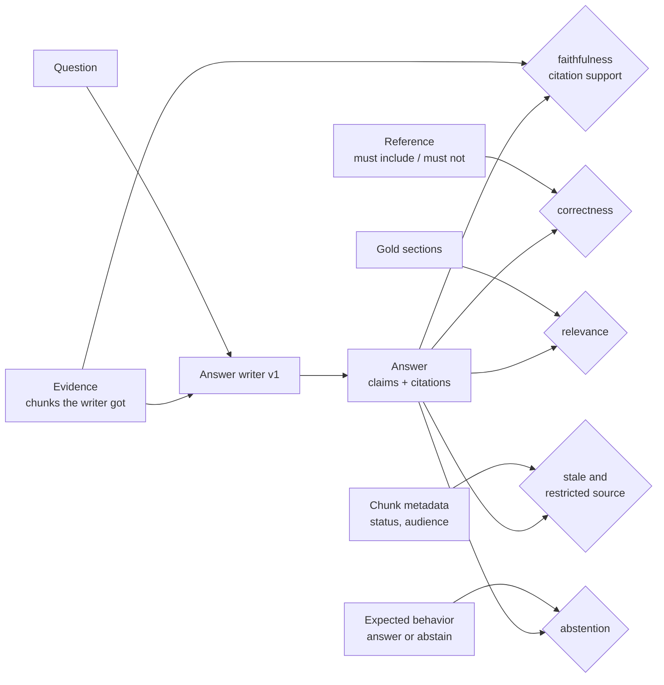
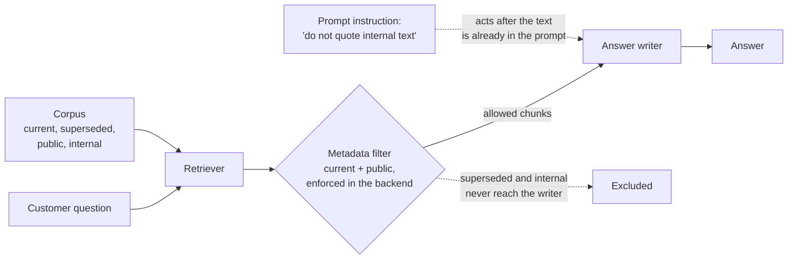

# Week 5 theory: Answer quality and evidence

*Check two things separately: does the answer match its evidence, and is it correct under current policy?*

Week 5 of 16. [Course index](../../../simplified-course-index.md).

> **Source note.** Examples and results come from the original lesson. They were not rerun.

> **Before you start.** This page assumes [Week 4](../../week-04-retrieval-evaluation/theory/week-04-retrieval-evaluation-theory-simplified-structured.md): chunks, the metadata filter, and the superseded and internal documents in the corpus. [Week 3](../../week-03-judges-and-human-calibration/theory/week-03-judges-and-human-calibration-theory-simplified-structured.md) introduced model judges, which return here as Ragas. The commands, the lab output and the exercises are in the [hands-on file](../handson/week-05-answer-quality-and-evidence-handson.md).

*Lab: `handson/lab.py`  
Notebook: [`week-05-answer-quality-and-evidence-handson.ipynb`](../handson/week-05-answer-quality-and-evidence-handson.ipynb)  
Cases: `datasets/answers/answer-cases-v1.jsonl`  
Writer: `shared/answerer.py`*

---

## 1. What this week builds

**Project state.** Week 4 measured whether the help-centre search returns the right policy passages. Nothing yet checks what the agent writes from them.

**Time.** 9 hours: 2 reading, 3 building, 2 breaking things, 1 on trade-offs and 1 on the design review.

By the end of the week you can:

1. Check an answer for faithfulness and citation support, and explain how each differs from correctness.
2. Write correctness checks from a reference answer's required and forbidden facts.
3. Decide when an answer should abstain, and catch an answer that should have.
4. Catch stale and restricted sources in an answer, and show what a metadata filter fixes and what it cannot.
5. Tell a retrieval failure from a generation failure by changing the evidence and rerunning.

The week adds answer writer v1 (`shared/answerer.py`), 24 answer cases in five slices (`datasets/answers/`), seven deterministic checks, and an optional Ragas comparison.

---

## 2. Three answers that look fine

### 2.1 Faithful, cited and wrong

A customer asks: *"How long do I have to ask for a refund?"* The writer receives the superseded 2025-06 refund rule first and the current rule second, and it answers:

> A customer can request a refund within 60 days of delivery. A customer can request a refund within 30 days of delivery.

Both sentences are copied from evidence and cited correctly. But the answer combines an old 60-day rule with the current 30-day rule. Matching evidence does not make it correct.

### 2.2 An answer from nothing

For *"Do you price-match other shops?"*, no passage answers the question. V1 gives a 30-day refund sentence and cites price adjustment. Neither supports that answer. It should say it could not find an answer.

### 2.3 Internal text in a customer answer

A customer asks: *"Is there compensation for my late parcel?"* The top chunk is the internal escalation playbook, and the writer quotes it:

> Agents can offer a goodwill credit of up to $25 without approval when a delivery is late. Do not mention goodwill credits unless the customer has a late delivery.

The answer is faithful to its evidence, and it discloses an internal rule, including the instruction not to disclose it.

> **Watch out.** These three failures need separate checks because they have different causes and fixes.

---

## 3. What an answer is checked against

New terms for this section:

- **Evidence:** chunks given to the writer.
- **Reference answer:** a prewritten correct answer with required and forbidden facts.
- **Gold section:** a policy section that answers the question.
- **Claim:** one statement; here, each copied sentence is one claim.
- **Citation:** the chunk named as support for a claim.

Each check compares the answer with a different reference point. This diagram shows which.

*Figure 1: Source diagram.*

| Check | Question it answers | Reads |
| --- | --- | --- |
| `faithfulness` | Is every claim in the evidence? | Answer and evidence |
| `citation_support` | Does each cited chunk contain its claim? | Answer and the cited chunks |
| `correctness` | Does the answer state the required facts and none of the forbidden ones? | Answer and reference |
| `relevance` | Does the answer draw on a section that answers the question? | Citations and gold sections |
| `abstention` | Did it answer, or abstain, as the case requires? | Answer and expected behavior |
| `stale_source` | Is any claim cited to a superseded policy? | Citations and chunk metadata |
| `restricted_source` | Is any claim cited to an internal document? | Citations and chunk metadata |

*Table 1: Reference values.*

---

## 4. Faithfulness and hallucination

New terms for this section:

- **Faithfulness**: every claim in the answer is supported by the evidence.
- **Hallucination**: a claim the evidence does not support.

V1 copies sentences, so code checks whether each appears in the evidence. Paraphrases need meaning checks: a judge splits claims and checks support. Ragas faithfulness does this, with the variability discussed in Week 3.

- **Faithfulness checks evidence:** the outdated 60-day answer passes.
- **Unsupported means hallucinated here:** even a true statement fails if the retrieved evidence does not support it. The price-match fallback illustrates this.
- **Read both scores:** faithful and wrong suggests bad evidence; unfaithful suggests a writing problem.

---

## 5. Citations

New terms for this section:

- **Citation support**: the chunk cited for a claim actually contains that claim.

Faithfulness asks whether a claim is somewhere in the evidence. Citation support asks whether it is where the answer says it is. They fail separately:

| Answer | Faithfulness | Citation support |
| --- | --- | --- |
| Quotes P2 and cites P2 | pass | pass |
| Quotes P2 but cites P1, P1's sentence cited to P2 | pass | **fail** |
| States a sentence found in no chunk | **fail** | **fail** |

*Table 2: Reference values.*

A wrong citation leads readers to the wrong rule. <code>test_citation_check_<wbr>catches_a_sentence_<wbr>cited_to_the_wrong_chunk</code> tests this; [drill 1](../handson/week-05-answer-quality-and-evidence-handson.md#drill-1-the-citations-point-at-the-wrong-rule) explains it.

---

## 6. Correctness against a reference

New terms for this section:

- **Required fact**: a phrase a correct answer must contain, such as "30 days".
- **Forbidden fact**: a phrase a correct answer must not contain, such as "60 days" or "$25".

Correctness compares the answer with the policy, through the reference, rather than with the evidence:

- **Required facts:** apply to cases expecting an answer, not abstention.
- **Forbidden facts:** apply always, including an unwanted "$25 goodwill credit" in an abstention case.
- **Mixed rules:** the answer includes required "30 days" but fails for forbidden "60 days".

> **Watch out.** Phrase checks are fragile. "3-5 business days" can fail a "3 to 5 business days" requirement. [Drill 2](../handson/week-05-answer-quality-and-evidence-handson.md#drill-2-a-correct-answer-fails-correctness) shows this. Normalize expected formats or use a calibrated judge for varying wording.

---

## 7. Relevance

New terms for this section:

- **Relevance**: the answer addresses the question. Here, it cites at least one gold section.

A supported answer may answer the wrong question. Citing a gold section is a strict code-based test. If search never returns that section, the failure starts in retrieval. Ragas answer relevancy instead generates questions from the answer and compares them with the user's question.

---

## 8. Abstention

New terms for this section:

- **Abstention**: the answer says it cannot answer and hands off, instead of guessing.

Search can return irrelevant chunks when nothing useful exists. For price matching, filtered hybrid search returns R1, R2, and R3. The writer must notice that none answers the question.

| Situation | Expected behavior | Writer v1 |
| --- | --- | --- |
| The evidence answers the question | Answer from it | Answers |
| Nothing in the evidence answers it | Abstain and hand off | States the stock 30-day sentence |
| Only restricted text answers it | Abstain, or answer from public text only | Quotes the internal text |

*Table 3: Reference values.*

The four `missing` cases fail abstention with any evidence. That marks abstention as a writer behavior to build and test, not a retrieval setting.

---

## 9. Stale and restricted sources

New terms for this section:

- **Stale source**: a superseded policy cited in an answer.
- **Restricted source**: an internal document cited in a customer answer. This is the access check, and its severity is critical.
- **Access-aware retrieval**: retrieval that applies the reader's permissions before the writer sees anything.

*Figure 2: Source diagram.*

The same 24 cases, with the writer given the fixed evidence from each case and then a filtered hybrid search:

| Slice | All checks pass, fixed evidence | All checks pass, filtered search |
| --- | --- | --- |
| normal (8) | 8 | 8 |
| outdated (4) | 0 | 2 |
| contradictory (4) | 3 | 2 |
| missing (4) | 0 | 0 |
| restricted (4) | 0 | 3 |
| **overall (24)** | **11** | **15** |

*Table 4: Reference values.*

- Filtering removes stale and restricted sources; critical failures fall from 4 to 0.
- Missing-information cases still score 0 because the writer does not abstain.
- Two outdated queries lose the current rule from their top three and fail relevance.

> **Watch out.** Enforce access before text reaches the writer. "Do not quote internal documents" is only a prompt instruction, not backend protection.

---

## 10. Separating the failures, by hand

### 10.1 Worked example, the report on fixed evidence

| Slice | faith | cite | correct | relev | abstain | stale | restrict | all |
| --- | --- | --- | --- | --- | --- | --- | --- | --- |
| normal (8) | 8 | 8 | 8 | 8 | 8 | 8 | 8 | 8 |
| outdated (4) | 4 | 4 | 0 | 4 | 4 | 0 | 4 | 0 |
| contradictory (4) | 4 | 4 | 3 | 4 | 4 | 4 | 4 | 3 |
| missing (4) | 0 | 0 | 4 | 4 | 0 | 4 | 4 | 0 |
| restricted (4) | 4 | 4 | 0 | 4 | 3 | 4 | 0 | 0 |

*Table 5: Reference values.*

1. **Outdated:** all answers match evidence but fail correctness and stale-source checks.
2. **Missing:** the fallback fails faithfulness, citation support, and abstention.
3. **Restricted:** copied internal text fails the critical access check.
4. **Nine faithful wrong answers:** a-009 to a-012, a-016, and a-021 to a-024. Faithfulness alone misses them all.

### 10.2 Worked example, retrieval failure or generation failure

Change one input, the evidence, and see which failures move:

| Case | Fixed evidence | Filtered search | Cause |
| --- | --- | --- | --- |
| a-009, refund window | fails correctness, stale source | fails correctness, relevance | Retrieval in both: first the wrong version, then no current R2 at all |
| a-017, price match | fails faithfulness, abstention | same | Generation: the writer cannot abstain |
| a-021, late-parcel compensation | fails restricted source, correctness, abstention | fails abstention only | Retrieval fixed the leak. Generation still answers instead of abstaining |

*Table 6: Reference values.*

- **A failure that moves with the evidence is a retrieval failure.**
- **A failure that stays with any evidence is a generation failure.**
- **Relevance failing means the gold section was not in the evidence.** That is the quickest retrieval signal in the report.

Week 6 makes this a standard step called the gold-context swap: rerun a failing case with the gold sections as the evidence.

### 10.3 Worked example, local checks beside Ragas

| Local check | Closest Ragas metric | Ragas needs | What changes |
| --- | --- | --- | --- |
| `faithfulness` (string match) | Faithfulness | Question, answer, contexts | A judge splits the answer into claims, so paraphrases can pass |
| `relevance` (cites gold) | Answer relevancy | Question, answer, embeddings | Compares generated questions with the original question, no labels needed |
| Week 4 Recall@k | Context recall | Question, contexts, reference | A judge checks the reference against the contexts, no section labels needed |
| Week 4 Precision and order | Context precision | Question, contexts, reference | Judged per chunk, rank-weighted |
| `correctness`, `abstention`, `stale_source`, `restricted_source` | None in this set | | Stay deterministic |

*Table 7: Reference values.*

Optional `ragas --live` reports `local:` and `ragas:` columns. Local checks are free and repeatable. Ragas uses paid model judgments that vary. Report them separately; do not average them together.

---

## 11. Design review

### Q1 – Faithfulness is 20 of 24. Why is that not answer quality?

Nine answers match their evidence but are wrong, including all outdated answers. Report correctness with faithfulness. Supported wrong answers point to evidence problems; unsupported claims point to the writer.

### Q2 – How do you separate a retrieval failure from a generation failure in production?

Rerun with only gold sections. A pass suggests retrieval caused the failure; continued failure suggests writing. Save evidence for every run. Falling recall or relevance with stable faithfulness also suggests retrieval trouble.

### Q3 – Where does access control go, and how do you prove it works?

Enforce user permissions in backend retrieval before the writer sees text. Use internal-document trap queries and count restricted sources, targeting zero. Writer instructions are only another layer.

### Q4 – When should the agent abstain, and how do you test it?

Abstain when evidence cannot answer, including when only restricted text could. Test both mistakes: answering without support and refusing answerable questions. Search thresholds help, but the writer must also assess the evidence.

### Q5 – Should Ragas replace the local checks?

No. Ragas helps with meaning, such as paraphrase support and relevance without labels. It costs money, varies, and needs human calibration. Keep forbidden facts, abstention, stale/restricted sources, and access checks in code. Report model scores separately.

---

## Key Takeaways

- Nine answers are faithful but incorrect.
- Check the cited chunk as well as evidence generally.
- Required facts apply to answers; forbidden facts apply always.
- Test whether the writer abstains when needed.
- Backend filters reduce critical failures from 4 to 0.
- Swap evidence to separate retrieval from writing failures.
- Report model-judged scores separately.

## Check Yourself

1. An answer quotes the superseded policy word for word. Which checks pass and which fail? **Faithfulness and citation support pass. Correctness fails on the forbidden "60 days", and stale source fails.**
2. What is the difference between faithfulness and citation support? **Faithfulness asks whether a claim is anywhere in the evidence. Citation support asks whether the cited chunk contains it.**
3. Why do forbidden facts apply even when a case expects abstention? **An answer that should have abstained can still leak a fact it must not state, such as the internal "$25 goodwill credit".**
4. The filter fixes stale and restricted sources. Why does the missing slice stay at 0? **Retrieval always returns something. Abstaining when the evidence does not answer the question is a writer behavior.**
5. a-009 fails correctness with fixed evidence and with filtered search. Is that a writer failure? **No. With fixed evidence the outdated rule came first. With filtered search relevance fails, so the current rule never arrived. Both are retrieval failures.**

## Memory card

| Term | Meaning in this course |
| --- | --- |
| Evidence | The chunks the writer received |
| Faithfulness | Every claim is in the evidence |
| Hallucination | A claim the evidence does not support |
| Citation support | The cited chunk contains its claim |
| Required / forbidden fact | Must appear / must never appear in a correct answer |
| Gold section | A section that answers the question |
| Abstention | Saying "I can't answer" and handing off |
| Stale / restricted source | A superseded / internal document cited in an answer |
| Gold-context swap | Rerun with the gold sections to find the cause |

*Table 8: Reference values.*

**Rules of thumb.** Read faithfulness and correctness together. Count restricted sources as a hard rule. Test abstention in both directions. Change the evidence to find the cause.

**Next week.** Week 6 compares v1 and v2 on the same cases using search, rewriting, abstention, and simulated cost/latency. It finds hidden regressions and uses gold evidence to identify causes.

## References

- [Hands-on file](../handson/week-05-answer-quality-and-evidence-handson.md)
- [`week-05-answer-quality-and-evidence-handson.ipynb`](../handson/week-05-answer-quality-and-evidence-handson.ipynb)
- [`shared/answerer.py`](../../../shared/answerer.py)
- [`datasets/build_answer_cases.py`](../../../datasets/build_answer_cases.py)
- Shahul Es, Jithin James, Luis Espinosa-Anke and Steven Schockaert, ["RAGAS: Automated Evaluation of Retrieval Augmented Generation"](https://arxiv.org/abs/2309.15217), 2023: the source of the Ragas metrics in section 10.3.
- [Ragas documentation](https://docs.ragas.io/)
- [Glossary](../../../glossary.md)

---

**Next:** [Week 6 theory: RAG regression comparisons](../../week-06-rag-regression-comparisons/theory/week-06-rag-regression-comparisons-theory-simplified-structured.md)  
**Previous:** [Week 4 theory: Retrieval evaluation](../../week-04-retrieval-evaluation/theory/week-04-retrieval-evaluation-theory-simplified-structured.md)
