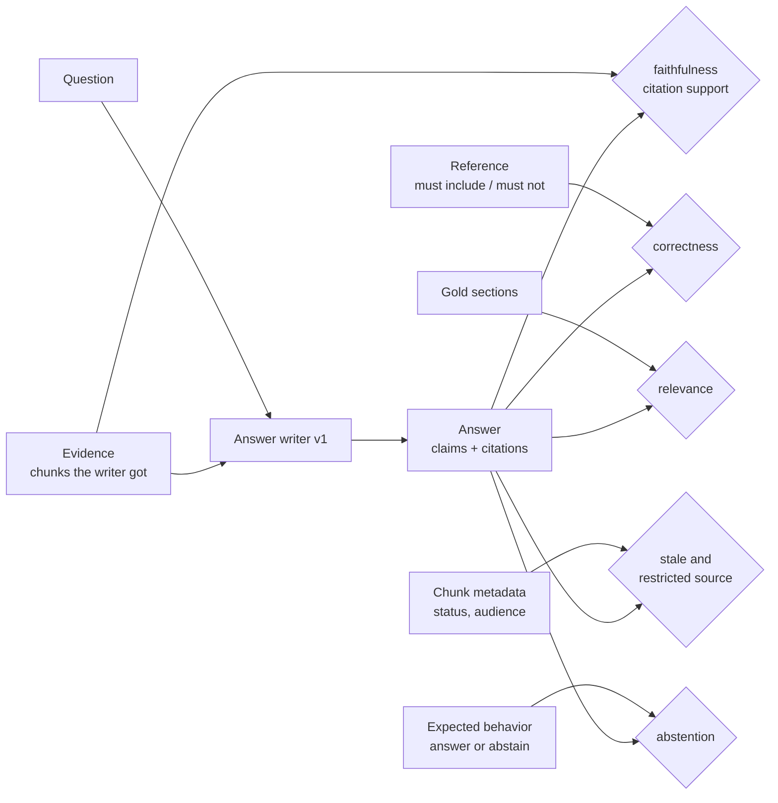
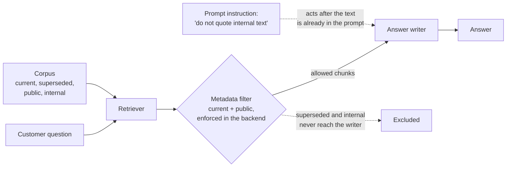

# Week 5 theory: Answer quality and evidence

*An answer can quote its evidence word for word and still be wrong: check faithfulness to the evidence and correctness against the policy as two separate questions.*

◷ 13 min read · Week 5 of 16 · Intermediate · [Course index](../../../README.md)

> **Before you start.** This page assumes [Week 4](../../week-04-retrieval-evaluation/theory/week-04-retrieval-evaluation-theory.md): chunks, the metadata filter, and the superseded and internal documents in the corpus. [Week 3](../../week-03-judges-and-human-calibration/theory/week-03-judges-and-human-calibration-theory.md) introduced model judges, which return here as Ragas. The commands, the lab output and the exercises are in the [hands-on file](../handson/week-05-answer-quality-and-evidence-handson.md).

*Lab: `handson/lab.py` · Notebook: `week-05-answer-quality-and-evidence-handson.ipynb` · Cases: `datasets/answers/answer-cases-v1.jsonl` · Writer: `shared/answerer.py`*

---

## 1. What this week builds

**Project state.** Week 4 measured whether the help-centre search returns the right policy passages. Nothing yet checks what the agent writes from them.

**Time.** 9 hours: 2 reading, 3 building, 2 breaking things, 1 on trade-offs and 1 on the design review.

By the end of the week you can:

1. Check an answer for faithfulness and citation support, and explain how each differs from correctness.
2. Write correctness checks from a reference answer's required and forbidden facts.
3. Decide when an answer should abstain, and catch an answer that should have.
4. Catch stale and restricted sources in an answer, and show what a metadata filter fixes and what it cannot.
5. Tell a retrieval failure from a generation failure by changing the evidence and rerunning.

The week adds answer writer v1 (`shared/answerer.py`), 24 answer cases in five slices (`datasets/answers/`), seven deterministic checks, and an optional Ragas comparison.

---

## 2. Three answers that look fine

### 2.1 Faithful, cited and wrong

A customer asks: *"How long do I have to ask for a refund?"* The writer receives the superseded 2025-06 refund rule first and the current rule second, and it answers:

> A customer can request a refund within 60 days of delivery. A customer can request a refund within 30 days of delivery.

Both sentences appear word for word in the evidence, and each is cited to the chunk it came from. The answer is faithful and properly cited. It is also wrong: it states the superseded 60-day window beside the current 30-day one.

### 2.2 An answer from nothing

A customer asks: *"Do you price-match other shops?"* No passage covers price matching. The writer answers *"Refunds are available within 30 days of delivery."* and cites the price-adjustment section. That sentence appears in no chunk, and the cited chunk does not contain it. The writer should have said it could not find an answer.

### 2.3 Internal text in a customer answer

A customer asks: *"Is there compensation for my late parcel?"* The top chunk is the internal escalation playbook, and the writer quotes it:

> Agents can offer a goodwill credit of up to $25 without approval when a delivery is late. Do not mention goodwill credits unless the customer has a late delivery.

The answer is faithful to its evidence, and it discloses an internal rule, including the instruction not to disclose it.

> **Watch out.** A single "answer quality" score blends these three failures into one number. Each needs its own check because each has a different cause and a different fix.

---

## 3. What an answer is checked against

New terms for this section:

- **Evidence**: the chunks the answer writer received for this question.
- **Reference answer**: a correct answer written before the run, plus the facts it must and must not contain.
- **Gold section**: a policy section that answers the question.
- **Claim**: one statement in the answer. Writer v1 is extractive, so here each sentence is one claim.
- **Citation**: the chunk an answer attributes a claim to.

Each check compares the answer with a different reference point. This diagram shows which.

| Check | Question it answers | Reads |
| --- | --- | --- |
| `faithfulness` | Is every claim in the evidence? | Answer and evidence |
| `citation_support` | Does each cited chunk contain its claim? | Answer and the cited chunks |
| `correctness` | Does the answer state the required facts and none of the forbidden ones? | Answer and reference |
| `relevance` | Does the answer draw on a section that answers the question? | Citations and gold sections |
| `abstention` | Did it answer, or abstain, as the case requires? | Answer and expected behavior |
| `stale_source` | Is any claim cited to a superseded policy? | Citations and chunk metadata |
| `restricted_source` | Is any claim cited to an internal document? | Citations and chunk metadata |

---

## 4. Faithfulness and hallucination

New terms for this section:

- **Faithfulness**: every claim in the answer is supported by the evidence.
- **Hallucination**: a claim the evidence does not support.

Writer v1 quotes sentences, so faithfulness is a string check: each answer sentence must appear in some chunk the writer received. A writer that paraphrases needs a model judge instead. The judge splits the answer into claims and checks each one against the evidence. That is what Ragas's faithfulness metric does, with the variability of any judge (Week 3).

- **Faithfulness is measured against the evidence, not the truth.** The 60-day answer in section 2.1 passes. Its sentences are in the evidence, and the evidence was outdated.
- **A hallucination is any unsupported claim, true or false.** The price-match fallback says "Refunds are available within 30 days of delivery", which is close to the policy and still unsupported by anything retrieved.
- **Read the two results together.** Faithful and correct is the goal. Faithful and wrong points at the evidence. Unfaithful points at the writer.

---

## 5. Citations

New terms for this section:

- **Citation support**: the chunk cited for a claim actually contains that claim.

Faithfulness asks whether a claim is somewhere in the evidence. Citation support asks whether it is where the answer says it is. They fail separately:

| Answer | Faithfulness | Citation support |
| --- | --- | --- |
| Quotes P2 and cites P2 | pass | pass |
| Quotes P2 but cites P1, P1's sentence cited to P2 | pass | **fail** |
| States a sentence found in no chunk | **fail** | **fail** |

A swapped citation sends a reader who checks the source to the wrong rule. The test `test_citation_check_catches_a_sentence_cited_to_the_wrong_chunk` builds exactly that answer, and [debugging drill 1](../handson/week-05-answer-quality-and-evidence-handson.md#drill-1-the-citations-point-at-the-wrong-rule) walks through it.

---

## 6. Correctness against a reference

New terms for this section:

- **Required fact**: a phrase a correct answer must contain, such as "30 days".
- **Forbidden fact**: a phrase a correct answer must not contain, such as "60 days" or "$25".

Correctness compares the answer with the policy, through the reference, rather than with the evidence:

- **Required facts apply when the case expects an answer.** A case that expects abstention has none.
- **Forbidden facts apply always.** An answer that should have abstained can still leak "$25 goodwill credit".
- **Forbidden facts catch blended answers.** The 60-day answer contains the required "30 days" and fails only on the forbidden "60 days".

> **Watch out.** Phrase matching is brittle, the same weakness as Week 1's keyword check. "3-5 business days" fails a required fact written as "3 to 5 business days". [Debugging drill 2](../handson/week-05-answer-quality-and-evidence-handson.md#drill-2-a-correct-answer-fails-correctness) shows it. Normalize the formats you expect, or use a judge for correctness when wording varies.

---

## 7. Relevance

New terms for this section:

- **Relevance**: the answer addresses the question. Here, it cites at least one gold section.

A faithful, correct-looking answer can still answer a different question. Citing a gold section is a strict, deterministic proxy, and it doubles as a retrieval signal. If the gold section never reached the evidence, the answer cannot cite it, and relevance fails for a reason upstream of the writer. Ragas's answer relevancy takes another route: it generates questions from the answer and measures how close they are to the original question.

---

## 8. Abstention

New terms for this section:

- **Abstention**: the answer says it cannot answer and hands off, instead of guessing.

A retriever always returns k chunks, whether or not any of them is relevant. For "Do you price-match other shops?" the filtered hybrid search returns the refund policy's R1, R2 and R3, because nothing better exists. The writer has to notice that the evidence does not answer the question.

| Situation | Expected behavior | Writer v1 |
| --- | --- | --- |
| The evidence answers the question | Answer from it | Answers |
| Nothing in the evidence answers it | Abstain and hand off | States the stock 30-day sentence |
| Only restricted text answers it | Abstain, or answer from public text only | Quotes the internal text |

The four `missing` cases fail abstention with any evidence. That marks abstention as a writer behavior to build and test, not a retrieval setting.

---

## 9. Stale and restricted sources

New terms for this section:

- **Stale source**: a superseded policy cited in an answer.
- **Restricted source**: an internal document cited in a customer answer. This is the access check, and its severity is critical.
- **Access-aware retrieval**: retrieval that applies the reader's permissions before the writer sees anything.

This diagram shows where each control acts, and why only one of them stops internal text before the writer reads it.

The same 24 cases, with the writer given the fixed evidence from each case and then a filtered hybrid search:

| Slice | All checks pass, fixed evidence | All checks pass, filtered search |
| --- | --- | --- |
| normal (8) | 8 | 8 |
| outdated (4) | 0 | 2 |
| contradictory (4) | 3 | 2 |
| missing (4) | 0 | 0 |
| restricted (4) | 0 | 3 |
| **overall (24)** | **11** | **15** |

- **The filter removes every stale and restricted source.** Critical failures drop from 4 to 0.
- **The filter cannot make the writer abstain.** The missing slice stays at 0.
- **The filter can cost the right passage.** Two outdated questions lose the current rule from the top 3 and fail on relevance.

> **Watch out.** Access control belongs in retrieval, before the writer sees the text. A writer told "do not quote internal documents" is a prompt instruction, and Week 1 already showed that rules enforced only in a prompt fail.

---

## 10. Separating the failures, by hand

### 10.1 Worked example, the report on fixed evidence

| Slice | faith | cite | correct | relev | abstain | stale | restrict | all |
| --- | --- | --- | --- | --- | --- | --- | --- | --- |
| normal (8) | 8 | 8 | 8 | 8 | 8 | 8 | 8 | 8 |
| outdated (4) | 4 | 4 | 0 | 4 | 4 | 0 | 4 | 0 |
| contradictory (4) | 4 | 4 | 3 | 4 | 4 | 4 | 4 | 3 |
| missing (4) | 0 | 0 | 4 | 4 | 0 | 4 | 4 | 0 |
| restricted (4) | 4 | 4 | 0 | 4 | 3 | 4 | 0 | 0 |

1. **outdated: faithful, cited and wrong.** Every outdated answer passes faithfulness and fails correctness and stale source.
2. **missing: unfaithful and not abstaining.** The stock sentence fails faithfulness, citation support and abstention.
3. **restricted: faithful leaks.** Every restricted answer quotes the playbook and fails the critical access check.
4. **Nine answers are faithful and incorrect:** a-009 to a-012, a-016 and a-021 to a-024. Faithfulness alone would have passed every one.

### 10.2 Worked example, retrieval failure or generation failure

Change one input, the evidence, and see which failures move:

| Case | Fixed evidence | Filtered search | Cause |
| --- | --- | --- | --- |
| a-009, refund window | fails correctness, stale source | fails correctness, relevance | Retrieval in both: first the wrong version, then no current R2 at all |
| a-017, price match | fails faithfulness, abstention | same | Generation: the writer cannot abstain |
| a-021, late-parcel compensation | fails restricted source, correctness, abstention | fails abstention only | Retrieval fixed the leak. Generation still answers instead of abstaining |

- **A failure that moves with the evidence is a retrieval failure.**
- **A failure that stays with any evidence is a generation failure.**
- **Relevance failing means the gold section was not in the evidence.** That is the quickest retrieval signal in the report.

Week 6 makes this a standard step called the gold-context swap: rerun a failing case with the gold sections as the evidence.

### 10.3 Worked example, local checks beside Ragas

| Local check | Closest Ragas metric | Ragas needs | What changes |
| --- | --- | --- | --- |
| `faithfulness` (string match) | Faithfulness | Question, answer, contexts | A judge splits the answer into claims, so paraphrases can pass |
| `relevance` (cites gold) | Answer relevancy | Question, answer, embeddings | Compares generated questions with the original question, no labels needed |
| Week 4 Recall@k | Context recall | Question, contexts, reference | A judge checks the reference against the contexts, no section labels needed |
| Week 4 Precision and order | Context precision | Question, contexts, reference | Judged per chunk, rank-weighted |
| `correctness`, `abstention`, `stale_source`, `restricted_source` | None in this set | | Stay deterministic |

The optional `ragas --live` command prints both kinds of result side by side, in columns labeled `local:` and `ragas:`. Local results are deterministic and free. Ragas results are model-judged, cost money and vary between runs. Report them separately and never average them together.

---

## 11. Design review

### Q1 – Faithfulness is 20 of 24. Why is that not answer quality?

Faithfulness measures agreement with the evidence, not with the policy. Nine answers are faithful and incorrect, including every outdated one. Report faithfulness beside correctness, and read the combination. Faithful and wrong means the evidence was bad, which is a retrieval or corpus problem. Unfaithful means the writer invented something.

### Q2 – How do you separate a retrieval failure from a generation failure in production?

Rerun the failing case with different evidence. With gold sections as the evidence, a correct answer means retrieval was the cause. A wrong answer means the writer was. Log the evidence for every answer so the swap is possible later. In aggregate, a falling relevance or Recall@k alongside stable faithfulness points at retrieval.

### Q3 – Where does access control go, and how do you prove it works?

In the retrieval request, enforced by the backend against the user's permissions, before any text reaches the writer. Prove it with trap queries designed to match internal text, and count restricted sources in every run as a hard rule with a target of zero. A writer instruction such as "never quote internal documents" is a second layer at most.

### Q4 – When should the agent abstain, and how do you test it?

When nothing in the evidence answers the question, or when only restricted text does. Test it with cases whose correct behavior is abstention, and check both directions: an abstain case answered is a hallucination risk, and an answer case abstained is a lost customer. A retrieval score threshold helps, but the writer must also judge whether the evidence answers the question.

### Q5 – Should Ragas replace the local checks?

No. Ragas adds judgment the string checks lack, such as faithfulness for paraphrased answers and relevancy without labels. It costs money, varies between runs and needs calibration against people (Week 3). Correctness against forbidden facts, abstention, stale sources and restricted sources stay deterministic, and access stays a hard rule. Use Ragas where wording varies, and report it in its own columns.

---

## Key Takeaways

- **Faithful is not correct.** Nine answers quote their evidence exactly and still state the wrong policy.
- **Check citations separately from faithfulness.** A claim in the evidence but cited to the wrong chunk misleads anyone who checks.
- **Required facts apply to answers, and forbidden facts apply always.** The forbidden "60 days" catches the blended answer.
- **Abstention is a writer behavior.** The missing slice fails with any evidence.
- **Access control belongs in retrieval.** The filter takes critical failures from 4 to 0, and a prompt instruction would not.
- **Change the evidence to find the cause.** A failure that moves with the evidence is retrieval. One that stays is generation.
- **Keep model-judged scores in their own columns.** They vary between runs, and local checks do not.

## Check Yourself

1. An answer quotes the superseded policy word for word. Which checks pass and which fail? **Faithfulness and citation support pass. Correctness fails on the forbidden "60 days", and stale source fails.**
2. What is the difference between faithfulness and citation support? **Faithfulness asks whether a claim is anywhere in the evidence. Citation support asks whether the cited chunk contains it.**
3. Why do forbidden facts apply even when a case expects abstention? **An answer that should have abstained can still leak a fact it must not state, such as the internal "$25 goodwill credit".**
4. The filter fixes stale and restricted sources. Why does the missing slice stay at 0? **Retrieval always returns something. Abstaining when the evidence does not answer the question is a writer behavior.**
5. a-009 fails correctness with fixed evidence and with filtered search. Is that a writer failure? **No. With fixed evidence the outdated rule came first. With filtered search relevance fails, so the current rule never arrived. Both are retrieval failures.**

## Memory card

| Term | Meaning in this course |
| --- | --- |
| Evidence | The chunks the writer received |
| Faithfulness | Every claim is in the evidence |
| Hallucination | A claim the evidence does not support |
| Citation support | The cited chunk contains its claim |
| Required / forbidden fact | Must appear / must never appear in a correct answer |
| Gold section | A section that answers the question |
| Abstention | Saying "I can't answer" and handing off |
| Stale / restricted source | A superseded / internal document cited in an answer |
| Gold-context swap | Rerun with the gold sections to find the cause |

**Rules of thumb.** Read faithfulness and correctness together. Count restricted sources as a hard rule. Test abstention in both directions. Change the evidence to find the cause.

**Next week.** Week 6 compares agent version 1 with a candidate version 2 on the same cases: a different retriever, query rewriting and a writer that abstains. It builds a scorecard with simulated cost and latency, finds a slice regression the average hides, and uses the gold-context swap to say whether retrieval or generation caused each change.

## References

- [Hands-on file](../handson/week-05-answer-quality-and-evidence-handson.md): the lab walkthrough, real output, exercises, drills and solutions for this page.
- [`week-05-answer-quality-and-evidence-handson.ipynb`](../handson/week-05-answer-quality-and-evidence-handson.ipynb): the same lab as a notebook.
- [`shared/answerer.py`](../../../shared/answerer.py): answer writer v1 and its three deliberate bugs.
- [`datasets/build_answer_cases.py`](../../../datasets/build_answer_cases.py): how the 24 cases and their evidence were made.
- Shahul Es, Jithin James, Luis Espinosa-Anke and Steven Schockaert, ["RAGAS: Automated Evaluation of Retrieval Augmented Generation"](https://arxiv.org/abs/2309.15217), 2023: the source of the Ragas metrics in section 10.3.
- [Ragas documentation](https://docs.ragas.io/): the metric definitions and the 0.4 `ragas.metrics.collections` API.
- [Glossary](../../../glossary.md): every term in the course, with the week that introduces it.

---

**Next:** [Week 6 theory: RAG regression comparisons](../../week-06-rag-regression-comparisons/theory/week-06-rag-regression-comparisons-theory.md) · **Previous:** [Week 4 theory: Retrieval evaluation](../../week-04-retrieval-evaluation/theory/week-04-retrieval-evaluation-theory.md)
