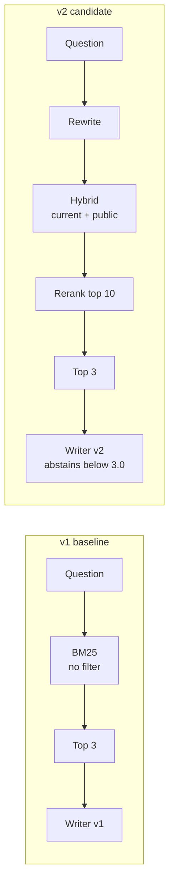
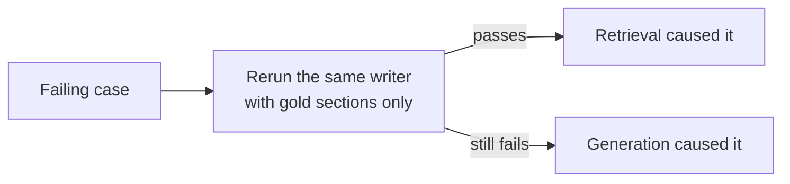

# Week 6 theory: RAG regression comparisons

*A candidate can raise every average and still break the main path: compare versions case by case and slice by slice, then decide by written rules.*

Week 6 of 16. [Course index](../../../simplified-course-index.md).

> **Source note.** Examples and results come from the original lesson. They were not rerun.

> **Before you start.** This page assumes [Week 4](../../week-04-retrieval-evaluation/theory/week-04-retrieval-evaluation-theory-simplified-structured.md) (retrieval metrics) and [Week 5](../../week-05-answer-quality-and-evidence/theory/week-05-answer-quality-and-evidence-theory-simplified-structured.md) (answer checks and the idea of changing the evidence to find a cause). Both sets of checks run here unchanged. The commands, the lab output and the exercises are in the [hands-on file](../handson/week-06-rag-regression-comparisons-handson.md).

*Lab: `handson/lab.py`  
Notebook: [`week-06-rag-regression-comparisons-handson.ipynb`](../handson/week-06-rag-regression-comparisons-handson.ipynb)  
Versions: `shared/rag_pipeline.py`  
Data: Week 4's 50 queries and Week 5's 24 answer cases*

---

## 1. What this week builds

**Project state.** Version 1 of the RAG pipeline searches with BM25, applies no filter, and answers with writer v1. Weeks 4 and 5 measured it. A team has built version 2 and wants to ship it.

**Time.** 9 hours: 2 reading, 3 building, 2 investigating, 1 on trade-offs and 1 on the design review.

By the end of the week you can:

1. Compare versions on fixed cases using quality, safety, cost, and latency.
2. Find slice and case regressions hidden by averages.
3. Swap in gold evidence to locate a failure.
4. Remove components one at a time to measure their contribution.
5. Recommend a release using written rules and explain latency trade-offs.

The week adds the pipeline versions (`shared/rag_pipeline.py`), writer v2 (`shared/answerer.py`) and a comparison lab. Cost and latency in this lab are simulated from illustrative constants.

---

## 2. A better average with a worse main path

Version 2 changes five things at once. On the same 24 answer cases, it passes 18 against version 1's 11, and its critical failures drop from 5 to 0. Every retrieval metric rises.

On the `normal` slice, the everyday questions, it passes 6 of 8 where version 1 passed 7. Case a-002, *"Does store credit expire?"*, now gets this answer:

> I can't find that in our help centre, so I'm passing your question to a specialist.

The right passage arrived. The writer's threshold was too high, so it refused to answer. Seven extra overall passes hide a loss on common questions.

> **Watch out.** Compare individual cases and slices. Write release rules before seeing results.

---

## 3. Comparing versions fairly

New terms for this section:

- **Baseline:** current version, v1.
- **Candidate:** proposed replacement, v2.
- **Paired comparison:** compare both versions on each identical case.
- **Version pin:** record the dataset, corpus, configuration, and writer used.

A fair comparison needs three things:

- **Same cases:** Week 4's 50 queries and Week 5's 24 answers.
- **Recorded versions:** identify all inputs and settings behind each score.
- **Keep pairs:** show cases that improve and regress. An average can cancel them out.

---

## 4. What changed between v1 and v2

New terms for this section:

- **Query rewriting:** change words before search, such as "money back" to "refund".
- **Reranking:** sort ten candidates with a slower scorer. This lab uses each chunk's best sentence overlap; a cross-encoder would read query and chunk together.
- **Abstention threshold:** minimum sentence score the writer needs to answer.

| Component | v1 | v2 | v2.1 |
| --- | --- | --- | --- |
| Query rewriting | no | yes | yes |
| Retriever | BM25 | hybrid | hybrid |
| Metadata filter | off | current + public | current + public |
| Reranking | no | top 10 | top 10 |
| k | 3 | 3 | 3 |
| Writer | v1 (never abstains) | v2, threshold 3.0 | v2, threshold 2.0 |

*Table 1: Reference values.*

*Figure 1: Source diagram.*

> **Watch out.** Five simultaneous changes hide which component helped. Section 8 tests them separately.

---

## 5. The scorecard

New terms for this section:

- **Scorecard:** quality, safety, cost, and latency in one comparison.
- **p50/p95 latency:** times that 50% and 95% of requests beat. p95 describes slow requests.
- **Simulated:** estimated from word-based token counts and fixed delays. These illustrate trade-offs, not real performance.

| Metric | v1 | v2 |
| --- | --- | --- |
| Retrieval Recall@3 | 0.710 | 0.823 |
| Retrieval MRR | 0.643 | 0.843 |
| Retrieval nDCG@3 | 0.616 | 0.791 |
| Filter violations (150 slots) | 35 | 0 |
| Answer cases passing all checks (24) | 11 | 18 |
| Critical failures | 5 | 0 |
| Answers abstained | 0 | 8 |
| SIMULATED cost per 1,000 answers ($) | 0.107 | 0.096 |
| SIMULATED p50 latency (ms) | 401 | 394 |
| SIMULATED p95 latency (ms) | 615 | 649 |

*Table 2: Reference values.*

- Quality rises; violations and critical failures fall to zero; seven more answers pass.
- V2 abstains eight times: five correctly, including missing cases and a-021. Three are answerable, two previously passing.
- Short refusals lower estimated cost and p50. Answering less is not a useful saving by itself.

---

## 6. Slices and paired results

### 6.1 Answer slices

| Slice | v1 | v2 | Change |
| --- | --- | --- | --- |
| normal (8) | 7 | 6 | **−1** |
| outdated (4) | 0 | 3 | +3 |
| contradictory (4) | 3 | 3 | 0 |
| missing (4) | 0 | 4 | +4 |
| restricted (4) | 1 | 2 | +1 |

*Table 3: Reference values.*

### 6.2 Case by case

- **Answers:** nine improve, two regress: a-002 (store credit) and a-023 ($3,000 approval), both now abstaining.
- **Retrieval:** nDCG@3 improves on 21 queries and falls on q-011, q-021, q-030, and q-046. The rug query q-046 drops 0.47 to 0.11 despite the average gain of 0.175.

> **Watch out.** Even slice averages hide losses. No retrieval slice drops overall, but four individual queries do. Show the paired regression list.

---

## 7. Retrieval or generation: the gold-context swap

New terms for this section:

- **Gold-context swap**: rerun a failing case with only its gold sections as the evidence. If it now passes, retrieval caused the failure. If it still fails, generation did.

*Figure 2: Source diagram.*

| Version | Retrieval causes | Generation causes |
| --- | --- | --- |
| v1 | 7: the outdated cases and the internal leaks (a-001, a-009 to a-012, a-022, a-024) | 6: the missing slice, a-016 and a-021 |
| v2 | none | 6: every failure, including a-001, a-002 and a-009, fails even on gold evidence |

*Table 4: Reference values.*

- **V1:** wrong-version and internal evidence point to search problems.
- **V2:** even gold evidence fails because threshold 3.0 rejects it. Fix the writer.
- **Limit:** abstention cases have empty gold evidence. In v2.1, a-021 is partly attributed to retrieval: a lost-parcel passage looked answerable, while empty evidence makes abstention easy.

---

## 8. Ablation: one component at a time

New terms for this section:

- **Ablation**: removing one component of a version and rerunning the same evaluation, to measure what that component contributes.

v2.1, the candidate with the threshold fixed to 2.0, with one component removed at a time:

| Variant | nDCG@3 | Recall@3 | Answers passing (24) | Critical | SIMULATED p50 ms |
| --- | --- | --- | --- | --- | --- |
| as configured | 0.791 | 0.823 | 22 | 0 | 501 |
| without rewrite | 0.794 | 0.830 | 22 | 0 | 486 |
| without rerank | 0.811 | 0.860 | 19 | 0 | 432 |
| without filter | 0.702 | 0.790 | 21 | 0 | 468 |

*Table 5: Reference values.*

1. **Reranking:** lowers retrieval metrics but adds three passing answers. It favors sentences the writer can copy, while section-level labels measure something different.
2. **Rewriting:** adds no passing answers, slightly worsens retrieval here, and costs 15 ms. Keep it only with evidence from other cases.
3. **Filter removal:** critical failures stay zero because v2 also drops internal chunks. But nDCG falls by 0.09, so keep the filter.

---

## 9. Retrieval drift

New terms for this section:

- **Retrieval drift**: retrieval results changing over time without any change to the retriever's code, because the corpus, the query mix or an embedding model changed.

Drift shows up as a comparison between the system today and a pinned earlier run of the same system:

- **Corpus:** new or revised policy changes rankings, as the old 2025-06 policy did.
- **Queries:** new products bring new vocabulary.
- **Models:** an embedding update changes the vectors used for search.

Rerun fixed queries regularly and after corpus changes. Compare pinned slice scores and violations. Exercise 4 measures the effect of adding a document.

---

## 10. The release decision

### 10.1 The rules

| Rule | Threshold (illustrative) | v2 | v2.1 |
| --- | --- | --- | --- |
| Critical failures | 0 | 0 | 0 |
| Passing answer cases lost on any slice | 0 | **normal: 7 to 6** | none |
| Recall@3 lost on any retrieval slice | at most 0.05 | none | none |
| SIMULATED p95 latency | at most 20% above baseline (738 ms) | 649 | 660 |
| **Decision** | | **BLOCK** | **SHIP** |

*Table 6: Reference values.*

Set rules before running the comparison. These thresholds are illustrations; real thresholds depend on refund harm and acceptable response time.

### 10.2 Worked example, writing the recommendation

1. **Decision:** block v2; ship v2.1 with threshold 2.0.
2. **Evidence:** 22/24 answers pass versus 11/24; zero critical failures; no slice loses a pass; Recall@3 rises 0.710 to 0.823.
3. **Remaining losses:** q-011, q-021, q-030, and q-046 still rank worse. They are separate retrieval queries, so answer impact is unmeasured. Add answer coverage and watch them.
4. **Trade-off:** simulated p50 rises 401 to 501 ms (+25%); p95 rises 615 to 660 ms (+7%). Both meet the budget, with eleven more correct answers and no internal leaks.
5. **Next:** test rewriting on more paraphrases or remove it. Measure real latency.

---

## 11. Design review

### Q1 – Quality improves and latency worsens. How do you defend shipping?

V2.1 adds 11 correct answers out of 24 and removes leaks, costing about 100 ms p50 and 45 ms p95 in simulation. Its 7% p95 increase meets the prewritten 20% budget. If needed, test removing the 15 ms rewriting step that adds no value here.

### Q2 – The candidate wins on average. Why block it?

The rule forbids losing a pass in any slice. V2 loses common case a-002 while improving rarer groups. The dataset average does not represent each group's business importance.

### Q3 – How do you know whether retrieval or generation caused a change?

Save each case's evidence. Swap in gold sections to test search versus writing. Then remove one component at a time and rerun to measure contributions.

### Q4 – Retrieval metrics improved without the reranker. Why keep it?

Without reranking, answers fall from 22/24 to 19/24 even though retrieval improves. Section relevance and useful sentence order differ. Prefer the measured end result and record this disagreement.

### Q5 – How would you catch retrieval drift after release?

Rerun pinned queries regularly and after corpus/model changes. Compare individual queries, slices, and violations with the baseline. Alert on newly returned internal or old-policy chunks.

---

## Key Takeaways

- Use identical cases and recorded versions.
- Show slices and individual changes: v2 gains seven overall but loses a common case.
- Report safety, cost, and latency; refusals can look cheap.
- Swap gold evidence to find causes.
- Remove components to measure their value.
- Decide with rules written beforehand: block v2, ship v2.1 here.
- Label simulated performance figures.

## Check Yourself

1. v2 passes 18 of 24 against v1's 11. Name the regression the average hides. **The normal slice drops from 7 to 6: a-002 now abstains on "Does store credit expire?"**
2. Why does v2 look cheaper than v1? **It abstains on 8 cases, and an abstention is a short reply. The saving comes from answering less.**
3. a-002 still fails when v2 gets only the gold section. What caused it? **Generation: the 3.0 abstention threshold rejects even the right evidence.**
4. Removing the reranker raises nDCG@3 from 0.791 to 0.811. Why keep it? **Answers drop from 22 to 19 of 24. The outcome outranks the retrieval proxy.**
5. Why must release rules be written before the comparison runs? **So nobody can set the threshold after seeing which version it favors.**

## Memory card

| Term | Meaning in this course |
| --- | --- |
| Baseline / candidate | The version in production / the version proposed |
| Paired comparison | Both versions on the same cases, compared case by case |
| Scorecard | Quality, safety, cost and latency side by side |
| p50 / p95 | Typical / slow-tail latency |
| Gold-context swap | Rerun with gold sections: passing means retrieval caused it |
| Ablation | Remove one component, rerun, measure its contribution |
| Query rewriting | Map customer wording onto policy terms before search |
| Reranking | Re-sort the top results with a second scorer |
| Retrieval drift | Results changing as the corpus, queries or models change |

*Table 7: Reference values.*

**Rules of thumb.** Same cases, pinned versions. Slices and pairs before averages. Swap the evidence to find the cause. Rules first, then the comparison.

**Next phase.** Phase 3 moves from what the agent says to what it does: Week 7 checks tool calls and the refunds they actually store, independently of the agent's claims.

## References

- [Hands-on file](../handson/week-06-rag-regression-comparisons-handson.md)
- [`week-06-rag-regression-comparisons-handson.ipynb`](../handson/week-06-rag-regression-comparisons-handson.ipynb)
- [`shared/rag_pipeline.py`](../../../shared/rag_pipeline.py)
- [`shared/answerer.py`](../../../shared/answerer.py)
- [Glossary](../../../glossary.md)

---

**Next:** [Week 7 theory: Tools and persisted side effects](../../week-07-tools-and-side-effects/theory/week-07-tools-and-side-effects-theory-simplified-structured.md)  
**Previous:** [Week 5 theory: Answer quality and evidence](../../week-05-answer-quality-and-evidence/theory/week-05-answer-quality-and-evidence-theory-simplified-structured.md)
