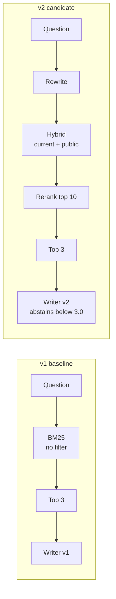
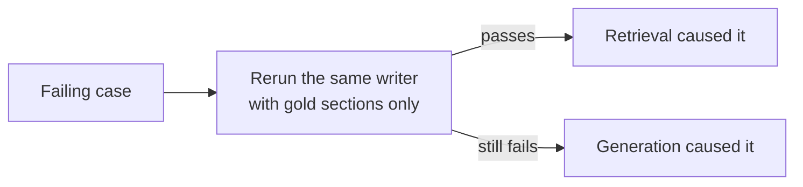

# Week 6 theory: RAG regression comparisons

*A candidate can raise every average and still break the main path: compare versions case by case and slice by slice, then decide by written rules.*

◷ 12 min read · Week 6 of 16 · Intermediate · [Course index](../../../README.md)

> **Before you start.** This page assumes [Week 4](../../week-04-retrieval-evaluation/theory/week-04-retrieval-evaluation-theory.md) (retrieval metrics) and [Week 5](../../week-05-answer-quality-and-evidence/theory/week-05-answer-quality-and-evidence-theory.md) (answer checks and the idea of changing the evidence to find a cause). Both sets of checks run here unchanged. The commands, the lab output and the exercises are in the [hands-on file](../handson/week-06-rag-regression-comparisons-handson.md).

*Lab: `handson/lab.py` · Notebook: `week-06-rag-regression-comparisons-handson.ipynb` · Versions: `shared/rag_pipeline.py` · Data: Week 4's 50 queries and Week 5's 24 answer cases*

---

## 1. What this week builds

**Project state.** Version 1 of the RAG pipeline searches with BM25, applies no filter, and answers with writer v1. Weeks 4 and 5 measured it. A team has built version 2 and wants to ship it.

**Time.** 9 hours: 2 reading, 3 building, 2 investigating, 1 on trade-offs and 1 on the design review.

By the end of the week you can:

1. Compare two versions on the same cases and report the result as a scorecard covering quality, safety, cost and latency.
2. Find a slice regression and case-level regressions that the overall average hides.
3. Decide whether retrieval or generation caused a change, using a gold-context swap.
4. Use an ablation to measure what each component of a version contributes.
5. Write a release recommendation from explicit rules, and defend a trade-off where quality improves and latency worsens.

The week adds the pipeline versions (`shared/rag_pipeline.py`), writer v2 (`shared/answerer.py`) and a comparison lab. Cost and latency in this lab are simulated from illustrative constants.

---

## 2. A better average with a worse main path

Version 2 changes five things at once. On the same 24 answer cases, it passes 18 against version 1's 11, and its critical failures drop from 5 to 0. Every retrieval metric rises.

On the `normal` slice, the everyday questions, it passes 6 of 8 where version 1 passed 7. Case a-002, *"Does store credit expire?"*, now gets this answer:

> I can't find that in our help centre, so I'm passing your question to a specialist.

The right passage was retrieved. The new writer refused to use it because its abstention threshold is set too high. The overall number rose by 7 cases and hid a regression on the slice most customers hit.

> **Watch out.** "Better on average" is not a release decision. Compare the same cases one by one and slice by slice, and decide with rules written before the comparison runs.

---

## 3. Comparing versions fairly

New terms for this section:

- **Baseline**: the version in production, here v1.
- **Candidate**: the version proposed to replace it, here v2.
- **Paired comparison**: both versions run on the same cases, and each case's results are compared with each other.
- **Version pin**: the recorded identity of everything that affects a result. Here, the dataset version, the corpus, the pipeline configuration and the writer.

A fair comparison needs three things:

- **The same cases.** Week 4's 50 queries and Week 5's 24 answer cases, unchanged. A different case set makes any difference uninterpretable.
- **Pinned versions.** Record which corpus, dataset and configuration produced each number.
- **Pairing kept.** A case that passed and now fails is a regression even when another case moved the other way. Averages cancel those moves out, and pairs show them.

---

## 4. What changed between v1 and v2

New terms for this section:

- **Query rewriting**: changing the customer's wording before search, here by mapping phrases such as "money back" onto policy terms such as "refund".
- **Reranking**: re-sorting the first 10 search results with a second, slower scorer. Here, each chunk's best sentence overlap with the question stands in for a cross-encoder, which reads the question and each chunk together.
- **Abstention threshold**: the minimum sentence score writer v2 needs before it answers.

| Component | v1 | v2 | v2.1 |
| --- | --- | --- | --- |
| Query rewriting | no | yes | yes |
| Retriever | BM25 | hybrid | hybrid |
| Metadata filter | off | current + public | current + public |
| Reranking | no | top 10 | top 10 |
| k | 3 | 3 | 3 |
| Writer | v1 (never abstains) | v2, threshold 3.0 | v2, threshold 2.0 |

This diagram shows the two pipelines.

> **Watch out.** Five changes at once make the result hard to explain. When the candidate wins or loses, nobody can say which change did it. Section 8 takes the version apart again.

---

## 5. The scorecard

New terms for this section:

- **Scorecard**: one table comparing the versions on quality, safety, cost and latency.
- **p50 and p95 latency**: the response time half of requests beat, and the time 95% beat. p95 describes the slow tail customers notice.
- **Simulated**: computed from illustrative constants, here a token count estimated from words and fixed per-step delays. Simulated numbers show the shape of a trade-off, never its real size.

| Metric | v1 | v2 |
| --- | --- | --- |
| Retrieval Recall@3 | 0.710 | 0.823 |
| Retrieval MRR | 0.643 | 0.843 |
| Retrieval nDCG@3 | 0.616 | 0.791 |
| Filter violations (150 slots) | 35 | 0 |
| Answer cases passing all checks (24) | 11 | 18 |
| Critical failures | 5 | 0 |
| Answers abstained | 0 | 8 |
| SIMULATED cost per 1,000 answers ($) | 0.107 | 0.096 |
| SIMULATED p50 latency (ms) | 401 | 394 |
| SIMULATED p95 latency (ms) | 615 | 649 |

- **Quality and safety both improve.** Every retrieval metric rises, violations and critical failures go to zero, and seven more answer cases pass.
- **v2 abstains 8 times.** Five are correct: the missing slice and a-021. The other three are answerable questions, and two of them used to pass.
- **v2 looks cheaper and faster at p50 because it says less.** An abstention is a short reply. A cost drop caused by refusing to answer is not a saving.

---

## 6. Slices and paired results

### 6.1 Answer slices

| Slice | v1 | v2 | Change |
| --- | --- | --- | --- |
| normal (8) | 7 | 6 | **−1** |
| outdated (4) | 0 | 3 | +3 |
| contradictory (4) | 3 | 3 | 0 |
| missing (4) | 0 | 4 | +4 |
| restricted (4) | 1 | 2 | +1 |

### 6.2 Case by case

- **Answers: 9 improved, 2 regressed.** The regressions are a-002 (store credit, now abstains) and a-023 (who approves a $3,000 refund, now abstains).
- **Retrieval: nDCG@3 improved on 21 queries and fell on 4.** The four are q-011, q-021, q-030 and q-046. On q-046, the final-sale rug, nDCG falls from 0.47 to 0.11. The average rose by 0.175 and carried those four along unnoticed.

> **Watch out.** A slice average can also hide regressions. The retrieval slices show no drop at all, while four individual queries got worse. Report the paired regressed list beside every average.

---

## 7. Retrieval or generation: the gold-context swap

New terms for this section:

- **Gold-context swap**: rerun a failing case with only its gold sections as the evidence. If it now passes, retrieval caused the failure. If it still fails, generation did.

This diagram shows the decision.

| Version | Retrieval causes | Generation causes |
| --- | --- | --- |
| v1 | 7: the outdated cases and the internal leaks (a-001, a-009 to a-012, a-022, a-024) | 6: the missing slice, a-016 and a-021 |
| v2 | none | 6: every failure, including a-001, a-002 and a-009, fails even on gold evidence |

- **v1's problems are mostly in search.** The wrong version and internal text reached the writer.
- **v2's problems are all in the writer.** The 3.0 threshold abstains even when handed exactly the right section. That points the fix at one number.
- **The swap has a limit.** For a case whose correct behavior is abstention, the gold evidence is empty, and any writer that abstains on empty evidence passes. In v2.1, a-021 is attributed to retrieval for that reason. The retrieved lost-parcel rule looked relevant enough to answer from, and that is a fair but partial reading.

---

## 8. Ablation: one component at a time

New terms for this section:

- **Ablation**: removing one component of a version and rerunning the same evaluation, to measure what that component contributes.

v2.1, the candidate with the threshold fixed to 2.0, with one component removed at a time:

| Variant | nDCG@3 | Recall@3 | Answers passing (24) | Critical | SIMULATED p50 ms |
| --- | --- | --- | --- | --- | --- |
| as configured | 0.791 | 0.823 | 22 | 0 | 501 |
| without rewrite | 0.794 | 0.830 | 22 | 0 | 486 |
| without rerank | 0.811 | 0.860 | 19 | 0 | 432 |
| without filter | 0.702 | 0.790 | 21 | 0 | 468 |

1. **The reranker lowers every retrieval metric and raises answers by 3.** It ranks chunks by their best sentence, which is the unit the extractive writer quotes. Section-level relevance falls while the sentence the writer needs moves up. Retrieval metrics and answer quality disagree, and the end-to-end result decides.
2. **Query rewriting earns nothing on this set.** Answers are unchanged, retrieval is marginally better without it, and it costs 15 ms. Keep it only if a case set where it helps exists.
3. **Without the filter, critical failures stay at 0.** Writer v2 drops internal chunks itself. The second layer works, and retrieval quality still falls by 0.09 nDCG. The filter stays.

---

## 9. Retrieval drift

New terms for this section:

- **Retrieval drift**: retrieval results changing over time without any change to the retriever's code, because the corpus, the query mix or an embedding model changed.

Drift shows up as a comparison between the system today and a pinned earlier run of the same system:

- **Corpus changes.** A new policy document, or a new version of an old one, changes which chunks win. The superseded 2025-06 policy is one past change of this kind.
- **Query mix changes.** A new product line brings questions with vocabulary no current chunk uses.
- **Model changes.** A provider updates an embedding model, and every vector moves.

Rerun the fixed query set on a schedule and after every corpus change, compare each slice with the pinned baseline, and watch the violation count. Exercise 4 in the hands-on file adds a document and measures the drift.

---

## 10. The release decision

### 10.1 The rules

| Rule | Threshold (illustrative) | v2 | v2.1 |
| --- | --- | --- | --- |
| Critical failures | 0 | 0 | 0 |
| Passing answer cases lost on any slice | 0 | **normal: 7 to 6** | none |
| Recall@3 lost on any retrieval slice | at most 0.05 | none | none |
| SIMULATED p95 latency | at most 20% above baseline (738 ms) | 649 | 660 |
| **Decision** | | **BLOCK** | **SHIP** |

The thresholds are written before the comparison runs, so nobody adjusts them to fit a result they like. The values here are illustrative. Real ones come from product risk: what one wrong refund answer costs, and how much latency customers tolerate.

### 10.2 Worked example, writing the recommendation

1. **Decision.** Block v2. Ship v2.1, the same pipeline with writer v2's abstention threshold at 2.0.
2. **Evidence.** v2.1 passes 22 of 24 answer cases against v1's 11, with 0 critical failures, no slice losing a case, and Recall@3 up from 0.710 to 0.823.
3. **Regressions found and handled.** v2's threshold made it abstain on answerable questions, a generation failure confirmed by the gold-context swap. Four retrieval queries still rank worse under v2.1 (q-011, q-021, q-030, q-046). They belong to the retrieval query set, not the answer cases, so their effect on answers is unmeasured. They go on a watch list, and the next answer-case update should cover them.
4. **Trade-off.** Simulated p50 latency rises from 401 to 501 ms (+25%), and p95 from 615 to 660 ms (+7%). Both are inside the budget. The gain is 11 more correct answers in 24 and no internal text in any answer, which outweighs a tenth of a second.
5. **Follow-ups.** Query rewriting showed no benefit in the ablation, so test it on more paraphrase cases or remove it. Measure real latency before relying on the simulated figures.

---

## 11. Design review

### Q1 – Quality improves and latency worsens. How do you defend shipping?

State both sides in the same units the business uses. v2.1 answers 11 more of 24 cases correctly and removes every internal leak, at about 100 ms more at p50 and 45 ms more at p95. Then check the decision against rules written in advance: the latency budget was 20% above baseline at p95, and v2.1 is at 7%. If a team cannot accept the latency, the ablation shows where to cut: rewriting costs 15 ms and buys nothing on this set.

### Q2 – The candidate wins on average. Why block it?

Because a slice the business depends on got worse, and the rule said no slice may lose a passing case. v2 lost a-002 on the normal slice, the everyday path, while gaining on slices that are rarer in traffic. An average weights slices by how many cases each happens to have, not by how much each matters.

### Q3 – How do you know whether retrieval or generation caused a change?

Swap the evidence. Rerun the failing case with its gold sections. Passing means retrieval was the cause, and failing anyway means generation was. Then ablate: remove one component at a time and rerun the evaluation. Neither works without logged evidence for every case, so keep it.

### Q4 – Retrieval metrics improved without the reranker. Why keep it?

The answers got worse: 19 of 24 against 22. Retrieval metrics are a means. They measure section-level relevance, and the writer needs the right sentence near the top. When a component trades a proxy metric for the outcome, the outcome decides. Record the disagreement, because it says the retrieval labels and the writer measure different things.

### Q5 – How would you catch retrieval drift after release?

Rerun the pinned query set on a schedule and after every corpus or model change, and compare each slice and the violation count with the pinned baseline. Pair the results by query, so a single query that drops is visible. Alert on any new violation, because a superseded or internal chunk winning a slot is the drift that reaches customers.

---

## Key Takeaways

- **Compare on the same cases, pinned.** Otherwise a difference has no meaning.
- **Read slices and pairs, not only averages.** v2 gains 7 cases overall and loses one on the main path.
- **Report safety, cost and latency beside quality.** v2 looks cheaper only because it abstains more.
- **Swap in the gold evidence to find the cause.** All of v2's failures are generation, and one threshold explains them.
- **Ablate to find what each component earns.** The reranker trades retrieval metrics for better answers, and rewriting earns nothing.
- **Decide by rules written beforehand.** v2 is blocked by one rule, and v2.1 ships within its latency budget.
- **Label simulated numbers.** They show the shape of a trade-off, not its size.

## Check Yourself

1. v2 passes 18 of 24 against v1's 11. Name the regression the average hides. **The normal slice drops from 7 to 6: a-002 now abstains on "Does store credit expire?"**
2. Why does v2 look cheaper than v1? **It abstains on 8 cases, and an abstention is a short reply. The saving comes from answering less.**
3. a-002 still fails when v2 gets only the gold section. What caused it? **Generation: the 3.0 abstention threshold rejects even the right evidence.**
4. Removing the reranker raises nDCG@3 from 0.791 to 0.811. Why keep it? **Answers drop from 22 to 19 of 24. The outcome outranks the retrieval proxy.**
5. Why must release rules be written before the comparison runs? **So nobody can set the threshold after seeing which version it favors.**

## Memory card

| Term | Meaning in this course |
| --- | --- |
| Baseline / candidate | The version in production / the version proposed |
| Paired comparison | Both versions on the same cases, compared case by case |
| Scorecard | Quality, safety, cost and latency side by side |
| p50 / p95 | Typical / slow-tail latency |
| Gold-context swap | Rerun with gold sections: passing means retrieval caused it |
| Ablation | Remove one component, rerun, measure its contribution |
| Query rewriting | Map customer wording onto policy terms before search |
| Reranking | Re-sort the top results with a second scorer |
| Retrieval drift | Results changing as the corpus, queries or models change |

**Rules of thumb.** Same cases, pinned versions. Slices and pairs before averages. Swap the evidence to find the cause. Rules first, then the comparison.

**Next phase.** Phase 3 moves from what the agent says to what it does: Week 7 checks tool calls and the refunds they actually store, independently of the agent's claims.

## References

- [Hands-on file](../handson/week-06-rag-regression-comparisons-handson.md): the lab walkthrough, real output, exercises, drills and solutions for this page.
- [`week-06-rag-regression-comparisons-handson.ipynb`](../handson/week-06-rag-regression-comparisons-handson.ipynb): the same lab as a notebook.
- [`shared/rag_pipeline.py`](../../../shared/rag_pipeline.py): versions v1, v2 and v2.1, query rewriting, reranking and the simulated cost and latency constants.
- [`shared/answerer.py`](../../../shared/answerer.py): writers v1 and v2.
- [Glossary](../../../glossary.md): every term in the course, with the week that introduces it.

---

**Next:** [Week 7 theory: Tools and persisted side effects](../../week-07-tools-and-side-effects/theory/week-07-tools-and-side-effects-theory.md) · **Previous:** [Week 5 theory: Answer quality and evidence](../../week-05-answer-quality-and-evidence/theory/week-05-answer-quality-and-evidence-theory.md)
