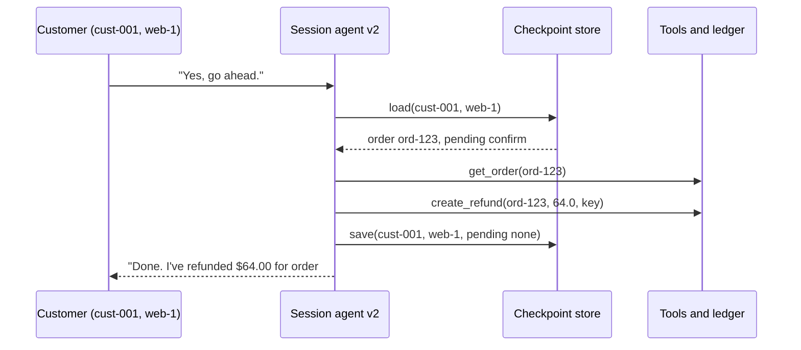
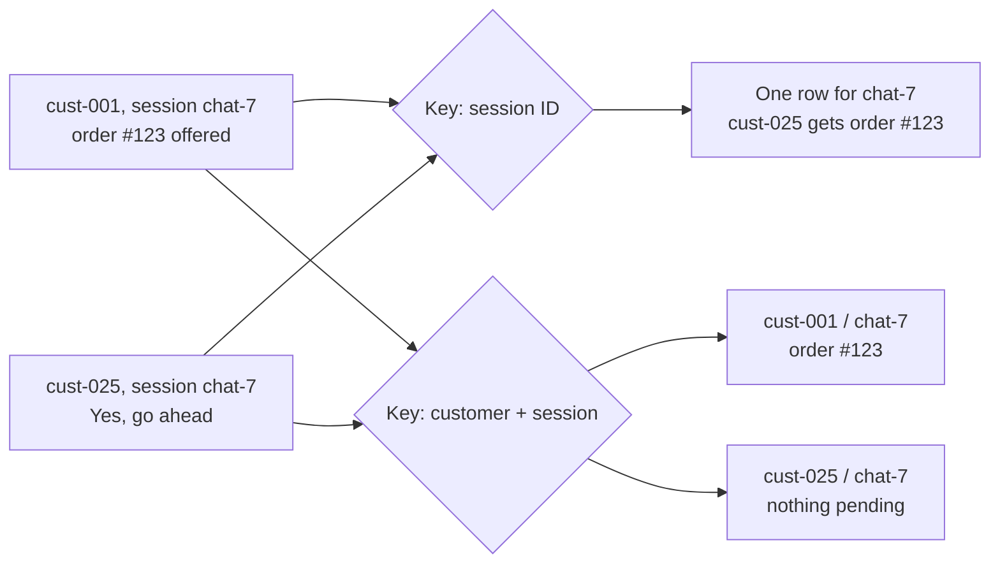
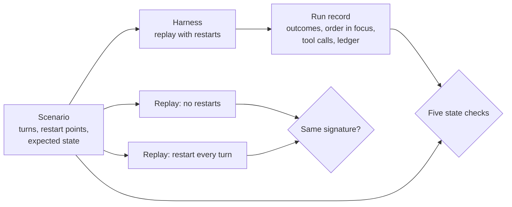

# Week 9 theory: Multi-turn state

*Test what a conversation remembers, keeps separate, and stores. Good replies alone cannot prove this.*

Week 9 of 16. [Course index](../../../simplified-course-index.md).

> **Source note.** Examples and results come from the original lesson. They were not rerun.

> **Before you start.** Read [Week 7](../../week-07-tools-and-side-effects/theory/week-07-tools-and-side-effects-theory-simplified-structured.md) on tools/ledger and [Week 8](../../week-08-trajectories-and-task-completion/theory/week-08-trajectories-and-task-completion-theory-simplified-structured.md) on task completion. Use [Week 2](../../week-02-golden-datasets/theory/week-02-golden-datasets-theory-simplified-structured.md)'s slices and policy 2026-01, R1–R6. See the [hands-on file](../handson/week-09-multi-turn-state-handson.md).

*Lab: `handson/lab.py`  
Notebook: [`week-09-multi-turn-state-handson.ipynb`](../handson/week-09-multi-turn-state-handson.ipynb)  
Agents: `shared/session_agent.py`  
Data: `datasets/conversations/conversations-v1.jsonl`*

---

## 1. What this week builds

**Project state.** Customers use several messages, digress, and confirm later. The session agent offers a refund and waits for "yes" before paying. V1 has four deliberate state bugs; v2 is the reference.

**Time.** 9 hours: 2 reading, 3 building, 2 investigating, 1 on the isolation drill and 1 on the design review.

By the end of the week you can:

1. Explain session, turn, state, and checkpoint storage.
2. Replay restarts and verify order memory.
3. Ask for missing/ambiguous orders and use the answer.
4. Detect cross-customer leaks in replies and calls.
5. Check state, saved outcomes, and restart invariance without exact wording.

The week adds the session agents and their checkpoint store (`shared/session_agent.py`), 25 conversation scenarios built by `datasets/build_conversations.py`, and a lab that replays them.

---

## 2. A refund that vanished on restart

### 2.1 The yes that arrived at a new process

Asha (cust-001) writes to the agent, and the agent process restarts between her two messages, as it does on every deploy.

> **Asha:** My ceramic lamp from order #123 arrived damaged.
> **Agent v1:** Order #123 (ceramic table lamp, $64.00) can be refunded. Shall I go ahead?
> *(the agent restarts)*
> **Asha:** Yes, go ahead.
> **Agent v1:** What can I help you with?

V1 kept state in a Python dictionary. Restarting loses it, so no refund is saved. Either reply alone looks reasonable.

### 2.2 The yes that went to another customer

Two customers' apps happen to send the same session ID, `chat-7`. Asha asks about order #123. Then Zara (cust-025) opens her chat and types "Yes, go ahead."

> **Agent v1, to Zara:** I couldn't refund order #123 (not_found). I've noted it for a specialist.

V1 uses session ID alone, mixing Zara with Asha. Strict blocks the lookup but the reply reveals Asha's order exists. Lax refunds Asha's $64.00 order on Zara's confirmation.

> **Watch out.** Test several turns, restarts, and mixed customers together. Single-reply tests miss these failures.

---

## 3. Sessions, turns and conversation state

New terms for this section:

- **Session:** one signed-in customer's conversation, named by an app-supplied ID.
- **Turn:** a message and response.
- **Conversation state:** task facts needed later: focused order, pending question, and candidate orders.
- **Transcript:** ordered messages and replies, not the same as structured state.
- **Session key:** identifies both customer and conversation.

v2 keeps four fields per session:

| Field | Example | What breaks if it is lost |
| --- | --- | --- |
| `order_id` | `ord-123` | The customer's yes has nothing to refund |
| `pending` | `confirm`, `which_order` or `order_id` | The agent cannot tell what a short answer such as "yes" or "the second one" refers to |
| `candidates` | `["ord-201", "ord-217"]` | "The second one" cannot be resolved |
| `turns` | `3` | Nothing on its own. It helps debugging |

*Table 1: Reference values.*

*Figure 1: Source diagram.*

---

## 4. Checkpoints and restarts

New terms for this section:

- **Checkpoint:** saved state a new process can load after a turn.
- **Durable state:** storage that survives the process, here SQLite.
- **Restart:** stop and recreate the agent; memory-only data disappears.

### 4.1 Where the state lives

V1 uses memory only. V2 saves a SQLite row per (customer, session) after every turn and reads it next time. The separate ledger survives agent restarts.

### 4.2 What the lab's restart does

The harness recreates the agent using the same checkpoint file. Ten turns in 25 scenarios restart. V1 loses pending confirmations in conv-01 and candidate choices in conv-03.

This lab recreates objects within one process. Module or class variables could survive. CI should also test a fresh process or container.

### 4.3 When the save happens

V2 saves after tools run, before replying. A crash after payment but before saving leaves an offer pending. Repeating "yes" reuses `cust-001:ord-123:refund`; backend idempotency returns the saved refund instead of paying twice. Week 10 injects this fault.

> **Watch out.** Require `restart_before` and count actual restarts. Without them, v1 passes all five restart scenarios because the test never restarted it.

---

## 5. Clarification

New terms for this section:

- **Clarification question:** asks for missing facts, such as the order.
- **Binding the answer:** interpret the reply using the saved question and candidates.
- **Ordinal reference:** a position, such as "the second one".

Ask when no order or several orders are named, not when one is clear. Clarification must create no refund or escalation.

"The second one" needs saved candidates `["ord-201", "ord-217"]`. V2 uses order numbers or first/second/last. V1 always selects the first. In conv-08 it refunds the $58.00 cooker instead of $110.00 shoes.

Conv-09 selects the first order, #203, and v1 passes accidentally. Test non-first choices, explicit numbers, positions, and choices after restart (conv-03).

---

## 6. Context carryover and long conversations

New terms for this section:

- **Context carryover:** reuse facts from earlier turns.
- **Digression:** a different question before returning to the task.
- **History window:** how many earlier turns are read. Context limits or summaries can also remove older facts.

V1 searches only the last three turns for order lookups. V2 stores the focused order in a field unaffected by digressions.

A sweep over the number of questions between the offer and the yes shows where v1 breaks:

| Questions between offer and yes | 0 | 1 | 2 | 3 | 4 to 8 |
| --- | --- | --- | --- | --- | --- |
| v1 | pass | pass | pass | **fail** | **fail** |
| v2 | pass | pass | pass | pass | pass |

*Table 2: Reference values.*

V1 asks for the order again after enough digressions. Test beyond the history limit, model context limit, or summary boundary.

Keep the order and pending action in structured fields outside free-text history. Do not depend on a summary retaining them correctly.

---

## 7. Cross-session leakage and tenant isolation

New terms for this section:

- **Tenant**: the party whose data must stay separate. Here each customer is a tenant.
- **Tenant isolation**: no customer sees or acts on another customer's data.
- **Cross-session leakage**: state from one customer's session reaching another session.

### 7.1 The session key

Client session IDs can repeat across devices or customers. V2 keys state by authenticated customer ID plus session ID. Never take identity from message text.

*Figure 2: Source diagram.*

### 7.2 The isolation check

Strict stores no refund in conv-16, so ledger passes. Isolation scans replies and tool arguments for orders the customer neither owns nor typed. Repeating a foreign number the customer already typed, as in conv-23's #134, is not a new disclosure.

V1 fails conv-16, conv-17, and conv-20. In conv-20, shared `chat-3` routes Bea Santos's confirmation to Cyril Moreau's #204.

### 7.3 Over-correcting

A customer-only key mixes that customer's separate chats. In conv-19, Asha's web confirmation reaches her app escalation and saves no refund. Keep such ordinary control cases to catch harmful fixes.

> **Watch out.** Restarting every turn clears v1's shared dictionary and hides the conv-16 leak. Also test isolation without restarts.

---

## 8. Testing state without exact wording

New terms for this section:

- **Exact-text check:** compare replies word for word.
- **Golden transcript:** saved reference replies, here `dataset/v2-transcripts.jsonl`.
- **State check:** compare turn outcomes, focused orders, calls, and ledger.
- **Restart invariance:** outcomes stay the same across restart schedules. Comparing runs to each other rather than labels is a **metamorphic test**.

### 8.1 Five state checks

| Worry | Check | Reads |
| --- | --- | --- |
| The agent did the wrong thing this turn | `outcomes` | each turn's outcome against the accepted ones |
| The agent lost or swapped the order | `order_continuity` | the order in focus after each turn |
| A refund happened before the yes, or during a question | `mutation_timing` | create_refund and escalate calls, per turn |
| The stored result is wrong or duplicated | `ledger` | the ledger, read back after the conversation |
| One customer saw another's order | `tenant_isolation` | replies and tool arguments, against ownership |

*Table 3: Reference values.*

None of them reads the reply's wording. The isolation check extracts order numbers from the reply, which is a fact the reply states, not a phrasing.

### 8.2 What exact text does

Rewording every reply template, the same facts in different words, gives these results:

| Agent and wording | Exact text | State checks |
| --- | --- | --- |
| v2, recorded wording | 25/25 | 25/25 |
| v2, reworded | 0/25 | 25/25 |
| v1, recorded wording | 13/25 | 12/25 |

*Table 4: Reference values.*

Text changes break exact matching even when behavior is valid. Matching text can also hide wrong state. In conv-22, both say "What can I help you with?" after cancellation and restart. Only v2 retains the order for a later renewed refund request; v1 asks for it again.

### 8.3 Restart invariance

Replay without restarts and with one before every turn. Compare outcomes, focused orders, refunds, and escalations. V2 matches on 25/25; v1 differs on all 25. No labels are needed, so this can test replayed live conversations too.

*Figure 3: Source diagram.*

---

## 9. The 25 scenarios

Each turn records customer, session, message, restart flag, accepted outcomes, and focused order. Each scenario defines final refunds and escalations.

| Slice | Scenarios | What varies | v1 fails |
| --- | --- | --- | --- |
| restart | conv-01 to 05 | Restart before the yes, before a clarification answer, twice, after the refund | 01, 03, 04 |
| clarification | conv-06 to 10 | Missing order, two orders answered by number or position, a correction | 07, 08 |
| digression | conv-11 to 15 | 1, 2, 3, 4 and 6 questions between offer and yes | 13, 14, 15 |
| isolation | conv-16 to 20 | Shared session IDs, interleaved customers, one customer in two sessions | 16, 17, 20 |
| combined | conv-21 to 25 | Final sale, a declined offer, someone else's order, high value, everything at once | 22, 25 |

*Table 5: Reference values.*

Twelve controls pass v1. Conv-02 repeats the order number after restart, for example. Controls check valid behavior and catch overcorrections such as customer-only keys.

### 9.1 Worked example, conv-08 by hand

Zara (cust-025) has orders #201 (rice cooker, $58.00) and #217 (running shoes, $110.00), both delivered within 30 days.

1. "Order #201 or #217 arrived broken" requires clarification with no focused order. Both ask.
2. "The second one" should offer `ord-217`. V1 picks #201; `order_continuity` fails.
3. "Yes" should store $110.00 on ord-217. V1 stores $58.00 on ord-201; `ledger` fails.
4. V1 passes outcome names (offer then refund) and timing (payment on yes). Neither proves the target is correct.

### 9.2 Worked example, the isolation check on conv-16

1. Asha, cust-001, names her #123. No leak.
2. Zara, cust-025, says "Yes, go ahead" without naming an order. Her orders are #201, #217, #233, #249, and #260.
3. V1 replies with #123 and calls `get_order(ord-123)`, owned by Asha.
4. `tenant_isolation` fails. Strict blocks the read and ledger passes, but the reply already leaks the order.

---

## 10. Reading the results

### 10.1 v1 against v2

V2 passes 25/25 on both backends; v1 passes 12/25. Strict v1 failures: outcomes 11, order continuity 12, ledger 11, isolation 3, mutation timing 0. Lax also fails ledger and timing on conv-16 because Zara's turn refunds Asha's order.

Each failure maps to a bug:

| v1 bug | Scenarios that fail because of it |
| --- | --- |
| 1. State only in memory | conv-01, 03, 04, 14, 22, 25 |
| 2. Session key without the customer | conv-16, 17, 20 |
| 3. First candidate, whatever the answer | conv-07, 08, 25 |
| 4. Order re-read from the last 3 turns | conv-13, 14, 15, 25 |

*Table 6: Reference values.*

### 10.2 Worked example, one conversation, three bugs

Conv-25 combines #201/#260, a selection, three digressions, and restart before yes. V1 first chooses #201 wrongly, then loses the order beyond its window, then loses all memory on restart. Short single-cause cases identify each bug; this long case tests their combination.

### 10.3 Severity

Isolation, ledger, or timing failures are critical and block release. Outcome or continuity errors without wrong side effects are major: they cause repeated questions rather than money loss or disclosure.

---

## 11. Design review

### Q1 – How do you test persistence without brittle exact-text matching?

Check expected state per turn and saved results at the end. Perform and count requested restarts. Compare no-restart and every-turn-restart runs. Extract required facts such as order numbers without fixing wording. Rewording fails 25 exact-text tests but no state checks here. Use a judge for tone if needed.

### Q2 – Where should conversation state live, and what must be in its key?

Save durable state after every turn under (authenticated customer, session). Keep order and pending action as fields. Test shared IDs across customers (conv-16) and separate sessions for one customer (conv-19).

### Q3 – The process dies after create_refund and before the checkpoint save. What happens next?

The saved state still shows a pending offer. Retrying with the same key returns the existing refund. Without that key, strict's one-refund rule still protects it, but lax may pay twice. Read the ledger to verify. Week 10 injects the crash.

### Q4 – The restart tests pass. What could still break in production?

Add fresh-process restarts, loading old-version checkpoints, and concurrent messages. Object-only restart misses module variables; deployments also change schemas. Count recreated agents to prove tests restarted them.

### Q5 – How long should test conversations be?

Find the history, context, or summary limit and test beyond it. V1 fails after three digressions; two-question tests miss this. Keep a few long scenarios and short cause-specific ones.

---

## Key Takeaways

- Good replies hide 13 failed conversations out of 25.
- Save state durably under customer and session.
- Bind answers to stored questions and candidates.
- Keep task facts outside history; test beyond memory limits.
- Scan replies and calls for leaks, not only ledger rows.
- Compare state and outcomes across restart schedules.
- Keep controls and single-cause cases.

## Check Yourself

1. What is lost after restart in conv-01? **Focused order and pending confirmation; outcomes, continuity, and ledger fail.**
2. Why does conv-16 pass ledger but fail isolation on strict? **No payment is saved, but Zara sees Asha's #123.**
3. Why does conv-08 pass outcomes? **Correct offer/refund labels target #201 instead of #217. Continuity/ledger catch it.**
4. What does restart invariance compare? **Outcomes, focused orders, and ledger with no restarts versus every-turn restarts; no labels needed.**
5. Why does a customer-only key fail conv-19? **Asha's web confirmation reaches her separate app chat; no refund is saved.**

## Memory card

| Term | Meaning in this course |
| --- | --- |
| Session / turn | One customer's conversation / one message and its response |
| Conversation state | Order in focus, pending question, candidates |
| Checkpoint | Saved state a new process continues from |
| Session key | (authenticated customer ID, session ID) |
| Binding the answer | Resolving "the second one" against the stored candidates |
| Context carryover | Using an earlier turn's facts in a later turn |
| Tenant isolation | No customer sees or acts on another's data |
| State check | Outcome, order in focus, tool calls, ledger |
| Restart invariance | Same behavior with and without restarts |
| Golden transcript | Recorded replies for exact-text comparison |

*Table 7: Reference values.*

**Rules of thumb.** Store task facts as fields, durably, under (customer, session). Restart in the test, and prove it restarted. Check state, never wording. Mix customers, and keep controls.

**Next week.** Week 10 injects commit timeouts, retries, poisoned policy text, and failed handoffs, checking the ledger after each fault.

## References

- [Hands-on file](../handson/week-09-multi-turn-state-handson.md)
- [`week-09-multi-turn-state-handson.ipynb`](../handson/week-09-multi-turn-state-handson.ipynb)
- [`shared/session_agent.py`](../../../shared/session_agent.py)
- [`datasets/build_conversations.py`](../../../datasets/build_conversations.py)
- [Glossary](../../../glossary.md)

---

**Next:** [Week 10 theory: Faults, adversarial inputs and handoffs](../../week-10-faults-adversarial-and-handoffs/theory/week-10-faults-adversarial-and-handoffs-theory-simplified-structured.md)  
**Previous:** [Week 8 theory: Trajectories and task completion](../../week-08-trajectories-and-task-completion/theory/week-08-trajectories-and-task-completion-theory-simplified-structured.md)
