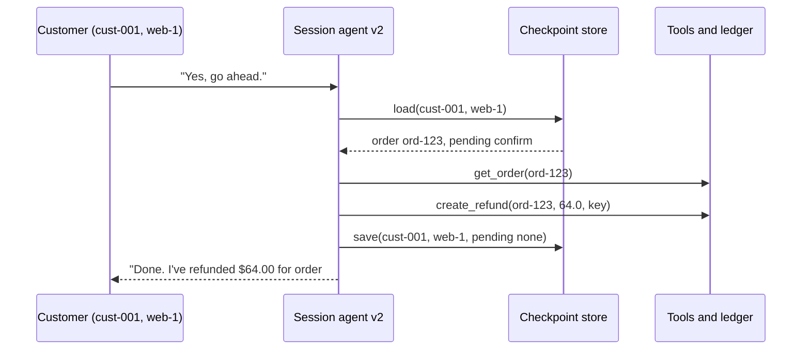
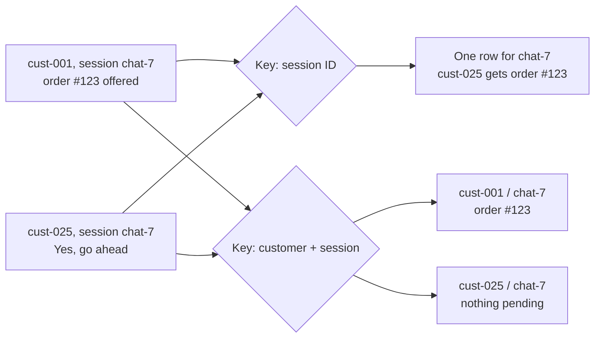
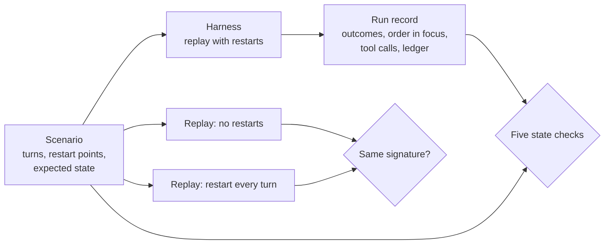

# Week 9 theory: Multi-turn state

*Every reply in a conversation can read well while the agent forgets the order on a restart or hands it to another customer: test the state it keeps and the refunds it stores, and leave the wording free.*

◷ 18 min read · Week 9 of 16 · Advanced · [Course index](../../../README.md)

> **Before you start.** This page assumes [Week 7](../../week-07-tools-and-side-effects/theory/week-07-tools-and-side-effects-theory.md) (tool calls, the strict and lax backends, reading back the refund ledger) and [Week 8](../../week-08-trajectories-and-task-completion/theory/week-08-trajectories-and-task-completion-theory.md) (judging a whole task by its end state). Slices come from [Week 2](../../week-02-golden-datasets/theory/week-02-golden-datasets-theory.md). Expectations follow refund policy 2026-01, rules R1 to R6. The commands, the lab output and the exercises are in the [hands-on file](../handson/week-09-multi-turn-state-handson.md).

*Lab: `handson/lab.py` · Notebook: `week-09-multi-turn-state-handson.ipynb` · Agents: `shared/session_agent.py` · Data: `datasets/conversations/conversations-v1.jsonl`*

---

## 1. What this week builds

**Project state.** Week 7's tool agent answers one message and is done. Real customers talk over several messages: they leave out the order number, ask a question in the middle, and say "yes" two minutes after the offer. This week's session agent offers a refund and waits for the customer's yes before it calls `create_refund`. Version 1 has four state bugs on purpose. Version 2 is the reference.

**Time.** 9 hours: 2 reading, 3 building, 2 investigating, 1 on the isolation drill and 1 on the design review.

By the end of the week you can:

1. Explain sessions, turns, conversation state and checkpoints, and say where each piece of state must live.
2. Replay a conversation with restarts and verify that the order survives them.
3. Check that the agent asks when the order is missing or ambiguous, and then uses the answer.
4. Detect cross-session leakage with a check that reads replies and tool calls, not only the ledger.
5. Test persistence through state and outcomes, including restart invariance, without matching exact text.

The week adds the session agents and their checkpoint store (`shared/session_agent.py`), 25 conversation scenarios built by `datasets/build_conversations.py`, and a lab that replays them.

---

## 2. A refund that vanished on restart

### 2.1 The yes that arrived at a new process

Asha (cust-001) writes to the agent, and the agent process restarts between her two messages, as it does on every deploy.

> **Asha:** My ceramic lamp from order #123 arrived damaged.
> **Agent v1:** Order #123 (ceramic table lamp, $64.00) can be refunded. Shall I go ahead?
> *(the agent restarts)*
> **Asha:** Yes, go ahead.
> **Agent v1:** What can I help you with?

No refund is stored. Each reply is polite and true. A test of either message alone passes. v1 kept the conversation in a Python dictionary, and the restart threw it away.

### 2.2 The yes that went to another customer

Two customers' apps happen to send the same session ID, `chat-7`. Asha asks about order #123. Then Zara (cust-025) opens her chat and types "Yes, go ahead."

> **Agent v1, to Zara:** I couldn't refund order #123 (not_found). I've noted it for a specialist.

v1 keys sessions by session ID alone, and Zara's message landed in Asha's conversation. The strict backend refused to show Zara the order, so no refund was stored. The reply still told Zara that Asha's order exists. On the lax backend from Week 7 the same turn refunds Asha's $64.00 lamp on Zara's say-so.

> **Watch out.** Neither failure is visible in a single reply. Both are about what the agent carried from one turn to the next, and only a multi-turn test that restarts the agent and mixes customers will show them.

---

## 3. Sessions, turns and conversation state

New terms for this section:

- **Session**: one conversation between one signed-in customer and the agent, named by a session ID that the app sends.
- **Turn**: one customer message and the agent's response to it.
- **Conversation state**: what the agent must remember between turns to continue the task. Here: the order in focus, the question it is waiting on, and the candidate orders of an open question.
- **Transcript**: the messages and replies, in order. The state can be derived from it, but it is not the same thing.
- **Session key**: what the agent uses to find a conversation's state. It must identify both the customer and the session.

v2 keeps four fields per session:

| Field | Example | What breaks if it is lost |
| --- | --- | --- |
| `order_id` | `ord-123` | The customer's yes has nothing to refund |
| `pending` | `confirm`, `which_order` or `order_id` | The agent cannot tell what a short answer such as "yes" or "the second one" refers to |
| `candidates` | `["ord-201", "ord-217"]` | "The second one" cannot be resolved |
| `turns` | `3` | Nothing on its own. It helps debugging |

This diagram shows one turn of v2. The state is loaded before the agent acts and saved before it replies.

---

## 4. Checkpoints and restarts

New terms for this section:

- **Checkpoint**: a saved copy of the conversation state, written after a turn, from which a new agent process can continue.
- **Durable state**: state kept in storage that outlives the process, here a SQLite file.
- **Restart**: the agent process stops and a new one starts, as on a deploy, a crash or a scale-down. Anything held only in memory is gone.

### 4.1 Where the state lives

v1 holds every session in a dictionary on the agent object. v2 writes one SQLite row per (customer, session) after every turn, and the next turn reads it back, whichever process serves it. The ledger is a separate service and stays up through the restart, as a real payments database would.

### 4.2 What the lab's restart does

The harness closes the agent and builds a new one that opens the same checkpoint file. Ten turns across the 25 scenarios have a restart before them. On v1, a restart before the yes (conv-01) or before "The first one" (conv-03) loses the conversation.

The lab restarts inside one Python process. Anything an agent kept in a module-level variable or a class attribute would survive this restart and not a real one. A suite that runs in CI should also restart in a new process or container at least once.

### 4.3 When the save happens

v2 saves the state after its tools have run and before it replies. If the process dies after `create_refund` and before the save, the next message finds the offer still pending. A second yes would call `create_refund` again. The idempotency key `cust-001:ord-123:refund` makes the backend return the refund it already stored, and the ledger holds one refund. Week 10 injects that fault and reads back the ledger.

> **Watch out.** A restart test only counts if the restart happened. A harness that treats a missing `restart_before` flag as "no restart" replays none of them, and v1 then passes all five restart scenarios. Count the restarts the harness performed and refuse a scenario file without the flag.

---

## 5. Clarification

New terms for this section:

- **Clarification question**: a question the agent asks because it cannot continue safely, such as "Which order?".
- **Binding the answer**: resolving the customer's reply against the question that was asked and the candidates stored with it.
- **Ordinal reference**: an answer by position, such as "the second one".

The agent should ask when the message names no order, or names two. It should not ask when exactly one order is named. A clarification turn must change no state outside the conversation: no refund and no escalation.

The answer to "Which one?" usually makes no sense on its own. "The second one." only means order #217 to an agent that stored `["ord-201", "ord-217"]` beside the question. v2 binds the answer: an order number if there is one, otherwise first, second or last. v1 takes the first candidate whatever the customer says. In conv-08, Zara answers "The second one." and v1 refunds the $58.00 rice cooker instead of the $110.00 running shoes.

conv-09 is the warning. The customer answers "The first one, #203", and v1 is right by accident. A clarification suite needs answers that pick a candidate other than the first, answers by number and by position, and an answer after a restart (conv-03).

---

## 6. Context carryover and long conversations

New terms for this section:

- **Context carryover**: using what an earlier turn established, such as the order, in a later turn.
- **Digression**: a turn about something else, such as a warranty question, after which the conversation returns to the task.
- **History window**: how much past conversation an agent reads back each turn. A model's context window, or a summary of older turns, has the same effect: facts outside it are gone.

v1 does not store the order as a field. Each turn it looks for the order among the orders it looked up in its last 3 turns. v2 keeps the order as a field of the state, and a digression leaves it alone.

A sweep over the number of questions between the offer and the yes shows where v1 breaks:

| Questions between offer and yes | 0 | 1 | 2 | 3 | 4 to 8 |
| --- | --- | --- | --- | --- | --- |
| v1 | pass | pass | pass | **fail** | **fail** |
| v2 | pass | pass | pass | pass | pass |

On the failing runs v1 answers the yes with "Could you share your order number?". A suite of short conversations would never show this. Long-conversation cases should go past the agent's window on purpose, and for a model-based agent that means past its context limit or its summarization point.

The fix that holds up is to keep task-critical facts, the order ID and the pending action, as structured state outside the free-text history. A summary of the conversation can drop an order number, and a field cannot.

---

## 7. Cross-session leakage and tenant isolation

New terms for this section:

- **Tenant**: the party whose data must stay separate. Here each customer is a tenant.
- **Tenant isolation**: no customer sees or acts on another customer's data.
- **Cross-session leakage**: state from one customer's session reaching another session.

### 7.1 The session key

v1 keys state by session ID alone. Session IDs come from the client: a per-device counter, a reused chat widget, a test account. Two customers can send the same one. v2 keys by (customer ID, session ID), where the customer ID comes from authentication, not from the message.

This diagram shows the two keys on conv-16.

### 7.2 The isolation check

The ledger alone misses the leak. On the strict backend conv-16 stores nothing, and the ledger check passes. The isolation check reads every reply and every tool argument and flags any order that the signed-in customer neither owns nor typed. That last condition matters: in conv-23 a customer asks for someone else's order #134 by number, and the agent's reply repeats the number the customer typed. That is not a leak.

Three v1 scenarios fail it: conv-16, conv-17 and conv-20. In conv-20 both customers have offers open under `chat-3`, and Bea Santos's yes reaches Cyril Moreau's order #204.

### 7.3 Over-correcting

Keying by customer ID alone closes the leak and merges two sessions of the same customer. In conv-19 Asha has a refund offer open in her web chat and an escalation in the app. With a customer-only key, her web "yes" finds the app conversation, where nothing is pending, and no refund is stored. A suite needs control scenarios like conv-19, where the right behavior is ordinary, to catch the fix that breaks something else.

> **Watch out.** Restarting before every turn hides the leak. After each restart v1's shared dictionary is empty, and conv-16 passes under that schedule. Run the isolation scenarios without restarts too.

---

## 8. Testing state without exact wording

New terms for this section:

- **Exact-text check**: comparing each reply with a recorded transcript, word for word.
- **Golden transcript**: the recorded replies an exact-text check compares against, here v2's replies in `dataset/v2-transcripts.jsonl`.
- **State check**: a check on what the agent knows and did: the outcome of a turn, the order in focus, the tool calls, the ledger.
- **Restart invariance**: the property that restarting the agent between turns changes nothing it does. Testing a property by comparing two runs of the system with each other, instead of with labels, is called a metamorphic test.

### 8.1 Five state checks

| Worry | Check | Reads |
| --- | --- | --- |
| The agent did the wrong thing this turn | `outcomes` | each turn's outcome against the accepted ones |
| The agent lost or swapped the order | `order_continuity` | the order in focus after each turn |
| A refund happened before the yes, or during a question | `mutation_timing` | create_refund and escalate calls, per turn |
| The stored result is wrong or duplicated | `ledger` | the ledger, read back after the conversation |
| One customer saw another's order | `tenant_isolation` | replies and tool arguments, against ownership |

None of them reads the reply's wording. The isolation check extracts order numbers from the reply, which is a fact the reply states, not a phrasing.

### 8.2 What exact text does

Rewording every reply template, the same facts in different words, gives these results:

| Agent and wording | Exact text | State checks |
| --- | --- | --- |
| v2, recorded wording | 25/25 | 25/25 |
| v2, reworded | 0/25 | 25/25 |
| v1, recorded wording | 13/25 | 12/25 |

A prompt edit or a model upgrade rewords replies all the time. An exact-text suite then fails everything and the team stops reading it. It also passes conv-22 for v1. The customer cancels the offer, the agent restarts, and the customer says "Yes." Both agents reply "What can I help you with?". v1 has lost the order in focus and v2 still holds it. A later "Actually, please refund it after all." gets a new offer from v2 and "Could you share your order number?" from v1. The words match and the state does not.

### 8.3 Restart invariance

Replay each scenario twice, with no restarts and with a restart before every turn, and compare what happened: the outcome and order in focus of each turn, the refunds and the escalations. v2 behaves the same on 25 of 25 scenarios. v1 behaves differently on all 25. The test needs no expected values, and any scenario, including a real conversation replayed from logs, can be run through it.

This diagram shows the harness and both ways it judges a run.

---

## 9. The 25 scenarios

Each scenario lists its turns. A turn names the signed-in customer, the session ID, the message, whether the agent restarts before it, and what must hold after it: the accepted outcomes and the order in focus. The scenario lists the refunds and escalations the ledger must hold at the end.

| Slice | Scenarios | What varies | v1 fails |
| --- | --- | --- | --- |
| restart | conv-01 to 05 | Restart before the yes, before a clarification answer, twice, after the refund | 01, 03, 04 |
| clarification | conv-06 to 10 | Missing order, two orders answered by number or position, a correction | 07, 08 |
| digression | conv-11 to 15 | 1, 2, 3, 4 and 6 questions between offer and yes | 13, 14, 15 |
| isolation | conv-16 to 20 | Shared session IDs, interleaved customers, one customer in two sessions | 16, 17, 20 |
| combined | conv-21 to 25 | Final sale, a declined offer, someone else's order, high value, everything at once | 22, 25 |

Twelve scenarios are controls that v1 passes, such as conv-02, where the answer after the restart carries the order number itself. They show the checks do not flag correct behavior, and they catch fixes that break ordinary paths (section 7.3).

### 9.1 Worked example, conv-08 by hand

Zara (cust-025) has orders #201 (rice cooker, $58.00) and #217 (running shoes, $110.00), both delivered within 30 days.

1. **Turn 1.** "Order #201 or #217 arrived broken, I'm not sure which number it was." Expected: `clarification_requested`, no order in focus. v1 and v2 both ask which.
2. **Turn 2.** "The second one." Expected: `refund_offered` with `ord-217` in focus. v2 offers #217. v1 offers #201, and `order_continuity` fails at turn 2.
3. **Turn 3.** "Yes." Expected: `refund_created`, and the ledger must hold one refund of $110.00 on ord-217. v1 stores $58.00 on ord-201. `ledger` fails.
4. **What passes.** `outcomes` passes for v1: an offer, then a refund, the right outcome names for the wrong order. `mutation_timing` passes too, because the refund came on the yes. Outcome labels alone would have missed this bug.

### 9.2 Worked example, the isolation check on conv-16

1. **Turn 1.** Asha (cust-001) types "Order #123 arrived damaged." She owns ord-123 and typed it. Nothing is flagged.
2. **Turn 2.** Zara (cust-025) types "Yes, go ahead." She typed no order number. Her own orders are ord-201, ord-217, ord-233, ord-249 and ord-260.
3. **What v1 touched.** Its reply names #123, and its trace has `get_order(ord-123)`. The owner of ord-123 is cust-001, and Zara never typed it.
4. **Verdict.** `tenant_isolation` fails at turn 2. The ledger check passes on the strict backend, because the backend refused the lookup. The leak is in the reply.

---

## 10. Reading the results

### 10.1 v1 against v2

v2 passes 25 of 25 on the strict and the lax backend. v1 passes 12 of 25 on both. Its failed checks: `outcomes` 11, `order_continuity` 12, `ledger` 11, `tenant_isolation` 3, `mutation_timing` 0 on the strict backend. On the lax backend `mutation_timing` and `ledger` also fail conv-16, because the refund of Asha's order is created on Zara's turn.

Each failure maps to a bug:

| v1 bug | Scenarios that fail because of it |
| --- | --- |
| 1. State only in memory | conv-01, 03, 04, 14, 22, 25 |
| 2. Session key without the customer | conv-16, 17, 20 |
| 3. First candidate, whatever the answer | conv-07, 08, 25 |
| 4. Order re-read from the last 3 turns | conv-13, 14, 15, 25 |

### 10.2 Worked example, one conversation, three bugs

conv-25 is six turns for Zara: two orders, "It's #260.", three questions and a restart before the yes. v1 picks #201 instead of #260 (bug 3). After three questions the order is outside its window (bug 4). The restart wipes what is left (bug 1). It answers the yes with "What can I help you with?". Fixing one bug at a time and rerunning shows each one: a long combined scenario says that something is wrong, and the short single-cause scenarios say what.

### 10.3 Severity

`tenant_isolation`, `ledger` and `mutation_timing` failures are critical. One of them blocks a release whatever the pass rate, as in Week 6's rules. `outcomes` and `order_continuity` failures without a wrong side effect are major. They cost the customer a repeated question, not money or privacy.

---

## 11. Design review

### Q1 – How do you test persistence without brittle exact-text matching?

Decide what the conversation must remember and do, and check that. Each scenario states, per turn, the accepted outcomes and the order in focus, and at the end the refunds and escalations the ledger must hold. The harness restarts the agent where the scenario says and reads back the ledger instead of trusting the reply. On top of that, run the restart-invariance comparison: the same conversation with no restarts and with a restart before every turn must produce the same outcomes, orders and ledger. It needs no labels, so it scales to replayed production conversations. Where the reply must state a fact, such as the order number, extract the fact and check it, and leave the phrasing to a judge for tone (Week 3). In this lab, rewording every reply fails 25 of 25 exact-text comparisons and none of the state checks.

### Q2 – Where should conversation state live, and what must be in its key?

In storage that outlives the agent process, written after every turn, keyed by the authenticated customer ID and the session ID. The customer ID must come from sign-in, never from the message. Keep task-critical facts as fields, the order and the pending action, rather than re-deriving them from the transcript. Test the key with two customers sharing a session ID (conv-16) and one customer in two sessions (conv-19).

### Q3 – The process dies after create_refund and before the checkpoint save. What happens next?

The next process loads the last saved state, with the offer still pending. If the customer says yes again, the agent calls `create_refund` again with the same idempotency key, and the backend returns the existing refund. The customer is refunded once and told it worked. Without the key, the strict backend's one-refund-per-order rule still returns the stored refund, and the lax backend refunds a second time. The ledger read-back is the only check that proves which happened. Week 10 injects this fault.

### Q4 – The restart tests pass. What could still break in production?

The lab restarts inside one process, so state in module-level variables or class attributes survives it. Real restarts also bring schema changes: a new version that cannot read an old checkpoint, or two replicas writing the same session at once. Add one restart in a fresh process, a test that loads checkpoints written by the previous release, and a concurrency case for two messages arriving together. Also check that a restart test really restarted: count the agents the harness built.

### Q5 – How long should test conversations be?

Long enough to pass the agent's memory limits on purpose. Find the limit: a history window, a context-length cap, the point where older turns are summarized. Then sweep the digression length across it. v1 fails from 3 questions on, and a suite of 2-question conversations would report it healthy. Keep the long cases few and add short single-cause cases beside them, so a failure points at its cause.

---

## Key Takeaways

- **A conversation's state is part of the product.** v1's replies are all fluent, and it gets 13 of 25 conversations wrong.
- **Checkpoint durable state, keyed by customer and session.** v2 survives every restart and never mixes customers.
- **Bind clarification answers to the question.** "The second one" needs the stored candidates. Test answers other than the first.
- **Keep task facts as fields, and test past the memory limit.** v1 forgets the order after 3 questions.
- **Read replies and tool calls for isolation, not only the ledger.** The strict backend blocked the refund in conv-16, and the reply still leaked the order.
- **Check state and outcomes, and compare runs with each other.** Rewording fails every exact-text comparison and no state check, and restart invariance needs no labels.
- **Keep controls and single-cause cases.** Controls catch over-corrections such as the customer-only key, and short cases name the bug.

## Check Yourself

1. v1 answers "Yes, go ahead." with "What can I help you with?" after a restart. Which state was lost, and which checks fail? **The order in focus and the pending confirmation. `outcomes`, `order_continuity` and `ledger` fail on conv-01.**
2. Why does the ledger check pass on conv-16 under the strict backend while the isolation check fails? **The backend refused get_order on Asha's order, so nothing was stored, but the reply showed order #123 to Zara.**
3. In conv-08, why does `outcomes` pass for v1? **v1 produced an offer and then a refund, the expected outcome names, only for order #201 instead of #217. `order_continuity` and `ledger` catch it.**
4. What does restart invariance compare, and why does it need no labels? **The outcomes, orders in focus and ledger of a run with no restarts and a run with a restart before every turn. It compares the agent with itself.**
5. Keying sessions by customer ID alone fixes conv-16. Which scenario fails instead, and why? **conv-19: Asha's web-chat yes finds her app conversation, where nothing is pending, so no refund is stored.**

## Memory card

| Term | Meaning in this course |
| --- | --- |
| Session / turn | One customer's conversation / one message and its response |
| Conversation state | Order in focus, pending question, candidates |
| Checkpoint | Saved state a new process continues from |
| Session key | (authenticated customer ID, session ID) |
| Binding the answer | Resolving "the second one" against the stored candidates |
| Context carryover | Using an earlier turn's facts in a later turn |
| Tenant isolation | No customer sees or acts on another's data |
| State check | Outcome, order in focus, tool calls, ledger |
| Restart invariance | Same behavior with and without restarts |
| Golden transcript | Recorded replies for exact-text comparison |

**Rules of thumb.** Store task facts as fields, durably, under (customer, session). Restart in the test, and prove it restarted. Check state, never wording. Mix customers, and keep controls.

**Next week.** Week 10 breaks the tools underneath the conversation: timeouts after a commit, retried requests, poisoned policy text and failed handoffs, read back against the same ledger.

## References

- [Hands-on file](../handson/week-09-multi-turn-state-handson.md): the lab walkthrough, real output, exercises, drills and solutions for this page.
- [`week-09-multi-turn-state-handson.ipynb`](../handson/week-09-multi-turn-state-handson.ipynb): the same lab as a notebook.
- [`shared/session_agent.py`](../../../shared/session_agent.py): session agents v1 and v2, the checkpoint store and the reply templates.
- [`datasets/build_conversations.py`](../../../datasets/build_conversations.py): the 25 scenarios and their expected state.
- [Glossary](../../../glossary.md): every term in the course, with the week that introduces it.

---

**Next:** [Week 10 theory: Faults, adversarial inputs and handoffs](../../week-10-faults-adversarial-and-handoffs/theory/week-10-faults-adversarial-and-handoffs-theory.md) · **Previous:** [Week 8 theory: Trajectories and task completion](../../week-08-trajectories-and-task-completion/theory/week-08-trajectories-and-task-completion-theory.md)
