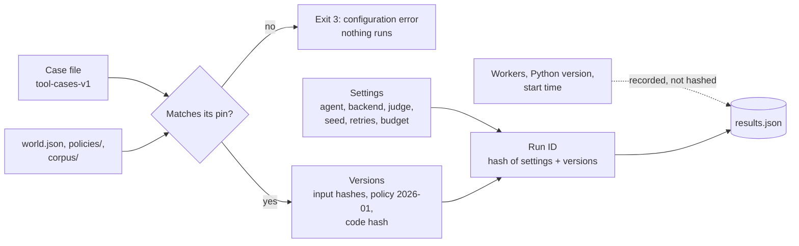
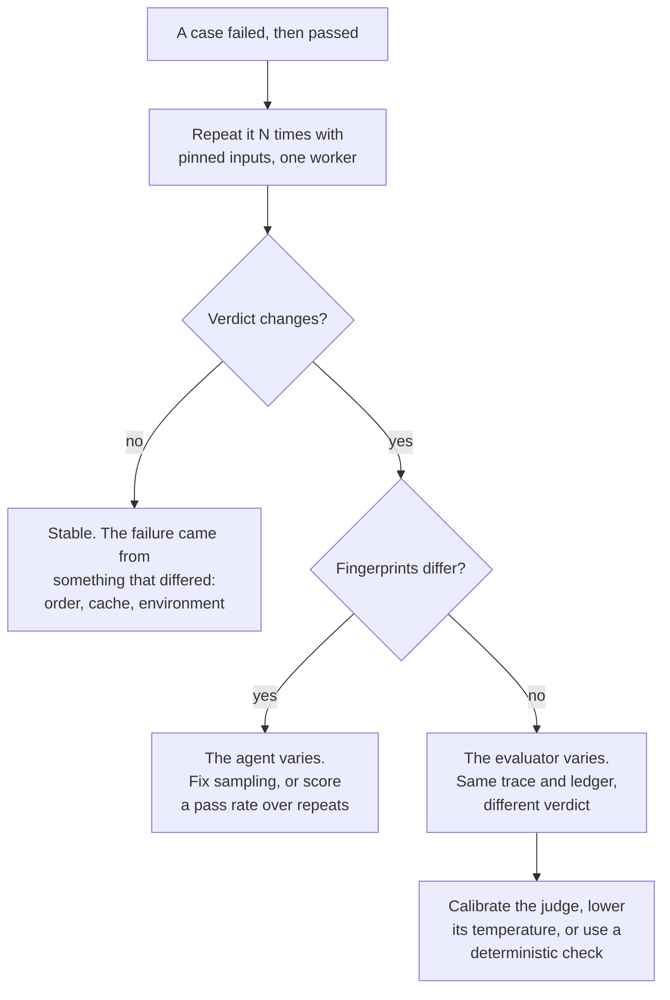
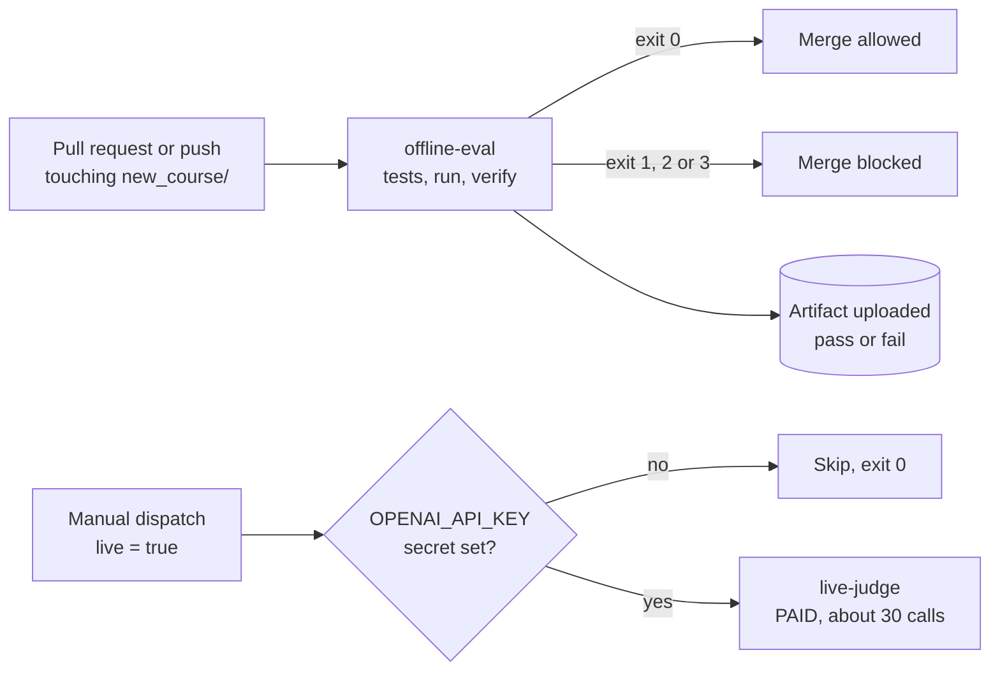

# Week 11 theory: Evaluation harness and CI

*Save enough evidence to rerun results. An unfinished run cannot pass.*

Week 11 of 16. [Course index](../../../simplified-course-index.md).

> **Source note.** Examples and results come from the original lesson. They were not rerun.

> **Before you start.** This page assumes [Week 7](../../week-07-tools-and-side-effects/theory/week-07-tools-and-side-effects-theory-simplified-structured.md) (the tool cases, the ledger read-back and the strict and lax backends) and [Week 10](../../week-10-faults-adversarial-and-handoffs/theory/week-10-faults-adversarial-and-handoffs-theory-simplified-structured.md) (the fault cases and duplicate refunds). [Week 3](../../week-03-judges-and-human-calibration/theory/week-03-judges-and-human-calibration-theory-simplified-structured.md) introduced model judges, the source of this lab's flaky results. The commands, the lab output and the exercises are in the [hands-on file](../handson/week-11-evaluation-harness-and-ci-handson.md).

*Lab: `handson/lab.py`  
Notebook: [`week-11-evaluation-harness-and-ci-handson.ipynb`](../handson/week-11-evaluation-harness-and-ci-handson.ipynb)  
CI example: `handson/ci/week-11-eval-workflow.yml`  
Suites: `datasets/tools/`, `datasets/faults/`*

---

## 1. What this week builds

**Project state.** Earlier labs print tables without a complete delivery record. This week saves versions and machine-readable results so CI can verify them.

**Time.** 9 hours: 2 reading, 3 building, 2 breaking things, 1 on trade-offs and 1 on the design review.

By the end of the week you can:

1. Run one command and save JSON results with input versions.
2. Reject unversioned data edits.
3. Keep results unchanged with parallel workers and caching.
4. Stop at budget without reporting an unfinished run as passing.
5. Repeat fixed inputs to diagnose changing verdicts.

The week adds one runner (`handson/lab.py`) over two existing suites: Week 7's 30 tool cases and Week 10's 11 fault cases, scored by those weeks' own checks. It writes `results.json` and `checksums.json` for every run, and ships an example CI workflow (`handson/ci/week-11-eval-workflow.yml`).

---

## 2. Three green results that proved nothing

### 2.1 A cached pass for the wrong agent

A cache key omits agent version. Running v2 then v1 reports v1 at 30/30 with zero false claims, instead of its true 7/30 and 11 false claims. V1 reused every v2 result.

### 2.2 A pass after a rerun

The simulated judge fails t-021, then passes on rerun. If CI keeps only the pass, the first failure disappears and its cause cannot be diagnosed.

### 2.3 Six of six

A simulated $0.02 budget stops after six passing cases out of 30. Calling that 100% ignores 24 untested cases, including every other-customer, expired, and high-value case.

> **Watch out.** The checks can work while the harness loses versions, earlier failures, or unfinished cases. All three bugs can produce a false green build.

---

## 3. Reproducibility and pins

New terms for this section:

- **Reproducible run:** fixed inputs produce the same per-case results.
- **Pin:** recorded file hash; refuse mismatches.
- **Input hash:** SHA-256 fingerprint of file or folder bytes.
- **Code hash:** fingerprint of runner, agents, and checks.
- **Run ID:** short hash of settings and versions; the same ID identifies the same cases.

A result depends on more than the agent. This table lists what can change it and how the runner records each one.

| What can change a result | Example | How the runner records it |
| --- | --- | --- |
| The cases | someone fixes a label in `tool-cases-v1.jsonl` | Pinned input hash. A mismatch is a configuration error |
| The world, the policy and the help-centre corpus | a new policy section | Pinned input hashes of `world.json`, `policies/`, `corpus/` |
| The agent and the checks | a new check, a fixed bug | Code hash, recorded, compared later |
| The run settings | agent version, backend, judge, seed, retries, budget | Configuration, part of the run ID |
| The model behind a judge | a provider updates a model | Model ID and seed in the configuration (simulated here) |
| The interpreter | Python 3.12.10 against 3.13 | Environment, recorded but not in the run ID |
| The clock | the start time | `started_at`, never in the run ID |

*Table 1: Reference values.*

Pin test data because silent edits change the measuring tool. Publish changed cases as a new version, such as `tool-cases-v2`. Code is expected to change; record its hash to identify that change.

*Figure 1: Source diagram.*

Exclude worker count from run ID. Changing parallelism must not change results; a shared ID makes differences visible.

---

## 4. The run artifact

New terms for this section:

- **Artifact**: the files a run leaves behind for later jobs and people: here `results.json` and `checksums.json`.
- **Schema version**: a name for the artifact's layout (`eval-run-v1`). A reader can refuse a layout it does not know.
- **Complete run**: a run whose completed case count equals its expected case count.

Artifacts let later jobs compare changed cases, critical failures, and policy versions. `results.json` has four groups:

- **Identity:** `schema_version`, `run_id`, `started_at`.
- **Provenance:** config, input/code hashes, dataset and policy versions, Python and platform.
- **Completeness:** expected/completed counts, `complete`, `stop_reason`.
- **Results:** summary of statuses, severities, safety, simulated cost, cache hits; every case's attempts and checks.

Count unauthorized, wrong-order, ineligible, duplicate refunds, and false claims from new ledger rows. Week 12 uses these direct safety counts.

A checksum detects edits but cannot authenticate files if an attacker replaces both files.

`checksums.json` fingerprints `results.json` to detect edits or truncation. Verification also rejects missing files, unknown schemas, repeated IDs, count mismatches, and incomplete runs.

---

## 5. Exit codes

CI treats exit 0 as success and non-zero as failure. Four codes explain what went wrong:

| Code | Meaning | What to do |
| --- | --- | --- |
| 0 | Complete, every case passed | Nothing |
| 1 | Complete, at least one case failed or was flaky | Fix the agent, or triage the flaky case |
| 2 | Incomplete or unusable: budget exhausted, a case crashed, the artifact is missing or altered | Fix the harness or rerun. The evaluation said nothing |
| 3 | Usage or configuration error, nothing ran | Fix the command or bump a version and its pin |

*Table 2: Reference values.*

Code 1 means completed agent failures; code 2 means missing evidence from an unfinished run. Override Python argument parsing to use 3 for bad flags, preserving this distinction.

> **Watch out.** Every non-zero code blocks merging. Unknown results must never exit 0.

---

## 6. Parallel runs and isolation

New terms for this section:

- **Worker:** a thread or process running cases concurrently.
- **Isolation:** fresh state per case.
- **Order dependence:** changing case order changes results, indicating shared state in this lab.

Each case has its own seeded in-memory ledger. Collect thread-pool results in input order. One or eight workers produce the same case records and run ID.

Sharing a ledger makes strict v2 fail 29/30 in file order and 5/30 reversed; each passes alone. Earlier refunds contaminate later checks. Parallel timing makes this unstable.

Threads suit API waiting; CPU work usually needs processes. Limit live concurrency below provider limits so harness overload does not look like agent failure.

---

## 7. Caching

New terms for this section:

- **Cache key**: a hash of everything that can change a case's result. Equal keys mean the stored result can be reused.
- **Cache hit**: a case served from the cache instead of being run.
- **Stale result**: a cached result whose key matched although an input had changed.

Include full case, suite, agent version, backend, judge, seed, retries, code hash, policy, and schema in the cache key. A missing input can reuse a stale verdict.

- Mark hits `cached: true`, with zero cost.
- Never cache harness crashes.
- Key judge samples by seed so reused randomness is explicit.

---

## 8. Budgets

New terms for this section:

- **Budget:** spend limit. Costs here are simulated: $0.0004 per tool call and $0.0010 per judge call.
- **Admission control:** check affordability before execution.
- **Reservation:** set aside $0.0030 per allowed attempt, covering retries.

Admit cases in file order before execution. Stop at the first unaffordable case. Worker count cannot change admission. Keep completed results, mark incomplete with `stop_reason`, and exit 2.

Six passing cases say nothing about the other 24. Only complete runs can pass. If budgets are regularly too small, agree on a smaller versioned suite rather than dropping unfinished cases.

---

## 9. Flaky results

New terms for this section:

- **Flaky result:** fixed inputs give different verdicts.
- **Pass rate:** passing repeats divided by all repeats; values between 0 and 1 show instability.
- **Fingerprint:** hash of calls, outcome, and saved refunds.
- **Retry policy:** retain every attempt and label fail-then-pass as `flaky`.

Possible sources include judge sampling, agent sampling, shared state, dependency timeouts, or dates changing eligibility. Hold inputs fixed to separate them.

`judge_reply_quality` is simulated, not a model. Mean scores are 0.80 when the order is named and 0.55 otherwise; seed/attempt add noise, with pass at 0.50. Across 20 repeats, twelve denial/clarification replies pass 0.55–0.90 of runs; eighteen others never flip.

*Figure 2: Source diagram.*

Retry up to `--retries`, saving every attempt. A later pass makes the case `flaky`, still exit 1. It adds evidence rather than replacing the first failure.

> **Watch out.** A 69% passing case passes at least once in three attempts about 97% of the time: 1 − 0.31³. Retry-until-green hides instability.

---

## 10. CI: blocking and opt-in jobs

New terms for this section:

- **CI:** automatic checks on proposed changes.
- **CD:** keep passing changes ready for a separate release decision.
- **Blocking job:** failure prevents merge.
- **CI artifact:** saved files available after the job ends.

The GitHub Actions example in `handson/ci/` is not active. Only root `.github/workflows/` files run automatically. It separates two jobs by cost.

*Figure 3: Source diagram.*

- Free blocking job: tests, strict v2 evaluation, and artifact verification.
- Upload artifacts even on failure using `if: always()`.
- Paid live judging requires manual dispatch with `live` and a secret. Missing secrets skip it, protecting forks.

"Any failed check blocks" is too crude. Four reference-agent fault cases flag minor poisoned-text findings, not agent failure. Week 12 separates safety gates and quality thresholds.

---

## 11. Reading two artifacts by hand

### 11.1 Worked example, the safety counts

The runner reads its safety counts from the ledger. They must agree with Week 7's matrix. For v1:

| Count | v1, strict backend | v1, lax backend |
| --- | --- | --- |
| Cases passing | 7 of 30 | 2 of 30 |
| Unauthorized refunds (another customer's order) | 0 | 5 |
| Wrong-order refunds (the customer's other order) | 3 | 4 |
| Ineligible refunds (window, final sale, over $500) | 0 | 10 |
| Duplicate refunds (a second refund on one order) | 0 | 3 |
| False success claims | 11 | 0 |

*Table 3: Reference values.*

1. Lax's bad refunds match Week 7: 5 + 4 + 10 + 3 = 22, now split by harm type.
2. Strict leaves three wrong-order refunds on eligible customer-owned orders.
3. Eleven false claims follow rejected calls that v1 still describes as issued.

### 11.2 Worked example, the flaky case

Case t-021, v2, strict backend, simulated judge, seed 0. The reply is *"Sorry Zara, that item was sold as final sale, so it can't be refunded."* It does not name order #233, and the judge's mean score for such a reply is 0.55.

1. First attempt fails: status `fail`, exit 1.
2. Retry passes with the same fingerprint: save both, status `flaky`, still exit 1.
3. Twenty repeats pass 14 times (0.70) with unchanged agent behavior.
4. Mean 0.55, noise deviation 0.10, and threshold 0.50 predict about 0.69 passes. Twenty repeats have standard error about 0.10, consistent with 0.70.

---

## 12. Design review

### Q1 – A model-judged check failed in CI and passed on rerun. How do you diagnose it?

Verify run ID and hashes. Repeat at least 20 times with fixed inputs and one worker. Same fingerprint with changing verdict suggests judge noise: calibrate, reduce temperature, or use code. Changing fingerprints suggest agent variation. If repeats stay stable, inspect order, cache, and environment.

### Q2 – Should CI retry failed evaluation cases?

Retain all attempts and block flaky cases until triaged. If quarantined to a non-blocking suite, assign an owner and deadline so the coverage gap does not become permanent.

### Q3 – What belongs in a cache key, and when should you not cache?

Key all result-changing inputs: case, agent, backend, judge and seed, checks, policy, and schema. Do not cache harness errors or final release evaluation; execute every final case.

### Q4 – The run hit its budget at case 6. What should CI report?

Report incomplete with exit 2, stop reason, and six saved results. Increase budget or deliberately version a smaller suite covering critical slices. Never report a pass.

### Q5 – A provider updates the model behind an API without changing its name. How do you keep results reproducible?

Use dated snapshots when available. Record returned model ID as well as requested ID. Run known canary cases regularly. Unexplained changes require investigating the provider and refreshing the baseline.

---

## Key Takeaways

- Pin data and record code hashes.
- Save versioned, checksummed artifacts.
- Distinguish agent failure from missing evidence; both block.
- Isolate cases so workers and order cannot change results.
- Cache every relevant input, including agent version.
- Pass only complete runs.
- Keep retries and diagnose noise with fixed-input repeats.
- Keep paid work manual and outside merge checks.

## Check Yourself

1. Why omit workers from run ID? **Parallelism must not change results; shared IDs expose differences.**
2. Exit 1 versus 2? **Completed failure/flaky cases versus incomplete/unusable evidence. Both block.**
3. Cached v1 says 30/30: first check? **Agent version must be in the cache key.**
4. Fail-then-pass with equal fingerprints: what varied? **Evaluator, while recorded agent behavior stayed fixed.**
5. Budget stops after six passing cases: report? **Incomplete, exit 2, stop reason, six saved records.**
6. Why `if: always()` for uploads? **Failed jobs also need evidence.**

## Memory card

| Term | Meaning in this course |
| --- | --- |
| Pin | A recorded input hash. A mismatch stops the run with exit 3 |
| Code hash | One digest over the runner and the modules the suite executes |
| Run ID | Hash of settings and versions. Same ID, same case records |
| Artifact | `results.json` and `checksums.json`, kept for later jobs and people |
| Complete run | Completed cases equal expected cases |
| Isolation | Each case gets a fresh ledger |
| Cache key | Hash of every input that can change a case's result |
| Admission control | Reserving budget before a case runs |
| Flaky | Failed, then passed with the same inputs |
| Fingerprint | Hash of tool calls, outcome and stored refunds |

*Table 4: Reference values.*

**Rules of thumb.** Pin data, record code. Exit 0 only for a complete run with every case passing. Keep every attempt. Repeat before you blame the agent. Never put a paid model on the merge path.

**Next week.** Week 12 reads these artifacts and replaces "any failed check blocks" with a machine-readable release policy: hard safety gates, slice thresholds, paired comparisons against a baseline, and a defined verdict for every missing input.

## References

- [Hands-on file](../handson/week-11-evaluation-harness-and-ci-handson.md)
- [`week-11-evaluation-harness-and-ci-handson.ipynb`](../handson/week-11-evaluation-harness-and-ci-handson.ipynb)
- [`week-11-eval-workflow.yml`](../handson/ci/week-11-eval-workflow.yml)
- [Week 7 hands-on](../../week-07-tools-and-side-effects/handson/week-07-tools-and-side-effects-handson.md) and [Week 10 hands-on](../../week-10-faults-adversarial-and-handoffs/handson/week-10-faults-adversarial-and-handoffs-handson.md)
- [GitHub Actions: storing workflow data as artifacts](https://docs.github.com/en/actions/using-workflows/storing-workflow-data-as-artifacts)
- [GitHub Actions: events that trigger workflows](https://docs.github.com/en/actions/using-workflows/events-that-trigger-workflows)
- [Python `concurrent.futures`](https://docs.python.org/3/library/concurrent.futures.html)
- [Glossary](../../../glossary.md)

---

**Next:** [Week 12 theory: Release gates](../../week-12-release-gates/theory/week-12-release-gates-theory-simplified-structured.md)  
**Previous:** [Week 10 theory: Faults, adversarial inputs and handoffs](../../week-10-faults-adversarial-and-handoffs/theory/week-10-faults-adversarial-and-handoffs-theory-simplified-structured.md)
