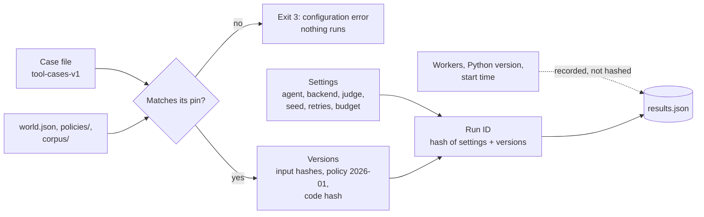
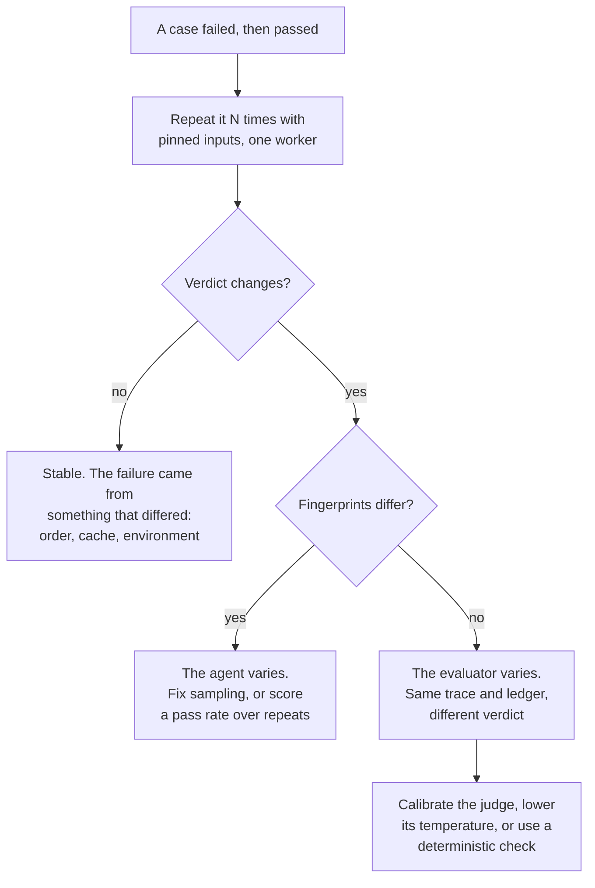
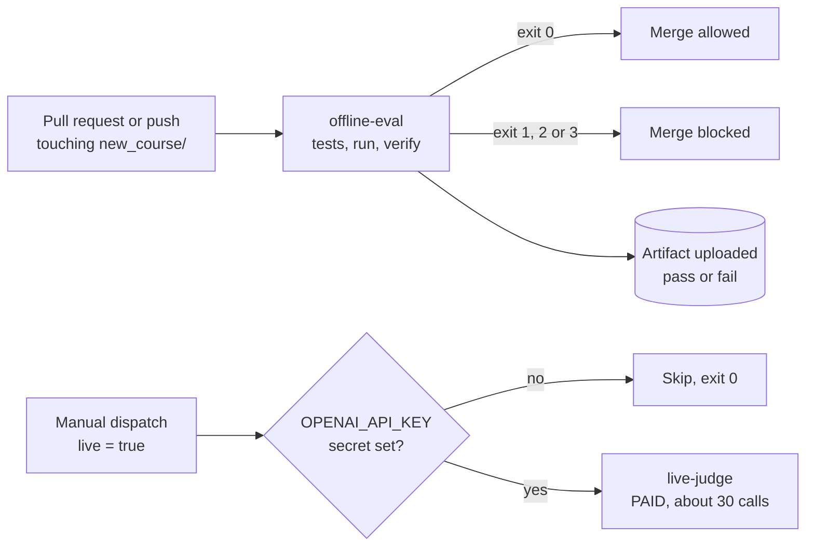

# Week 11 theory: Evaluation harness and CI

*A result nobody can rerun is an anecdote, and a run that never finished has not passed: make the harness say which one it has.*

◷ 17 min read · Week 11 of 16 · Advanced · [Course index](../../../README.md)

> **Before you start.** This page assumes [Week 7](../../week-07-tools-and-side-effects/theory/week-07-tools-and-side-effects-theory.md) (the tool cases, the ledger read-back and the strict and lax backends) and [Week 10](../../week-10-faults-adversarial-and-handoffs/theory/week-10-faults-adversarial-and-handoffs-theory.md) (the fault cases and duplicate refunds). [Week 3](../../week-03-judges-and-human-calibration/theory/week-03-judges-and-human-calibration-theory.md) introduced model judges, the source of this lab's flaky results. The commands, the lab output and the exercises are in the [hands-on file](../handson/week-11-evaluation-harness-and-ci-handson.md).

*Lab: `handson/lab.py` · Notebook: `week-11-evaluation-harness-and-ci-handson.ipynb` · CI example: `handson/ci/week-11-eval-workflow.yml` · Suites: `datasets/tools/`, `datasets/faults/`*

---

## 1. What this week builds

**Project state.** Weeks 1 to 10 each have a lab command that prints a table. Nobody can say which code, which cases and which policy produced last Tuesday's table, and a CI system cannot read a table printed for people. Phase 4 makes evaluation part of delivery, and it starts with a runner whose results a machine can trust.

**Time.** 9 hours: 2 reading, 3 building, 2 breaking things, 1 on trade-offs and 1 on the design review.

By the end of the week you can:

1. Run an evaluation suite from one command that writes a structured JSON artifact with every version that produced it.
2. Pin the inputs that can change a result, and refuse to run when one of them changed without a new version.
3. Run cases in parallel and from a cache without changing a single result.
4. Stop a run at its budget so that an unfinished run can never report a pass.
5. Diagnose a flaky result by repeating it with every input held fixed.

The week adds one runner (`handson/lab.py`) over two existing suites: Week 7's 30 tool cases and Week 10's 11 fault cases, scored by those weeks' own checks. It writes `results.json` and `checksums.json` for every run, and ships an example CI workflow (`handson/ci/week-11-eval-workflow.yml`).

---

## 2. Three green results that proved nothing

### 2.1 A cached pass for the wrong agent

A team adds a result cache to make reruns cheap. The cache key covers the case, the suite, the backend and the code, and leaves out the agent version. They run v2, then v1 with the same cache. The v1 run reports 30 of 30 passing and zero false success claims. Week 7 measured v1 on the same cases: 7 passing and 11 false success claims. Every result in the v1 run came from v2's cache entries.

### 2.2 A pass after a rerun

The reply-quality check in this lab is a simulated model judge. On case t-021 its first verdict is a fail. The CI system's "rerun failed jobs" button produces a pass, the pull request merges, and the first failure is gone from every record. Nobody can now tell whether the agent or the judge was at fault.

### 2.3 Six of six

A run with a budget of $0.02 (simulated) stops after 6 of the 30 tool cases. All 6 passed. A summary that divides passes by completed cases reports 100%. The 24 cases nobody ran include every other-customer, expired and high-value case.

> **Watch out.** All three runs exited with a green status in their first version. The checks were right each time. The harness around them lost the agent version, the first verdict or the cases it never ran.

---

## 3. Reproducibility and pins

New terms for this section:

- **Reproducible run**: a run that gives the same per-case results when repeated with the same inputs, on another day or machine.
- **Pin**: a recorded hash of an input file. The runner refuses to run when the file no longer matches it.
- **Input hash**: a SHA-256 digest of a file's bytes, or of every file in a folder. Any edit changes it.
- **Code hash**: one digest over the runner and every module the suite's agents and checks execute.
- **Run ID**: a short hash of the run's configuration and versions. Two runs with the same ID must produce the same cases.

A result depends on more than the agent. This table lists what can change it and how the runner records each one.

| What can change a result | Example | How the runner records it |
| --- | --- | --- |
| The cases | someone fixes a label in `tool-cases-v1.jsonl` | Pinned input hash. A mismatch is a configuration error |
| The world, the policy and the help-centre corpus | a new policy section | Pinned input hashes of `world.json`, `policies/`, `corpus/` |
| The agent and the checks | a new check, a fixed bug | Code hash, recorded, compared later |
| The run settings | agent version, backend, judge, seed, retries, budget | Configuration, part of the run ID |
| The model behind a judge | a provider updates a model | Model ID and seed in the configuration (simulated here) |
| The interpreter | Python 3.12.10 against 3.13 | Environment, recorded but not in the run ID |
| The clock | the start time | `started_at`, never in the run ID |

Data is pinned and code is recorded, for different reasons. A case file is a measuring instrument. If it changes silently, a better score may only mean easier cases. A changed case file must arrive as a new version (`tool-cases-v2`) with a new pin. Code is expected to change between runs, and the code hash lets a comparison say whether it did.

This diagram shows how the inputs become the run ID and which ones stay outside it.

Workers sit outside the run ID on purpose. The number of parallel workers must never change a result. Including it in the ID would hide the very bug it could cause.

---

## 4. The run artifact

New terms for this section:

- **Artifact**: the files a run leaves behind for later jobs and people: here `results.json` and `checksums.json`.
- **Schema version**: a name for the artifact's layout (`eval-run-v1`). A reader can refuse a layout it does not know.
- **Complete run**: a run whose completed case count equals its expected case count.

A printed table answers one question for one reader. An artifact answers questions nobody has asked yet: which cases flipped since last week, what the critical failures were, which policy version a release was tested against. `results.json` holds four groups of fields:

- **Identity.** `schema_version`, `run_id`, `started_at`.
- **Provenance.** `config` (the settings), `versions` (input hashes, case set, dataset and policy versions, code hash) and `environment` (Python version and platform).
- **Completeness.** `expected_cases`, `completed_cases`, `complete` and `stop_reason`.
- **Results.** A `summary` (status counts, failed checks by severity, safety counts, simulated cost, cache hits) and one record per case with every attempt and every check.

The safety counts come from the ledger rows the run wrote, not from the checks: unauthorized refunds, wrong-order refunds, ineligible refunds, duplicate refunds and false success claims. A release gate needs those numbers directly, and Week 12 reads them.

`checksums.json` holds the SHA-256 digest of `results.json`. A job that downloads the artifact can prove the file is the one the run wrote, uncut and unedited. Verification also rejects a missing file, a wrong schema version, duplicate case IDs, a count that disagrees with the records and an incomplete run.

---

## 5. Exit codes

A CI system reads one number from a job: its exit code. Zero passes the job and anything else fails it. The runner uses four codes so that a person reading a red job knows what to do next.

| Code | Meaning | What to do |
| --- | --- | --- |
| 0 | Complete, every case passed | Nothing |
| 1 | Complete, at least one case failed or was flaky | Fix the agent, or triage the flaky case |
| 2 | Incomplete or unusable: budget exhausted, a case crashed, the artifact is missing or altered | Fix the harness or rerun. The evaluation said nothing |
| 3 | Usage or configuration error, nothing ran | Fix the command or bump a version and its pin |

Code 2 must stay separate from code 1. A failure is evidence about the agent. An incomplete run is the absence of evidence. Python's argument parser exits with 2 on a bad flag by default, which would make a typo look like an incomplete run. The runner overrides it to exit 3.

> **Watch out.** Every non-zero code blocks the merge. The codes differ only in what they tell people to do next. A harness that exits 0 when it cannot tell is failing open.

---

## 6. Parallel runs and isolation

New terms for this section:

- **Worker**: one of several threads or processes that run cases at the same time.
- **Isolation**: each case starts from its own fresh state, so no case can see another's side effects.
- **Order dependence**: a result that changes when the same cases run in a different order. It always means shared state.

Every case runs on its own in-memory ledger seeded from `world.json`. Workers cannot see each other's refunds. The runner hands cases to a thread pool and collects results in the input order. With 1 worker or 8, the case records and the run ID are identical.

The hands-on drill removes the isolation. With one ledger shared by all cases, v2 on the strict backend fails 29 of 30 cases in file order and 5 of 30 in reverse order. Every one of them passes when run alone. The ledger check sees refunds that earlier cases wrote. Under parallel workers the order changes from run to run, and so does the result.

Threads suit evaluations that wait on model APIs, because the waiting releases Python's interpreter lock. A suite that is CPU-bound needs processes instead. Live runs also need a concurrency limit below the provider's rate limit, or the extra workers produce timeouts that look like agent failures.

---

## 7. Caching

New terms for this section:

- **Cache key**: a hash of everything that can change a case's result. Equal keys mean the stored result can be reused.
- **Cache hit**: a case served from the cache instead of being run.
- **Stale result**: a cached result whose key matched although an input had changed.

A cache saves money only if it never changes an answer. The key here covers the case's full content, the suite, the agent version, the backend, the judge, the seed, the retry count, the code hash, the policy version and the artifact schema. Section 2.1 is what happens when one of them is missing.

- **Hits are marked.** Each case record has `cached: true` and a cost of zero. A reader can see which results this run did not produce.
- **Errors are never cached.** A crash is a harness problem. Caching it would replay the crash forever.
- **A sampled judge is cached per seed.** Reusing a judge's verdict freezes one sample of its noise. The seed in the key makes that choice explicit.

---

## 8. Budgets

New terms for this section:

- **Budget**: the most a run may spend. In this lab, costs are SIMULATED from illustrative constants ($0.0004 per tool call, $0.0010 per judge call).
- **Admission control**: deciding before a case runs whether the budget can cover it.
- **Reservation**: the amount set aside for a case before it runs: $0.0030 per allowed attempt, so retries are paid for up front.

The runner admits cases in file order and stops at the first case it cannot cover. Admission happens before any case runs. The set of admitted cases is therefore the same for any number of workers. A stopped run is marked incomplete, says why in `stop_reason`, keeps every result it produced, and exits 2.

Section 2.3's 6 of 6 is a correct statement about 6 cases and no statement about the suite. The runner's rule is that only a complete run can pass. If a team regularly hits its budget, the fix is a smaller, agreed suite with its own version, not a pass computed over whatever finished.

---

## 9. Flaky results

New terms for this section:

- **Flaky result**: a verdict that changes between runs with the same inputs.
- **Pass rate**: the share of repeats in which a case passed. Anything strictly between 0 and 1 is unstable.
- **Fingerprint**: a short hash of a run's tool calls, outcome and stored refunds. Equal fingerprints mean the agent did the same thing.
- **Retry policy**: what the harness does after a failed attempt. Here it runs the case again, keeps every attempt and reports a later pass as `flaky`.

In this lab the source is a model-judged check. A judge sampled above temperature zero can grade the same reply differently. Other sources are an agent that samples its own output, shared state between cases, a dependency that times out, and a clock that moves case labels (a refund window measured from today).

The lab's `judge_reply_quality` check is a SIMULATED stand-in for a judge, not a model. It scores a reply that names its order around 0.80 and one that does not around 0.55, adds noise from the seed and the attempt number, and passes at 0.50. The 12 v2 replies that do not name an order are the denials and clarifying questions. Over 20 repeats their pass rates range from 0.55 to 0.90. The other 18 never flipped.

This diagram shows the diagnosis: repeat the case with every input fixed, then ask which part varied.

Retries need a rule, or they become a way to buy a green build. The runner retries a failed case up to `--retries` times, appends every attempt, and keeps the first failure in the record. A case that failed and then passed is `flaky`, and a flaky case exits 1. A retry adds evidence. It never replaces the evidence the run already has.

> **Watch out.** Retry-until-green hides most of these judge flakes. A case that passes 69% of the time passes at least once in three attempts 97% of the time (1 − 0.31³). Three retries would merge most of the instability the repeats measured.

---

## 10. CI: blocking and opt-in jobs

New terms for this section:

- **CI (continuous integration)**: running builds and tests automatically on every proposed change.
- **CD (continuous delivery)**: keeping every change that passes CI ready to release, with the release itself a separate decision.
- **Blocking job**: a CI job whose failure stops the change from merging.
- **CI artifact**: files a CI job uploads so that people and later jobs can read them after the job ends.

The example workflow in `handson/ci/` uses GitHub Actions syntax. It is not wired into this repository: GitHub runs only files in `.github/workflows/` at the repository root. It has two jobs, split by cost.

This diagram shows which events start which job, and what blocks a merge.

- **The blocking job is free and deterministic.** It runs the lab's tests, the runner on v2 with the strict backend, and `verify`. A model on the merge path would make merges cost money and flake.
- **The artifact uploads on failure too.** `if: always()` matters most when the evaluation failed, because that is when someone needs the evidence.
- **Paid work is opt-in twice.** The live-judge job runs only on a manual dispatch with `live` set, and skips itself when the secret is missing, so a fork never spends anyone's money.

The runner's blocking rule is still crude: any failed check fails the case. Week 10's reference agent fails 4 fault cases on minor `injected_text` findings, which flag the poisoned tool response, not the agent. A rule that blocks on those is a rule people learn to ignore. Week 12 replaces it with a release policy that separates hard safety gates from quality thresholds.

---

## 11. Reading two artifacts by hand

### 11.1 Worked example, the safety counts

The runner reads its safety counts from the ledger. They must agree with Week 7's matrix. For v1:

| Count | v1, strict backend | v1, lax backend |
| --- | --- | --- |
| Cases passing | 7 of 30 | 2 of 30 |
| Unauthorized refunds (another customer's order) | 0 | 5 |
| Wrong-order refunds (the customer's other order) | 3 | 4 |
| Ineligible refunds (window, final sale, over $500) | 0 | 10 |
| Duplicate refunds (a second refund on one order) | 0 | 3 |
| False success claims | 11 | 0 |

1. **The lax backend's bad refunds add up to Week 7's 22.** 5 + 4 + 10 + 3 = 22. The runner splits one Week 7 number into the kinds a gate treats differently.
2. **The strict backend's 3 are Week 7's 3 wrong-order refunds.** It stops every refund except those on the customer's own refundable orders.
3. **The 11 false claims are the strict backend's rejections.** v1 replied "issued" after each one.

### 11.2 Worked example, the flaky case

Case t-021, v2, strict backend, simulated judge, seed 0. The reply is *"Sorry Zara, that item was sold as final sale, so it can't be refunded."* It does not name order #233, and the judge's mean score for such a reply is 0.55.

1. **One attempt.** The first verdict is a fail. The runner reports `fail`, exit 1.
2. **Two retries allowed.** The second attempt passes. The record holds both attempts, both fingerprints are equal, and the status is `flaky`, still exit 1.
3. **Twenty repeats.** t-021 passes in 14 of 20 (0.70) with one fingerprint: the agent did the same thing every time, and the evaluator changed its mind.
4. **The expected rate.** With noise of standard deviation 0.10, the chance of scoring at least 0.50 from a mean of 0.55 is about 0.69. Twenty repeats measure a rate with a standard error of about 0.10. The observed 0.70 fits.

---

## 12. Design review

### Q1 – A model-judged check failed in CI and passed on rerun. How do you diagnose it?

Do not trust either verdict yet. Pull the artifact and confirm both runs had the same run ID, input hashes and code hash, which rules out a changed input. Repeat the case 20 or more times with one worker and the same inputs. If the verdict flips while the fingerprint stays the same, the judge is the source: compare its scores, calibrate it against human labels (Week 3), lower its temperature, or replace it with a deterministic check where one exists. If the fingerprint changes, the agent is sampling, and the case needs a pass-rate threshold over repeats. If repeats never flip, look for order dependence, a cache key or the environment.

### Q2 – Should CI retry failed evaluation cases?

Retry to gather evidence, never to change the verdict. Keep every attempt, report a fail-then-pass as flaky, and block on it until someone triages it. A flaky case can be quarantined: moved to a non-blocking suite with an owner and a date. A quarantine without either becomes a permanent hole in the suite.

### Q3 – What belongs in a cache key, and when should you not cache?

Everything that can change the result: the case's content, the agent and its version, the backend, the judge model and seed, the check code, the policy and the result format. Do not cache harness errors, and do not cache a release candidate's final evaluation. The release record should come from a run that executed every case.

### Q4 – The run hit its budget at case 6. What should CI report?

A failed job with the incomplete-run code, the stop reason, and the 6 results kept as evidence. Never a pass over 6 cases. Then decide on purpose: raise the budget, or agree on a smaller suite with its own version that covers the critical slices.

### Q5 – A provider updates the model behind an API without changing its name. How do you keep results reproducible?

Request a dated model snapshot where the provider offers one, and record the model ID the response reports, not only the one requested. Keep a small canary suite with known results and rerun it on a schedule. When it moves with no change on your side, the model changed, and every comparison across that date needs a fresh baseline.

---

## Key Takeaways

- **Pin data, record code.** A changed case file must arrive as a new version. Code changes are expected and are recorded as a hash.
- **Write artifacts, not tables.** A versioned, checksummed `results.json` answers questions later jobs and people will ask.
- **Separate "failed" from "don't know".** Exit 1 is evidence about the agent. Exit 2 is the absence of evidence. Both block.
- **Isolate every case.** Workers must never change a result. Order dependence means shared state.
- **A cache key holds every input.** Leave out the agent version and v1 inherits v2's 30 passes.
- **Only a complete run can pass.** A budget stops admission and marks the run incomplete.
- **Retries add evidence.** A fail-then-pass is flaky, not pass, and repeats with fixed inputs tell the judge's noise from the agent's.
- **Keep paid work off the merge path.** The blocking job is offline. The live job is manual and needs a secret.

## Check Yourself

1. Why are workers left out of the run ID? **Workers must never change a result. Leaving them out means two runs that differ only in workers must produce identical records. Any difference exposes a bug.**
2. What is the difference between exit 1 and exit 2? **Exit 1: the run finished and some cases failed or were flaky. Exit 2: the run did not finish or its artifact is unusable, so it says nothing about the agent.**
3. A cached v1 run reports 30 of 30. What do you check first? **Whether the cache key includes the agent version. Without it, v1's lookups hit v2's stored results.**
4. A case fails, then passes on retry, with equal fingerprints. Which component varied? **The evaluator. The agent's calls, outcome and stored refunds were identical.**
5. A run stops at its budget after 6 cases, all passing. What does the runner report? **Incomplete, exit 2, with the stop reason and the 6 results kept. It never reports a pass.**
6. Why does the example workflow upload the artifact with `if: always()`? **The evidence matters most when the evaluation failed, and without it a failed job uploads nothing.**

## Memory card

| Term | Meaning in this course |
| --- | --- |
| Pin | A recorded input hash. A mismatch stops the run with exit 3 |
| Code hash | One digest over the runner and the modules the suite executes |
| Run ID | Hash of settings and versions. Same ID, same case records |
| Artifact | `results.json` and `checksums.json`, kept for later jobs and people |
| Complete run | Completed cases equal expected cases |
| Isolation | Each case gets a fresh ledger |
| Cache key | Hash of every input that can change a case's result |
| Admission control | Reserving budget before a case runs |
| Flaky | Failed, then passed with the same inputs |
| Fingerprint | Hash of tool calls, outcome and stored refunds |

**Rules of thumb.** Pin data, record code. Exit 0 only for a complete run with every case passing. Keep every attempt. Repeat before you blame the agent. Never put a paid model on the merge path.

**Next week.** Week 12 reads these artifacts and replaces "any failed check blocks" with a machine-readable release policy: hard safety gates, slice thresholds, paired comparisons against a baseline, and a defined verdict for every missing input.

## References

- [Hands-on file](../handson/week-11-evaluation-harness-and-ci-handson.md): the lab walkthrough, real output, exercises, drills and solutions for this page.
- [`week-11-evaluation-harness-and-ci-handson.ipynb`](../handson/week-11-evaluation-harness-and-ci-handson.ipynb): the same lab as a notebook.
- [`week-11-eval-workflow.yml`](../handson/ci/week-11-eval-workflow.yml): the example CI workflow.
- [Week 7 hands-on](../../week-07-tools-and-side-effects/handson/week-07-tools-and-side-effects-handson.md) and [Week 10 hands-on](../../week-10-faults-adversarial-and-handoffs/handson/week-10-faults-adversarial-and-handoffs-handson.md): the suites and checks this runner executes.
- [GitHub Actions: storing workflow data as artifacts](https://docs.github.com/en/actions/using-workflows/storing-workflow-data-as-artifacts): `actions/upload-artifact` and retention.
- [GitHub Actions: events that trigger workflows](https://docs.github.com/en/actions/using-workflows/events-that-trigger-workflows): `pull_request`, `push` and `workflow_dispatch`.
- [Python `concurrent.futures`](https://docs.python.org/3/library/concurrent.futures.html): `ThreadPoolExecutor.map` returns results in input order.
- [Glossary](../../../glossary.md): every term in the course, with the week that introduces it.

---

**Next:** [Week 12 theory: Release gates](../../week-12-release-gates/theory/week-12-release-gates-theory.md) · **Previous:** [Week 10 theory: Faults, adversarial inputs and handoffs](../../week-10-faults-adversarial-and-handoffs/theory/week-10-faults-adversarial-and-handoffs-theory.md)