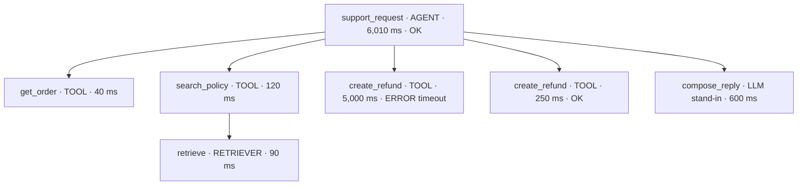
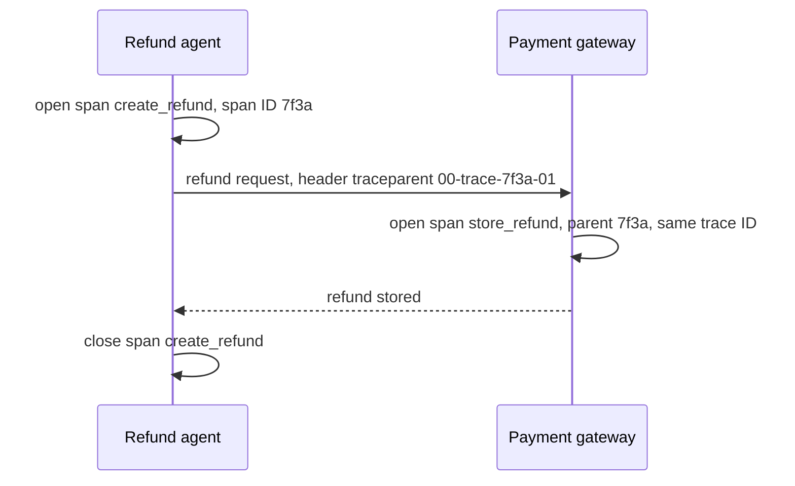
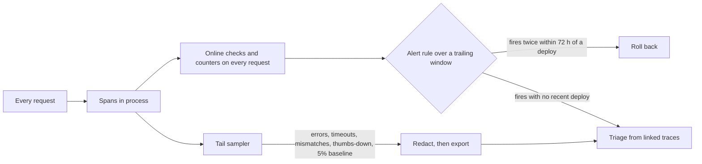

# Week 13 theory: Tracing and online evaluation

*Live requests have no answer key. Use traces, saved results, and alerts to find failures.*

Week 13 of 16. [Course index](../../../simplified-course-index.md).

> **Source note.** Results are inherited, not rerun.

> **Before you start.** Review [Week 7](../../week-07-tools-and-side-effects/theory/week-07-tools-and-side-effects-theory-simplified-structured.md)'s ledger, [Week 10](../../week-10-faults-adversarial-and-handoffs/theory/week-10-faults-adversarial-and-handoffs-theory-simplified-structured.md)'s timeouts, and [Week 12](../../week-12-release-gates/theory/week-12-release-gates-theory-simplified-structured.md)'s releases. Use the [lab](../handson/week-13-tracing-and-online-evaluation-handson.md) and [runbook](../handson/week-13-tracing-and-online-evaluation-runbook.md).

*Lab: `handson/lab.py`  
Notebook: [`week-13-tracing-and-online-evaluation-handson.ipynb`](../handson/week-13-tracing-and-online-evaluation-handson.ipynb)  
Data: `dataset/traffic-config-v1.json`, `dataset/online-policy-v1.json`  
Tracing: `shared/tracing.py`*

---

## 1. What this week builds

**Project state.** Offline cases provide expected answers. Live requests do not; check observed records after release.

**Time.** 10 hours: 2 reading, 3 instrumenting and replaying, 2 on alerts and the rollback, 2 on sampling, privacy and drift, and 1 on the runbook and the design review.

By the end of the week you can:

1. Record agent, tool, retrieval, and reply spans using OpenInference names.
2. Check traces and ledger without expected answers.
3. Define alert windows, thresholds, minimum volume, and rollback rules.
4. Compare head and tail sampling for rare failures.
5. Redact exported data and distinguish input drift from quality changes.

This week adds `shared/tracing.py`, traffic/alert policy, 14 days of simulated replay, a dashboard, and a runbook.

---

## 2. A deploy that told customers their refund failed

### 2.1 The deploy

V2.2 retries a timed-out refund once with a stable key. On day 9 at 10:00, v2.3 removes that retry while keeping decisions unchanged.

Gateway calls time out 8% of the time, half before saving and half after. Retrying hides most failures in v2.2. V2.3 exposes every timeout:

> I couldn't issue the refund (timeout). Please try again later.

All traffic is simulated: 5,600 seeded requests over 14 days against synthetic records.

### 2.2 What each signal showed on day 9

| Signal | Day 9 value | Days 1 to 8 | Did it see the deploy? |
| --- | --- | --- | --- |
| p95 latency of a request | 1,010 ms | 1,010 ms | No |
| Thumbs-down rate (SIMULATED feedback) | 22% | 23% to 39% | No: it was lower than on any earlier day |
| Refund failure rate, whole day | 2.7% | 0% to 1.0% | Weakly |
| Refund failure rate, 6 hours from 09:00 | 5.9% (3 of 51 attempts) | never above 5% on 40 or more attempts | Yes, at 15:00 |

*Table 1: Reference values.*

Latency changes little. Feedback is sparse and reacts more to denials than failures. The useful signal is refund attempts ending in error, measured from spans in sections 6–8.

---

## 3. Traces and spans

New terms for this section:

- **Span:** one operation's name, times, status, and attributes.
- **Trace:** all spans for one request, sharing a 32-hex-digit trace ID.
- **Span/parent IDs:** 16-hex-digit identifiers linking the tree. Root has no parent.
- **Attributes:** key-value facts, such as tool arguments.
- **Status:** UNSET, OK, or ERROR with details.
- **Instrumentation:** record operations without changing behavior.

These definitions follow the OpenTelemetry data model. OpenTelemetry is the open standard for traces, metrics and logs, with SDKs for most languages.

`TracedRuntime` wraps each tool call as TOOL; `search_policy` also creates RETRIEVER with returned chunks. `trace_request` adds AGENT around the request and LLM for the reply step, without editing the underlying agents.

*Figure 1: Source diagram.*

### 3.1 What the spans record

Root records message, reply, IDs, version, and claimed outcome. TOOL records arguments/results. Failed calls have ERROR; root fails only if the request fails overall.

Times are simulated: 40 ms lookup, 250 ms refund, 600 ms reply, 5,000 ms timeout. Real tracers use clocks. Fixed delays and seeded IDs make replay repeatable.

### 3.2 What the spans do not record

Spans do not prove saved state. In r-1528, both refund calls time out, the second after commit. Reply says failed, but ledger holds `refund-210-7`. Check the ledger separately.

---

## 4. OpenInference conventions

New terms for this section:

- **Semantic conventions:** shared attribute names that other tools understand.
- **OpenInference:** AI span conventions on OpenTelemetry for agents, models, tools, and retrieval.

`shared/tracing.py` uses the names from the `openinference-semantic-conventions` package, version 0.1.43:

| Span kind | Used for | Attributes it carries here |
| --- | --- | --- |
| `AGENT` | one customer request, end to end | `input.value`, `output.value`, `session.id`, `user.id` |
| `TOOL` | each tool call | `tool.name`, `tool.parameters`, `output.value` |
| `RETRIEVER` | the search inside `search_policy` | `input.value`, `retrieval.documents.N.document.id`, `retrieval.documents.N.document.content` |
| `LLM` | the reply step | `llm.model_name`, `input.value`, `output.value` |

*Table 2: Reference values.*

`openinference.span.kind` identifies span type. Indexed retrieval keys identify chunks. Custom `refund.outcome_claimed` and `refund.order_id` support online checks.

No model runs here. The LLM span is labeled `deterministic-stand-in (no model call)`. Real agents create spans for each model call, recording prompt, completion, and token counts.

---

## 5. Context propagation

New terms for this section:

- **Context propagation:** carry trace and parent IDs to the next operation.
- **`traceparent`:** W3C header `00-<trace ID>-<parent span ID>-<flags>`; `01` means sampled.

Within one process, a context variable tracks the current span so new spans become its children automatically.

Across processes, send context in headers. This diagram illustrates a gateway joining the trace. The lab stays local; tests round-trip the header and create its child span.

*Figure 2: IDs are abbreviated; real headers need full-length identifiers.*

Without propagation, gateway errors form separate traces with no link to the affected customer's request.

---

## 6. Online checks without an answer key

New terms for this section:

- **Online evaluation:** check live requests.
- **Reference-free:** compare records without a labeled expected answer.
- **Refund attempt:** at least one `create_refund` span.
- **Refund failure:** last refund span has ERROR.
- **Failure rate:** failures / attempts in a time window.
- **Claim mismatch:** claimed success without saved refund, or claimed failure with one saved.

Offline and online evaluation answer different questions with different evidence:

| Question | Offline | Online |
| --- | --- | --- |
| Expected answer? | Known label | Unknown |
| Inputs? | Fixed/versioned cases | Live requests |
| Fault frequency? | Scheduled | Observed |
| Checks? | Labels and invariants | Records, invariants, feedback |
| Timing? | Before release | After traffic starts |

*Table 3: Reference values.*

Offline faults show this can happen. Live timeout rates determine how often it happens to customers.

Count attempts and failures from refund spans. Compare root's claimed outcome with new ledger rows. These checks need neither topic labels nor expected answers.

---

## 7. Alerts

New terms for this section:

- **Window:** recent 6 or 24 hours.
- **Evaluation:** calculate and compare hourly.
- **Minimum volume:** enough attempts to interpret a rate.
- **Page:** urgent response; **ticket:** working-hours review.
- **False page:** alert without a real problem.

The online policy (`dataset/online-policy-v1.json`) defines four alerts. Its thresholds are illustrative, chosen from this replay's baseline rates:

| Alert | Fires when | Window | Minimum volume | Severity |
| --- | --- | --- | --- | --- |
| `refund_failure_rate_high` | refund failure rate above 5% | 6 h | 40 refund attempts | page |
| `claim_mismatch` | any claim mismatch | 6 h | none | page |
| `thumbs_down_rate_high` | thumbs-down rate above 33% | 24 h | 40 feedback events | ticket |
| `input_drift` | topic-mix drift above 0.15 | 24 h | 100 requests | ticket |

*Table 4: Reference values.*

### 7.1 Worked example, detecting the day-9 deploy

The deploy happened at 10:00. Each row is one evaluation of `refund_failure_rate_high` over the 6 hours before it:

| Evaluated at | Refund attempts | Failures | Rate | Fires? |
| --- | --- | --- | --- | --- |
| 11:00 | 36 | 1 | 2.8% | No: under 40 attempts |
| 12:00 | 42 | 1 | 2.4% | No |
| 13:00 | 45 | 2 | 4.4% | No |
| 14:00 | 46 | 2 | 4.3% | No |
| 15:00 | 51 | 3 | 5.9% | Yes |
| 16:00 | 49 | 3 | 6.1% | Yes, the second evaluation in a row |

*Table 5: Reference values.*

1. At 11:00, five of six window hours still contain healthy v2.2 traffic.
2. Only six to nine refund attempts arrive hourly; v2.3 fails about 1/12.
3. At 15:00, 3/51 = 5.9%, crossing 5%.

Detection takes five hours. At 4% and minimum 30 attempts, exercise 3 detects two hours sooner but falsely alerts three times on v2.2-only windows.

> **Watch out.** A one-hour window without minimum volume fires at 1/7 = 14%. Five of eight alerts cover only v2.2 traffic. Drill 1 reproduces it.

---

## 8. Rollback triggers

New terms for this section:

- **Rollback:** serve the previous version.
- **Trigger:** rule starting rollback from live evidence.
- **Time to detect/mitigate:** deploy-to-alert and deploy-to-rollback.

Rollback needs two consecutive high-failure alerts within 72 hours of deploy. This filters one-hour noise and avoids blaming older releases automatically.

In the replay the alert fired at 15:00 and 16:00, and v2.2 served again from 16:00:

| | Rollback rule on | Rollback rule off |
| --- | --- | --- |
| Time to detect | 5 h | 5 h |
| Time to mitigate | 6 h | never |
| Requests served by v2.3 | 113 | 2,229 |
| Customers told the refund failed | 3 | 64 |
| ... of whom the ledger shows refunded | 0 | 31 |

*Table 6: Reference values.*

The three v2.3 failures before rollback occur before commit, so claims match. Without rollback, 31 of 64 failures are mismatches, consistent with about half the timeouts occurring after commit.

### 8.1 A page that is not a rollback

V2.2 pages on day 4 at 20:00 and day 13 at 19:00. R-1528 times out before then after commit. Without a recent deploy, reconcile and fix final-timeout lookup by key. See the [runbook](../handson/week-13-tracing-and-online-evaluation-runbook.md).

---

## 9. Sampling

New terms for this section:

- **Sampling:** save some traces to reduce storage and personal data.
- **Head:** decide before work. Here, low 64 trace-ID bits below rate × 2^64, like `TraceIdRatioBased`, give consistent service decisions.
- **Tail:** decide after seeing the result.

The replay has 8 failure traces among 5,600: refund failures and claim mismatches. Each sampler keeps:

| Sampler | Traces kept | Spans kept | Failure traces kept |
| --- | --- | --- | --- |
| Head, 1% | 71 | 338 | 0 of 8 |
| Head, 5% | 299 | 1,465 | 0 of 8 |
| Head, 10% | 589 | 2,869 | 1 of 8 |
| Tail, plus a 5% head baseline | 898 | 4,465 | 8 of 8 |

*Table 7: Reference values.*

Tail keeps errors, timeouts, mismatches, and thumbs-downs: 637 traces, including 473 negative ratings. Add a 5% normal baseline for comparison.

Metrics and stored traces need different coverage. This diagram shows the split the lab uses.

*Figure 3: Source diagram.*

> **Watch out.** Alert from all-request counts, not saved samples. At 5% or 10% head sampling, no window reaches 40 refund attempts; even the bad deploy never alerts.

---

## 10. Feedback and drift

New terms for this section:

- **Feedback:** simulated 30% response; thumbs-down chance 5% after refund, 60% after denial.
- **Input drift:** changed requests.
- **Quality drift:** changed handling.
- **Total variation:** half the absolute distribution differences; 0 identical, 1 disjoint.

During days 4 to 6, a clearance sale brings far more refund requests for final-sale items. The agent denies them correctly. Customers dislike the denials:

| Days | Topic drift | Requests denied | Thumbs-down | Refund failure rate |
| --- | --- | --- | --- | --- |
| 1 to 3 | 0.04 to 0.07 | 16% to 19% | 26% to 29% | 0% |
| 4 to 6, the sale | 0.33 to 0.34 | 46% to 48% | 34% to 39% | 0% to 1.0% |
| 9, the deploy | 0.07 | 17% | 22% | 2.7% |

*Table 8: Reference values.*

`input_drift` and `thumbs_down_rate_high` both fired during the sale. Neither fired on day 9. The feedback alert measured the inputs, not the quality.

### 10.1 Worked example, the drift score on day 4

The lab classifies each message into a topic with keyword rules, an input feature cheap enough to compute on every request. Days 1 to 3 are the baseline:

| Topic | Baseline share | Day 4 share | Difference |
| --- | --- | --- | --- |
| damaged | 41.7% | 26.0% | 15.7 |
| sale | 6.1% | 39.8% | 33.7 |
| no order number | 16.7% | 11.3% | 5.4 |
| late opening | 11.0% | 7.5% | 3.5 |
| on behalf | 8.7% | 7.0% | 1.7 |
| faulty | 8.5% | 4.5% | 4.0 |
| follow-up | 7.2% | 4.0% | 3.2 |

*Table 9: Reference values.*

The differences sum to 67.2 percentage points. Half of that, 0.336, is the day's drift score. The alert's threshold is 0.15.

Drift shows changed traffic, not necessarily worse behavior. Refund failures stay low while denials remain correct under policy. File a ticket with policy/sale owners rather than roll back.

---

## 11. Privacy and redaction

New terms for this section:

- **Personal data:** identifying names, emails, cards, IDs.
- **Redaction:** mask before export.
- **Pseudonym:** stable salted-hash ID replacement; not guaranteed anonymity.
- **Export:** send spans outside the process.

Replay messages include 1,619 names/emails and 289 card numbers. Tool idempotency keys also include customer IDs.

`export_span` redacts every string attribute in three ways:

1. Mask emails and card patterns.
2. Replace IDs, including inside keys, with pseudonyms.
3. Mask signed-in customers' full, first, and last names.

Patterns miss all 1,619 names. Known session identity masks those names. The combined exported-attribute scan finds no tested email, card, raw ID, or known name.

> **Watch out.** Unknown or third-party names can escape. Redaction reduces exposure, not proves anonymity. Limit access and retention; omit unneeded fields.

Redact dashboard traces and optional OpenTelemetry exports. Online checks use raw in-process spans without writing them out.

---

## 12. The dashboard and the runbook

The dashboard at `handson/runs/week-13/dashboard.html` shows version, volume, failures, mismatches, feedback, drift, and p95 per six-hour window. Alerts link up to three redacted traces.

The [runbook](../handson/week-13-tracing-and-online-evaluation-runbook.md) covers confirming alerts, reading traces, checking deploys, rollback or reconciliation, and verifying recovery.

---

## 13. Design review

### Q1 – The release already passed an offline evaluation. Why watch production at all?

Offline tests show known failure mechanisms. Live checks show frequency and affected traffic. Turn incidents into cases and offline safety rules into online checks.

### Q2 – Why compute alerts on every request but store only sampled traces?

Count all requests for alerts. Save failures plus a small normal baseline. The 5% head sample cannot reach minimum volume here.

### Q3 – The thumbs-down alert fires during a sale. Do you roll back?

No. Sale drift reaches 0.34; denials rise about 17% to 47%; failures stay 0–1.0%. Feedback reflects unpopular correct denials. Review traces before rollback.

### Q4 – What may a trace contain, and who may read it?

Export needed fields only. Mask patterns, IDs, and known names; keep raw checks in process. Restrict access, retention, and log reads. Unknown names may escape.

### Q5 – How do you choose an alert's threshold, window and minimum volume?

V2.2 fails about 1/300 attempts, v2.3 1/12. At six to nine attempts/hour, six-hour windows and minimum 40 detect in five hours. Lower thresholds add false pages; twelve-hour windows miss this deploy. Replay and revisit rules as traffic changes.

---

## Key Takeaways

- Check spans and ledger without answer labels.
- Trace trees locate individual failed operations.
- Use OpenInference names and propagate `traceparent`.
- Set alert window, threshold, and minimum volume.
- Rollback limits v2.3 to 113 requests and three failures, versus 2,229 and 64 without it.
- Count all requests; tail keeps all eight failure traces while 5% head keeps none.
- Separate input drift from quality decline.
- Mask known names as well as patterns before export.

## Check Yourself

1. R-3211: why ERROR tool but OK root? **First refund times out; retry succeeds.**
2. Why no expected-answer check online? **Live requests lack labels; compare records.**
3. Why no day-9 13:00 alert at 2/45? **4.4% is below 5%.**
4. Why did 5% head miss eight failures? **Random selection happens before outcomes.**
5. What did patterns miss? **1,619 names; known-identity masking removes them.**
6. Roll back day-4 v2.2 mismatch? **No recent deploy; reconcile and fix final-timeout handling.**

## Memory card

| Term | Meaning |
| --- | --- |
| Span / trace | Operation / linked request operations |
| Root span | First, here AGENT |
| OpenInference | Shared AI attribute names |
| `traceparent` | Trace ID, parent ID, flags |
| Reference-free | No expected answer needed |
| Refund failure rate | Failed attempts / attempts |
| Claim mismatch | Reply disagrees with ledger |
| Minimum volume | Traffic needed before alerting |
| Rollback trigger | Rule restoring baseline |
| Head / tail | Sample before / after results |
| Input / quality drift | Changed requests / changed handling |
| Pseudonym | Salted replacement ID |

*Table 10: Reference values.*

**Rules of thumb.** Verify ledger. Require alert volume. Roll back confirmed recent-deploy failures. Count all, save selectively. Check drift. Redact before export.

**Next week.** Week 14 shares evaluation across three teams with permissions, audit, budgets, and tenant protection.

## References

- [Hands-on file](../handson/week-13-tracing-and-online-evaluation-handson.md)
- [Operations runbook](../handson/week-13-tracing-and-online-evaluation-runbook.md)
- [`week-13-tracing-and-online-evaluation-handson.ipynb`](../handson/week-13-tracing-and-online-evaluation-handson.ipynb)
- [`shared/tracing.py`](../../../shared/tracing.py)
- [`shared/fault_agents.py`](../../../shared/fault_agents.py)
- [OpenTelemetry: Traces](https://opentelemetry.io/docs/concepts/signals/traces/)
- [OpenTelemetry: Sampling](https://opentelemetry.io/docs/concepts/sampling/)
- [W3C Trace Context](https://www.w3.org/TR/trace-context/)
- [OpenInference semantic conventions](https://github.com/Arize-ai/openinference/tree/main/spec)
- [Google SRE Workbook: Alerting on SLOs](https://sre.google/workbook/alerting-on-slos/)
- [Glossary](../../../glossary.md)

---

**Next:** [Week 14 theory: Multi-tenant governance](../../week-14-multi-tenant-governance/theory/week-14-multi-tenant-governance-theory-simplified-structured.md)  
**Previous:** [Week 12 theory: Release gates](../../week-12-release-gates/theory/week-12-release-gates-theory-simplified-structured.md)
