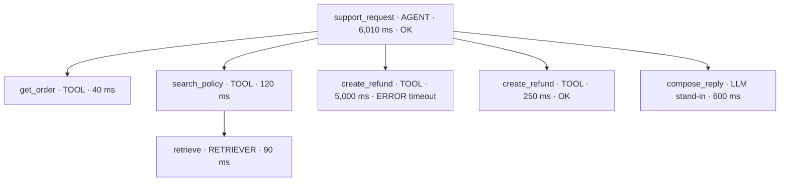
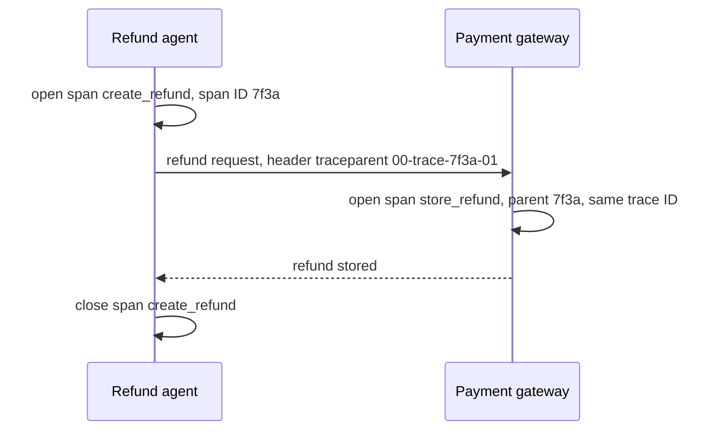
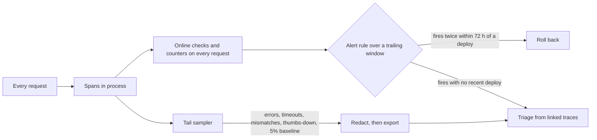

# Week 13 theory: Tracing and online evaluation

*In production there is no answer key: the trace and the ledger have to say whether a refund worked, and the alert has to say so before the customers do.*

◷ 20 min read · Week 13 of 16 · Advanced · [Course index](../../../README.md)

> **Before you start.** This page assumes [Week 7](../../week-07-tools-and-side-effects/theory/week-07-tools-and-side-effects-theory.md) (the tool runtime and reading the ledger back) and [Week 10](../../week-10-faults-adversarial-and-handoffs/theory/week-10-faults-adversarial-and-handoffs-theory.md) (timeouts before and after commit, and the stable idempotency key). [Week 12](../../week-12-release-gates/theory/week-12-release-gates-theory.md) decides whether a version ships. This week watches it after it ships. The commands, the lab output and the exercises are in the [hands-on file](../handson/week-13-tracing-and-online-evaluation-handson.md), and the on-call steps in the [operations runbook](../handson/week-13-tracing-and-online-evaluation-runbook.md).

*Lab: `handson/lab.py` · Notebook: `week-13-tracing-and-online-evaluation-handson.ipynb` · Data: `dataset/traffic-config-v1.json`, `dataset/online-policy-v1.json` · Tracing: `shared/tracing.py`*

---

## 1. What this week builds

**Project state.** Weeks 1 to 12 evaluate the refund agent offline: fixed cases, known answers, a verdict before release. Once a version serves customers, no case file says what the right outcome was, and the requests are ones nobody wrote.

**Time.** 10 hours: 2 reading, 3 instrumenting and replaying, 2 on alerts and the rollback, 2 on sampling, privacy and drift, and 1 on the runbook and the design review.

By the end of the week you can:

1. Record one request as a tree of spans: the agent, each tool call, retrieval and the reply step, with OpenInference attribute names.
2. Run reference-free checks on every trace: refund failures from the spans, and the claimed outcome against the ledger.
3. Define an alert with a window, a threshold and a minimum volume, and a rollback rule, then measure how long a bad deploy took to detect and undo.
4. Show with numbers that head sampling loses rare failures and tail sampling keeps them.
5. Redact exported spans, and tell input drift from a drop in quality.

The week adds a standard-library span recorder (`shared/tracing.py`), a traffic configuration and an online policy (`dataset/`), a lab that replays 14 days of SIMULATED traffic, a static dashboard and an operations runbook.

---

## 2. A deploy that told customers their refund failed

### 2.1 The deploy

Version v2.2 makes tool agent v2's decisions and retries a timed-out `create_refund` once, with a stable idempotency key. On day 9 at 10:00, v2.3 replaces it. v2.3 makes the same decisions with the retry removed.

The payment gateway times out on 8% of `create_refund` calls, half of them before the refund is stored and half after. On v2.2 the retry hides almost all of them. On v2.3 every timeout reaches the customer:

> I couldn't issue the refund (timeout). Please try again later.

All the traffic in this week is SIMULATED: 5,600 requests over 14 days, generated from a seed and replayed against the course's synthetic world.

### 2.2 What each signal showed on day 9

| Signal | Day 9 value | Days 1 to 8 | Did it see the deploy? |
| --- | --- | --- | --- |
| p95 latency of a request | 1,010 ms | 1,010 ms | No |
| Thumbs-down rate (SIMULATED feedback) | 22% | 23% to 39% | No: it was lower than on any earlier day |
| Refund failure rate, whole day | 2.7% | 0% to 1.0% | Weakly |
| Refund failure rate, 6 hours from 09:00 | 5.9% (3 of 51 attempts) | never above 5% on 40 or more attempts | Yes, at 15:00 |

Latency barely depends on the outcome. Most customers give no feedback, and the ones who do react to denials more than to failures. The signal that found the deploy was read from the traces themselves: how many refund attempts ended in an error. Sections 6 to 8 build that signal and the rule that acted on it.

---

## 3. Traces and spans

New terms for this section:

- **Span**: the record of one operation: a name, a start and end time, a status and attributes.
- **Trace**: every span of one request, linked into a tree. All of them share a **trace ID** (32 hexadecimal digits).
- **Span ID** and **parent span ID**: a span's own ID (16 hexadecimal digits) and the ID of the span that started it. The first span of a request, the **root span**, has no parent.
- **Attributes**: key-value pairs on a span, such as the tool's name and arguments.
- **Status**: UNSET, OK or ERROR, with a message for errors.
- **Instrumentation**: code that creates spans around existing operations without changing what they do.

These definitions follow the OpenTelemetry data model. OpenTelemetry is the open standard for traces, metrics and logs, with SDKs for most languages.

`shared/tracing.py` instruments the course's code without editing it. `TracedRuntime` subclasses Week 7's tool runtime: every call becomes a TOOL span, and `search_policy` also opens a RETRIEVER span listing the chunks it returned. `trace_request` wraps one agent run in an AGENT span and adds an LLM span for the reply step.

This diagram shows the trace of request r-3211 on v2.2. The first refund call timed out before the commit, and the retry stored the refund.

### 3.1 What the spans record

The root span holds the customer's message as input and the reply as output, the session and user IDs, the agent version and the outcome the agent claimed. Each TOOL span holds the arguments and the response. A failed call sets the status of its own span to ERROR with the error code, such as `timeout`. The root span is ERROR only when the request failed as a whole, as with `refund_failed`.

The durations are SIMULATED. The lab charges each operation a fixed cost: 40 ms for `get_order`, 250 ms for `create_refund`, 600 ms for the reply step, and 5,000 ms for any call that times out. A real tracer reads the clock. The simulated clock makes every replay produce the same trace, and the span and trace IDs come from a seeded generator for the same reason.

### 3.2 What the spans do not record

A span says what the agent asked for and what the tool answered. It does not say what the ledger holds. In r-1528 both refund calls time out, the second one after the commit. The spans show two errors and a reply saying the refund failed. The ledger holds `refund-210-7`. The online checks in section 6 read the ledger separately for this reason.

---

## 4. OpenInference conventions

New terms for this section:

- **Semantic conventions**: agreed attribute names, so that tools reading spans from different programs find the same data under the same key.
- **OpenInference**: semantic conventions for AI applications, built on OpenTelemetry. They name span kinds and attributes for agents, model calls, tools and retrieval.

`shared/tracing.py` uses the names from the `openinference-semantic-conventions` package, version 0.1.43:

| Span kind | Used for | Attributes it carries here |
| --- | --- | --- |
| `AGENT` | one customer request, end to end | `input.value`, `output.value`, `session.id`, `user.id` |
| `TOOL` | each tool call | `tool.name`, `tool.parameters`, `output.value` |
| `RETRIEVER` | the search inside `search_policy` | `input.value`, `retrieval.documents.N.document.id`, `retrieval.documents.N.document.content` |
| `LLM` | the reply step | `llm.model_name`, `input.value`, `output.value` |

Every span also carries `openinference.span.kind`. List attributes are flattened with an index: the first retrieved chunk of r-3211 is `retrieval.documents.0.document.id = refund-policy-2026-01#R3`. The lab adds two attributes of its own, `refund.outcome_claimed` and `refund.order_id`, for the online checks.

The course's agents are deterministic code standing in for a model. The LLM span marks where a model call would sit in a real agent, and its `llm.model_name` is `deterministic-stand-in (no model call)`. A real agent emits one LLM span per model call, with the prompt, the completion and the token counts.

---

## 5. Context propagation

New terms for this section:

- **Context propagation**: passing the current trace ID and span ID to the next operation, so its span joins the same trace with the right parent.
- **`traceparent` header**: the W3C Trace Context format for carrying that context between processes: `00-<trace ID>-<parent span ID>-<flags>`. Flag `01` means the trace is sampled.

Inside one process, `shared/tracing.py` keeps the current span in a Python context variable. A span started while another is open becomes its child, which is how a TOOL span finds its AGENT parent without any argument passing.

Between processes, the caller sends the context in a header. This diagram shows the payment gateway joining the refund agent's trace. The lab runs in one process and does not make this call. Its tests round-trip a `traceparent` header and start a child span from it.

Without propagation the gateway starts a new trace for every call. Its timeouts then appear in its own traces, and nothing links them to the customer who was told the refund failed.

---

## 6. Online checks without an answer key

New terms for this section:

- **Online evaluation**: checks that run on live traffic as it is served.
- **Reference-free check**: a check that needs no expected answer. It compares the system's records with each other.
- **Refund attempt**: a request whose trace has at least one `create_refund` span.
- **Refund failure**: a refund attempt whose last `create_refund` span is ERROR.
- **Refund failure rate**: refund failures divided by refund attempts, over a window of time.
- **Claim mismatch**: the claimed outcome disagrees with the ledger, a refund claimed with none stored or a failure claimed with a refund stored.

Offline and online evaluation answer different questions with different evidence:

| Question | Offline (Weeks 1 to 12) | Online (this week) |
| --- | --- | --- |
| What is the right outcome? | Written in the case | Unknown |
| Which inputs? | The case file, fixed and versioned | Whatever customers send |
| How often does a fault happen? | As often as the case schedules it | As often as it really does |
| What can be checked? | Outcome against the label, plus every invariant | Invariants only: the trace, the ledger, feedback |
| When is the verdict? | Before release | Minutes to hours after the harm starts |

Week 10's offline suite already showed that an agent without a retry tells some customers a stored refund failed. It could not say how often. That depends on the gateway's real timeout rate, which only production traffic shows.

The lab runs three checks on every trace. A refund attempt and a refund failure come from the `create_refund` spans. A claim mismatch compares `refund.outcome_claimed` on the root span with the ledger's new rows for the order. None of them uses the request's topic or any expected outcome.

---

## 7. Alerts

New terms for this section:

- **Window**: the stretch of recent traffic a metric is computed over, here the trailing 6 or 24 hours.
- **Evaluation**: one computation of the metric and comparison with the threshold. The lab evaluates every alert at the end of every hour.
- **Minimum volume**: the least traffic a window needs before the alert may fire. A rate over 3 attempts is noise.
- **Page** and **ticket**: a page wakes someone now. A ticket waits for working hours.
- **False page**: an alert that fires when nothing is wrong.

The online policy (`dataset/online-policy-v1.json`) defines four alerts. Its thresholds are illustrative, chosen from this replay's baseline rates:

| Alert | Fires when | Window | Minimum volume | Severity |
| --- | --- | --- | --- | --- |
| `refund_failure_rate_high` | refund failure rate above 5% | 6 h | 40 refund attempts | page |
| `claim_mismatch` | any claim mismatch | 6 h | none | page |
| `thumbs_down_rate_high` | thumbs-down rate above 33% | 24 h | 40 feedback events | ticket |
| `input_drift` | topic-mix drift above 0.15 | 24 h | 100 requests | ticket |

### 7.1 Worked example, detecting the day-9 deploy

The deploy happened at 10:00. Each row is one evaluation of `refund_failure_rate_high` over the 6 hours before it:

| Evaluated at | Refund attempts | Failures | Rate | Fires? |
| --- | --- | --- | --- | --- |
| 11:00 | 36 | 1 | 2.8% | No: under 40 attempts |
| 12:00 | 42 | 1 | 2.4% | No |
| 13:00 | 45 | 2 | 4.4% | No |
| 14:00 | 46 | 2 | 4.3% | No |
| 15:00 | 51 | 3 | 5.9% | Yes |
| 16:00 | 49 | 3 | 6.1% | Yes, the second evaluation in a row |

1. **The window starts mostly before the deploy.** At 11:00 the 6-hour window holds 5 hours of v2.2 traffic, which almost never fails.
2. **Volume arrives slowly.** Six to nine refund attempts an hour reach the agent, and on v2.3 about 1 in 12 of them fails.
3. **The third failure crosses the line.** At 15:00, 3 failures in 51 attempts is 5.9%, above 5%.

Detection took 5 hours. A lower threshold detects sooner and pages more often on noise. The hands-on file's exercise 3 measures that trade: at 4% with a minimum of 30 attempts, the alert fires 2 hours sooner and also fires 3 times on windows that only v2.2 served.

> **Watch out.** Dropping the minimum volume makes an alert fast and useless. With a 1-hour window and no minimum, one failure among 7 attempts is 14% and pages. Five of the eight evaluations that fire that way cover only v2.2 traffic. Drill 1 in the hands-on file reproduces this.

---

## 8. Rollback triggers

New terms for this section:

- **Rollback**: serving the previous version again.
- **Rollback trigger**: a rule that starts a rollback from live signals, without waiting for a person.
- **Time to detect** and **time to mitigate**: from the deploy to the first alert, and from the deploy to the rollback.

The policy's rule: roll back when `refund_failure_rate_high` fires on two consecutive evaluations within 72 hours of a deploy. The second evaluation guards against one unlucky hour. The deploy window keeps the rule from rolling back a version that has served for weeks, where the cause is more likely elsewhere.

In the replay the alert fired at 15:00 and 16:00, and v2.2 served again from 16:00:

| | Rollback rule on | Rollback rule off |
| --- | --- | --- |
| Time to detect | 5 h | 5 h |
| Time to mitigate | 6 h | never |
| Requests served by v2.3 | 113 | 2,229 |
| Customers told the refund failed | 3 | 64 |
| ... of whom the ledger shows refunded | 0 | 31 |

The 3 failures on v2.3 all timed out before the commit, which is why none of them is a claim mismatch. Without the rule, v2.3 serves for the rest of the replay, and 31 of its 64 failures are claim mismatches: about half, matching the half of timeouts that come after the commit.

### 8.1 A page that is not a rollback

`claim_mismatch` also paged twice when only v2.2 was serving, on day 4 at 20:00 and day 13 at 19:00. The trace of r-1528 shows why: the first attempt timed out before the commit, the retry timed out after it, and v2.2 told the customer the refund failed. Week 10's sweep ran the same schedule. No deploy is involved, so the rule does not roll back. The response is to reconcile with the customer, and to fix the agent: after a final timeout, look the refund up by its idempotency key before claiming it failed. The [runbook](../handson/week-13-tracing-and-online-evaluation-runbook.md) walks through both kinds of page.

---

## 9. Sampling

New terms for this section:

- **Sampling**: keeping only some traces, because storing every span of every request costs money and holds more personal data.
- **Head sampling**: deciding when the trace starts, before anything is known about it. The lab keeps a trace when the low 64 bits of its trace ID fall under the rate times 2^64, as OpenTelemetry's `TraceIdRatioBased` sampler does. Every service makes the same decision for the same trace.
- **Tail sampling**: deciding after the trace ends, from what happened in it.

The replay has 8 failure traces among 5,600: refund failures and claim mismatches. Each sampler keeps:

| Sampler | Traces kept | Spans kept | Failure traces kept |
| --- | --- | --- | --- |
| Head, 1% | 71 | 338 | 0 of 8 |
| Head, 5% | 299 | 1,465 | 0 of 8 |
| Head, 10% | 589 | 2,869 | 1 of 8 |
| Tail, plus a 5% head baseline | 898 | 4,465 | 8 of 8 |

The tail sampler keeps a trace with an ERROR root span, a timed-out tool call, a claim mismatch or a thumbs-down. That is 637 traces, and the 5% baseline adds normal traffic to compare them with. Most of what it stores is thumbs-down traces (473), the price of keeping the evidence feedback points at.

Metrics and stored traces need different coverage. This diagram shows the split the lab uses.

> **Watch out.** An alert computed from sampled traces inherits the sample's volume. From a 5% or 10% head sample, `refund_failure_rate_high` never reaches 40 refund attempts in a window and never fires, deploy included. Count every request, and sample only what you store.

---

## 10. Feedback and drift

New terms for this section:

- **User feedback**: a thumbs-up or thumbs-down a customer chooses to give. In this lab it is SIMULATED: 30% of requests get feedback, and the chance of a thumbs-down depends on the outcome, 5% after a refund and 60% after a denial.
- **Input drift**: a change in what customers send.
- **Quality drift**: a change in how well the agent handles what they send.
- **Total variation distance**: half the sum of the absolute differences between two distributions, from 0 (identical) to 1 (no overlap).

During days 4 to 6, a clearance sale brings far more refund requests for final-sale items. The agent denies them correctly. Customers dislike the denials:

| Days | Topic drift | Requests denied | Thumbs-down | Refund failure rate |
| --- | --- | --- | --- | --- |
| 1 to 3 | 0.04 to 0.07 | 16% to 19% | 26% to 29% | 0% |
| 4 to 6, the sale | 0.33 to 0.34 | 46% to 48% | 34% to 39% | 0% to 1.0% |
| 9, the deploy | 0.07 | 17% | 22% | 2.7% |

`input_drift` and `thumbs_down_rate_high` both fired during the sale. Neither fired on day 9. The feedback alert measured the inputs, not the quality.

### 10.1 Worked example, the drift score on day 4

The lab classifies each message into a topic with keyword rules, an input feature cheap enough to compute on every request. Days 1 to 3 are the baseline:

| Topic | Baseline share | Day 4 share | Difference |
| --- | --- | --- | --- |
| damaged | 41.7% | 26.0% | 15.7 |
| sale | 6.1% | 39.8% | 33.7 |
| no order number | 16.7% | 11.3% | 5.4 |
| late opening | 11.0% | 7.5% | 3.5 |
| on behalf | 8.7% | 7.0% | 1.7 |
| faulty | 8.5% | 4.5% | 4.0 |
| follow-up | 7.2% | 4.0% | 3.2 |

The differences sum to 67.2 percentage points. Half of that, 0.336, is the day's drift score. The alert's threshold is 0.15.

A drift alert says the traffic changed. Whether the change hurts depends on the quality signals for the new traffic: here the failure rate held, and the extra denials were correct under policy 2026-01. The correct response is a ticket to the people who own the policy and the sale, not a rollback.

---

## 11. Privacy and redaction

New terms for this section:

- **Personal data**: anything that identifies a person: names, email addresses, payment card numbers, account IDs.
- **Redaction**: masking personal data before a span leaves the process.
- **Pseudonym**: a stable stand-in for an identifier, here a salted hash of the customer ID. The same customer gets the same pseudonym in every trace, and the ID cannot be read back from it.
- **Export**: sending spans to storage outside the process, where more people can read them for longer.

Traces copy the customer's own words. In the replay, 1,619 messages start with the customer's name and email address, and 289 include a card number. Tool arguments carry customer IDs inside idempotency keys.

`export_span` redacts every string attribute in three ways:

1. **Patterns** mask emails and card-like numbers.
2. **Pseudonyms** replace customer IDs, including the one inside the idempotency key.
3. **Session identity** masks the full name, first name and last name the runtime holds for the signed-in customer.

Patterns alone left all 1,619 names in place: a name has no fixed shape. The session identity removes them, because the system already knows whose request it is. With all three, a scan of every exported attribute finds no email, card number, raw customer ID or customer name.

> **Watch out.** Redaction reduces what leaks and cannot prove nothing does. A message naming a third person, or a name the runtime does not hold, passes all three steps. Limit who can read exported traces and for how long, and prefer not exporting a field at all when no check needs it.

Redaction runs on every span that leaves the process: the dashboard's linked traces and the optional OpenTelemetry export. The online checks read the in-process spans, which are never written out.

---

## 12. The dashboard and the runbook

The lab writes a static HTML page to `handson/runs/week-13/dashboard.html`. Each row is a 6-hour window with its version, requests, refund attempts, failure rate, claim mismatches, thumbs-down rate, drift and p95 latency. Each alert links to up to three exported, redacted traces from the window that fired it. A metric says something is wrong, and the linked trace shows which call failed and what the customer was told.

The [runbook](../handson/week-13-tracing-and-online-evaluation-runbook.md) is the procedure for the person paged: confirm the alert, read the linked traces, check the change log for a recent deploy, roll back or reconcile, and verify that the alert resolves.

---

## 13. Design review

### Q1 – The release already passed an offline evaluation. Why watch production at all?

Offline evaluation measures behavior on inputs and fault rates someone wrote down. Week 10's cases showed that an agent without a retry tells customers a stored refund failed. They could not show how often, because each timeout was scheduled by the case. Production supplies the real inputs, the real gateway timeout rate and the real mix of topics, which the replay's sale showed can change in a day. Offline results answer "can this fail and how", before release. Online signals answer "how often is it failing now, and for whom". Each needs the other: a production failure becomes a new offline case, and an offline invariant becomes an online check.

### Q2 – Why compute alerts on every request but store only sampled traces?

Counting is cheap and alerts need volume. From a 5% head sample the refund alert never had 40 attempts in a window and never fired. Storing traces costs money and holds personal data, and most traces of a healthy request add nothing. Count every request in process. Keep the traces worth reading, every failure and a small baseline, by deciding at the tail.

### Q3 – The thumbs-down alert fires during a sale. Do you roll back?

No. Check whether the inputs changed before blaming the agent. During days 4 to 6 the topic drift reached 0.34, the share of denied requests rose from about 17% to about 47%, and the refund failure rate stayed between 0% and 1.0%. The extra thumbs-down came from correct denials. Feedback reflects what customers wanted, which is not the same as what the policy allows. Use it to find traces worth reading, and never as a rollback trigger on its own.

### Q4 – What may a trace contain, and who may read it?

Only what a check or a debugging step needs. Redact before export: patterns for emails and card numbers, pseudonyms for IDs, and the session's known identity for names, which patterns miss. Keep raw text inside the process for the online checks. Restrict exported traces to the people on call, keep them for a fixed period, and log who reads them. A trace store full of raw customer messages is a second customer database with weaker controls.

### Q5 – How do you choose an alert's threshold, window and minimum volume?

From the baseline rate, the size of change worth catching and the traffic per hour. v2.2 fails about 1 refund attempt in 300, when two timeouts come in a row, and v2.3 about 1 in 12. With six to nine attempts an hour, a 6-hour window and a minimum of 40 attempts separate them in 5 hours without paging on v2.2. A lower threshold detected 2 hours sooner and paged 3 times on v2.2 alone. A 12-hour window never fired during the 6 hours v2.3 served. Write the trade down, replay past traffic against a proposed rule before adopting it, and revisit it when traffic grows.

---

## Key Takeaways

- **Production has no answer key.** Check invariants instead: refund failures from the spans, and the claim against the ledger.
- **A span records one operation and its status.** The trace is the tree of them for one request, and the error sits on the span that failed.
- **Use shared conventions.** OpenInference names let other tools read the same agent, tool, retrieval and model spans.
- **Propagate context.** A `traceparent` header puts the gateway's spans in the customer's trace.
- **An alert needs a window, a threshold and a minimum volume.** The deploy was detected after 5 hours, and a version without a minimum paged on single failures.
- **A rollback rule turns detection into mitigation.** It limited v2.3 to 113 requests and 3 failures, against 2,229 requests and 64 failures without it.
- **Count everything, store selectively.** Head sampling at 5% kept none of the 8 failure traces. Tail sampling kept all 8.
- **Separate input drift from quality drift.** The sale moved the topics and the thumbs-down rate, and not the failure rate.
- **Redact before export.** Patterns missed 1,619 names that the session's known identity removed.

## Check Yourself

1. Which span of r-3211 has status ERROR, and why is the root span OK? **The first `create_refund` span, with a timeout. The retry stored the refund, and the request as a whole succeeded.**
2. Why can the online checks not use the request's expected outcome? **Live requests have none. The checks compare the trace with the ledger instead.**
3. At 13:00 on day 9 the window had 2 failures in 45 attempts. Why did the alert not fire? **4.4% is under the 5% threshold. The volume was enough, the rate was not.**
4. Why did head sampling at 5% keep none of the 8 failure traces? **The decision is made from the trace ID before the request runs, so it keeps a random 5% and 8 rare traces can all miss.**
5. What did the patterns-only exporter leak, and what fixed it? **The 1,619 names in messages. Masking the signed-in customer's known names removed them.**
6. The `claim_mismatch` page on day 4 came from v2.2. Should the rule roll back? **No. No deploy caused it. Reconcile with the customer and fix the agent's check after a final timeout.**

## Memory card

| Term | Meaning in this course |
| --- | --- |
| Span / trace | One operation / every span of one request, linked by parent IDs |
| Root span | The request's first span, here the AGENT span |
| OpenInference | Attribute names for agent, tool, retriever and model spans |
| `traceparent` | W3C header carrying trace ID, parent span ID and sampled flag |
| Reference-free check | Compares the system's records, needs no expected answer |
| Refund failure rate | Failed refund attempts over refund attempts, in a window |
| Claim mismatch | Claimed outcome disagrees with the ledger |
| Minimum volume | Least traffic before an alert may fire |
| Rollback trigger | Live-signal rule that restores the previous version |
| Head / tail sampling | Decide at the start from the ID / at the end from what happened |
| Input drift / quality drift | Different inputs / worse handling of them |
| Pseudonym | Salted hash standing in for a customer ID |

**Rules of thumb.** Read the ledger, not the reply. Give every alert a minimum volume. Roll back on a confirmed signal after a recent deploy. Count every request, store the interesting ones. Check the inputs before blaming the agent. Redact before anything leaves the process.

**Next week.** Week 14 puts the evaluation behind a shared API for three teams, with permissions, an audit log and usage per team. The pseudonyms and the redaction from this week are where tenant data protection starts.

## References

- [Hands-on file](../handson/week-13-tracing-and-online-evaluation-handson.md): the lab walkthrough, real output, exercises, drills and solutions for this page.
- [Operations runbook](../handson/week-13-tracing-and-online-evaluation-runbook.md): what to do when each alert fires.
- [`week-13-tracing-and-online-evaluation-handson.ipynb`](../handson/week-13-tracing-and-online-evaluation-handson.ipynb): the same lab as a notebook.
- [`shared/tracing.py`](../../../shared/tracing.py): the span recorder, the instrumentation, head sampling and redaction.
- [`shared/fault_agents.py`](../../../shared/fault_agents.py): the stable-key and no-retry agents behind v2.2 and v2.3.
- [OpenTelemetry: Traces](https://opentelemetry.io/docs/concepts/signals/traces/): spans, trace and span IDs, parents, status and attributes.
- [OpenTelemetry: Sampling](https://opentelemetry.io/docs/concepts/sampling/): head and tail sampling, and the trace-ID ratio sampler.
- [W3C Trace Context](https://www.w3.org/TR/trace-context/): the `traceparent` header format.
- [OpenInference semantic conventions](https://github.com/Arize-ai/openinference/tree/main/spec): span kinds and attribute names for AI applications.
- [Google SRE Workbook: Alerting on SLOs](https://sre.google/workbook/alerting-on-slos/): windows, thresholds and the trade between detection time and false alerts.
- [Glossary](../../../glossary.md): every term in the course, with the week that introduces it.

---

**Next:** [Week 14 theory: Multi-tenant governance](../../week-14-multi-tenant-governance/theory/week-14-multi-tenant-governance-theory.md) · **Previous:** [Week 12 theory: Release gates](../../week-12-release-gates/theory/week-12-release-gates-theory.md)
