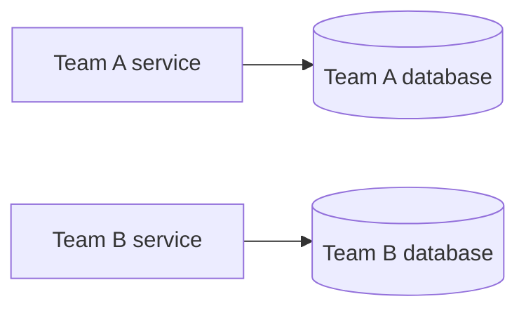
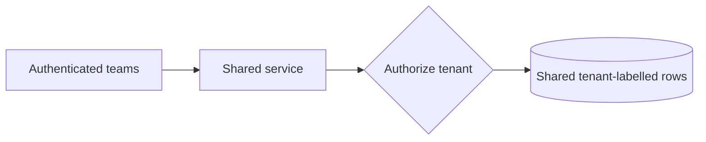
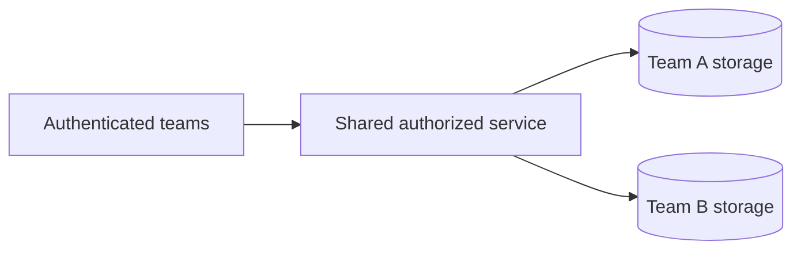
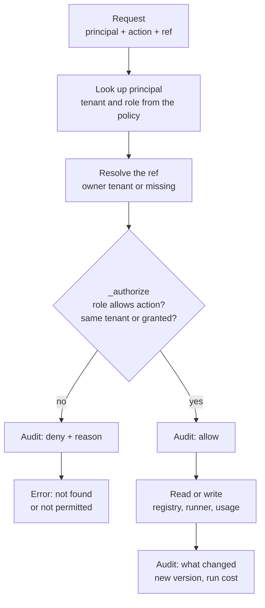
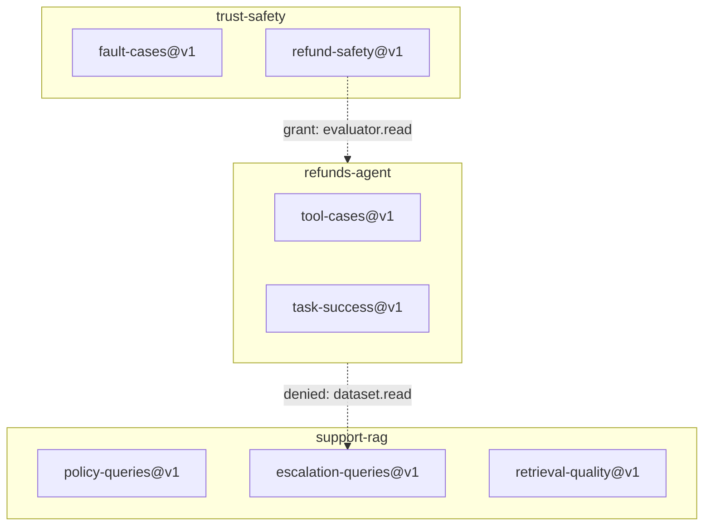
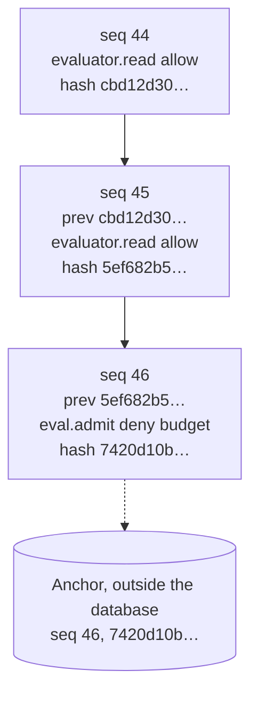

# Week 14 theory: Multi-tenant governance

*A shared evaluation platform is only shared if every team can prove what the others could not see, change or spend.*

Week 14 of 16. [Course index](../../../simplified-course-index.md).

> **Source note.** Examples and results come from the original lesson. They were not rerun.

> **Before you start.** Use [Week 11](../../week-11-evaluation-harness-and-ci/theory/week-11-evaluation-harness-and-ci-theory-simplified-structured.md)'s runner, [Week 12](../../week-12-release-gates/theory/week-12-release-gates-theory-simplified-structured.md)'s policies, [Week 13](../../week-13-tracing-and-online-evaluation/theory/week-13-tracing-and-online-evaluation-theory-simplified-structured.md)'s redaction, and [Week 4](../../week-04-retrieval-evaluation/theory/week-04-retrieval-evaluation-theory-simplified-structured.md)'s search. See the [lab](../handson/week-14-multi-tenant-governance-handson.md).

*Lab: `handson/lab.py`  
Notebook: [`week-14-multi-tenant-governance-handson.ipynb`](../handson/week-14-multi-tenant-governance-handson.ipynb)  
Platform: `shared/governance.py`  
Data: `dataset/tenants-v1.json`, `dataset/evaluators-v1.json`, `dataset/escalation-queries-v1.jsonl`*

---

## 1. What this week builds

**Project state.** Three teams share evaluation: support RAG tests search, refunds tests agents, and trust/safety owns checks. Shared tools save work but need permissions, separate data, cost ownership, and records of actions.

**Time.** 9 hours: 2 reading, 3 building, 2 breaking things, 1 on trade-offs and 1 on the design review.

By the end of the week you can:

1. Enforce tenant/role permissions in one backend function; hide whether forbidden IDs exist.
2. Version and hash datasets/evaluators, recording exact versions per run.
3. Redact before saving and scan database bytes.
4. Record allowed/denied actions in a hash-chained log; explain its limits.
5. Charge the requesting team and reject unaffordable runs.

The week adds `shared/governance.py`, a small evaluation API that Week 16 reuses, and a lab that gives it three fictional teams, their real runners from Weeks 4 and 11, a scripted working day and four attacks.

---

## 2. A shared script that read another team's tickets

### 2.1 The request

Support's eight `escalation-queries` include six names/emails. A refunds engineer asks the shared script for that dataset by supplying support's team name.

### 2.2 What the service did

The script trusts the supplied team instead of checking the engineer. Six customers' names and emails enter a notebook outside the collecting team and purpose.

### 2.3 What nobody can show afterwards

No read is logged. Later nobody can identify access. Editing shared queries also silently changes test data under the same name, breaking comparisons.

> **Watch out.** This needs no malicious caller. The service trusts a caller-supplied tenant, retains unnecessary personal data, and records nothing.

---

## 3. Tenants and where the boundary is enforced

New terms for this section:

- **Tenant:** team with separate data, checks, runs, and budget: `support-rag`, `refunds-agent`, or `trust-safety`.
- **Principal:** requesting person/service belonging to a tenant or platform.
- **Tenant isolation:** prevent cross-team access or spending without a grant.

### 3.1 Three ways to separate tenants

Teams can be separated at different layers, and each choice moves cost and risk:

| Model | Separate resources | Isolation | Cost |
| --- | --- | --- | --- |
| Silo | Database, storage, runners per tenant | Strong physical separation | Maintain multiple systems |
| Pool | Tenant-labeled rows in one database | Depends on every access check | One system; missed checks expose data |
| Bridge | Shared services, separate storage | Physical data separation, shared logic | Added storage/access coordination |

*Table 1: Reference values.*

The lab pools rows in one SQLite database, each with an owner tenant. Other storage models still need access checks for shared runners and evaluators.

**Silo.** Separate services and stores reduce cross-team exposure but duplicate operations.

*Figure 1: Added illustration of the silo model.*

**Pool.** Shared tenant-labeled rows reduce operations but require every access check.

*Figure 2: Added illustration of the pool model.*

**Bridge.** Shared services use separate stores; shared runners and grants still need authorization.

*Figure 3: Added illustration of the bridge model.*

### 3.2 The tenant comes from the identity

Accept a principal, then obtain its tenant and role from trusted platform policy. Do not offer a parameter for choosing another caller tenant. Production must authenticate that principal too.

Every public API method resolves ownership and calls `Platform._authorize` before access. Notebooks and dashboards cannot bypass it because they cannot access the database directly.

*Figure 4: Source diagram.*

---

## 4. Roles and permissions

New terms for this section:

- **RBAC:** assign permissions by role.
- **Permission:** resource action, such as `dataset.read`.
- **Least privilege:** give only needed permissions.
- **Separation of duties:** split defining checks, running them, and reviewing access.

### 4.1 The role table

`tenants-v1.json` defines four roles. Three are per tenant and one is for the platform:

| Permission | viewer | engineer | owner | auditor (platform) |
| --- | --- | --- | --- | --- |
| `dataset.read`, `evaluator.read`, `run.read` | yes | yes | yes | no |
| `dataset.write`, `eval.run` | no | yes | yes | no |
| `evaluator.write`, `evaluator.share` | no | no | yes | no |
| `usage.read`, `audit.read` | no | no | own tenant | all tenants |

*Table 2: Reference values.*

Nine principals try nine API operations. All are denied other teams' datasets/runs. The auditor sees usage and audit records, not dataset contents.

### 4.2 Why evaluators belong to owners

Changing evaluators changes "pass". Engineers register data and run tests; only tenant owners register/share evaluators. Review and version those changes so later results identify the rule used.

Auditors see who accessed what and the decision, across teams, without customer rows or results. Keep data access separate from reviewing its use.

---

## 5. Denials that do not leak

New terms for this section:

- **Enumeration**: discovering what exists by asking for many IDs and watching which answers differ.
- **Indistinguishable denial**: answering "missing" and "exists but forbidden" with the same message.

Sequential run IDs are guessable. Eight probes request foreign dataset versions, missing datasets, trust/safety faults, existing/missing runs, a foreign evaluator, and evaluator registration.

Seven replies say `not found or not permitted`, hiding existence. The eighth says engineers lack `evaluator.write`, revealing only their role limit.

Audit retains five `cross_tenant` and two `missing` reasons. Support's owner sees four denials touching support resources. Missing resources belong to no tenant; only the requesting tenant owner and platform auditor see those probes.

> **Watch out.** Random 128-bit IDs reduce guessing, but shared links or logs can expose them. Always enforce ownership.

---

## 6. The registry: versions, hashes and namespaces

New terms for this section:

- **Registry:** owned, versioned, hashed datasets/evaluators.
- **Namespace:** tenant prefix, such as `trust-safety/refund-safety`.
- **Ref:** full entry name, `tenant/name@vN`.
- **Grant:** owner lets another tenant use an evaluator.

### 6.1 Every change is a new version

Entries are immutable. Hash canonical JSON on registration. Same content reuses its version; changed content creates a new one, leaving old entries readable.

Register the 30 tool cases twice: both return `tool-cases@v1`. Changing t-023 risk from high to critical creates v2; v1 still says high.

Two mechanisms keep entries fixed, at two layers:

- SQLite triggers reject registry `UPDATE`/`DELETE`, requiring a new version.
- Reads recompute hashes. Bypassing triggers to edit a row causes an integrity error when it no longer matches `cea3a4cc2952…`.

### 6.2 Runs record what they used

Runs record dataset and evaluator refs/hashes with results. This replaces Week 11's file-path pins with owned registry entries. Compare dataset hashes to verify unchanged test data across dates.

### 6.3 Sharing a check without sharing control

Trust/safety grants refunds use of its five-zero-limit `refund-safety` rules. Grants allow evaluator read/run, not rewriting or sharing: write/share still require ownership.

*Figure 5: Source diagram.*

> **Watch out.** Refunds can validly create an empty evaluator in its own namespace with the same short name. Release gates must require the intended full ref and hash, not "refund-safety" alone.

---

## 7. Redaction before storage

New terms for this section:

- **Personal data:** names, emails, cards, and customer IDs.
- **Redaction:** mask content with placeholders.
- **Pseudonym:** stable replacement allowing joins without storing the raw identifier there.

Uploaded escalation data contains four emails, two cards, one typed customer ID, and six names. `register_dataset` redacts `message`, `query`, `note`, `reply`, and `text` before hashing or saving. Callers cannot skip it.

Patterns miss all six names. Also mask known names from `world.json`. Typed IDs become stable pseudonyms, such as `user-ae4f7183e1`.

Structured `customer_id` fields remain for synthetic replay. The database contains 41 such IDs. Production would need matching pseudonyms in cases and fixture data; this lab does not build that system.

Scan SQLite bytes, including logs/results: no tested emails, cards, or known names remain. Recall@5 stays 0.8125 before/after masking on eight queries. This does not prove all redaction is harmless; name-dependent queries may lose meaning.

---

## 8. The audit log

New terms for this section:

- **Audit event:** time, principal, tenant, resource/action, decision, and reason.
- **Append-only:** add without editing/removing.
- **Hash chain:** each event includes the previous hash in its own hash.
- **Anchor:** sequence/hash copy stored outside the log system.

### 8.1 What an event holds

Log references, not rows: principal, `dataset.read`, resource ref, deny, `cross_tenant`. Redact details too so audit does not become another raw-data copy.

The working day logs 46 events: 45 allowed, one denied. Allowed reads show what was actually accessed; denied probes show attempted access. Both matter.

### 8.2 What the chain detects

Hash canonical event JSON with the previous hash. The first points to 64 zeros. Verify every link in order.

*Figure 6: Source diagram.*

Deleting seq 46 after seq 47 exists yields `seq 47: expected seq 46, events are missing`. Edits also break links. SQLite triggers stop API-side changes but database administrators can bypass them.

### 8.3 What only an anchor detects

A chain proves the events are consistent with each other, not that they are all there. Two attacks pass verification:

- **Truncation:** removing the latest event leaves a valid shorter chain.
- **Rewriting:** removing an interior event and recomputing later hashes restores internal consistency.

An external anchor records seq 46 and `7420d10b…`. Either attack makes that event missing or different. Store anchors somewhere operators cannot rewrite, such as write-once storage, another team's service, or protected release records.

### 8.4 Who reads the log

Owners see their tenant's events and others' access to owned resources. Platform auditor sees all. Reading audit records creates another event.

---

## 9. Attribution and budgets

New terms for this section:

- **Attribution:** record the team causing cost.
- **Reservation:** estimated upper cost before running.
- **Admission control:** refuse unaffordable work before starting.

Usage rows record run, team, principal, cases, and simulated cost. Charge the team running evaluation, not the shared evaluator's owner.

Reserve cases × tenant reserve-per-case against monthly spending. Reject excess before execution; charge actual cost after completion.

Refunds spent $0.0392 + $0.0288 = $0.068. The lax safety probe reserves 30 × $0.003 = $0.09, exceeding its $0.15 budget. Actual $0.0288 would fit. Conservative reservations can block required safety evidence.

---

## 10. Isolation and auditability trade-offs

Each control on this page costs something, and the choice should be explicit:

| Risk | Stronger control | Cost |
| --- | --- | --- |
| Missed tenant check | Separate storage/keys | More operations; harder sharing |
| Audit unavailable | Refuse action | Service availability depends on logging |
| Personal data in log | References/hashes; redact | Controlled content lookup needed |
| Long-lived evidence | Retention and external anchors | Storage; deletion conflicts |
| Overspending | Reserve before running | May block safety probes |
| Shared checks | Per-evaluator grants | Review overhead; revocation can break pipelines |

*Table 3: Reference values.*

Two limits need design work. Action and audit are separate commits here, so a crash can leave no event. Production needs one transaction or refusal when audit cannot be written. Also reserve safety-only budget or let trust/safety pay for mandatory probes so exploration cannot consume it.

---

## 11. The day's numbers by hand

### 11.1 Worked example, one probe through the access check

The refunds engineer asks for `support-rag/escalation-queries@v1`.

1. Policy identifies `refunds.engineer` as refunds tenant, engineer role.
2. Requested registry entry belongs to support RAG.
3. Engineer has `dataset.read` permission.
4. Tenants differ; dataset grants do not apply. Deny `cross_tenant`.
5. Caller sees `not found or not permitted`; audit keeps the reason for support's owner.

### 11.2 Worked example, the budget denial

1. Run-0003 costs $0.0392; run-0004 $0.0288: $0.0680 spent.
2. Reserve 30 × $0.003 = $0.0900.
3. $0.1580 exceeds $0.15: deny `budget`.
4. Actual lax v2 cost would be 72 × $0.0004 = $0.0288. Reservation uses Week 11's allowance for tools and a judge call.

### 11.3 Worked example, the chain across a deletion

1. Seq 45 hash `5ef682b5…`; seq 46 points to it and hashes `7420d10b…`; seq 47 points to seq 46.
2. Delete 46: missing sequence and broken previous-hash link.
3. Renumber 47 to 46 and recompute from seq 45: internal verification passes.
4. External anchor expects `7420d10b…` at 46. New hash differs: tampering detected.

---

## 12. Design review

### Q1 – Why should a guessed run ID get the same answer as a missing one?

Different replies reveal which foreign datasets/runs exist. Return the same denial to unauthorized callers; retain the real reason for authorized investigators.

### Q2 – Pool or silo for an evaluation platform that holds customer conversations?

Share logic and select storage by sensitivity. Per-team storage/encryption limits exposure from shared-code mistakes but adds key management and cross-team complexity. Keep centralized authorization either way.

### Q3 – The refunds owner registered their own `refund-safety` with no rules. What stops it from passing their release?

Own-namespace registration is allowed. Release policy must pin `trust-safety/refund-safety` and its hash; reject mismatches. Audit records expose who registered the substitute.

### Q4 – The budget denied a safety probe. How do you fix that without dropping budgets?

Protect safety budget from exploration or have trust/safety fund probes. Improve reservations with measured per-runner cost. Keep admission control and audit denials. Missing required safety evidence makes release HOLD.

### Q5 – What does the audit chain prove, and what does it not?

Chains detect changed order/content unless rewritten after an anchor. Without external anchors, truncation and recomputation can pass. Direct database actions may create no events. Also verify registry hashes and restrict database access.

---

## Key Takeaways

- Derive tenant and role from trusted identity policy.
- Centralize authorization and record both outcomes.
- Separate evaluator ownership, execution, and auditing.
- Make missing and forbidden look alike to callers.
- Version immutable entries and verify hashes.
- Redact before storing, then scan saved bytes.
- Anchor audit heads outside the system.
- Charge runners' teams and protect mandatory safety budget.

## Check Yourself

1. Fix caller-supplied tenant? **Resolve tenant/role from trusted caller identity.**
2. Why can refunds use but not rewrite shared safety? **Grant covers read/run; ownership controls write/share.**
3. What does support see for run-0001 versus missing run-0099? **Its own run's cross-tenant denial. Auditor/requesting owner see the missing probe.**
4. Why repeat registration stays v1? **Identical content hash.**
5. What six items escape pattern masking? **Known customer names; mask using world.json.**
6. Does deleting the latest event break chain verification? **No; an external anchor is needed.**
7. Who pays for shared checks? **The team running them.**

## Memory card

| Term | Meaning |
| --- | --- |
| Tenant | Team owning data, checks, runs, spend |
| Principal | Identity mapped to tenant/role in `tenants-v1.json` |
| RBAC | Viewer, engineer, owner, auditor permissions |
| Indistinguishable denial | Same missing/forbidden reply |
| Registry ref | `tenant/name@vN`, content-hashed |
| Grant | Cross-team evaluator read/run only |
| Redaction before storage | Backend masks free text; scan saved bytes |
| Hash chain | Event hashes previous hash and itself |
| Anchor | Head sequence/hash stored elsewhere |
| Attribution | Charge the requesting team |

*Table 4: Reference values.*

**Rules of thumb.** Resolve trusted identity. Centralize access and audit. Pin registry hashes. Mask before saving; scan stored bytes. Anchor externally. Protect required safety spending.

**Next week.** Week 15 measures how far to trust the numbers this platform produces: repeated runs, confidence intervals, paired bootstrap comparisons and disagreement between judges and humans.

## References

- [Hands-on file](../handson/week-14-multi-tenant-governance-handson.md)
- [`week-14-multi-tenant-governance-handson.ipynb`](../handson/week-14-multi-tenant-governance-handson.ipynb)
- [`tenants-v1.json`](../dataset/tenants-v1.json)
- [OWASP Authorization Cheat Sheet](https://cheatsheetseries.owasp.org/cheatsheets/Authorization_Cheat_Sheet.html)
- [OWASP Top 10, A01 Broken Access Control](https://owasp.org/Top10/A01_2021-Broken_Access_Control/)
- [NIST SP 800-162, Attribute Based Access Control](https://csrc.nist.gov/pubs/sp/800/162/upd2/final)
- [AWS SaaS Lens, silo, pool and bridge models](https://docs.aws.amazon.com/wellarchitected/latest/saas-lens/silo-pool-and-bridge-models.html)
- [RFC 6962, Certificate Transparency](https://www.rfc-editor.org/rfc/rfc6962)
- [Glossary](../../../glossary.md)

---

**Next:** [Week 15 theory: Reliable measurement and statistics](../../week-15-reliable-measurement-and-statistics/theory/week-15-reliable-measurement-and-statistics-theory-simplified-structured.md)  
**Previous:** [Week 13 theory: Tracing and online evaluation](../../week-13-tracing-and-online-evaluation/theory/week-13-tracing-and-online-evaluation-theory-simplified-structured.md)
