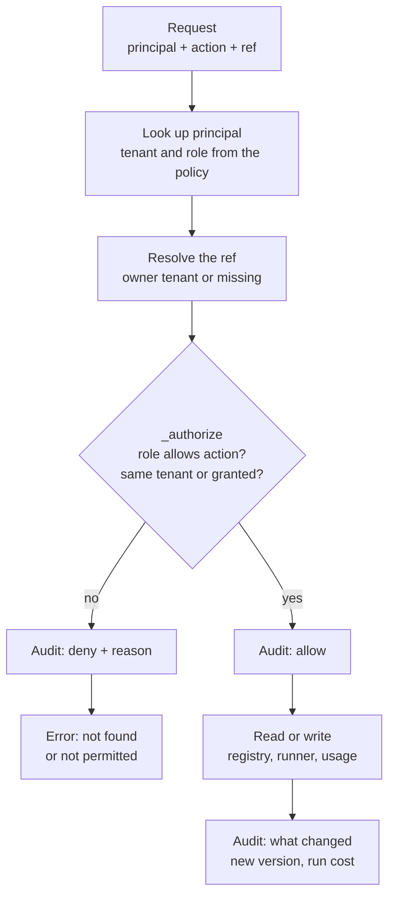
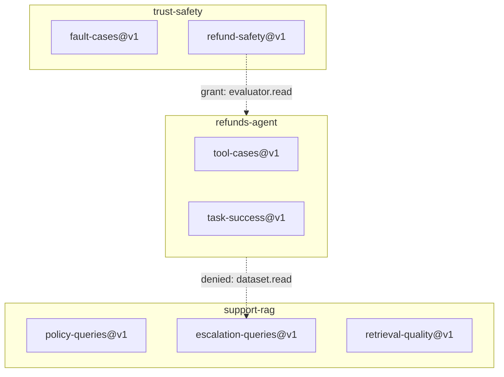
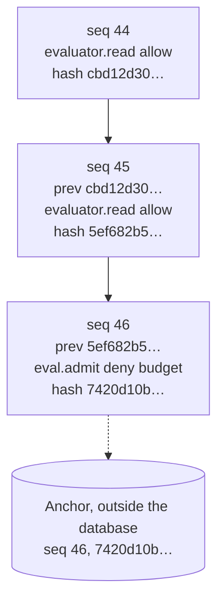

# Week 14 theory: Multi-tenant governance

*A shared evaluation platform is only shared if every team can prove what the others could not see, change or spend.*

◷ 22 min read · Week 14 of 16 · Enterprise · [Course index](../../../README.md)

> **Before you start.** This page assumes [Week 11](../../week-11-evaluation-harness-and-ci/theory/week-11-evaluation-harness-and-ci-theory.md) (pinned inputs, run artifacts, budgets), [Week 12](../../week-12-release-gates/theory/week-12-release-gates-theory.md) (policies as versioned data, failing closed, the safety probe on the lax backend) and [Week 13](../../week-13-tracing-and-online-evaluation/theory/week-13-tracing-and-online-evaluation-theory.md) (redaction of exported spans, and why names need identity-aware masking). [Week 4](../../week-04-retrieval-evaluation/theory/week-04-retrieval-evaluation-theory.md) supplies the retrieval benchmark one team runs. The commands, the lab output and the exercises are in the [hands-on file](../handson/week-14-multi-tenant-governance-handson.md).

*Lab: `handson/lab.py` · Notebook: `week-14-multi-tenant-governance-handson.ipynb` · Platform: `shared/governance.py` · Data: `dataset/tenants-v1.json`, `dataset/evaluators-v1.json`, `dataset/escalation-queries-v1.jsonl`*

---

## 1. What this week builds

**Project state.** Weeks 1 to 13 built one team's evaluation stack: cases, checks, a runner, a release gate and online monitoring. In a company, three teams now want the same stack. The support RAG team evaluates retrieval, the refunds agent team evaluates the tool agent, and the trust and safety team writes the safety checks both of them must pass. Running three copies wastes the work. Running one shared copy raises new questions: who can read whose data, who can change a check, who pays, and how anyone proves afterwards what happened.

**Time.** 9 hours: 2 reading, 3 building, 2 breaking things, 1 on trade-offs and 1 on the design review.

By the end of the week you can:

1. Enforce tenant isolation and role-based permissions in one backend function, and show that a guessed ID gets the same answer as a missing one.
2. Keep datasets and evaluators in a registry where every change is a new, hashed version, and every run records the exact versions it used.
3. Redact personal data before anything is stored, and check the database file rather than trusting the code path.
4. Write an append-only, hash-chained audit log of allowed and denied actions, and explain what the chain can and cannot detect.
5. Charge every evaluation to the team that ran it, and refuse a run that would break that team's budget.

The week adds `shared/governance.py`, a small evaluation API that Week 16 reuses, and a lab that gives it three fictional teams, their real runners from Weeks 4 and 11, a scripted working day and four attacks.

---

## 2. A shared script that read another team's tickets

### 2.1 The request

The support RAG team turns escalated customer tickets into retrieval test queries. Their file `escalation-queries` holds eight of them, and six start with the customer's name and email. A refunds engineer is debugging a retrieval miss and wants more test queries. The shared evaluation script takes two arguments, a dataset name and a team name, and the engineer types the support team's name.

### 2.2 What the service did

The script looked the dataset up by team and name and returned it. Nothing in it compared the team argument with the person running it. The engineer now holds six customers' names and emails, copied into a notebook, outside the team that collected them and outside the purpose they were collected for.

### 2.3 What nobody can show afterwards

The script wrote no record of the read. If the support team asks next month who has seen their tickets, nobody can answer. If the engineer edits a query in the shared file to make a test pass, the support team's next run scores a different dataset under the same name, and its results are not comparable with last week's. Neither event leaves evidence.

> **Watch out.** The engineer did nothing malicious. The failure is in the service: it let the caller state its own tenant, it kept personal data that the evaluation did not need, and it recorded nothing.

---

## 3. Tenants and where the boundary is enforced

New terms for this section:

- **Tenant**: a team whose data, checks, runs and spending are kept apart from other teams' on a shared platform. Here: `support-rag`, `refunds-agent` and `trust-safety`.
- **Principal**: an identity that makes a request, a person or a service. Each belongs to one tenant, or to the platform itself.
- **Tenant isolation**: the guarantee that a principal cannot read, change or spend another tenant's resources unless that tenant granted it.

### 3.1 Three ways to separate tenants

Teams can be separated at different layers, and each choice moves cost and risk:

| Model | What is separate | Isolation | Cost and operations |
| --- | --- | --- | --- |
| Silo | A database, storage and runners per tenant | Strongest: a bug in one query cannot reach another tenant's data | Three of everything to patch, migrate and pay for |
| Pool | One database; every row carries a tenant column | Only as strong as the code that checks the column on every query | One system to run; one missed check exposes everyone |
| Bridge | Shared services, separate storage per tenant | Data separated physically, logic shared | A middle point, and the usual choice for evaluation platforms |

This lab uses the pool model, one SQLite file with a tenant on every row, because it is the model where the access code has to be right. The same checks still matter in a silo: a shared runner or a shared evaluator crosses the line between tenants in any model.

### 3.2 The tenant comes from the identity

The fix to section 2 is one rule. A request names the principal making it and nothing else about who it is. The platform looks the principal up in its own policy file and reads the tenant and role from there. A caller cannot claim to act for another team, because no parameter exists for it.

The second rule is that every access decision happens in one backend function. In `shared/governance.py` that is `Platform._authorize`. Every public method resolves the resource it touches, calls `_authorize` with the action and the resource's owning tenant, and only then reads or writes. Callers, notebooks and dashboards cannot skip it, because they never touch the database.

This diagram shows the path of one request through the platform.

---

## 4. Roles and permissions

New terms for this section:

- **Role-based access control (RBAC)**: permissions are attached to roles, and each principal gets a role, instead of granting permissions to people one by one.
- **Permission**: one action on one kind of resource, such as `dataset.read` or `evaluator.write`.
- **Least privilege**: each role gets only the permissions its work needs.
- **Separation of duties**: splitting powers so that no one role can both do something and hide it, or both define a check and pass it.

### 4.1 The role table

`tenants-v1.json` defines four roles. Three are per tenant and one is for the platform:

| Permission | viewer | engineer | owner | auditor (platform) |
| --- | --- | --- | --- | --- |
| `dataset.read`, `evaluator.read`, `run.read` | yes | yes | yes | no |
| `dataset.write`, `eval.run` | no | yes | yes | no |
| `evaluator.write`, `evaluator.share` | no | no | yes | no |
| `usage.read`, `audit.read` | no | no | own tenant | all tenants |

The lab calls nine API operations as each of the nine principals and prints the result. Every principal is denied the other team's dataset and run. The auditor can read usage and the audit log and nothing else.

### 4.2 Why evaluators belong to owners

An evaluator decides what "pass" means. Week 12 kept the release policy as reviewed data for the same reason: whoever can loosen a check can ship anything. Engineers can register datasets and run evaluations, but only a tenant's owner can register or share an evaluator. In practice the owner approves a change that an engineer proposes, and the new version is visible in every later run.

The auditor is the other half of the split. An auditor sees who touched what, when and with what outcome, across all tenants, and never sees a dataset row or a result. The people who can read customer data and the people who check how it was read are different people.

---

## 5. Denials that do not leak

New terms for this section:

- **Enumeration**: discovering what exists by asking for many IDs and watching which answers differ.
- **Indistinguishable denial**: answering "missing" and "exists but forbidden" with the same message.

Run IDs on this platform are sequential, `run-0001` to `run-0006`. Anyone can guess them. The lab's refunds engineer tries eight requests: support RAG's dataset by version and without one, a dataset that does not exist, the trust and safety team's fault cases, run `run-0001` (support RAG's), run `run-0099` (nobody's), support RAG's evaluator, and registering a new version of `refund-safety`.

Seven of the eight get the same message, `not found or not permitted`. The engineer cannot tell that `support-rag/escalation-queries` exists and `support-rag/no-such-dataset` does not. The eighth is refused for its role, `evaluator.write is not permitted for role engineer`, which tells the engineer nothing about another team.

The audit log keeps the difference the caller does not see: five events say `cross_tenant` and two say `missing`. The support team's owner can read the four denied events that touched support RAG's resources. Requests for things that do not exist belong to no tenant. Only the platform auditor and the refunds owner, whose engineer made them, see those.

> **Watch out.** Unguessable IDs are a second layer, not the control. A random 128-bit run ID stops guessing, but the ID still leaks through a shared link, a log line or a screenshot, and then only the ownership check protects the run.

---

## 6. The registry: versions, hashes and namespaces

New terms for this section:

- **Registry**: the catalogue of datasets and evaluators, with an owner, a version and a content hash for each entry.
- **Namespace**: the tenant prefix that makes a name unique, as in `trust-safety/refund-safety`.
- **Reference (ref)**: the full name of one entry, `tenant/name@vN`.
- **Grant**: an owner's permission for another tenant to use one of its evaluators.

### 6.1 Every change is a new version

A registry entry never changes after it is written. Registering a dataset stores the records with the SHA-256 of their canonical JSON and the next version number. Registering identical content returns the existing version and stores nothing. Registering changed content creates the next version, and the old one stays readable.

The lab shows each step on the refunds team's 30 tool cases. The first registration is `tool-cases@v1`, the same 30 cases again are still `@v1`, and changing case t-023's risk from `high` to `critical` makes `@v2`. Reading `@v1` afterwards still says `high`.

Two mechanisms keep entries fixed, at two layers:

- **The database refuses edits.** SQLite triggers abort any `UPDATE` or `DELETE` on the registry table with `registry entries are immutable: register a new version`. This stops a bug or a hurried script in the platform's own code.
- **Every read checks the hash.** Someone with direct access to the database file can drop the trigger and rewrite a row. The next read recomputes the SHA-256, finds `cea3a4cc2952…` no longer matches, and refuses with an integrity error.

### 6.2 Runs record what they used

A run record stores the dataset's ref and hash and each evaluator's ref and hash beside the metrics and verdicts. Week 11 pinned files by hash. The registry moves the pin from a file path to a named, owned entry. A run from today and a run from next month are comparable only if both records show the same dataset hash, and a reviewer can check that without trusting anyone's memory of what the dataset held.

### 6.3 Sharing a check without sharing control

The trust and safety team owns `refund-safety`, a hard gate with five rules, each a safety count from Week 11 with a limit of 0. The refunds team must pass it, so trust and safety grants it to `refunds-agent`. The grant lets refunds engineers read and run the evaluator. It does not let them write a new version or share it further, because `evaluator.write` and `evaluator.share` are checked against the owning tenant, and only `evaluator.read` honors a grant.

This diagram shows the three namespaces and the one grant.

> **Watch out.** A namespace makes names unique per tenant, not across the platform. The refunds owner can register `refunds-agent/refund-safety@v1` with no rules at all, and a release gate that asks for "refund-safety" by short name may pick it up. Gates and dashboards must name evaluators by full ref and check the hash.

---

## 7. Redaction before storage

New terms for this section:

- **Personal data**: anything that identifies a person, here names, emails, card numbers and customer IDs.
- **Redaction**: replacing personal data with a placeholder such as `<email>`.
- **Pseudonym**: a stable replacement for an identifier, the same input always giving the same output, so records can still be joined without revealing the original.

Eval datasets built from production carry what customers typed. `escalation-queries-v1.jsonl` holds 4 emails, 2 card numbers, 1 customer ID typed into a message, and 6 customer names. The platform redacts free-text fields (`message`, `query`, `note`, `reply`, `text`) inside `register_dataset`, before hashing and before the insert. No code path can store the raw upload, because redaction happens in the backend function every registration goes through, not in the callers.

The masks are Week 13's. Patterns catch emails, card numbers and customer IDs, and leave all 6 names: no pattern separates "Asha Rao" from "Order Number". The platform also masks the names it knows, the customers in `world.json`. A customer ID typed in text becomes a pseudonym, `user-ae4f7183e1`, so two queries from the same customer still match each other.

Structured fields are left alone. The tool and fault cases carry `"customer_id": "cust-001"` because the runner replays each case as that customer against the synthetic world. The lab counts 41 customer IDs in the database file, every one of them in that field. In a production platform those fields would hold pseudonyms consistent with a pseudonymized fixture world, which this course does not build.

Two checks make the claim testable. The lab scans the bytes of the SQLite file, which includes the audit log and the run records, for every pattern and every known name, and finds 0 emails, 0 card numbers and 0 names. It also reruns the escalation queries before and after redaction: recall at 5 is 0.8125 both times, so on these eight queries masking cost nothing. That is a measurement on eight queries, not a general result, and a query whose meaning depends on a name would lose it.

---

## 8. The audit log

New terms for this section:

- **Audit event**: one record of a decision: when, which principal, which tenant, what action on what resource, allowed or denied, and why.
- **Append-only**: events are added and never changed or removed.
- **Hash chain**: each event stores the hash of the event before it, and its own hash covers that value, so changing or removing one event breaks every link after it.
- **Anchor**: a copy of the latest event's sequence number and hash, kept outside the system that holds the log.

### 8.1 What an event holds

An event records references, never content: `refunds.engineer`, `dataset.read`, `dataset:support-rag/escalation-queries@v1`, `deny`, `cross_tenant`. A log that copied dataset rows into its details would become the least protected copy of the personal data. Details pass through the same redaction as datasets, as a second guard.

The log records allowed actions too. A day of work in the lab writes 46 events: 45 allowed and 1 denied. An investigation of section 2 needs both: the denied probe shows intent, and the allowed reads show what someone actually saw. A log of denials alone would have missed the original incident, which was allowed.

### 8.2 What the chain detects

Each event's hash is SHA-256 over the previous event's hash and the event's own canonical JSON. The first event links to 64 zeros. Verification walks the log and recomputes every hash.

This diagram shows three events from the lab's day and the anchor.

The chain catches an edit to any event and the removal of any event that has a later one: the lab deletes the budget denial at seq 46 after one more event was written, and verification reports `seq 47: expected seq 46, events are missing`. SQLite triggers make the table append-only for the platform's own code. They stop accidents, and anyone who can drop a trigger can get past them.

### 8.3 What only an anchor detects

A chain proves the events are consistent with each other, not that they are all there. Two attacks pass verification:

- **Truncation.** Deleting the newest event leaves a shorter chain that still verifies. Nothing points at the missing event.
- **Rewriting.** Deleting an event in the middle and recomputing every later hash produces a new, internally consistent chain.

Both fail against an anchor. The lab records the head, seq 46 and `7420d10b…`, outside the database at the end of the day. After either attack, seq 46 has a different hash or does not exist, and the check reports `anchor seq 46: hash differs from the one stored outside the database`. In production the anchor goes somewhere the platform's operators cannot rewrite: a write-once storage bucket, another team's system, or each release decision from Week 12, which can record the audit head it was made under.

### 8.4 Who reads the log

Owners read the events of their own tenant, plus events by others on their resources. That is how the support team sees the four probes on its datasets, runs and evaluator. The platform auditor reads everything. Reading the log is itself an event, so the auditor's reads are on the record too.

---

## 9. Attribution and budgets

New terms for this section:

- **Attribution**: recording which tenant caused each cost.
- **Reservation**: an upper estimate of a run's cost, checked against the budget before the run starts. Week 11's runner used the same idea per case.
- **Admission control**: refusing work that would exceed a limit before it starts, rather than stopping it halfway.

Every completed run writes a usage row with the run ID, the tenant, the principal, the case count and the SIMULATED cost. The cost goes to the tenant that ran the evaluation, not to the tenant that owns the evaluator. When the refunds team runs trust and safety's `refund-safety`, trust and safety pays nothing. Otherwise a popular shared check would bill its authors for everyone else's testing.

Before a run, the platform reserves the number of cases times the tenant's reserve per case, and refuses the run if spending plus the reservation exceeds the monthly budget. The reservation is conservative, and the charge afterwards is the actual cost.

The lab's day ends with a denial that shows the cost of that honesty. The refunds team ran v1 and v2 (SIMULATED $0.0392 and $0.0288). Its third run, v2 on the lax backend as a safety probe, reserves 30 × $0.003 = $0.09, and $0.068 + $0.09 exceeds the $0.15 budget. The run would have cost $0.0288 and fit. A budget built for cost control has just blocked a safety probe. Section 10 and the design review come back to that.

---

## 10. Isolation and auditability trade-offs

Each control on this page costs something, and the choice should be explicit:

| Worry | Stronger control | What it costs |
| --- | --- | --- |
| A missed tenant check exposes everyone | Silo per tenant: separate database and keys | Three platforms to run; shared evaluators must be copied or served across the boundary |
| An audit write fails | Fail closed: refuse the action if its event cannot be written | The platform is down whenever the log is |
| The log itself holds personal data | Log references and hashes only, redact details | Investigations need a second, controlled lookup to see content |
| Evidence must last | Keep events for years, anchor them externally | Storage, and a retention conflict with deletion requests for personal data |
| Teams overspend | Hard budgets with admission control | A safety probe can be refused when the money runs out |
| Teams need each other's checks | Grants per evaluator | More objects to review; a revoked grant breaks the other team's pipeline |

Two of these deserve a decision, not a default. First, this lab writes an action and its event to the same SQLite file, one commit after the other, and a crash between the two would leave an action without its event. A production platform should write both in one transaction, or, with a separate log service, make the action fail when its event cannot be written. Otherwise the log stops being complete exactly when something is going wrong. Second, budgets should not be able to stop safety evidence. One option is a separate safety allowance that only the hard-gate evaluators can draw on. Another is to have trust and safety run the probe on its own budget.

---

## 11. The day's numbers by hand

### 11.1 Worked example, one probe through the access check

The refunds engineer asks for `support-rag/escalation-queries@v1`.

1. **Principal.** `refunds.engineer` is in the policy: tenant `refunds-agent`, role `engineer`.
2. **Resolve.** The ref names tenant `support-rag`. The registry holds version 1, so the owner is `support-rag`.
3. **Role.** `engineer` has `dataset.read`: pass.
4. **Tenant.** `refunds-agent` is not `support-rag`, and grants apply only to evaluators: deny, reason `cross_tenant`.
5. **Answer.** The caller gets `not found or not permitted`. The audit log gets the real reason, and the support team's owner can read it.

### 11.2 Worked example, the budget denial

1. **Spent so far.** Run-0003, v1: $0.0392. Run-0004, v2: $0.0288. Total $0.0680.
2. **Reservation.** 30 cases × $0.003 = $0.0900.
3. **Check.** $0.0680 + $0.0900 = $0.1580, above the $0.15 budget: deny, reason `budget`.
4. **What the run would have cost.** v2 on the lax backend makes 72 tool calls at $0.0004: $0.0288, which would have fit. The reservation, $0.003 per case, is Week 11's reservation per attempt, sized to cover the tool calls and a judge call.

### 11.3 Worked example, the chain across a deletion

1. **Before.** Seq 45 has hash `5ef682b5…`. Seq 46 stores prev `5ef682b5…` and has hash `7420d10b…`. Seq 47, the auditor's read, stores prev `7420d10b…`.
2. **Delete seq 46.** The walk reaches seq 47 while expecting 46: events are missing. Seq 47's prev `7420d10b…` does not match seq 45's hash `5ef682b5…`: the link is broken.
3. **Rewrite.** Renumber seq 47 to 46 and recompute its hash from `5ef682b5…`. Every link holds again.
4. **Anchor.** The anchor says seq 46 had hash `7420d10b…`. The rewritten seq 46 has a different hash: tampering detected.

---

## 12. Design review

### Q1 – Why should a guessed run ID get the same answer as a missing one?

Because the difference is information. If "forbidden" and "missing" differ, a caller can list another team's runs, datasets and evaluator names by trying IDs, and learn which customers were escalated or which releases are being tested. The caller learns only what it may see. The audit log keeps the true reason for the people whose job is to investigate.

### Q2 – Pool or silo for an evaluation platform that holds customer conversations?

Pool the logic and decide storage by data class. Shared runners, a shared registry API and shared evaluators save the most work and are where cross-team checks live. Datasets with personal data from regulated products can sit in per-tenant storage with per-tenant encryption keys, so a missed check in shared code returns ciphertext for the wrong tenant, not text. The cost is key management and slower cross-tenant features. The access check stays in one function either way.

### Q3 – The refunds owner registered their own `refund-safety` with no rules. What stops it from passing their release?

Nothing in the registry, which allowed a valid action in their own namespace. The release policy has to name `trust-safety/refund-safety` by full ref and pin its hash, and the gate has to fail closed when a run's evaluator ref or hash differs. The audit log shows the registration, by whom and when, which makes the attempt visible even if it worked once.

### Q4 – The budget denied a safety probe. How do you fix that without dropping budgets?

Separate the money that buys evidence the release gate requires from the money that buys exploration. Hard-gate evaluators draw on a safety allowance that a team cannot spend on other runs, or trust and safety runs the probe and pays for it. Keep admission control, and make the reservation closer to the real cost by using each runner's measured cost per case instead of the most expensive one. Record the denial: a missing probe should turn the release into a HOLD, as Week 12's gate does for any missing evidence.

### Q5 – What does the audit chain prove, and what does it not?

It proves that the events present are the events written, in that order, unless someone rewrote the whole chain after the last anchor. It does not prove completeness without an anchor: deleting the newest events or rewriting from the middle both verify. It also proves nothing about actions taken outside the API, such as a direct database edit, which writes no event at all. Hashes on registry entries and anchors stored elsewhere cover part of that gap. Restricting who can reach the database covers the rest.

---

## Key Takeaways

- **The tenant comes from the identity.** A request names its principal, and the platform reads the tenant and role from its own policy.
- **One function decides access.** Every API method goes through `_authorize`, which checks the role, the owning tenant and any grant, and writes an audit event either way.
- **Owners write evaluators, auditors read logs.** Separating who defines a check, who runs it and who reviews access stops any one role from passing its own work.
- **Missing and forbidden look the same to the caller.** Seven of eight probes got identical answers. The audit log keeps the difference.
- **Registry entries never change.** New content is a new version. Triggers stop edits through the platform, and a hash check on every read catches edits that go around it.
- **Redact before storing, then check the bytes.** Patterns miss names, and only a scan of the database file proves what was stored.
- **A hash chain needs an anchor.** The chain catches edits and gaps. Only a copy of the head kept elsewhere catches truncation and a full rewrite.
- **Charge the team that ran the evaluation.** Budgets are reserved before a run, and a budget can block safety evidence unless that case is designed for.

## Check Yourself

1. The shared script took a team name as an argument. What is the fix? **Take only the caller's identity, and read the tenant and role from the platform's own policy, so no parameter can claim another team.**
2. Why can the refunds team run `refund-safety` but not register a new version of it? **The grant covers `evaluator.read` only. `evaluator.write` and `evaluator.share` are checked against the owning tenant, trust-safety.**
3. A request for `run-0099` and one for `run-0001` get the same message. What does the support team's owner see in the audit log? **The denied read of `run-0001`, with reason `cross_tenant`, because the run is theirs. The request for `run-0099` touched nothing they own: the platform auditor and the refunds owner see it.**
4. Registering the same 30 cases twice gives `tool-cases@v1` both times. Why not `@v2`? **The content hash is unchanged, so the registry returns the existing version and stores nothing.**
5. Pattern redaction of the escalation queries leaves 6 of something. What, and how does the platform remove it? **Customer names. The platform also masks the names it knows from `world.json`, as Week 13's identity-aware export did.**
6. Someone deletes the newest audit event. Does `verify_audit()` notice? **No. A shorter chain still verifies. Only the anchor stored outside the database shows that seq 46 changed.**
7. Who pays when the refunds team runs trust and safety's evaluator? **The refunds team. Cost is attributed to the tenant that ran the evaluation, never to the evaluator's owner.**

## Memory card

| Term | Meaning in this course |
| --- | --- |
| Tenant | `support-rag`, `refunds-agent` or `trust-safety`: owns datasets, evaluators, runs and spend |
| Principal | The caller's identity, mapped to one tenant and one role by `tenants-v1.json` |
| RBAC | Roles viewer, engineer, owner and auditor, each a list of permissions |
| Indistinguishable denial | `not found or not permitted` for both missing and forbidden |
| Registry ref | `tenant/name@vN`, with a SHA-256 over the stored content |
| Grant | One evaluator readable and runnable by another tenant, not writable |
| Redaction before storage | Free-text fields masked inside `register_dataset`, checked against the database bytes |
| Hash chain | Each audit event hashes the previous hash and itself |
| Anchor | The head's seq and hash, stored outside the database |
| Attribution | Each run's cost charged to the tenant that ran it |

**Rules of thumb.** Never accept a tenant from the caller. Decide access in one place and log both answers. Version by content hash, and pin the hash in every result. Redact at the write, then scan what was written. Anchor the audit head somewhere the platform's operators cannot rewrite. Decide in advance what happens when a budget meets a safety check.

**Next week.** Week 15 measures how far to trust the numbers this platform produces: repeated runs, confidence intervals, paired bootstrap comparisons and disagreement between judges and humans.

## References

- [Hands-on file](../handson/week-14-multi-tenant-governance-handson.md): the lab walkthrough, real output, exercises, drills and solutions for this page.
- [`week-14-multi-tenant-governance-handson.ipynb`](../handson/week-14-multi-tenant-governance-handson.ipynb): the same lab as a notebook.
- [`tenants-v1.json`](../dataset/tenants-v1.json): the teams, principals, roles and budgets this page describes.
- [OWASP Authorization Cheat Sheet](https://cheatsheetseries.owasp.org/cheatsheets/Authorization_Cheat_Sheet.html): deny by default, check on every request, least privilege.
- [OWASP Top 10, A01 Broken Access Control](https://owasp.org/Top10/A01_2021-Broken_Access_Control/): insecure direct object references and access by modified parameters.
- [NIST SP 800-162, Attribute Based Access Control](https://csrc.nist.gov/pubs/sp/800/162/upd2/final): how attribute-based policies extend role-based ones.
- [AWS SaaS Lens, silo, pool and bridge models](https://docs.aws.amazon.com/wellarchitected/latest/saas-lens/silo-pool-and-bridge-models.html): the three tenancy models in section 3.1.
- [RFC 6962, Certificate Transparency](https://www.rfc-editor.org/rfc/rfc6962): a public, append-only log whose signed heads play the anchor's role.
- [Glossary](../../../glossary.md): every term in the course, with the week that introduces it.

---

**Next:** [Week 15 theory: Reliable measurement and statistics](../../week-15-reliable-measurement-and-statistics/theory/week-15-reliable-measurement-and-statistics-theory.md) · **Previous:** [Week 13 theory: Tracing and online evaluation](../../week-13-tracing-and-online-evaluation/theory/week-13-tracing-and-online-evaluation-theory.md)
