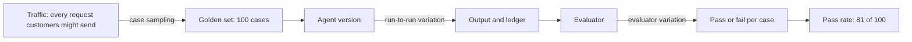
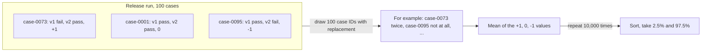
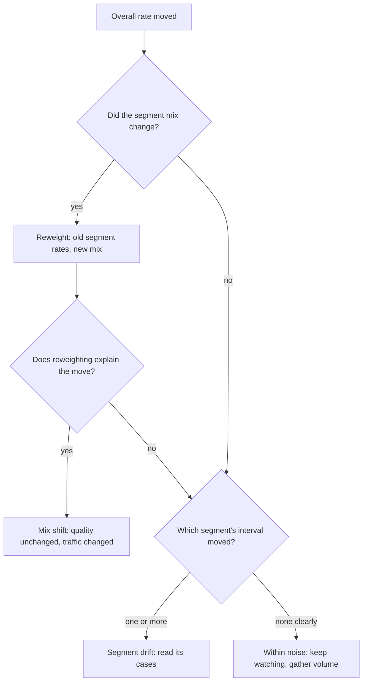

# Week 15 theory: Reliable measurement and statistics

*Measure normal score variation before calling a small change an improvement.*

Week 15 of 16. [Course index](../../../simplified-course-index.md).

> **Source note.** Results are inherited, not rerun.

> **Before you start.** Review [agreement](../../week-03-judges-and-human-calibration/theory/week-03-judges-and-human-calibration-theory-simplified-structured.md), [judge noise](../../week-11-evaluation-harness-and-ci/theory/week-11-evaluation-harness-and-ci-theory-simplified-structured.md), [paired comparisons](../../week-12-release-gates/theory/week-12-release-gates-theory-simplified-structured.md), and [traffic mix](../../week-13-tracing-and-online-evaluation/theory/week-13-tracing-and-online-evaluation-theory-simplified-structured.md). Use the [lab](../handson/week-15-reliable-measurement-and-statistics-handson.md).

*Lab: `handson/lab.py`  
Notebook: [`week-15-reliable-measurement-and-statistics-handson.ipynb`](../handson/week-15-reliable-measurement-and-statistics-handson.ipynb)  
Experiment: `dataset/stochastic-experiment-v1.json`  
Second reviewer: `dataset/second-reviewer-sheet-v1.csv`*

---

## 1. What this week builds

**Project state.** Week 12 checks pass rates and safety. It does not measure how much pass rates vary on rerun.

**Time.** Nine hours: reading 2, building 3, experiments 2, trade-offs 1, review 1.

This week's goals:

1. Report uncertainty around pass rates and reviewer agreement.
2. Compare versions by resampling matching case IDs.
3. Estimate enough cases to detect a chosen improvement.
4. Separate agent noise, judge noise, and case selection.
5. Separate changed segment quality from changed traffic mix.

Adds a simulated experiment on 100 cases, a second authored review sheet for 30 replies, and Markdown/JSON reliability reports.

---

## 2. A two-point gain that might be noise

### 2.1 The claim

V1 passes 81/100; v2 83/100. The claimed "+2.0%" means two percentage points. Is that improvement reliable?

### 2.2 What a rerun shows

Twenty unchanged v1 runs pass 74–86 cases; v2 passes 77–85. V2 loses six pairs. Individual differences range from −5 to +10.

A simulated judge passes 23–29/30 identical replies over 20 seeds: twenty points of evaluator-only spread.

### 2.3 What is simulated here

No model runs. Seeded slice probabilities favor v2 only on `window_boundary`/`amount_boundary`: built-in gain 2.0 points. The chosen release seed gives 81 versus 83.

Simulation illustrates chosen noise. Measure real model variability with real repeated runs.

---

## 3. Where variation comes from

New terms for this section:

- **Run-to-run variation:** unchanged cases receive different agent results.
- **Evaluator variation:** unchanged outputs receive different grades. Fixed deterministic checks do not vary.
- **Case sampling:** different selected cases change the score.
- **Synthetic variation:** randomness chosen by a simulation.
- **Measured variation:** observed changes in a real system.

*Figure 1: Source diagram.*

### 3.1 A hard case stays hard

Fixed case difficulty is shared across versions/runs. `case_share = 0.7` mixes 70% case influence and 30% fresh run influence.

At case share 1, reruns are deterministic. At 0, each run is independent.

### 3.2 Three rates for one version

V1 has three rates:

| Rate | Value | What it describes |
| --- | --- | --- |
| Built-in rate | 81.1% | The probabilities averaged over the cases' slices: the rate over all traffic like these slices |
| Rate on these 100 cases | 79.7% (79.5% averaged over 20 runs) | These particular cases, with their fixed difficulties. The cases drawn are slightly harder than average |
| One run | 81.0% (the release run) | One draw of the run-to-run luck on these cases |

*Table 1: Reference values.*

Repeats estimate these cases; more cases estimate wider traffic.

---

## 4. Confidence intervals for one pass rate

New terms for this section:

- **Confidence interval:** computed range; a 95% method covers truth in about 95/100 repeated experiments.
- **Standard error:** typical sampling variation, approximately √(p(1 − p)/n).
- **Wald:** estimate ±1.96 standard errors.
- **Wilson:** interval bounded by 0–100%, retaining uncertainty near either end.

Normal-distribution 95% coverage gives 1.96. Fewer cases and rates near 50% usually mean wider intervals.

### 4.1 The Wilson interval

For k passes in n cases, with p = k / n and z = 1.96:

| Part | Details |
| --- | --- |
| 1 | centre = (p + z² / 2n) / (1 + z² / n) |
| 2 | half   = z × √( p(1 − p)/n + z² / 4n² ) / (1 + z² / n) |
| 3 | interval = centre − half  to  centre + half |

*Table 2: Reference values.*

Wilson pulls toward 50%, retaining width at extremes. V1: 72.2–87.5%; v2: 74.5–89.1%.

> **Watch out.** Overlap does not prove equality. Use section 6's paired comparison, not overlap, to test the difference.

### 4.2 Thirty of thirty

For 30/30, Wald gives misleading 100–100%; Wilson 88.6–100%, allowing roughly 11% failure. The approximate **rule of three** gives upper failure limit 3/n at 95% confidence: 10% here.

Passing a zero-failure gate does not prove zero population risk. More cases reduce uncertainty; backend rules provide separate protection.

---

## 5. Bootstrap resampling

New terms for this section:

- **Bootstrap:** estimate sampling variation by repeatedly drawing from observed cases.
- **With replacement:** return each selected item before drawing again; repeats and omissions are possible.
- **Percentile interval:** sorted bootstrap values from the 2.5th to 97.5th percentile.

### 5.1 The idea

Repeated replacement samples approximate fresh traffic samples using the one dataset available.

### 5.2 The steps

1. Start with 100 case IDs and results.
2. Draw 100 IDs with replacement.
3. Compute the statistic.
4. Repeat 10,000 times, using seed 15 here.
5. Sort values; take the 2.5th and 97.5th percentiles.

Use bootstrap for rates, differences, and kappa.

### 5.3 What the bootstrap assumes

Use independent, representative cases. Twenty renamed copies exaggerate evidence; risk-heavy mixes do not match traffic. Below about twenty cases, percentile intervals can be unreliable.

---

## 6. Paired comparisons

New terms for this section:

- **Paired:** compare versions on each identical case.
- **Discordant:** one passes, one fails.
- **McNemar:** test discordant directions as coin flips under equal performance.
- **p-value:** probability of equally/more extreme evidence assuming equality, not probability of equality itself.

### 6.1 Why pairing helps

Release results agree on 92 cases. Five favor v2, three favor v1: net +2. These eight discordant cases drive the comparison.

Pairing subtracts shared difficulty; separate rates retain it twice.

### 6.2 The paired bootstrap

For each ID compute v2 − v1: +1, 0, or −1. Resample IDs with both results together.

*Figure 2: Source diagram.*

Gain +2.0 points; paired 95% interval −3.0 to +8.0: `INCONCLUSIVE`. McNemar p = 0.73, consistent with chance.

### 6.3 When the pairing breaks

Unpaired interval −9.0 to +12.0 is twice as wide and describes independent samples.

Position-joining shuffled results keeps +2.0 but gives −9.0 to +13.0 and discordance 8→32. Join IDs, not completion order.

---

## 7. Sample size and power

New terms for this section:

- **Significance level:** false-positive rate under no difference; here 5%.
- **Power:** chance of detecting a real chosen effect; here 80%.
- **Minimum detectable effect:** smallest reliably detected difference at that sample size and power.

### 7.1 How many paired cases

With discordant share q and true difference d, each paired contribution has variance q − d². Approximate required cases:

| Part | Details |
| --- | --- |
| 1 | n = (z_α + z_β)² × (q − d²) / d² |
| 2 | z_α = 1.96 (95%),  z_β = 0.84 (80% power),  so (z_α + z_β)² = 7.85 |

*Table 3: Reference values.*

At q = 0.08 and d = 0.02, n = 7.85 × 0.0796 / 0.0004 = 1,562. One hundred cases detect about 7.6 points at 80% power, not two.

> **Watch out.** Across twenty pairs, discordance spans 8–24, averaging sixteen. Average-based planning needs 3,142 cases; 100 detect about eleven points. Use pilot/repeat estimates, not the unusually favorable release run.

### 7.2 Without pairing

Independent samples need approximately 7.85 × [p₁(1 − p₁) + p₂(1 − p₂)] / d²: 5,789 per version here. Pairing needs about one-quarter to one-half as many.

### 7.3 What to say about the two points

Two points needs about 1,600–4,700 pairs, averaging 3,100. Ship for independently verified fixes if justified; do not claim quality improvement. Expand changed-slice coverage.

> **Watch out.** Selecting winning comparisons creates false improvements. A 5% test falsely rejects equality about once in twenty. Choose metrics, slices, and sample size beforehand.

---

## 8. Repeated runs

New terms for this section:

- **A/A test:** compare unchanged versions; differences measure noise.
- **Pseudo-replication:** count repeated observations of one case as independent new cases.

### 8.1 The A/A spread

V1's 74–86/100 range and 3.3 standard deviation exceed the claimed two-point gain. Start with A/A.

### 8.2 Averaging repeats per case

Resample case IDs carrying each version's twenty-run average. Counting 2,000 case-runs independently falsely multiplies evidence twentyfold.

| Runs per version | Difference | 95% interval | Width | Verdict |
| --- | --- | --- | --- | --- |
| 1 (release run) | +2.0 | −3.0 to +8.0 | 11.0 | `INCONCLUSIVE` |
| 20 | +2.1 | 0.0 to +4.2 | 4.2 | `INCONCLUSIVE` |
| 40 | +1.8 | +0.3 to +3.6 | 3.3 | `IMPROVED` |
| 80 | +1.4 | +0.1 to +3.1 | 3.0 | `IMPROVED` |

*Table 4: Reference values.*

Width flattens near three points. These cases' true simulated effect is +1.6, not population +2.0. Four boundary cases barely improve; case-0071/0072 almost never pass. Repeats study fixed cases; more cases improve generalization.

### 8.3 Repeats cost money

Twenty repeats cost twenty runs, including judges. Repeat while intervals shrink; then add cases.

### 8.4 Evaluator variation

Prefer deterministic checks. Otherwise control/record judge settings without assuming determinism, or repeat grades and vote. Stable trace/ledger with changing verdict identifies evaluator noise.

---

## 9. Judge calibration and human disagreement

New terms for this section:

- **Inter-rater agreement:** agreement between human reviewers, measured with kappa.
- **Adjudication:** resolve disagreement using another reviewer, rubric owner, or additional evidence.

### 9.1 Kappa with an interval

Kappa 0.505 on 26 replies has interval −0.061 to 0.885: too uncertain for firm judge conclusions.

Roughly four times the labels halves width: about 100 here. Include failures; 25/30 authored labels pass, making kappa sensitive to few cases.

### 9.2 The second reviewer

Both sheets are authored `example-not-human-review` data. They demonstrate methods, not real judge/reviewer performance.

| Raters | Cases | Agree | Kappa | 95% interval |
| --- | --- | --- | --- | --- |
| Reviewer A vs reviewer B | 30 | 24 | 0.455 | 0.070 to 0.793 |
| Judge vs reviewer A | 26 | 22 | 0.505 | −0.061 to 0.885 |
| Judge vs reviewer B | 26 | 22 | 0.620 | 0.264 to 0.913 |

*Table 5: Reference values.*

Human agreement contextualizes judge agreement; it is not a strict ceiling, especially with unequal evidence.

### 9.3 Reading the disagreements

The reviewers split on 6 replies, and the split falls into two groups:

- **Ledger:** unauthorized refunds case-0024/0025/0026 fail. B inferred ownership; A lacked it. Deterministic records settle facts.
- **Rubric:** case-0017's wrong reason meets contradictory score/pass rules. Case-0028/0029 expose an unclear next-step rule. Edit, then relabel.

Three of four judge/A disagreements also split reviewers: case-0017/0028/0029. Fix the rubric rather than teach one ambiguous interpretation.

---

## 10. Segments and drift

New terms for this section:

- **Segment:** related cases or traffic, like a slice.
- **Mix shift:** changed shares of segments.
- **Segment drift:** changed success within a segment.
- **Reweighting:** use the same segment weights to compare periods fairly.

### 10.1 Small segments are mostly noise

`missing_order`: 7/7 versus 5/7 despite equal probability 0.70. Intervals 64.6–100% and 35.9–91.8%. One flip moves fourteen points, beyond the ten-point tolerance.

Tiny slices reveal failures, not precise rates. Review flips; add cases.

### 10.2 Mix shift moves the average with every segment unchanged

Apply Week 13's baseline/sale mixes to seven slices' unchanged v1 twenty-run rates:

| Mix | Final-sale share | v1 overall |
| --- | --- | --- |
| Golden set (these seven slices) | 10.4% | 84.4% |
| Baseline traffic | 5% | 85.8% |
| Clearance-sale traffic | 40% | 76.5% |

*Table 6: Reference values.*

Overall falls 9.3 points with no slice changing. More traffic enters `final_sale`, where v1 passes 60.7%.

*Figure 3: Source diagram.*

Report slices; reweight dataset averages to live traffic.

---

## 11. The reliability report

The Markdown/JSON report records experiment version, seed, resamples, and:

1. Interval verdict and required cases.
2. Release rates/intervals, pairing, discordance, McNemar p.
3. Repeats and A/A noise.
4. Rater agreement and adjudication.
5. Segment/mix rates.
6. Simulation and statistical limits.

Requiring the paired lower bound above −2 points tests an allowed regression margin, not equality. Week 16 adds shared infrastructure.

---

## 12. The release run, by hand

### 12.1 Worked example, the Wilson interval for 81 of 100

p = 0.81, n = 100, z = 1.96, z² = 3.8416.

1. Shrink factor: 1 + z²/n = 1.038416.
2. Centre: (0.81 + 3.8416/200)/1.038416 = (0.81 + 0.019208)/1.038416 = 0.7985.
3. Inside square root: 0.001539 + 0.000096 = 0.001635; root 0.04044. Multiply 1.96: 0.07926; divide 1.038416: 0.0763.
4. Interval: 0.7985 ±0.0763 = 72.2–87.5%.

### 12.2 Worked example, the paired difference and McNemar

1. Five favor v2, three favor v1, 92 agree.
2. Difference: (5 − 3)/100 = +0.02.
3. One-tail probability: [C(8,5)+C(8,6)+C(8,7)+C(8,8)]/2⁸ = (56+28+8+1)/256 = 0.363. Double: p = 0.727.
4. This split fits ordinary chance: `INCONCLUSIVE`.

### 12.3 Worked example, the cases a 2-point gain needs

1. q = 8/100 = 0.08.
2. Variance = 0.08 − 0.0004 = 0.0796.
3. Multiplier ≈7.85 from 95% confidence and 80% power.
4. Paired n = 7.85 × 0.0796/0.0004 = 1,562.
5. Unpaired: 7.85 × (0.81 × 0.19 + 0.83 × 0.17)/0.0004 = 5,789 per version.
6. Average q rounded 0.16, more precisely 0.1605: 7.85 × (0.1605 − 0.0004)/0.0004 = 3,142.

---

## 13. Design review

### Q1 – The team says v2 is 2% better. What do you reply?

Inconclusive: −3 to +8 points, p = 0.73. Roughly 3,100 pairs are needed. Claim verified fixes, not proven "+2%" quality.

### Q2 – Why compare versions on the same cases rather than on fresh samples?

Matched difficulty cancels, narrowing uncertainty. Join and resample IDs with both results. Sudden discordance jumps suggest a broken join.

### Q3 – Is it better to run each case 20 times or to have 20 times as many cases?

Use A/A to identify run noise. Repeats reduce it but leave the case-sampling floor. More independent cases improve broader estimates. Include judge cost.

### Q4 – The judge's kappa against a reviewer is 0.505. Is the judge calibrated?

Not from 26 authored labels. A/B kappa is 0.455; ambiguous rules explain three judge disagreements. Fix rubric, collect real double-reviewed labels, and use deterministic facts.

### Q5 – The production pass rate fell 9 points during a sale. Roll back?

Final sale grows 5%→40%, explaining the drop without changed slice quality. Reweight first; investigate genuine within-slice drift using intervals and Week 13's runbook.

---

## Key Takeaways

- Distinguish population, case-set, and single-run rates.
- Report intervals, even for perfect samples.
- Bootstrap independent cases.
- Preserve pairs by ID.
- Plan realistic sample sizes.
- Repeats reduce run noise only.
- Compare reviewers before judges.
- Reweight traffic before diagnosing drift.

## Check Yourself

1. Why not Wald for 30/30? **Zero-width certainty is misleading; Wilson is 88.6–100%.**
2. Why replacement? **Without it every sample contains the same cases.**
3. What drives 81 versus 83? **Eight discordant cases: five favor v2, three v1.**
4. Broken list-position pairing symptom? **Same difference, wider interval, discordance 8→32. Join IDs.**
5. Cases for two points at q = 0.08? **7.85 × (0.08 − 0.0004)/0.0004 = 1,562.**
6. After twenty repeats give 0.0 to +4.2, why might further repeats eventually stop helping? **Further repeats eventually leave case-sampling uncertainty; add cases.**
7. Overall falls nine points, slices unchanged? **Mix shift; reweight old slice rates to confirm.**

## Memory card

| Term | Meaning |
| --- | --- |
| Confidence interval | Range with stated repeated-experiment coverage |
| Wilson interval | Bounded proportion interval |
| Bootstrap | Repeated replacement samples |
| Paired bootstrap | Carry both results per sampled ID |
| Discordant | Versions disagree |
| McNemar | Test discordant directions |
| Power | Detect chosen real effect, here 80% |
| Minimum detectable effect | Smallest reliably detected change |
| A/A | Compare unchanged version |
| Pseudo-replication | Mistake repeats for new cases |
| Inter-rater agreement | Compare reviewers, contextualizing judge agreement |
| Mix shift | Segment shares change |
| Segment drift | Segment quality changes |

*Table 7: Reference values.*

**Rules of thumb.** Read intervals. Preserve pairs. Plan sample sizes. Repeat until gains flatten, then add cases. Review human disagreement. Reweight before rollback.

**Next week.** Week 16 adds shared queues, workers, budgets, fault recovery, release decisions, and audit trails.

## References

- [Hands-on file](../handson/week-15-reliable-measurement-and-statistics-handson.md)
- [`week-15-reliable-measurement-and-statistics-handson.ipynb`](../handson/week-15-reliable-measurement-and-statistics-handson.ipynb)
- [`stochastic-experiment-v1.json`](../dataset/stochastic-experiment-v1.json)
- [Week 3 theory, agreement with human labels](../../week-03-judges-and-human-calibration/theory/week-03-judges-and-human-calibration-theory-simplified-structured.md#8-agreement-with-human-labels)
- [Week 12 theory, paired comparisons and slice thresholds](../../week-12-release-gates/theory/week-12-release-gates-theory-simplified-structured.md#6-paired-comparisons-and-slice-thresholds)
- Edwin B. Wilson, "Probable inference, the law of succession, and statistical inference", *Journal of the American Statistical Association* 22 (1927): the interval in section 4.
- Bradley Efron and Robert Tibshirani, *An Introduction to the Bootstrap* (Chapman & Hall, 1993): resampling and percentile intervals.
- Quinn McNemar, "Note on the sampling error of the difference between correlated proportions or percentages", *Psychometrika* 12 (1947): the paired test in section 6.
- [Anthropic, "Adding error bars to evals"](https://www.anthropic.com/research/statistical-approach-to-model-evals)
- [Glossary](../../../glossary.md)

---

**Next:** [Week 16 theory: Distributed evaluation capstone](../../week-16-distributed-evaluation-capstone/theory/week-16-distributed-evaluation-capstone-theory-simplified-structured.md)  
**Previous:** [Week 14 theory: Multi-tenant governance](../../week-14-multi-tenant-governance/theory/week-14-multi-tenant-governance-theory-simplified-structured.md)
