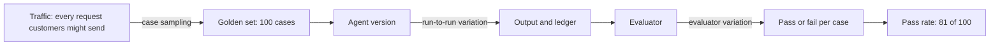
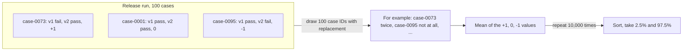
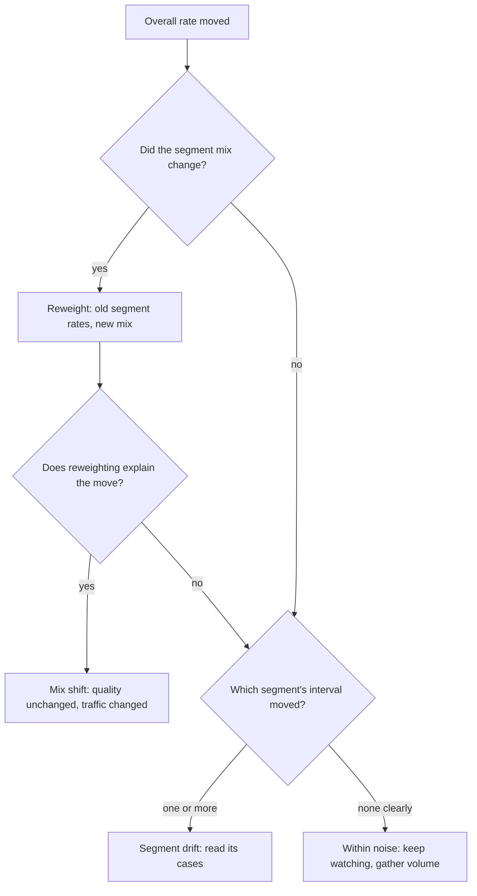

# Week 15 theory: Reliable measurement and statistics

*v2 beat v1 by two points on 100 cases, and twenty reruns of v1 alone moved by twelve: find out how far a number moves on its own before you act on a change in it.*

◷ 25 min read · Week 15 of 16 · Advanced · [Course index](../../../README.md)

> **Before you start.** This page assumes [Week 3](../../week-03-judges-and-human-calibration/theory/week-03-judges-and-human-calibration-theory.md) (Cohen's kappa and the example review sheet), [Week 11](../../week-11-evaluation-harness-and-ci/theory/week-11-evaluation-harness-and-ci-theory.md) (the simulated judge and flaky results) and [Week 12](../../week-12-release-gates/theory/week-12-release-gates-theory.md) (paired comparisons by case ID and slice tolerances). [Week 13](../../week-13-tracing-and-online-evaluation/theory/week-13-tracing-and-online-evaluation-theory.md) supplies the traffic mix used in section 10. The commands, the lab output and the exercises are in the [hands-on file](../handson/week-15-reliable-measurement-and-statistics-handson.md).

*Lab: `handson/lab.py` · Notebook: `week-15-reliable-measurement-and-statistics-handson.ipynb` · Experiment: `dataset/stochastic-experiment-v1.json` · Second reviewer: `dataset/second-reviewer-sheet-v1.csv`*

---

## 1. What this week builds

**Project state.** Week 12's gate compares a candidate with the baseline on the same cases and blocks on any hard failure. Its quality rules compare one pass rate with a threshold, and its slice rule compares two pass rates. None of them asks how much those rates would move if the same version ran again.

**Time.** 9 hours: 2 reading, 3 building, 2 breaking things, 1 on trade-offs and 1 on the design review.

By the end of the week you can:

1. Put a confidence interval on a pass rate and on a judge's agreement with reviewers, and explain what its width means.
2. Compare two versions with a paired bootstrap that resamples case IDs, and show what breaks when the pairing is lost.
3. Calculate how many cases a comparison needs to detect a given improvement, and refuse a claim the data cannot support.
4. Separate run-to-run variation, evaluator variation and case sampling, and say which one repeats can reduce.
5. Tell a change in one segment's quality from a change in the traffic mix, and write the result as a reliability report.

The week adds a SIMULATED stochastic experiment over the 100 golden cases, a second authored review sheet for Week 3's 30 replies, and a lab that writes `reliability-report.md` and `reliability-report.json`.

---

## 2. A two-point gain that might be noise

### 2.1 The claim

A team reports that refund agent v2 passes 83 of the 100 golden cases and v1 passes 81. The dashboard shows a green arrow and "+2.0%". They want to ship v2 as an improvement.

### 2.2 What a rerun shows

Run v1 twenty times on the same 100 cases, with nothing changed, and it passes between 74 and 86. Twenty runs of v2 pass between 77 and 85. In 6 of the 20 run pairs, v2 scores lower than v1. A single pair of runs can show v2 ahead by 10 cases or behind by 5.

The judge adds its own movement. Week 11's simulated judge grades tool agent v2's 30 replies, which are identical every time. Over 20 seeds it passes between 23 and 29 of them: 20 points of spread from the grader alone.

### 2.3 What is simulated here

None of these agents is a model. The experiment file gives each slice of cases a pass probability for v1 and v2, and the lab draws each result from a seeded random number. v2's probabilities are higher on two slices, `window_boundary` and `amount_boundary`, and the same everywhere else. Averaged over the 100 cases, v2 is built to be exactly 2.0 points better. The seed was chosen so that the first run, called the release run, shows that 2-point gain: 81 against 83.

That gives this week something real evaluations never have, the true answer. It also limits what the numbers mean. They show how sampling noise of a given size behaves. They do not show how much a real model varies, which only repeated runs of that model can measure.

---

## 3. Where variation comes from

New terms for this section:

- **Run-to-run variation**: the change in a result when the same version runs the same cases again. A model sampled at a temperature above zero produces it.
- **Evaluator variation**: the change in a verdict when the same output is graded again. A sampled judge produces it. A deterministic check, such as a ledger read-back, has none.
- **Case sampling**: the change in a result from which cases happen to be in the set. A different 100 cases drawn from the same kind of traffic would give a different pass rate.
- **Synthetic variation**: variation produced by a seeded random number generator, with a size someone chose.
- **Measured variation**: variation observed by repeating a real system.

This diagram shows where each kind of variation enters a result.



### 3.1 A hard case stays hard

Real agents fail the same cases repeatedly. A boundary case that confuses v1 will often confuse v2, because both read the same policy text and the same message. The experiment builds that in. Each case has a fixed difficulty, shared by every run and both versions, and each run adds fresh luck. The `case_share` of 0.7 sets the mix: 70% of what decides a case's result belongs to the case, 30% to the run.

This one number shapes everything in the rest of this page. With a case share of 1 the agent is deterministic and reruns change nothing. With 0 every run is independent and the same case passes and fails at random.

### 3.2 Three rates for one version

The experiment has three different pass rates for v1, and they are easy to confuse:

| Rate | Value | What it describes |
| --- | --- | --- |
| Built-in rate | 81.1% | The probabilities averaged over the cases' slices: the rate over all traffic like these slices |
| Rate on these 100 cases | 79.7% (79.5% averaged over 20 runs) | These particular cases, with their fixed difficulties. The cases drawn are slightly harder than average |
| One run | 81.0% (the release run) | One draw of the run-to-run luck on these cases |

Repeats move the third toward the second. Only more cases move the second toward the first.

---

## 4. Confidence intervals for one pass rate

New terms for this section:

- **Confidence interval**: a range computed from the data by a method that, over many repeated experiments, contains the true value in the stated share of them. A 95% interval method misses 1 time in 20.
- **Standard error**: the typical distance between an estimate and the true value across repeated samples. For a pass rate p from n cases it is about the square root of p × (1 − p) / n.
- **Wald interval**: the estimate plus and minus 1.96 standard errors.
- **Wilson interval**: an interval for a proportion that stays inside 0 to 100% and keeps a sensible width when the rate is near either end.

The 1.96 comes from the normal distribution: 95% of its area lies within 1.96 standard deviations of the middle. A wider interval comes from fewer cases or a rate nearer 50%.

### 4.1 The Wilson interval

For k passes in n cases, with p = k / n and z = 1.96:

```text
centre = (p + z² / 2n) / (1 + z² / n)
half   = z × √( p(1 − p)/n + z² / 4n² ) / (1 + z² / n)
interval = centre − half  to  centre + half
```

The centre is pulled slightly toward 50%, and the half-width keeps a term that does not vanish when p is 0 or 1. v1's 81 of 100 gives 72.2% to 87.5%. v2's 83 of 100 gives 74.5% to 89.1%. The two intervals overlap almost completely.

> **Watch out.** Overlapping intervals do not prove two versions are the same, and they are the wrong test for a paired comparison. Section 6 compares the versions directly. Use one-rate intervals to report each version, not to compare them.

### 4.2 Thirty of thirty

A Wald interval for 30 passes in 30 cases has a standard error of zero and reports 100% to 100%. That reads as certainty from 30 cases. The Wilson interval for 30 of 30 is 88.6% to 100%: the data fit a true failure rate up to about 11%. A quick check for zero failures is the rule of three: with n cases and no failures, the failure rate is below 3 / n with 95% confidence, so 10% for 30 cases.

This matters for Week 12's critical slices. Zero unauthorized refunds in 30 cases is a pass of a hard gate, and it is the right decision. It is not evidence that the rate is zero. Only many more cases, or a backend that makes the failure impossible, can say that.

---

## 5. Bootstrap resampling

New terms for this section:

- **Bootstrap**: a way to estimate how much a statistic would vary across repeated samples by resampling the one sample you have.
- **Resampling with replacement**: drawing n items from a list of n, putting each one back after drawing it, so some appear twice and some not at all.
- **Percentile interval**: the middle 95% of the bootstrap values, from the value 2.5% of the way up the sorted list to the value 97.5% of the way up.

### 5.1 The idea

The ideal way to learn how much a pass rate varies is to draw many fresh sets of 100 cases from real traffic and score each. That is rarely possible. The bootstrap uses the one set you have as a stand-in for the traffic it came from. Drawing 100 cases with replacement from the golden set imitates drawing a new golden set, and the spread of the statistic across many such draws approximates its spread across real new sets.

### 5.2 The steps

1. Start with the 100 case IDs and each case's result.
2. Draw 100 case IDs at random, with replacement.
3. Compute the statistic on the drawn cases, for example the pass rate.
4. Repeat steps 2 and 3 many times. The lab uses 10,000 resamples with a fixed seed, 15, which makes the interval reproducible.
5. Sort the 10,000 values and take the 2.5th and 97.5th percentiles.

The same steps work for any statistic computed per set: a pass rate, a difference between versions, or Cohen's kappa. That generality is why this week uses it, and why no formula is needed for kappa's interval in section 9.

### 5.3 What the bootstrap assumes

The cases must be independent draws from the traffic you care about. Near-duplicate cases, such as 20 copies of one damaged-item request with different names, count as 20 independent pieces of evidence and make the interval too narrow. A golden set built to over-represent rare slices describes those slices well and the overall traffic poorly. The bootstrap also needs enough cases: below about 20, the resamples repeat the same few patterns and the interval is unreliable.

---

## 6. Paired comparisons

New terms for this section:

- **Paired comparison**: comparing two versions on the same cases, case by case, rather than comparing two separate pass rates.
- **Discordant case**: a case where one version passed and the other failed. A case both pass or both fail says nothing about which version is better.
- **McNemar's test**: a paired test that looks only at the discordant cases. If the versions were equally good, each discordant case would be equally likely to favour either one, like a coin flip.
- **p-value**: the probability of a result at least this lopsided if the versions were equally good. A small p-value means equality explains the data poorly.

### 6.1 Why pairing helps

Because a hard case stays hard, most cases give both versions the same result. In the release run, 92 of the 100 cases agree. Only 8 are discordant: 5 that only v2 passed and 3 that only v1 passed. The +2 is 5 minus 3. Everything the data can say about the change is in those 8 cases.

Two separate pass rates hide this. Each one carries the full spread from which cases are easy and which are hard, and comparing them adds the two spreads together. Pairing subtracts the shared part away.

### 6.2 The paired bootstrap

Each case gets one number, v2's result minus v1's: +1, 0 or −1. The paired bootstrap resamples case IDs and carries both versions' results with each drawn ID, so a resample never mixes v1's result on one case with v2's result on another.

This diagram shows one resample.



On the release run the difference is +2.0 points with a 95% interval of −3.0 to +8.0. The interval includes zero: the verdict is INCONCLUSIVE. McNemar's exact test on the 8 discordant cases gives p = 0.73: a 5-to-3 split or something more lopsided happens 73% of the time when the versions are equal.

### 6.3 When the pairing breaks

Throwing the pairing away and resampling each version's cases separately gives −9.0 to +12.0, twice as wide. That is the honest answer to a different question: how different are two pass rates measured on two unrelated sets of cases.

A pairing can also break without anyone choosing to discard it. If v2's results come back in a different order, because parallel workers finish in completion order, and the code matches results by position, every case is compared with some other case. Nothing errors: both lists hold the same 100 case IDs. The difference is still +2.0, because the totals did not change. The interval widens to −9.0 to +13.0 and the discordant count jumps from 8 to 32. Join on case ID, always, and treat a jump in discordant cases as a symptom.

---

## 7. Sample size and power

New terms for this section:

- **Significance level**: the chance of declaring a difference when there is none, here 5%, the complement of a 95% interval.
- **Power**: the chance of detecting a difference of a given size when it is really there. 80% is a common choice.
- **Minimum detectable effect**: the smallest difference a comparison of a given size detects with the chosen power.

### 7.1 How many paired cases

Each case contributes +1, 0 or −1. If q is the share of discordant cases and d the true difference, the variance of one case's contribution is q − d². The number of cases needed is:

```text
n = (z_α + z_β)² × (q − d²) / d²
z_α = 1.96 (95%),  z_β = 0.84 (80% power),  so (z_α + z_β)² = 7.85
```

With q = 0.08 from the release run and d = 0.02, n = 7.85 × 0.0796 / 0.0004 = 1,562 paired cases. The golden set has 100. Turned around, 100 paired cases detect a gain of about 7.6 points with 80% power. A 2-point gain is far below what this set can see.

> **Watch out.** The discordant share from one run is itself an estimate. Across the 20 run pairs it ranges from 8 to 24 cases, about 16 on average, and the release run has the fewest of all. At the average, a 2-point gain needs 3,142 paired cases, and 100 cases detect about 11 points rather than 7.6. The release run's paired interval is narrower than most runs' would be for the same reason. Size the set from repeated runs or a pilot, not from one run.

### 7.2 Without pairing

Two independent samples need about 7.85 × (p₁(1 − p₁) + p₂(1 − p₂)) / d² cases per version: 5,789 each for 81% against 83%. Pairing cuts the requirement by nearly four times at the release run's discordance, and by almost half at the 20-run average, because most of each result belongs to the case and cancels out.

### 7.3 What to say about the two points

The staff-level answer to the team in section 2 is short. The data are consistent with v2 being 3 points worse or 8 points better. A 2-point gain needs between about 1,600 and 4,700 paired cases to detect reliably, depending on how many cases disagree, and about 3,100 at the average. Ship v2 if it is better for other reasons, such as a fixed defect a hard gate checks, but do not report a quality improvement. If 2 points matters to the business, grow the set for the slices v2 changed, where the discordant cases are.

> **Watch out.** Running many comparisons and reporting the one that cleared zero finds improvements that are not there. At 95%, 1 comparison in 20 between equal versions clears zero by chance. Decide the metric, the slices and the number of cases before the run.

---

## 8. Repeated runs

New terms for this section:

- **A/A test**: running the same version twice and comparing it with itself. Any difference is noise.
- **Pseudo-replication**: treating repeated runs of the same case as if they were new cases.

### 8.1 The A/A spread

v1's 20 runs pass between 74 and 86 of 100, a gap of 12 cases, with a standard deviation of 3.3. Two runs of the same version can differ by more than the 2-point improvement the team reported. An A/A test is the cheapest way to see how large a change has to be before it is worth looking at.

### 8.2 Averaging repeats per case

Averaging each case's result over 20 runs removes most of the run-to-run luck. The comparison then resamples cases, never runs: each drawn case ID carries its 20-run average for both versions. Resampling the 2,000 case-runs as if they were independent would count each case 20 times and make the interval far too narrow, which is pseudo-replication.

| Runs per version | Difference | 95% interval | Width | Verdict |
| --- | --- | --- | --- | --- |
| 1 (release run) | +2.0 | −3.0 to +8.0 | 11.0 | INCONCLUSIVE |
| 20 | +2.1 | 0.0 to +4.2 | 4.2 | INCONCLUSIVE |
| 40 | +1.8 | +0.3 to +3.6 | 3.3 | IMPROVED |
| 80 | +1.4 | +0.1 to +3.1 | 3.0 | IMPROVED |

The width falls fast at first and then stops near 3 points. What remains is case sampling: which 100 cases were drawn. The estimate also heads toward +1.6, not the built-in +2.0. The simulation knows each case's difficulty, so it can compute the effect on these 100 cases exactly, and it is +1.6. Four of the ten boundary cases are so hard or so easy that v2's higher probability barely moves them: case-0071 and case-0072 almost never pass under either version. Repeats answer "is v2 better on these 100 cases?" More cases answer "is v2 better on traffic like this?"

### 8.3 Repeats cost money

Twenty runs cost twenty times the evaluation budget, and with a model judge every run pays for both the agent and the judge. Repeats are worth buying when run-to-run variation is large compared with the effect, and the interval is still shrinking. When the width stops falling, stop repeating and add cases.

### 8.4 Evaluator variation

Week 11's simulated judge passes 23 to 29 of 30 unchanged replies across 20 seeds. Any rate that includes a sampled judge's verdict carries that spread on top of the agent's. Three remedies, in order of preference: replace the judged check with a deterministic one where the rule allows it, fix the judge's seed and temperature for comparisons so both versions are graded the same way, or grade each output several times and use the majority. Week 11's flake report separates the two sources: a case whose trace and ledger never change but whose verdict does is evaluator variation.

---

## 9. Judge calibration and human disagreement

New terms for this section:

- **Inter-rater agreement**: how often two human reviewers give the same verdict, measured with the same kappa as judge-to-human agreement.
- **Adjudication**: resolving a disagreement between reviewers, by a third reviewer, by the rubric's owner, or by evidence neither reviewer saw.

### 9.1 Kappa with an interval

Week 3 reported a kappa of 0.505 between the judge and the example review sheet, on the 26 replies the judge graded validly. A bootstrap over those 26 case IDs gives a 95% interval of −0.061 to 0.885. The data fit a judge no better than chance and a judge that agrees very well. With 26 labels, kappa says almost nothing about the judge.

Because the interval's width shrinks with the square root of the number of labels, halving it needs about four times as many: on the order of 100 labelled replies. Label the replies the judge will grade in production, and include enough fails: in the example sheet 25 of 30 replies pass, so a handful of cases decide kappa.

### 9.2 The second reviewer

This week adds a second authored review sheet, reviewer B, for the same 30 replies. Both sheets are written by the course to exercise the method, and both carry `label_source` `example-not-human-review`. None of the numbers below measures a real judge or a real reviewer.

| Raters | Cases | Agree | Kappa | 95% interval |
| --- | --- | --- | --- | --- |
| Reviewer A vs reviewer B | 30 | 24 | 0.455 | 0.070 to 0.793 |
| Judge vs reviewer A | 26 | 22 | 0.505 | −0.061 to 0.885 |
| Judge vs reviewer B | 26 | 22 | 0.620 | 0.264 to 0.913 |

The reviewers agree with each other no better than the judge agrees with either of them. Agreement between people is the ceiling for a judge: a judge that disagrees with reviewer A as often as reviewer B does is behaving like another reviewer.

### 9.3 Reading the disagreements

The reviewers split on 6 replies, and the split falls into two groups:

- **Settled by the ledger.** case-0024, 0025 and 0026 refund an order the customer does not own. Reviewer B noticed, from other replies, that the order belongs to someone else. Reviewer A could not see ownership. The ledger records a refund to the wrong customer, so the deterministic check settles it: fail. No label is needed for a fact the system records.
- **Sent to the rubric's owner.** case-0017 declines correctly with a wrong reason. The rubric says a wrong reason fails the verdict and also says a wrong reason scores 3, which is a pass. case-0028 and 0029 ask for an order number, and the rubric's pass requires a next step. The reviewers read the same rubric two ways. The fix is a rubric edit, after which both reviewers relabel.

Three of the judge's four disagreements with reviewer A are on case-0017, 0028 and 0029, where the reviewers disagree too. Those are rubric ambiguity, not judge errors. Calibrating the judge against reviewer A alone would have taught it one reviewer's reading of an ambiguous rule.

---

## 10. Segments and drift

New terms for this section:

- **Segment**: a subset of cases or traffic sharing a property, such as a slice. Week 12 calls them slices.
- **Mix shift**: a change in how much of the traffic each segment makes up.
- **Segment drift**: a change in a segment's own pass rate.
- **Reweighting**: computing the overall rate a set of segment rates would give under a different mix, so that two periods are compared with the same weights.

### 10.1 Small segments are mostly noise

In the release run, v1 passes all 7 `missing_order` cases and v2 passes 5. Both versions have the same probability for that slice, 0.70. The 29-point drop is pure noise. The Wilson intervals, 64.6% to 100% and 35.9% to 91.8%, overlap almost entirely. A regression rule like Week 12's, with its 10-point tolerance for normal-risk slices, would block on it. With 7 cases, one flipped case is 14 points.

A handful of cases can show that a slice fails completely. It cannot show a moderate change in either direction. Read the flipped cases themselves, and for a slice that matters, add cases until its interval is narrow enough to act on.

### 10.2 Mix shift moves the average with every segment unchanged

Week 13's simulated traffic has a baseline topic mix and a clearance-sale mix with far more final-sale requests. Mapping its topics onto seven of the course's slices and weighting v1's 20-run slice rates by each mix gives:

| Mix | Final-sale share | v1 overall |
| --- | --- | --- |
| Golden set (these seven slices) | 10.4% | 84.4% |
| Baseline traffic | 5% | 85.8% |
| Clearance-sale traffic | 40% | 76.5% |

No slice's rate changed. The overall rate fell 9.3 points because traffic moved toward `final_sale`, where v1 passes 60.7% of cases. A dashboard that plots only the overall rate would show a quality drop during the sale.

This diagram shows the questions to ask when an overall rate moves.



The golden set's own mix differs from both traffic mixes. An offline pass rate is a rate for the golden set's mix. Report it per slice, and reweight to the production mix when the question is what customers will see.

---

## 11. The reliability report

The lab's `report` command writes the evidence above into one Markdown file and one JSON file. The report states the experiment version, seed and number of resamples, then:

1. **Decision.** IMPROVED when the whole paired interval is above zero, REGRESSED when it is below, INCONCLUSIVE when it contains zero, with the cases needed for the effect in question.
2. **Release run.** Each version's pass rate with its Wilson interval, the paired and unpaired intervals, the discordant counts and McNemar's p-value.
3. **Repeats.** The 20-run comparison and the A/A spread of the agent and of the judge.
4. **Agreement.** Kappa with intervals for every pair of raters, the disagreements and where each one went.
5. **Segments.** Slice counts with intervals and the overall rate under each mix.
6. **Caveats.** What is simulated, what the cases represent and what the intervals assume.

The verdict feeds the release decision. Week 12's quality gates compare one rate with a threshold. A rule written against the interval, such as "the lower end of the paired interval is above −2 points", turns "no worse than the baseline" into something the data can support. Week 16 runs the same comparison across many tenants' suites.

---

## 12. The release run, by hand

### 12.1 Worked example, the Wilson interval for 81 of 100

p = 0.81, n = 100, z = 1.96, z² = 3.8416.

1. **Shrink factor.** 1 + z² / n = 1.038416.
2. **Centre.** (0.81 + 3.8416 / 200) / 1.038416 = (0.81 + 0.019208) / 1.038416 = 0.7985.
3. **Half-width.** 0.81 × 0.19 / 100 = 0.001539, plus 3.8416 / 40,000 = 0.000096, gives 0.001635. Its square root is 0.04044, times 1.96 is 0.07926, divided by 1.038416 is 0.0763.
4. **Interval.** 0.7985 ± 0.0763: 72.2% to 87.5%.

### 12.2 Worked example, the paired difference and McNemar

1. **Discordant cases.** 5 cases only v2 passed, 3 only v1 passed, 92 agree.
2. **Difference.** (5 − 3) / 100 = +0.02, 2 points.
3. **McNemar.** Under equal versions, each of the 8 discordant cases favours v2 with probability 1/2. The chance of 5 or more favouring one side is (C(8,5) + C(8,6) + C(8,7) + C(8,8)) / 2⁸ = (56 + 28 + 8 + 1) / 256 = 0.363. Doubled for both directions: p = 0.727.
4. **Conclusion.** A split this lopsided is ordinary when the versions are equal: INCONCLUSIVE, the same verdict as the bootstrap.

### 12.3 Worked example, the cases a 2-point gain needs

1. **Discordant share.** q = 8 / 100 = 0.08.
2. **Variance per case.** q − d² = 0.08 − 0.0004 = 0.0796.
3. **Multiplier.** (1.96 + 0.84)² = 7.85.
4. **Cases.** 7.85 × 0.0796 / 0.0004 = 1,562.
5. **Unpaired, for contrast.** 7.85 × (0.81 × 0.19 + 0.83 × 0.17) / 0.0004 = 7.85 × 0.2950 / 0.0004 = 5,789 per version.
6. **At the average discordance.** Over 20 run pairs, q averages 0.16: 7.85 × (0.1605 − 0.0004) / 0.0004 = 3,142 paired cases.

---

## 13. Design review

### Q1 – The team says v2 is 2% better. What do you reply?

That the release run cannot tell. The paired interval runs from 3 points worse to 8 points better, McNemar's p is 0.73, and detecting 2 points with 80% power needs about 3,100 paired cases at the average discordance across runs, thirty times the golden set. I would ask what else justifies v2, such as a defect it fixes that a deterministic check confirms, and ship on that. I would not let "+2%" appear in the release notes. If 2 points is worth money, the next step is more cases in the slices v2 changed.

### Q2 – Why compare versions on the same cases rather than on fresh samples?

Because most of what decides a case's result belongs to the case. On the same cases, that part cancels and only the discordant cases remain, which is why the paired interval is half the width of the unpaired one here and needs a quarter to a half of the cases. The pairing has to be kept all the way through: join results on case ID, resample case IDs and carry both outcomes, and treat a sudden jump in discordant cases as a broken join.

### Q3 – Is it better to run each case 20 times or to have 20 times as many cases?

It depends on where the variation is. Repeats remove run-to-run variation and leave case sampling. Here the interval stops shrinking near 3 points, and the estimate converges to the effect on these particular cases. More cases shrink both parts and widen what the result generalizes to. Run an A/A test first: if two runs of one version barely differ, repeats buy little. Count the judge's cost too, because a judged run pays twice.

### Q4 – The judge's kappa against a reviewer is 0.505. Is the judge calibrated?

Not on this evidence. The interval runs from below zero to 0.885, because it rests on 26 labels, and the labels here are authored examples rather than human review. A second reviewer agrees with the first at 0.455, so the ceiling is low too, and three of the judge's four disagreements are replies where the reviewers also disagree. The work is a rubric fix for those ambiguous rules, a few hundred real labels by at least two reviewers, and a deterministic check wherever the system records the fact, as the ledger does for case-0024.

### Q5 – The production pass rate fell 9 points during a sale. Roll back?

First check the mix. Reweighting the pre-sale slice rates to the sale's mix explains the whole drop: final-sale requests went from 5% to 40% of traffic, and they pass less often than the requests they displaced. No slice's rate moved, so nothing in the agent changed and a rollback would change nothing. Report slice rates beside the overall one, alert on a slice's own interval moving, and size alert thresholds so a mix change does not page anyone. If a slice's rate had dropped beyond its interval, that would be segment drift, and the runbook from Week 13 applies.

---

## Key Takeaways

- **Know which number you have.** A built-in rate, the rate on these cases and one run's rate differ, and only more cases close the first gap.
- **Put an interval on every rate.** Wilson for a pass rate, the bootstrap for anything else. 30 of 30 is 88.6% to 100%, not 100%.
- **The bootstrap resamples the unit that varies.** Resample cases, never runs, and keep each case's results together.
- **Pair by case ID.** Only discordant cases carry information. Losing the pairing doubles the interval, silently if results are matched by position.
- **Calculate the cases before the run.** A 2-point gain needs 1,562 paired cases at the release run's discordance and 3,142 at the 20-run average. 100 cases detect about 7.6 points at the first and 11 at the second.
- **Repeats reduce only run-to-run noise.** Their benefit stops at the case-sampling floor, and every repeat costs a full run.
- **Agreement between people bounds the judge.** Read where reviewers split: some splits are ledger facts, others are rubric ambiguity.
- **Check the mix before blaming quality.** Reweighting separates a mix shift from a segment's own drift.

## Check Yourself

1. Why is the Wald interval for 30 of 30 wrong? **Its standard error is zero and it reports 100% to 100%. The Wilson interval is 88.6% to 100%: the data fit a failure rate up to about 11%.**
2. A bootstrap resamples 100 cases. Why with replacement? **Without replacement every resample is the same 100 cases. With replacement each resample imitates drawing a new set from the same traffic.**
3. v1 passes 81 and v2 passes 83. Which cases carry the evidence about the change? **The 8 discordant cases: 5 only v2 passed and 3 only v1 passed. The 92 cases where they agree say nothing about which is better.**
4. Code matches v1 and v2 results by list position, and v2's list is in completion order. What do you see? **The difference is unchanged, the interval widens to about the unpaired width, and the discordant count jumps from 8 to 32. Join on case ID.**
5. How many paired cases does a 2-point gain need with 8% discordant cases, 95% confidence and 80% power? **7.85 × (0.08 − 0.0004) / 0.0004 = 1,562.**
6. Twenty runs per version narrow the interval to 0.0 to +4.2 points. Why does adding runs eventually stop helping? **Repeats remove run-to-run luck only. What remains is case sampling, which needs more cases.**
7. The overall pass rate fell 9 points and no slice's rate changed. What happened? **A mix shift: traffic moved toward a slice with a lower pass rate. Reweighting the old slice rates to the new mix reproduces the drop.**

## Memory card

| Term | Meaning in this course |
| --- | --- |
| Confidence interval | A range from a method that contains the true value in 95% of repeated experiments |
| Wilson interval | Interval for a pass rate that stays in 0 to 100% and is never zero-width |
| Bootstrap | Resample the cases with replacement many times and read the spread of the statistic |
| Paired bootstrap | Resample case IDs, carry both versions' results with each |
| Discordant case | One version passed, the other failed |
| McNemar's test | The discordant split tested as coin flips |
| Power | The chance of detecting a real effect of a given size, here 80% |
| Minimum detectable effect | The smallest effect a comparison of this size detects with that power |
| A/A test | One version compared with itself: its spread is noise |
| Pseudo-replication | Counting repeated runs of a case as new cases |
| Inter-rater agreement | Kappa between two reviewers: the ceiling for a judge |
| Mix shift | Segment shares change, segment rates do not |
| Segment drift | A segment's own rate changes |

**Rules of thumb.** Interval first, then the point estimate. Pair by case ID and count the discordant cases. Compute the cases needed before arguing about a small effect. Repeat until the interval stops shrinking, then add cases. Two reviewers before one judge. Reweight before you roll back.

**Next week.** Week 16 runs evaluation as a shared, multi-tenant service: queues, worker pools, quotas, budgets and fault recovery, with this week's reliability report and Week 12's gate producing the release decision and its audit trail.

## References

- [Hands-on file](../handson/week-15-reliable-measurement-and-statistics-handson.md): the lab walkthrough, real output, exercises, drills and solutions for this page.
- [`week-15-reliable-measurement-and-statistics-handson.ipynb`](../handson/week-15-reliable-measurement-and-statistics-handson.ipynb): the same lab as a notebook.
- [`stochastic-experiment-v1.json`](../dataset/stochastic-experiment-v1.json): the SIMULATED experiment this page describes.
- [Week 3 theory, agreement with human labels](../../week-03-judges-and-human-calibration/theory/week-03-judges-and-human-calibration-theory.md#8-agreement-with-human-labels): Cohen's kappa and the confusion matrix.
- [Week 12 theory, paired comparisons and slice thresholds](../../week-12-release-gates/theory/week-12-release-gates-theory.md#6-paired-comparisons-and-slice-thresholds): the gate this week's intervals inform.
- Edwin B. Wilson, "Probable inference, the law of succession, and statistical inference", *Journal of the American Statistical Association* 22 (1927): the interval in section 4.
- Bradley Efron and Robert Tibshirani, *An Introduction to the Bootstrap* (Chapman & Hall, 1993): resampling and percentile intervals.
- Quinn McNemar, "Note on the sampling error of the difference between correlated proportions or percentages", *Psychometrika* 12 (1947): the paired test in section 6.
- [Anthropic, "Adding error bars to evals"](https://www.anthropic.com/research/statistical-approach-to-model-evals): clustered standard errors, paired differences and power for model evaluations.
- [Glossary](../../../glossary.md): every term in the course, with the week that introduces it.

---

**Next:** [Week 16 theory: Distributed evaluation capstone](../../week-16-distributed-evaluation-capstone/theory/week-16-distributed-evaluation-capstone-theory.md) · **Previous:** [Week 14 theory: Multi-tenant governance](../../week-14-multi-tenant-governance/theory/week-14-multi-tenant-governance-theory.md)
