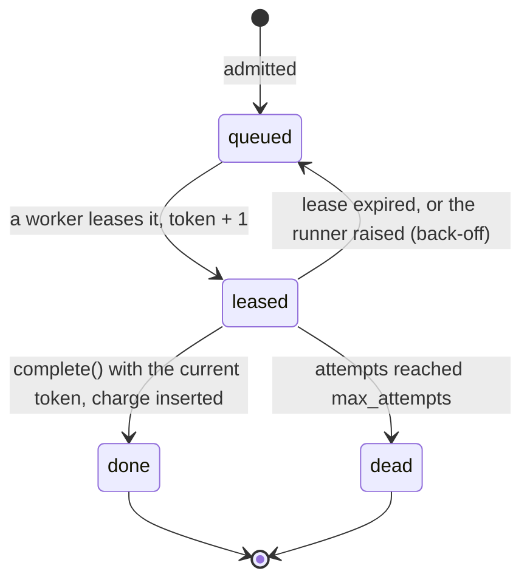
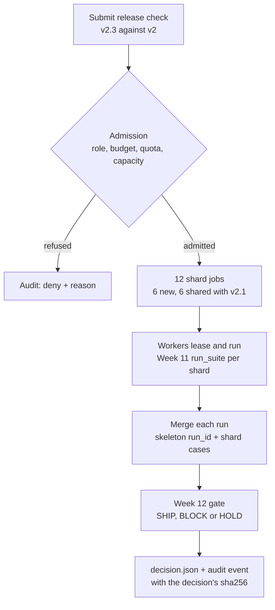
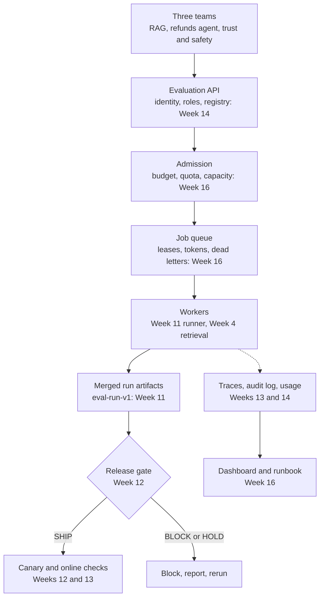

# Week 16 theory: Distributed evaluation capstone

*Keep evaluation work visible and recoverable when workers fail, teams overload the queue, or budgets run out.*

Week 16 of 16. [Course index](../../../simplified-course-index.md).

> **Source note.** Results are inherited, not rerun.

> **Before you start.** Review [Week 11](../../week-11-evaluation-harness-and-ci/theory/week-11-evaluation-harness-and-ci-theory-simplified-structured.md)'s artifacts, [Week 12](../../week-12-release-gates/theory/week-12-release-gates-theory-simplified-structured.md)'s gates, [Week 13](../../week-13-tracing-and-online-evaluation/theory/week-13-tracing-and-online-evaluation-theory-simplified-structured.md)'s traces, [Week 14](../../week-14-multi-tenant-governance/theory/week-14-multi-tenant-governance-theory-simplified-structured.md)'s governance, and [Week 15](../../week-15-reliable-measurement-and-statistics/theory/week-15-reliable-measurement-and-statistics-theory-simplified-structured.md)'s statistics. Use the [lab/checklist](../handson/week-16-distributed-evaluation-capstone-handson.md).

*Lab: `handson/lab.py`  
Notebook: [`week-16-distributed-evaluation-capstone-handson.ipynb`](../handson/week-16-distributed-evaluation-capstone-handson.ipynb)  
Decisions: `handson/week-16-distributed-evaluation-capstone-adr-001-lease-queue.md`, `-adr-002-tenant-fairness.md`  
Runbook: `handson/week-16-distributed-evaluation-capstone-runbook.md`  
Data: `dataset/queue-policy-v1.json`, `dataset/day-script-v1.json`*

---

## 1. What this week builds

**Project state.** Week 14 runs evaluations inside API calls. A large sweep delays releases; worker crashes lose work. Add a queue and worker pool with recovery and team fairness.

**Time.** Ten hours: reading 2, building 3, faults 2, capacity/cost 1, review/demo 2.

This week's goals:

1. Lease shards without losing jobs or accepting stale results/duplicate charges.
2. Bound retries and retain dead jobs as missing evidence.
3. Check role, reserved budget, quota, and capacity before admission.
4. Measure team fairness and service targets.
5. Defend choices using decision records and a runbook.

Adds SQLite jobs, simulated workers, prototype thread trials, dashboard, decision records, and runbook. Reuses Weeks 11–14 unchanged.

---

## 2. A release decision stuck behind a sweep

### 2.1 The request

At 09:00, support submits 3 retrievers ×3 k values ×5 ten-query shards: 45 proposed jobs, 40 admitted. Refunds submits v2.3 versus v2 at 09:00:20. Four workers use FIFO.

### 2.2 What the platform did

The release decision arrives 530 seconds later at 09:09:10, missing 300 seconds. A dead worker can silently remove ten cases; careless retry accounting can charge twice.

### 2.3 What nobody can show afterwards

Job records show coverage, accepted results, and waits. Trust/safety waits 470 seconds for 30 seconds of work. Gates cannot repair scheduling.

> **Watch out.** Lost shards, duplicate cases, or old-code results can change release decisions even when individual checks work.

---

## 3. Queues, workers and leases

New terms for this section:

- **Job:** shard of up to ten cases for one agent/run.
- **Queue:** stored waiting jobs and states; here SQLite.
- **Worker pool:** four workers, `w1`–`w4`.
- **Lease:** temporary job claim, also called visibility timeout.
- **Lease token:** increasing claim number required at completion.

### 3.1 Why a queue

The API saves work and returns. Workers execute it separately at available capacity. Job rows track ownership and progress through crashes.

### 3.2 Leases

Lease marks `leased` with worker and a 60-second deadline. Success becomes `done`; expiry returns `queued`. A slow healthy worker can also expire, causing repeated execution.

*Figure 1: Source diagram.*

### 3.3 Fencing a late result with the token

W3 stalls 100 seconds; lease expires t=190. W4 finishes token 2 at t=230; w3 returns token 1 at 260. Matching job/state/token is required: reject stale completion. This is **fencing**.

### 3.4 At-least-once execution, exactly-once effect

New terms for this section:

- **At-least-once execution:** work may repeat after uncertain failures; bounded attempts can still end dead.
- **Idempotent completion:** repeated reporting saves one result and charge.

Workers may finish then die before reporting. Rerun rather than lose evidence. Save result/charge atomically by job ID and current token. Unique usage IDs prevent duplicate charges. Here 64 completed jobs have one usage row each; dead job has none.

Repeated work still costs the platform: $0.0132 simulated wasted spend, not charged to teams.

---

## 4. Retries, back-off and dead letters

New terms for this section:

- **Back-off:** wait longer between failed attempts.
- **Poison job:** repeatedly fails regardless of worker.
- **Dead letter:** retained failed job after its attempt limit.

Worker expiry requeues immediately. Runner failure waits 15 seconds, then 30. After three unsuccessful attempts, retain the job as dead.

Poison shard fails at t=50, 71, and 102; dead at 103. Infinite retries waste budget. Only one allowed attempt makes a worker crash change v2.1 from SHIP to HOLD.

> **Watch out.** Fifteen-second leases expire on healthy 20/30-second jobs: 60 dead jobs, 176 rejected late results, both releases HOLD. Use longer leases or renew them.

---

## 5. Admission control and backpressure

New terms for this section:

- **Admission:** accept or reject before execution.
- **Reservation:** estimated job cost held until completion, then replaced by actual charge.
- **Quota:** active jobs allowed per team.
- **Capacity:** active jobs allowed overall.
- **Backpressure:** reject excess work with a retry-later signal.

### 5.1 Four checks, in order

A submission passes four checks before any job exists:

| Check | What it compares | Answer when it fails | Retry later? |
| --- | --- | --- | --- |
| Role | The principal's role allows `eval.run` (Week 14's `_authorize`) | `eval.run is not permitted for role viewer` | No |
| Budget | Spent + reserved by queued and running jobs + this request's reservation, against the team's budget | `spent 0.0000 + reserved 0.2700 + this request 0.0900 > 0.3` | No, not this period |
| Quota | The team's active jobs + this request's new jobs, against its quota | `40 active + 5 new > 40 for support-rag: retry later` | Yes |
| Capacity | All active jobs + new jobs, against the queue's capacity | `... > queue capacity 70: retry later` | Yes |

*Table 1: Reference values.*

Accept every shard in a request or refuse it whole. Partial admission can hold budget while waiting for missing shards.

### 5.2 Why the budget counts reservations

Queued work already commits budget. Before any refunds job finishes, v2.1/v2.3 reserve $0.27. V2.4 adds $0.09, exceeding $0.30 despite zero spending. Reserve $0.0015/case versus about $0.001 actual. Final charge is $0.1740.

### 5.3 Idempotent submission

Hash job IDs from tenant, runner, agent, backend, dataset hash, and cases; hash request fields too. Resending v2.1 at t=6 returns `duplicate` without reservation. V2.3 reuses six baseline shards, adding six new jobs.

---

## 6. Fairness between teams

New terms for this section:

- **Starvation:** other work repeatedly prevents service.
- **Noisy neighbour:** one tenant's load delays others.
- **Round robin:** take turns among teams with queued work.

FIFO lets a large early submission occupy all workers. Fair dispatch picks the least-recently-served team, then its oldest job. Each waiting team gets a turn.

This is the same SIMULATED day, with the same faults, under both rules:

| Team | FIFO wait p50 / p95 (s) | Round-robin wait p50 / p95 (s) |
| --- | --- | --- |
| refunds-agent | 455 / 510 | 135 / 320 |
| support-rag | 180 / 370 | 313 / 510 |
| trust-safety | 470 / 490 | 20 / 40 |

*Table 2: Reference values.*

Release times improve 495→245 and 530→340 seconds. Support absorbs more of its own load's delay.

Admission quotas and dispatch fairness address different problems. Support's ninth request is refused at t=0, accepted at t=240. With quota 15 under FIFO, releases take 235/281 seconds, but six of nine support requests are refused.

> **Watch out.** Equal jobs are not equal worker time. Thirty-second support versus twenty-second refunds jobs gives support 60% when both wait. Weight by duration or agreed shares.

---

## 7. Sharding and merging evidence

New terms for this section:

- **Shard:** subset of one run's cases.
- **Fan-out/fan-in:** split jobs, then merge results.

Release checks run baseline/candidate on strict/lax: four runs ×30 cases, each split into three ten-case jobs. Week 11 scores shards; merging creates checksummed `eval-run-v1` artifacts for Week 12's gate.

*Figure 2: Source diagram.*

Two rules keep the merged evidence honest:

- **Run ID from trusted code:** run zero cases to compute configuration/code/data identity. Reject shards with another ID.
- **Expected cases from plan:** dead evidence remains missing. A fault run is 10/11, `complete: false`, naming its dead job; verification rejects it and gate HOLDs. Drill 2 wrongly counts returned shards only, hiding f-011 as 10/10.

V2.1 merged artifacts match single-process output except start time/workers: same cases, summaries, and IDs `run-cbef76e4b10a`/`run-a8f8503cf957`.

---

## 8. Observing the platform

Admission's `eval_request` span stores `traceparent` in jobs. Worker attempts become child `EVALUATOR` spans. V2.1 has 13 attempts for 12 jobs, including ERROR `lease expired on w2`.

Shared jobs retain the first request's context, so v2.3 shows only six new shards. Production can link shared spans to several requests; this lab does not implement span links.

Audit records authorization, admission with dataset ref/hash, and final verdict with decision SHA-256. `job_events` separately retains lease/retry/expiry mechanics.

Dashboard shows SLOs, team waits/budgets/charges, requests, decisions, redacted traces, denials, faults, and audit head.

---

## 9. SLOs and capacity

New terms for this section:

- **SLI:** measured service value, such as decision time.
- **SLO:** target over a period.
- **Utilisation:** worker time spent doing jobs.

Illustrative targets: decisions within 300 seconds and team p95 wait within 120. Round robin gives 245/340 seconds. About 1,600 job-seconds arrive for four workers: roughly 400 seconds to clear all work. This is not a lower bound for every individual request. Six workers finish v2.3 in 200 seconds here.

Times above are simulated. Source prototype trials drain 556–626 jobs/s with one thread, 431–582 with eight. SQLite's single write lock dominates; healthy leases sometimes expire while waiting. Repeated jobs are charged once. These measure queue overhead on one machine, not production capacity. Plan using real API latency/cost, submission rates, spare capacity, and load tests.

> **Watch out.** On the source machine, `time.sleep(0.005)` actually took 85–105 ms. Default trials avoid sleeps so timer batching does not dominate measurements.

---

## 10. The capstone architecture

### 10.1 The platform, week by week

*Figure 3: Source diagram.*

### 10.2 What the prototype stands in for

| Prototype part | Production equivalent | What changes |
| --- | --- | --- |
| SQLite `jobs` table, `BEGIN IMMEDIATE` | PostgreSQL with `SELECT ... FOR UPDATE SKIP LOCKED`, or a managed queue with visibility timeouts | Many writers instead of one; the lease and token rules stay |
| Simulated workers and threads | Worker processes or containers, autoscaled on queue depth | Real heartbeats to renew leases; real crashes |
| Artifacts in `handson/runs/` | Object storage with write-once retention | Checksums stay; storage outlives the machine |
| Audit anchor printed by the lab | The audit head stored in a separate system | Someone other than the platform's operators holds it |
| Principals from `tenants-v1.json` | Single sign-on identities and service accounts | Workers act as a service principal on behalf of the submitter |
| Fixed cost per case | Token counts from the model API | Reservations from estimated tokens, charges from actual |

*Table 3: Reference values.*

ADR-001 explains leases, repeatable execution, and idempotent completion. ADR-002 explains admission quotas and fair dispatch. Both sit beside the lab.

---

## 11. The day by hand

### 11.1 Worked example, the budget refusal

The refunds team's budget is $0.30 and its reservation is $0.0015 per case.

1. T=5, v2.1: 4 ×30 = 120 cases; reserve 120 ×$0.0015 = $0.18.
2. T=20, v2.3: six new ten-case shards reserve $0.09; total $0.27.
3. T=40, v2.4: $0 spent +$0.27 reserved +$0.09 requested = $0.36. Budget $0.30: deny.
4. Eighteen completed jobs cost $0.1740; release their reservations.

### 11.2 Worked example, the crashed shard

The job is v2's safety-probe shard 3 of 3, ten tools cases at 2 seconds each.

1. T=90: w2 gets token 1, deadline 150; normal finish 110.
2. T=100: worker dies without reporting.
3. T=150: lease expires; requeue immediately.
4. T=160: w4 gets token 2.
5. T=180: save once, charge $0.0112. Recovery adds 70 seconds versus normal finish.

### 11.3 Worked example, the floor under the release latency

1. By t=40: 40 ×30 = 1,200 sweep seconds; 18 ×20 = 360 tools seconds; ten fault cases ×3 = 30; three failed attempts ×1 = 3. Total 1,593 job-seconds.
2. Four workers need at least 1,593/4 ≈398 seconds of service to clear all work, ignoring idle/staggered arrival. Individual requests may finish sooner.
3. Round robin completes v2.1 at 245 seconds and v2.3 at 340. V2.3 submits 15 seconds later; its six new shards follow twelve v2.1 shards within refunds' turns.

---

## 12. Design review

### Q1 – Why accept at-least-once execution instead of building exactly-once?

An unreported completion is indistinguishable from unstarted work. Rerun to preserve evidence, then deduplicate result/charge by job ID and fence tokens. Here wasted execution costs $0.0132. Exactly-once effects do not mean exactly-once execution.

### Q2 – Why SQLite, and what replaces it?

SQLite exposes atomic leases, fenced completion, and transactions, but has one writer: roughly 430–630 jobs/s here. PostgreSQL can lease with `SELECT ... FOR UPDATE SKIP LOCKED`; managed queues are another option. Preserve tokens, idempotency, transactional accounting, and dead-letter handling.

### Q3 – The trust and safety team asks for its own dedicated worker pool. Do you agree?

First check SLOs: trust/safety waits p95 40 seconds, under 120. Dedicated workers reduce neighbour interference but sit idle for this team's two jobs. Sensitive-data isolation may justify reserved workers with shared overflow.

### Q4 – The release SLO is breached. Is that a fairness problem or a capacity problem?

Check total work, request dependencies, arrival times, and scheduling. FIFO's 470-second wait for 30-second work shows unfairness. Under round robin, add workers, reduce sweep quota/job size, or prioritize releases to meet 300 seconds. Total-clearance bounds alone cannot prove one request must miss its SLO.

### Q5 – How would you show a reviewer that no evaluation run was silently lost?

Show every request's terminal state, dead IDs, planned versus returned cases, verified artifacts, and one charge per finished job. Dead jobs have no charge. `job_events` records retries and stale results rather than hiding them.

---

## Key Takeaways

- Save accepted jobs separately from execution.
- Recover expired leases; size or renew them properly.
- Fence completions and atomically save result/charge once.
- Bound retries and retain dead jobs.
- Check role, reservations, quota, and capacity before admission.
- Combine admission limits with fair dispatch.
- Merge against trusted run IDs and planned coverage.
- Separate fairness, total workload, individual deadlines, and real capacity evidence.

## Check Yourself

1. Why reject w3 token 1 after w4 token 2? **Only current leased token can complete or charge.**
2. Why back-off for failure but not expiry? **Dependency failure needs recovery time; lost worker does not prove bad work.**
3. Why deny with $0 spent? **$0.27 reserved +$0.09 exceeds $0.30.**
4. Why only six new v2.3 jobs? **Six identical baseline shards already exist.**
5. One dead fault shard: artifact/verdict? **10/11, incomplete, dead ID; verification rejects, gate HOLD.**
6. How meet v2.3's deadline? **Six workers yield 200 seconds here; reducing sweeps is another option. Overall workload alone does not bound each request.**
7. Why no SQLite speedup at eight threads? **Single write lock dominates leases/completions.**

## Memory card

| Term | Meaning in this course |
| --- | --- |
| Job | One shard of up to 10 cases, with a content-hashed ID |
| Lease | A worker's claim on a job until a deadline, 60 s in the lab |
| Lease token | Raised on every lease; completion must match it |
| At-least-once, exactly-once effect | Jobs may run twice; result and charge commit once per job ID |
| Back-off | 15 s, then 30 s, after a runner failure; none after a lease expiry |
| Dead letter | A job that used its 3 attempts; its run becomes unfinished |
| Reservation | $0.0015 per case held from admission until the job finishes |
| Quota, capacity | Active jobs per team; active jobs in the whole queue |
| Round robin | The next free worker goes to the team served least recently |
| SLO | Release decision within 300 s; p95 queue wait within 120 s |

*Table 4: Reference values.*

**Rules of thumb.** Hash work IDs. Fence and charge atomically. Renew long leases. Retain dead evidence. Reserve budgets. Check request deadlines separately from total workload. Label simulations and prototype measurements.

**Next week.** The course ends here. Use the [index](../../../simplified-course-index.md) and hands-on capstone checklist to review the complete platform.

## References

- [Hands-on file](../handson/week-16-distributed-evaluation-capstone-handson.md)
- [ADR-001, lease-based queue](../handson/week-16-distributed-evaluation-capstone-adr-001-lease-queue.md) and [ADR-002, tenant fairness](../handson/week-16-distributed-evaluation-capstone-adr-002-tenant-fairness.md)
- [Runbook](../handson/week-16-distributed-evaluation-capstone-runbook.md)
- [`queue-policy-v1.json`](../dataset/queue-policy-v1.json)
- [Amazon SQS visibility timeout](https://docs.aws.amazon.com/AWSSimpleQueueService/latest/SQSDeveloperGuide/sqs-visibility-timeout.html)
- [Martin Kleppmann, How to do distributed locking](https://martin.kleppmann.com/2016/02/08/how-to-do-distributed-locking.html)
- [Amazon Builders' Library, Timeouts, retries and backoff with jitter](https://aws.amazon.com/builders-library/timeouts-retries-and-backoff-with-jitter/)
- [Amazon Builders' Library, Fairness in multi-tenant systems](https://aws.amazon.com/builders-library/fairness-in-multi-tenant-systems/)
- [Google SRE book, Service Level Objectives](https://sre.google/sre-book/service-level-objectives/)
- [PostgreSQL, SELECT ... FOR UPDATE SKIP LOCKED](https://www.postgresql.org/docs/current/sql-select.html#SQL-FOR-UPDATE-SHARE)
- [SQLite, BEGIN IMMEDIATE](https://www.sqlite.org/lang_transaction.html)
- [W3C Trace Context](https://www.w3.org/TR/trace-context/)
- [Michael Nygard, Documenting architecture decisions](https://cognitect.com/blog/2011/11/15/documenting-architecture-decisions)
- [Glossary](../../../glossary.md)

---

**Next:** [Course index](../../../simplified-course-index.md)  
**Previous:** [Week 15 theory: Reliable measurement and statistics](../../week-15-reliable-measurement-and-statistics/theory/week-15-reliable-measurement-and-statistics-theory-simplified-structured.md)
