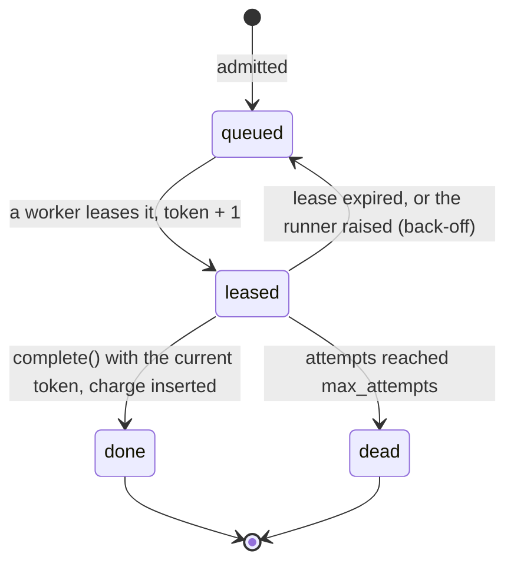
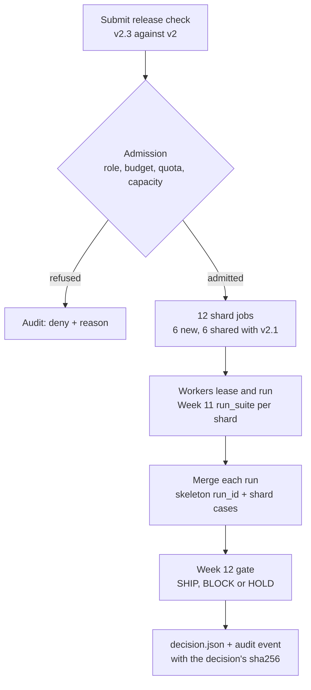
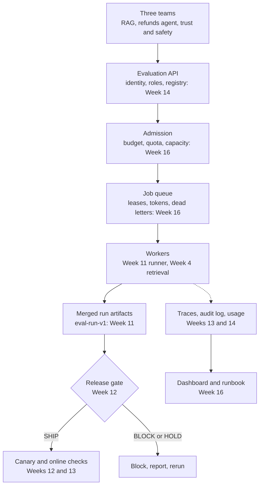

# Week 16 theory: Distributed evaluation capstone

*A shared evaluation platform has to keep its promises when workers die, one team floods the queue and budgets run out, and has to say so when it cannot.*

◷ 23 min read · Week 16 of 16 · Enterprise · [Course index](../../../README.md)

> **Before you start.** This page assumes [Week 11](../../week-11-evaluation-harness-and-ci/theory/week-11-evaluation-harness-and-ci-theory.md) (run artifacts, run IDs, budgets), [Week 12](../../week-12-release-gates/theory/week-12-release-gates-theory.md) (the gate, and HOLD on missing evidence), [Week 13](../../week-13-tracing-and-online-evaluation/theory/week-13-tracing-and-online-evaluation-theory.md) (traces and `traceparent`) and [Week 14](../../week-14-multi-tenant-governance/theory/week-14-multi-tenant-governance-theory.md) (the platform, tenants, budgets and the audit log). [Week 15](../../week-15-reliable-measurement-and-statistics/theory/week-15-reliable-measurement-and-statistics-theory.md) explains how far to trust the numbers this platform produces. The commands, the lab output, the exercises and the capstone checklist are in the [hands-on file](../handson/week-16-distributed-evaluation-capstone-handson.md).

*Lab: `handson/lab.py` · Notebook: `week-16-distributed-evaluation-capstone-handson.ipynb` · Decisions: `handson/week-16-distributed-evaluation-capstone-adr-001-lease-queue.md`, `-adr-002-tenant-fairness.md` · Runbook: `handson/week-16-distributed-evaluation-capstone-runbook.md` · Data: `dataset/queue-policy-v1.json`, `dataset/day-script-v1.json`*

---

## 1. What this week builds

**Project state.** Week 14 gave three teams one evaluation platform, and every evaluation ran inside the API call that asked for it. That works for one engineer and one run. It fails when the support RAG team starts a 45-job retrieval sweep at 09:00 and the refunds team needs a release decision at 09:00:20: both wait on the same machine, and a worker that dies takes its run with it. This week puts a queue and a pool of workers between the API and the runners, and makes the whole path, from submission to release decision, survive faults and stay fair.

**Time.** 10 hours: 2 reading, 3 building, 2 breaking things, 1 on capacity and cost, and 2 on the architecture review and demo.

By the end of the week you can:

1. Run evaluation shards from a queue with leases, where a dead or stalled worker loses no job and no late result is stored or charged twice.
2. Bound retries with back-off and end a job that keeps failing in an explicit dead-letter state, which makes its run unfinished, never smaller.
3. Admit work only when the team's role, budget (with reservations), quota and the queue's capacity allow it.
4. Dispatch fairly across teams, and measure queue wait and decision latency against service-level objectives.
5. Defend the platform's architecture, with two decision records and a runbook, at a Staff-level review.

The week adds a lab with a SQLite job queue, a simulated day for three teams on four workers, a real-threads trial, a static dashboard, two architecture decision records and a runbook. It reuses Week 11's runner, Week 12's gate and candidates, Week 13's tracer and Week 14's platform without changing them.

---

## 2. A release decision stuck behind a sweep

### 2.1 The request

At 09:00:00 the support RAG team re-indexes its help centre and submits a retrieval sweep: three retrievers times three values of k, each split into five shards of ten queries, 40 jobs admitted. At 09:00:20 the refunds team submits a release check for candidate v2.3 against v2. Both go into one first-in, first-out queue served by four workers.

### 2.2 What the platform did

The release check waited behind every sweep job. Its decision arrived at 09:09:10, 530 seconds after submission, against a target of 300. Meanwhile one worker died half way through a v2 shard. In the simplest design the shard is gone and the merged run is quietly ten cases shorter. In a slightly better design a supervisor retries it, and the team is charged twice because the charge happened inside the first attempt.

### 2.3 What nobody can show afterwards

Without job records, nobody can say whether the decision used all 30 cases, whether a worker's late result overwrote a newer one, or why the trust and safety team's 30-second job waited 470 seconds. Week 12's gate decided correctly on the evidence it was given. The failures are in how the evidence was produced, scheduled and paid for.

> **Watch out.** A distributed evaluation can produce a wrong release decision without any check being wrong: a lost shard, a duplicated case or a result from older code changes the evidence the gate reads.

---

## 3. Queues, workers and leases

New terms for this section:

- **Job**: one unit of work the platform schedules. Here, one shard: up to ten cases of one run of one agent version.
- **Queue**: the list of jobs waiting for a worker, with their state. Here, a SQLite table.
- **Worker pool**: the processes that take jobs and run them. The lab has four, `w1` to `w4`.
- **Lease**: a time-limited claim on a job. A worker that holds a lease may run the job until the deadline. Cloud queues call this a visibility timeout.
- **Lease token**: a number that goes up every time the job is leased. A worker must show its token to report a result.

### 3.1 Why a queue

Without a queue, the API call that submits an evaluation also runs it. A long sweep holds a connection open, a crash in the runner loses the request, and nothing limits how much work runs at once. A queue separates accepting work from doing it. The API records the job and returns. Workers take jobs at the rate they can run them, and the job's row says at every moment who has it and what happened.

### 3.2 Leases

A worker that takes a job marks it `leased`, with its own name and a deadline 60 seconds later. If it reports before the deadline, the job is `done`. If the deadline passes first, the platform assumes the worker is dead and puts the job back as `queued`. The platform cannot tell a dead worker from a slow one. A lease that expires on a healthy worker means the job runs twice.

This diagram shows the states a job moves through.

### 3.3 Fencing a late result with the token

In the lab, worker w3 stalls for 100 seconds on a sweep shard. Its lease expires at t=190, the shard goes back to the queue, and w4 leases it with token 2 and finishes at t=230. At t=260 w3 wakes up and reports its result with token 1. The completion is one SQL statement, `UPDATE jobs SET state='done' ... WHERE job_id=? AND state='leased' AND lease_token=?`. No row matches token 1. Nothing changes, and w3 is told its result is stale. The token works like a fencing token in distributed locking: the storage refuses a writer whose claim has been superseded.

### 3.4 At-least-once execution, exactly-once effect

New terms for this section:

- **At-least-once execution**: every job runs one or more times. Leases give this guarantee.
- **Idempotent completion**: reporting the same job's result twice has the effect of reporting it once.

No queue can promise that a job runs exactly once when workers can die after doing the work and before saying so. The lab accepts at-least-once execution and makes the effects happen once. The result and the charge are written in one transaction, keyed by the job ID, under the lease token. A unique index on the usage table's job column refuses a second charge even if the code were wrong. On the simulated day, 64 finished jobs have exactly one usage row each and the dead job has none.

The cost of this choice is real work done twice. The crashed and the stalled attempts ran evaluations nobody was charged for: $0.0132 of SIMULATED spend on the day, paid by the platform rather than a team.

---

## 4. Retries, back-off and dead letters

New terms for this section:

- **Back-off**: waiting before the next attempt, longer after each failure, so a failing dependency is not hammered.
- **Poison job**: a job that fails every time it runs, whatever the worker.
- **Dead letter**: the terminal state for a job that used up its attempts. It is kept, with its error, for a person to look at.

The lab separates two kinds of failure. A worker that dies says nothing, and the job comes back when its lease expires, without back-off: the job did not fail, its worker did. A runner that raises reports the failure, and the job comes back after a back-off of 15 seconds, then 30. After three attempts the job is dead.

One of trust and safety's fault-suite shards is a SIMULATED poison job. It was leased at t=50, 71 and 102, failed each time, and was dead-lettered at t=103. Retrying forever would have spent the team's budget and a worker's time on a job that cannot succeed. Retrying once would make every brief infrastructure failure a lost shard: with `max_attempts` set to 1, the crash alone turns v2.1's SHIP into a HOLD.

> **Watch out.** A lease shorter than a job kills healthy work. With a 15-second lease, every 20-second tools shard and 30-second sweep shard expires before it finishes, runs three times and is dead-lettered: 60 dead jobs, 176 rejected late results, both releases on HOLD. Set the lease above the longest job, or have workers renew it while they run.

---

## 5. Admission control and backpressure

New terms for this section:

- **Admission control**: deciding at submission whether the platform takes the work at all.
- **Reservation**: an estimate of a job's cost, held against the team's budget from admission until the job finishes, then replaced by the actual charge.
- **Quota**: the most active jobs one team may have at once.
- **Capacity**: the most active jobs the queue holds across all teams.
- **Backpressure**: refusing new work when the system is full, with a signal to try again later, so the queue does not grow without limit.

### 5.1 Four checks, in order

A submission passes four checks before any job exists:

| Check | What it compares | Answer when it fails | Retry later? |
| --- | --- | --- | --- |
| Role | The principal's role allows `eval.run` (Week 14's `_authorize`) | `eval.run is not permitted for role viewer` | No |
| Budget | Spent + reserved by queued and running jobs + this request's reservation, against the team's budget | `spent 0.0000 + reserved 0.2700 + this request 0.0900 > 0.3` | No, not this period |
| Quota | The team's active jobs + this request's new jobs, against its quota | `40 active + 5 new > 40 for support-rag: retry later` | Yes |
| Capacity | All active jobs + new jobs, against the queue's capacity | `... > queue capacity 70: retry later` | Yes |

A request is admitted whole or refused whole. A release check with half its shards admitted would wait for the other half while holding reservations.

### 5.2 Why the budget counts reservations

Week 14 checked the budget when a run started, because runs started immediately. With a queue, admitted work is money already committed. The refunds team's v2.1 and v2.3 checks reserved $0.27 before either had run, and the v2.4 check at t=40 would have taken the total to $0.36, over the $0.30 budget. Checked against spending alone ($0.0000 at that moment), it would have been admitted. The lab's reservation of $0.0015 per case is above the actual cost of about $0.001, and the refunds team ends the day charged $0.1740. Reservations make the budget a ceiling that holds even when estimates are wrong in the safe direction.

### 5.3 Idempotent submission

A job's ID is a hash of the work: the team, the runner, the agent, the backend, the dataset hash and the shard's cases. The request's ID is a hash of its fields. When the refunds client timed out and sent its v2.1 request again at t=6, the platform found the same request ID and answered `duplicate` without reserving anything. When v2.3 was submitted, its six baseline shards had the same IDs as v2.1's. Only six new jobs were queued. The same rule that prevents double work on a resend makes shared baselines free.

---

## 6. Fairness between teams

New terms for this section:

- **Starvation**: a team's jobs wait indefinitely because other work is always chosen first.
- **Noisy neighbour**: a tenant whose load degrades service for the others on shared infrastructure.
- **Round robin**: giving the next free worker to the next team in turn, among teams with queued jobs.

First in, first out is fair to jobs and unfair to teams. Whoever submits the most work first gets all the workers until it is done. The lab's fair dispatcher picks, among teams with queued jobs, the team whose last lease is oldest, and gives a worker that team's oldest job. A team with one job waiting is served within one rotation.

This is the same SIMULATED day, with the same faults, under both rules:

| Team | FIFO wait p50 / p95 (s) | Round-robin wait p50 / p95 (s) |
| --- | --- | --- |
| refunds-agent | 455 / 510 | 135 / 320 |
| support-rag | 180 / 370 | 313 / 510 |
| trust-safety | 470 / 490 | 20 / 40 |

The release decisions moved from 495 and 530 seconds to 245 and 340. The support team, which flooded the queue, now absorbs the wait it created.

Fairness works at two points. The quota limits how much of the queue one team can fill at admission: the support team's ninth sweep request was refused at t=0 and admitted when it was resent at t=240. Round robin limits how much of the workers one team can hold at dispatch. Either alone helps. Lowering the support quota to 15 under FIFO brings the release decisions to 235 and 281 seconds, at the cost of refusing six of the support team's nine requests.

> **Watch out.** The lab's round robin counts jobs, not seconds. A support shard takes 30 seconds and a refunds shard 20, so "one job each" gives the support team 60% of the worker time when both are waiting. Weight by expected duration, or by a share agreed with each team, when job sizes differ.

---

## 7. Sharding and merging evidence

New terms for this section:

- **Shard**: a slice of a run's cases that one job evaluates.
- **Fan-out and fan-in**: splitting a request into jobs, then combining their results.

A release check is four runs (v2 and the candidate, each on the strict backend and as a safety probe on the lax one, as Week 12's policy requires) of 30 cases, split into three shards each: 12 jobs. Each job runs Week 11's `run_suite` on its ten cases. When every job of the request is done or dead, the shards of each run are merged into one `eval-run-v1` artifact, written with Week 11's checksum, and Week 12's gate reads the two folders and decides.

This diagram shows one release request through the platform.

Two rules keep the merged evidence honest:

- **The run ID comes from the code, not from a shard.** The merge first runs the runner over zero cases. That gives the run ID Week 11 derives from the configuration and the hashes of the code and data. Every shard must carry the same ID. A shard run by a worker with other code or data is refused, never merged.
- **The expected cases come from the plan, not from the results.** A dead shard leaves the run at 10 of 11 cases with `complete: false` and the dead job named. Week 11's `verify_artifact` rejects it and Week 12's gate turns it into a HOLD. Drill 2 builds the expected list from the shards that came back instead: the run says 10 of 10, complete, and case f-011 disappears.

With both rules, a sharded run is the single-process run. The merged v2.1 artifacts equal the ones Week 12's `produce` writes in one process, apart from the start time and the worker count: the same run IDs `run-cbef76e4b10a` and `run-a8f8503cf957`, the same cases and the same summaries.

---

## 8. Observing the platform

A request is one Week 13 trace. Admission opens a root span, `eval_request`, and stores its W3C `traceparent` in every job row it creates. A worker that runs a job reads the header from the row and records its attempt as an `EVALUATOR` span under that root. The trace crosses the queue the way it would cross a network call. The v2.1 request's trace has 13 attempt spans for 12 jobs, and the one marked ERROR is the shard whose worker died, with `lease expired on w2`.

Jobs shared between requests carry the first request's trace context. The v2.3 trace shows only its six new shards. OpenTelemetry's span links are the tool for a job that serves several requests: each request's trace would link to the shared spans. The lab does not record links.

The audit log records decisions, not mechanics. For each request it holds the `eval.run` authorization, the `eval.admit` decision with the pinned dataset version and hash, and the final event with the verdict and the SHA-256 of `decision.json`. Leases, retries and expiries go to the queue's own `job_events` table. Keeping them out of the audit log keeps it readable, and the job table keeps the operational history.

The dashboard is one static page under `handson/runs/`: the SLOs with their status, each team's waits, charges and budget, every request with its result and links to its decision report and redacted trace, the admission denials, the fault history and the audit head.

---

## 9. SLOs and capacity

New terms for this section:

- **Service-level indicator (SLI)**: a measured quantity, such as the time from submitting a release check to its decision.
- **Service-level objective (SLO)**: a target for an SLI over a period, such as "every release decision within 300 seconds".
- **Utilisation**: the share of worker time spent on jobs.

The queue policy sets two illustrative SLOs: a release decision within 300 seconds of submission, and a p95 queue wait within 120 seconds for every team. Under round robin, v2.1's decision took 245 seconds and v2.3's took 340. Fair dispatch did not close the gap because the gap is capacity. In the first 40 seconds, about 1,600 job-seconds of work arrived: 40 sweep shards at 30 seconds, 18 tools shards at 20, and trust and safety's fault shards. Four workers need at least 400 seconds to clear that, whatever the order. Fairness chooses who waits. Only more workers, smaller jobs or less admitted work shortens the wait. With six workers the same day decides v2.3 in 200 seconds.

All of these are simulated seconds from a fixed cost per case. They show how the scheduling rules behave, not how fast a real platform would be. The real-threads trial measures something else: the queue's own overhead on this machine. Across two runs, one thread drained 556 to 626 jobs per second from a SQLite file and eight threads 431 to 582: more threads never helped, because every lease and completion takes SQLite's single write lock. At eight threads, a few healthy leases even expired while their workers waited for the lock, and those jobs ran twice and were charged once. That number is a prototype ceiling, not a production estimate. A production estimate starts from measured model latency and cost per case, the expected submissions per hour per team, and a target utilisation well below 100%, and it is checked against a load test on the real queue.

> **Watch out.** Measure the measuring tool. On this machine `time.sleep(0.005)` took between 85 and 105 milliseconds, because the operating system batches timers for background processes. A thread trial that simulated I/O with short sleeps would have measured the timer, which is why the lab's default trial adds no sleep.

---

## 10. The capstone architecture

### 10.1 The platform, week by week

This diagram shows the platform the course built, and the week each part comes from.

### 10.2 What the prototype stands in for

| Prototype part | Production equivalent | What changes |
| --- | --- | --- |
| SQLite `jobs` table, `BEGIN IMMEDIATE` | PostgreSQL with `SELECT ... FOR UPDATE SKIP LOCKED`, or a managed queue with visibility timeouts | Many writers instead of one; the lease and token rules stay |
| Simulated workers and threads | Worker processes or containers, autoscaled on queue depth | Real heartbeats to renew leases; real crashes |
| Artifacts in `handson/runs/` | Object storage with write-once retention | Checksums stay; storage outlives the machine |
| Audit anchor printed by the lab | The audit head stored in a separate system | Someone other than the platform's operators holds it |
| Principals from `tenants-v1.json` | Single sign-on identities and service accounts | Workers act as a service principal on behalf of the submitter |
| Fixed cost per case | Token counts from the model API | Reservations from estimated tokens, charges from actual |

The two decision records beside the hands-on file explain the two choices a reviewer is most likely to challenge: a lease-based queue with at-least-once execution and idempotent completion (ADR-001), and team fairness through quotas at admission and round robin at dispatch (ADR-002).

---

## 11. The day by hand

### 11.1 Worked example, the budget refusal

The refunds team's budget is $0.30 and its reservation is $0.0015 per case.

1. **v2.1 at t=5.** 4 runs × 30 cases = 120 cases. Reserved: 120 × $0.0015 = $0.18.
2. **v2.3 at t=20.** The 6 baseline shards already exist. 6 new shards × 10 cases × $0.0015 = $0.09. Reserved in total: $0.27.
3. **v2.4 at t=40.** Spent $0.0000, since no refunds job has finished yet. Reserved $0.27. This request: $0.09. Total $0.36, above $0.30: refused, reason `budget`.
4. **End of day.** 18 refunds jobs finished and were charged $0.1740 in total. The reservations were released as each job finished.

### 11.2 Worked example, the crashed shard

The job is v2's safety-probe shard 3 of 3, ten tools cases at 2 seconds each.

1. **t=90.** w2 leases it: attempt 1, token 1, deadline t=150. Its normal finish would be t=110.
2. **t=100.** w2 dies half way through. Nothing is reported.
3. **t=150.** The lease expires. The job goes back to the queue with no back-off.
4. **t=160.** w4, the first free worker, leases it: attempt 2, token 2.
5. **t=180.** w4 completes with token 2. One usage row, $0.0112. The shard finished 70 seconds later than it would have without the crash.

### 11.3 Worked example, the floor under the release latency

1. **Work arriving by t=40.** 40 sweep shards × 30 s = 1,200 job-seconds. 18 tools shards × 20 s = 360. Trust and safety: one 10-case fault shard × 3 s per case = 30, plus three 1-second failed attempts. Total about 1,593 job-seconds.
2. **Four workers.** 1,593 ÷ 4 ≈ 398 seconds before the last of this work can finish, in any order.
3. **What fairness buys.** Round robin puts the refunds shards early in that 398 seconds. v2.1's decision lands at 245 seconds and v2.3's at 340, because v2.3 was submitted 15 seconds later and its six shards queue behind v2.1's twelve within the refunds team's turns.

---

## 12. Design review

### Q1 – Why accept at-least-once execution instead of building exactly-once?

A worker can finish a job and die before it reports. No queue can tell that worker from one that died before starting. Either the job reruns or it may be lost. Losing evidence is worse than paying for a rerun. The platform therefore reruns, and makes the effects idempotent: one result and one charge per job ID, fenced by the lease token, with a unique index as a second guard. The price is visible on the dashboard as wasted spend ($0.0132 on the simulated day). Exactly-once delivery systems also reduce to this pattern: deduplication on an ID at the point of effect.

### Q2 – Why SQLite, and what replaces it?

SQLite makes the rules visible in one file: `BEGIN IMMEDIATE` serialises leases, conditional updates fence late writers, and the queue, usage and audit tables share one transaction. Its limit showed in the thread trial: one writer, roughly 430 to 630 jobs per second on this machine, with no gain from more threads. A production platform moves the same tables to PostgreSQL and leases with `SELECT ... FOR UPDATE SKIP LOCKED`, or uses a managed queue for dispatch and keeps the job ledger in the database. The lease, token, idempotent completion and dead-letter rules move unchanged. Only the lock changes.

### Q3 – The trust and safety team asks for its own dedicated worker pool. Do you agree?

A dedicated pool is the silo model from Week 14 applied to compute. It removes noisy-neighbour risk for that team and costs idle capacity the rest of the time: trust and safety had two jobs on the simulated day. First check whether quotas and fair dispatch already meet its SLO. Here its p95 wait was 40 seconds under round robin, inside the 120-second target. If a hard isolation requirement remains, for example jobs that handle unredacted data, a small reserved pool with the shared pool as overflow gives the guarantee at lower cost than a full silo.

### Q4 – The release SLO is breached. Is that a fairness problem or a capacity problem?

Compute the floor first. If the work admitted before the release check needs more worker time than the target allows (here about 398 seconds against 300), no ordering meets the SLO and the answers are capacity, smaller shards, a lower sweep quota or a priority class for release checks. If the floor is well under the target and one team's waits are far above the others', it is a fairness problem. The lab shows both: FIFO was a fairness failure (trust and safety waited 470 seconds for a 30-second job), and v2.3's 340 seconds under round robin is a capacity failure.

### Q5 – How would you show a reviewer that no evaluation run was silently lost?

Four pieces of evidence, all from the lab. Every request ends in a terminal state, decided, complete or unfinished, and the dashboard lists the unfinished ones with the dead job IDs. Every merged artifact takes its expected case list from the plan, and `verify_artifact` rejects an incomplete run, which the gate turns into HOLD. Every finished job has exactly one usage row and every dead job none, a query anyone can rerun. And every job's history is in `job_events`, from enqueue to its last state: a retry or a late result is visible, not inferred.

---

## Key Takeaways

- **A queue separates accepting work from doing it.** The job row records who holds the work, until when, and what happened.
- **Leases give at-least-once execution.** A dead worker's job comes back when its lease expires, and a lease shorter than the job kills healthy work.
- **Tokens and one transaction give exactly-once effects.** A late result with an old token changes nothing, and the charge commits with the result or not at all.
- **Retries are bounded and failures are kept.** Back-off for jobs that fail, none for workers that die, and a dead letter after three attempts.
- **Admission comes before work.** Role, budget with reservations, quota, then capacity, and a request is taken whole or refused whole.
- **Fairness has two halves.** Quotas limit how much of the queue one team fills, and round robin limits how much of the workers it holds.
- **Merged evidence must equal single-process evidence.** The run ID comes from the code and the expected cases from the plan, so a lost shard yields HOLD, never a smaller pass.
- **Fairness cannot create capacity.** Compute the floor before blaming the scheduler, and label prototype numbers as prototype numbers.

## Check Yourself

1. w3's late result arrives with token 1 after w4 finished with token 2. What stops it from overwriting the result? **The completion updates the row only where `lease_token` equals the caller's token. No row has token 1, so the update and the charge are skipped and w3 is told its result is stale.**
2. Why does an expired lease put the job back without back-off, while a runner exception adds 15 or 30 seconds? **An expired lease means the worker died or stalled, not that the job failed. An exception means the job itself failed, and waiting gives a failing dependency time to recover.**
3. The refunds team had spent $0.0000 when its v2.4 request was refused on budget. Why? **Its admitted v2.1 and v2.3 checks had reserved $0.27, and the v2.4 request would have added $0.09, above the $0.30 budget.**
4. Why did v2.3's request create only six new jobs? **Its six v2 baseline shards have the same job IDs, hashes of the same work, as v2.1's, so they were already in the queue.**
5. The trust and safety sweep finished with one dead shard. What does its artifact say, and what would Week 12's gate do with such a run? **10 of 11 cases, `complete: false`, naming the dead job. Week 11's `verify_artifact` rejects it, and the gate decides HOLD.**
6. Round robin brought v2.1's decision from 495 to 245 seconds but v2.3 still missed the 300-second target. What would fix it? **Capacity: about 1,600 job-seconds arrived for four workers, a floor near 400 seconds. Six workers decide v2.3 in 200 seconds, or the sweep could be admitted with a smaller quota.**
7. Why did eight threads drain the SQLite queue no faster than one? **Every lease and completion takes SQLite's single write lock, and the jobs did no other work, so the lock was the whole job.**

## Memory card

| Term | Meaning in this course |
| --- | --- |
| Job | One shard of up to 10 cases, with a content-hashed ID |
| Lease | A worker's claim on a job until a deadline, 60 s in the lab |
| Lease token | Raised on every lease; completion must match it |
| At-least-once, exactly-once effect | Jobs may run twice; result and charge commit once per job ID |
| Back-off | 15 s, then 30 s, after a runner failure; none after a lease expiry |
| Dead letter | A job that used its 3 attempts; its run becomes unfinished |
| Reservation | $0.0015 per case held from admission until the job finishes |
| Quota, capacity | Active jobs per team; active jobs in the whole queue |
| Round robin | The next free worker goes to the team served least recently |
| SLO | Release decision within 300 s; p95 queue wait within 120 s |

**Rules of thumb.** Make the work's ID a hash of the work. Fence every completion with the lease token and charge in the same transaction. Set the lease above the longest job or renew it. Keep failed jobs as dead letters and their runs as unfinished. Check budgets against reservations, not spending. Compute the capacity floor before tuning the scheduler. Label every number as simulated, prototype or measured.

**Next week.** There is none. Go back to the [course index](../../../README.md) and use the capstone checklist in the hands-on file to review the platform end to end, from Week 1's golden cases to this week's release decision.

## References

- [Hands-on file](../handson/week-16-distributed-evaluation-capstone-handson.md): the lab walkthrough, real output, exercises, drills, the capstone checklist and solutions.
- [ADR-001, lease-based queue](../handson/week-16-distributed-evaluation-capstone-adr-001-lease-queue.md) and [ADR-002, tenant fairness](../handson/week-16-distributed-evaluation-capstone-adr-002-tenant-fairness.md): the two architecture decision records.
- [Runbook](../handson/week-16-distributed-evaluation-capstone-runbook.md): what to do when the queue, a worker or a budget misbehaves.
- [`queue-policy-v1.json`](../dataset/queue-policy-v1.json): workers, lease, attempts, quotas, budgets and SLOs this page describes.
- [Amazon SQS visibility timeout](https://docs.aws.amazon.com/AWSSimpleQueueService/latest/SQSDeveloperGuide/sqs-visibility-timeout.html): the managed-queue form of a lease.
- [Martin Kleppmann, How to do distributed locking](https://martin.kleppmann.com/2016/02/08/how-to-do-distributed-locking.html): fencing tokens and why a lease alone does not stop a paused process.
- [Amazon Builders' Library, Timeouts, retries and backoff with jitter](https://aws.amazon.com/builders-library/timeouts-retries-and-backoff-with-jitter/): bounded retries and why jitter spreads them out.
- [Amazon Builders' Library, Fairness in multi-tenant systems](https://aws.amazon.com/builders-library/fairness-in-multi-tenant-systems/): quotas, admission and noisy neighbours.
- [Google SRE book, Service Level Objectives](https://sre.google/sre-book/service-level-objectives/): SLIs, SLOs and how to choose them.
- [PostgreSQL, SELECT ... FOR UPDATE SKIP LOCKED](https://www.postgresql.org/docs/current/sql-select.html#SQL-FOR-UPDATE-SHARE): the production form of the lab's lease query.
- [SQLite, BEGIN IMMEDIATE](https://www.sqlite.org/lang_transaction.html): the write lock the lab takes before choosing a job.
- [W3C Trace Context](https://www.w3.org/TR/trace-context/): the `traceparent` header carried in each job row.
- [Michael Nygard, Documenting architecture decisions](https://cognitect.com/blog/2011/11/15/documenting-architecture-decisions): the ADR format the two records follow.
- [Glossary](../../../glossary.md): every term in the course, with the week that introduces it.

---

**Next:** [Course index](../../../README.md) · **Previous:** [Week 15 theory: Reliable measurement and statistics](../../week-15-reliable-measurement-and-statistics/theory/week-15-reliable-measurement-and-statistics-theory.md)
